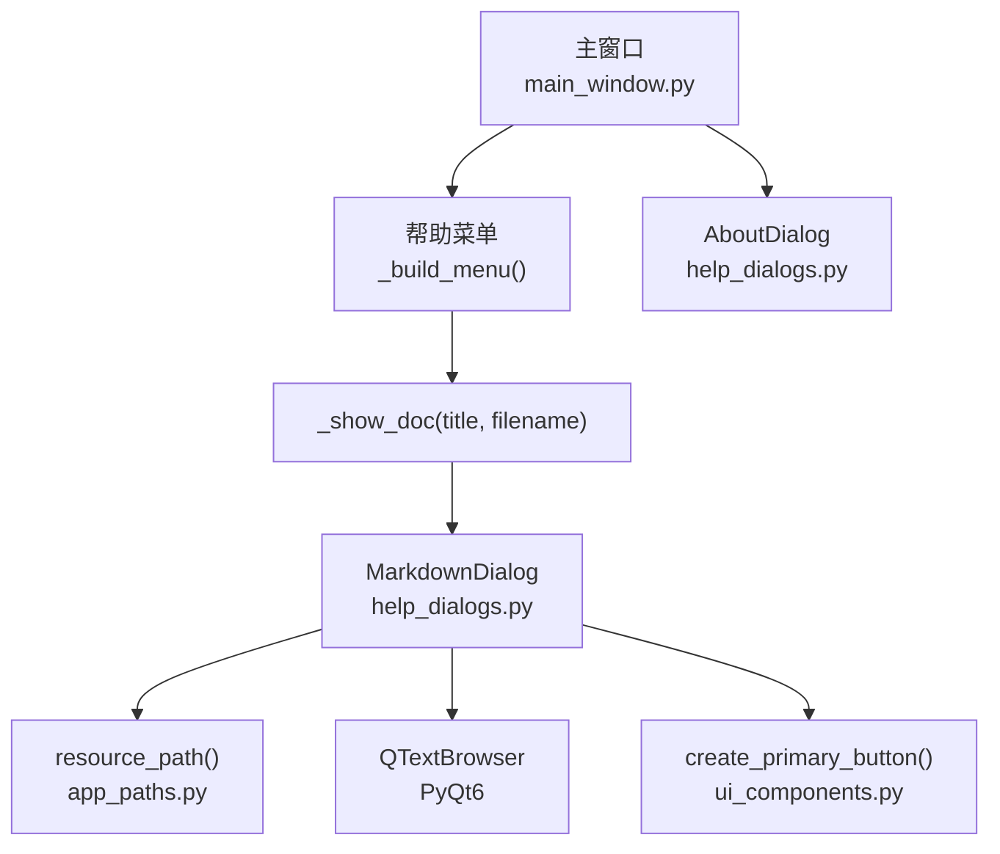
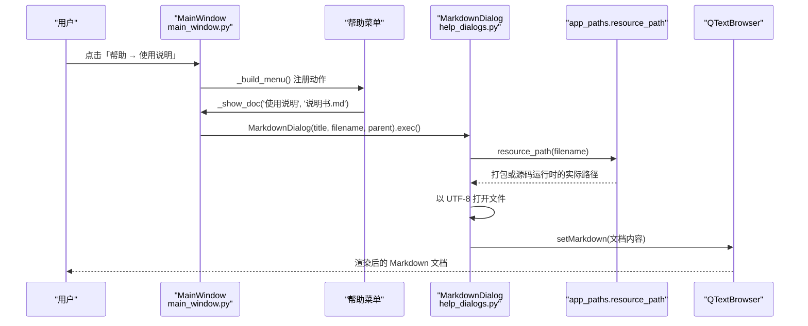
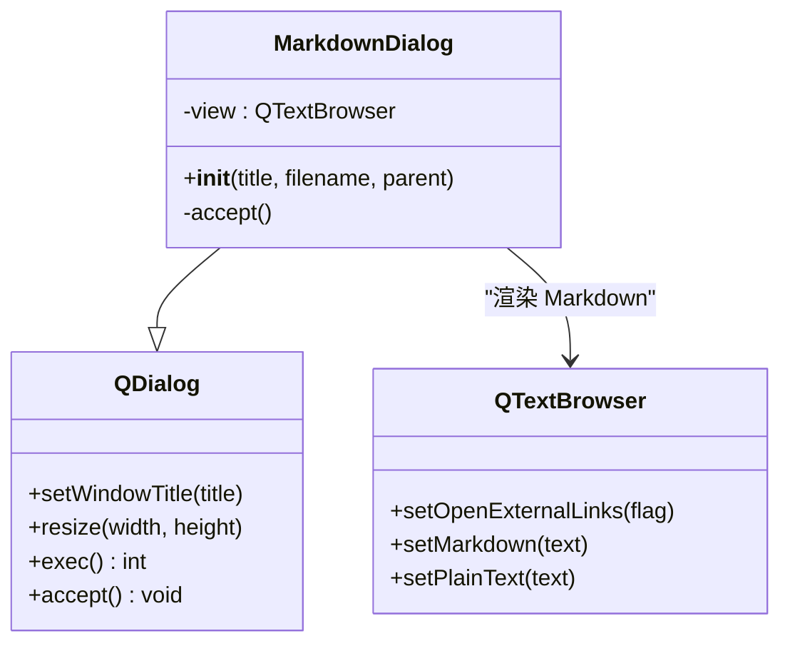
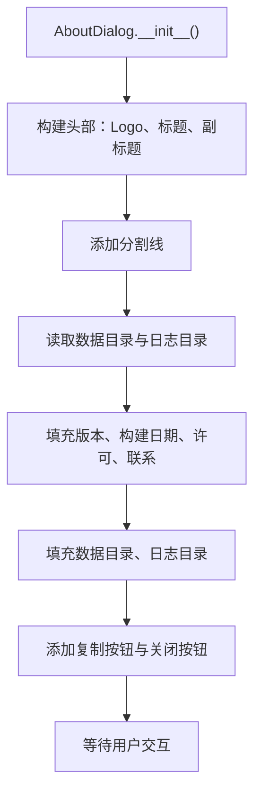
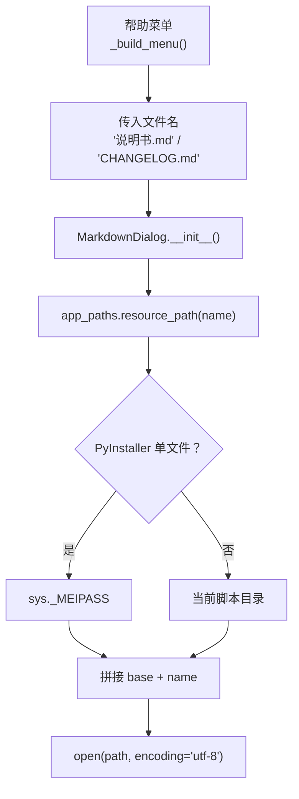
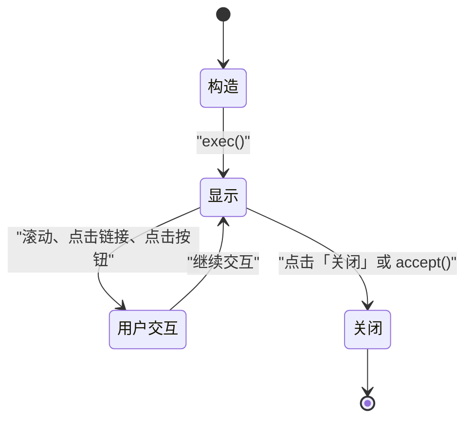
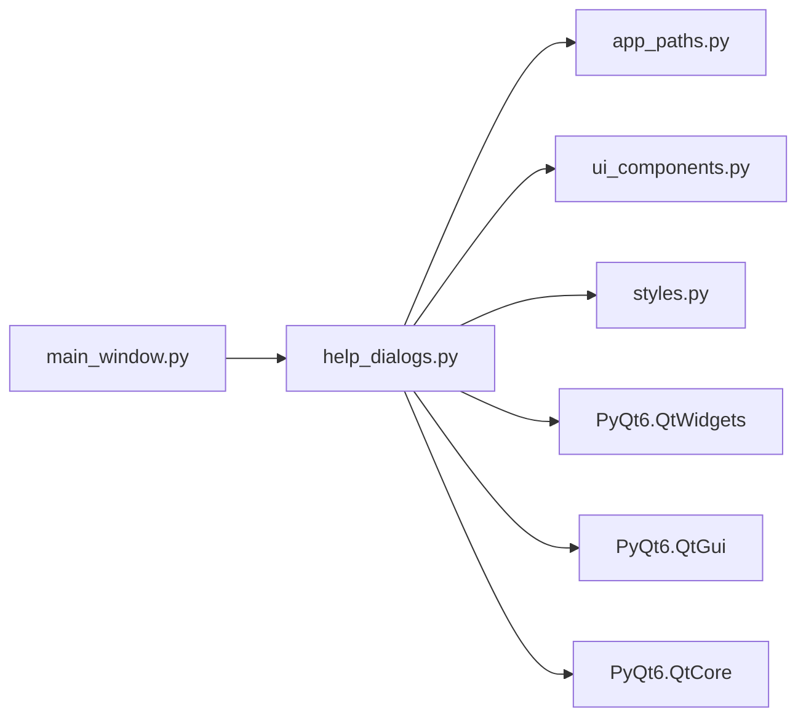

# 帮助对话框与 Markdown 文档加载

<cite>
**本文引用的文件**   
- [help_dialogs.py](file://help_dialogs.py)
- [main_window.py](file://main_window.py)
- [app_paths.py](file://app_paths.py)
- [styles.py](file://styles.py)
- [ui_components.py](file://ui_components.py)
- [说明书.md](file://说明书.md)
</cite>

## 目录
1. [引言](#引言)
2. [项目结构中的帮助模块](#项目结构中的帮助模块)
3. [核心组件](#核心组件)
4. [架构总览](#架构总览)
5. [详细组件分析](#详细组件分析)
6. [Markdown 语法与样式来源](#markdown-语法与样式来源)
7. [帮助文档组织方式](#帮助文档组织方式)
8. [典型调用方式](#典型调用方式)
9. [关键函数接口](#关键函数接口)
10. [对话框生命周期](#对话框生命周期)
11. [依赖关系分析](#依赖关系分析)
12. [性能考虑](#性能考虑)
13. [常见问题排查](#常见问题排查)
14. [结论](#结论)

## 引言
本文件聚焦 Aurascope 的「帮助对话框」能力：从菜单栏「帮助」入口打开，加载随包分发的 Markdown 文档，并在 Qt 对话框中渲染展示。需要明确的是，当前实现是一个轻量离线帮助查看器，而不是通用 Markdown 编辑器或在线文档系统；它通过 PyQt6 内置的 `QTextBrowser.setMarkdown` 渲染 Markdown，并通过 `app_paths.resource_path` 定位资源文件。

## 项目结构中的帮助模块
在仓库根目录中，帮助相关代码集中在两个位置：
- `help_dialogs.py`：定义帮助对话框类，负责读取 Markdown、显示错误提示、以及提供「关于 Aurascope」信息窗口。
- `main_window.py`：主窗口负责构建菜单栏，并把「使用说明」「更新日志」等菜单项连接到帮助对话框。

此外，帮助文档内容以 Markdown 文件形式存放，例如仓库根目录下的 `说明书.md`；路径解析由 `app_paths.py` 提供。全局样式来自 `styles.py`，按钮等控件则复用 `ui_components.py` 的工厂函数。



**图表来源**
- [main_window.py:225-248](file://main_window.py#L225-L248)
- [help_dialogs.py:20-43](file://help_dialogs.py#L20-L43)
- [app_paths.py:8-11](file://app_paths.py#L8-L11)

**章节来源**
- [help_dialogs.py:1-132](file://help_dialogs.py#L1-L132)
- [main_window.py:225-248](file://main_window.py#L225-L248)
- [app_paths.py:1-42](file://app_paths.py#L1-L42)

## 核心组件
帮助模块的核心是 `help_dialogs.py` 中的两个对话框类：

| 组件 | 职责 | 主要行为 |
|---|---|---|
| `MarkdownDialog` | 显示随包分发的 Markdown 帮助文档 | 根据标题和文件名创建对话框；用 `QTextBrowser` 渲染 Markdown；找不到文件时显示纯文本错误提示；底部提供「关闭」按钮。 |
| `AboutDialog` | 显示版本、构建日期、许可、联系、数据目录、日志目录 | 使用 `recipe_dir` 与 `log_dir` 获取路径；提供复制版本信息和打开目录功能。 |

这两个类都继承自 `QDialog`，属于模态对话框：由主窗口构造后调用 `.exec()` 阻塞显示，用户点击「关闭」后返回。

**章节来源**
- [help_dialogs.py:20-43](file://help_dialogs.py#L20-L43)
- [help_dialogs.py:46-132](file://help_dialogs.py#L46-L132)

## 架构总览
帮助对话框的调用链非常短：用户操作主窗口菜单栏 → 主窗口构造并执行 Markdown 对话框 → 对话框解析资源路径 → 读取 Markdown → 交给 `QTextBrowser` 渲染。



**图表来源**
- [main_window.py:233-245](file://main_window.py#L233-L245)
- [help_dialogs.py:23-38](file://help_dialogs.py#L23-L38)
- [app_paths.py:8-11](file://app_paths.py#L8-L11)

## 详细组件分析

### MarkdownDialog：离线 Markdown 查看器
`MarkdownDialog` 是一个固定尺寸的模态对话框，默认宽度 780、高度 640，内部使用垂直布局，包含一个可滚动 Markdown 浏览器和一个底部「关闭」按钮。

关键点如下：
- 构造函数参数为 `title`、`filename`、可选 `parent`。
- 使用 `QTextBrowser` 作为 Markdown 渲染容器。
- 启用外部链接跳转：`setOpenExternalLinks(True)`。
- 使用 `encoding='utf-8'` 打开 Markdown 文件。
- 如果文件不存在或无法打开，捕获 `OSError` 并显示纯文本错误消息。
- 不直接应用全局 QSS，而是依赖父窗口或 QApplication 已设置的全局样式。



**图表来源**
- [help_dialogs.py:20-43](file://help_dialogs.py#L20-L43)

**章节来源**
- [help_dialogs.py:20-43](file://help_dialogs.py#L20-L43)

### AboutDialog：关于窗口
`AboutDialog` 不是 Markdown 查看器，但同属帮助模块，用于展示版本、构建日期、许可、联系、数据目录和日志目录。它复用了 `ui_components.py` 的卡片标题、副标题、分割线、信息标签和按钮工厂，同时通过 `recipe_dir` 与 `log_dir` 获取路径。

需要注意：
- 数据目录和日志目录可能因权限问题不可访问，因此 `_safe_dir` 会捕获异常并显示占位符。
- 「打开」按钮仅在路径有效时启用，点击后通过 `QDesktopServices.openUrl` 打开系统资源管理器。
- 「复制版本信息」会把版本、构建日期、数据目录、日志目录写入剪贴板。



**图表来源**
- [help_dialogs.py:46-132](file://help_dialogs.py#L46-L132)

**章节来源**
- [help_dialogs.py:46-132](file://help_dialogs.py#L46-L132)

## Markdown 语法与样式来源

### 支持的 Markdown 语法范围
当前帮助对话框没有引入第三方 Markdown 解析库，也没有自定义渲染器。它直接使用 `QTextBrowser.setMarkdown`，因此支持的能力取决于 PyQt6/Qt 内置的 Markdown 渲染器。

可以确认的行为包括：
- 标题、段落、列表、表格、粗体、斜体、链接等常见 Markdown 元素。
- 外部链接可通过 `setOpenExternalLinks(True)` 跳转到系统默认浏览器。
- 不支持 HTML 注入式扩展（因为这里只传 Markdown 字符串）。
- 不支持 Python Markdown、MyST、Obsidian 等扩展语法，除非 Qt 底层恰好兼容。

因此，编写帮助文档时应优先使用标准 Markdown，避免依赖特定平台或第三方解析器的特殊语法。

### 字体与样式来源
`MarkdownDialog` 本身没有显式调用 `styles.STYLESHEET` 或 `styles.DIALOG_STYLESHEET`，也没有直接设置 `QFont`。这意味着它的视觉风格主要来自以下两条路径：

1. **全局 QSS 样式表**  
   `styles.py` 定义了 `STYLESHEET` 和 `DIALOG_STYLESHEET`。主窗口通常会在启动时把全局样式应用到 `QApplication` 上，从而让 `QDialog`、`QTextBrowser`、`QPushButton` 等控件继承统一配色、圆角、滚动条样式。

2. **Qt 默认样式**  
   如果全局样式未生效，`QTextBrowser` 会使用 Qt 默认样式，表现为较旧的 Windows 文本浏览器外观。

`styles.py` 中定义的字体 token 包括：
- 界面字体：`font_ui`，优先级为 Apple System、Segoe UI、PingFang SC、Microsoft YaHei。
- 正文字体：`font`，额外包含 Bahnschrift、Segoe UI Variable Display。
- 等宽字体：`mono`，用于代码、数值输出。

由于 `MarkdownDialog` 没有单独设置字体，其正文字体通常受全局 `QWidget` 的 `font-size: 14px` 影响。若中文显示异常，应优先检查全局样式是否成功加载，以及系统中是否存在可用的中文字体。

**章节来源**
- [help_dialogs.py:20-43](file://help_dialogs.py#L20-L43)
- [styles.py:27-53](file://styles.py#L27-L53)
- [styles.py:536-539](file://styles.py#L536-L539)

## 帮助文档组织方式
当前仓库中与帮助相关的 Markdown 文件位于仓库根目录，其中 `说明书.md` 是当前主窗口「使用说明」菜单对应的文档。

| 菜单项 | 对应 Markdown 文件 | 说明 |
|---|---|---|
| 使用说明 | `说明书.md` | 产品使用手册，覆盖 ROI、空洞分析、示教批量、剪切力、物料计数、图像拼接、快捷键、常见问题等。 |
| 更新日志 | `CHANGELOG.md` | 当前代码中引用了该文件名，但仓库结构中未列出该文件；若缺失，用户将看到「未找到文档」提示。 |

路径解析逻辑如下：
- 主窗口传入相对文件名，如 `'说明书.md'`。
- `MarkdownDialog` 调用 `app_paths.resource_path(filename)`。
- `resource_path` 先判断是否为 PyInstaller 单文件模式：如果是，取 `_MEIPASS` 解包目录；否则取当前脚本所在目录。
- 最终拼接成绝对路径并打开。



**图表来源**
- [main_window.py:233-245](file://main_window.py#L233-L245)
- [help_dialogs.py:33-37](file://help_dialogs.py#L33-L37)
- [app_paths.py:8-11](file://app_paths.py#L8-L11)

**章节来源**
- [main_window.py:233-245](file://main_window.py#L233-L245)
- [help_dialogs.py:33-37](file://help_dialogs.py#L33-L37)
- [app_paths.py:8-11](file://app_paths.py#L8-L11)
- [说明书.md:1-157](file://说明书.md#L1-L157)

## 典型调用方式
帮助对话框的典型调用方式是：从主窗口的菜单栏触发，而不是从业务 Tab 页直接调用。

具体流程：
1. 用户在自绘标题栏的「帮助」菜单中点击「使用说明」。
2. 主窗口调用 `_show_doc('使用说明', '说明书.md')`。
3. `_show_doc` 构造 `MarkdownDialog('使用说明', '说明书.md', self)` 并调用 `.exec()`。
4. 对话框阻塞显示，用户阅读后点击「关闭」。
5. 主窗口恢复响应。

如果需要从其他入口触发，例如某个 Tab 页的「帮助」按钮，推荐封装一个统一的辅助函数，例如：

```python
def show_help(parent, title, filename):
    from help_dialogs import MarkdownDialog
    dialog = MarkdownDialog(title, filename, parent)
    dialog.exec()
```

这样可以把「标题 + 文件名」映射集中管理，避免各处硬编码不同 Markdown 文件名。

**章节来源**
- [main_window.py:233-245](file://main_window.py#L233-L245)
- [help_dialogs.py:23-43](file://help_dialogs.py#L23-L43)

## 关键函数接口

### MarkdownDialog
| 项目 | 说明 |
|---|---|
| 类名 | `MarkdownDialog` |
| 继承 | `QDialog` |
| 构造函数 | `__init__(self, title, filename, parent=None)` |
| 参数 | `title`：对话框标题；`filename`：随包分发的 Markdown 文件名；`parent`：父窗口对象。 |
| 返回值 | 无；通过 `.exec()` 返回用户交互结果。 |
| 主要副作用 | 创建对话框、读取 Markdown、渲染到 `QTextBrowser`、添加「关闭」按钮。 |
| 失败行为 | 文件不存在或无法打开时，显示纯文本「未找到文档」提示。 |

### AboutDialog
| 项目 | 说明 |
|---|---|
| 类名 | `AboutDialog` |
| 继承 | `QDialog` |
| 构造函数 | `__init__(self, parent=None)` |
| 参数 | `parent`：父窗口对象。 |
| 返回值 | 无；通过 `.exec()` 返回用户交互结果。 |
| 主要副作用 | 显示版本、构建日期、许可、联系、数据目录、日志目录；提供复制版本信息和打开目录功能。 |

### 主窗口集成方法
| 方法 | 作用 |
|---|---|
| `_build_menu()` | 构建「文件」和「帮助」菜单，注册「使用说明」「更新日志」「检查更新」「关于 Aurascope」。 |
| `_show_doc(title, filename)` | 构造并显示 Markdown 帮助对话框。 |
| `_show_about()` | 构造并显示「关于 Aurascope」对话框。 |

**章节来源**
- [help_dialogs.py:20-132](file://help_dialogs.py#L20-L132)
- [main_window.py:225-248](file://main_window.py#L225-L248)

## 对话框生命周期
帮助对话框的生命周期遵循 Qt 模态对话框约定：



具体阶段：
1. **构造**：主窗口调用 `MarkdownDialog(title, filename, parent)`。
2. **显示**：调用 `.exec()` 进入事件循环，阻塞父窗口。
3. **加载文档**：构造过程中立即尝试读取 Markdown 并渲染。
4. **用户交互**：滚动浏览、点击外部链接、点击「关闭」。
5. **关闭**：点击「关闭」调用 `self.accept()`，`.exec()` 返回。
6. **销毁**：Python 引用计数释放对象；若父窗口仍持有引用，则随父窗口销毁。

注意：当前实现没有在 `__del__` 或关闭事件中做额外清理，也没有缓存 Markdown 内容。每次打开都会重新读取文件。

**图表来源**
- [help_dialogs.py:23-43](file://help_dialogs.py#L23-L43)
- [main_window.py:244-245](file://main_window.py#L244-L245)

**章节来源**
- [help_dialogs.py:23-43](file://help_dialogs.py#L23-L43)
- [main_window.py:244-245](file://main_window.py#L244-L245)

## 依赖关系分析
帮助模块的依赖方向清晰且单向：



- `main_window.py` 依赖 `help_dialogs.py` 暴露的 `AboutDialog` 和 `MarkdownDialog`。
- `help_dialogs.py` 依赖 `app_paths.py` 的资源路径解析。
- `help_dialogs.py` 依赖 `ui_components.py` 的按钮和标签工厂。
- `help_dialogs.py` 间接依赖 `styles.py` 的全局样式。
- 所有 GUI 组件来自 PyQt6。

潜在风险：
- 如果 `CHANGELOG.md` 未被打包进发行版，「更新日志」菜单会显示「未找到文档」。
- 如果全局样式未加载，`MarkdownDialog` 可能看起来与主窗口不一致。
- `MarkdownDialog` 没有对超大 Markdown 做分页或懒加载，长文档一次性读入内存。

**图表来源**
- [main_window.py:28-29](file://main_window.py#L28-L29)
- [help_dialogs.py:3-13](file://help_dialogs.py#L3-L13)

**章节来源**
- [main_window.py:28-29](file://main_window.py#L28-L29)
- [help_dialogs.py:3-13](file://help_dialogs.py#L3-L13)

## 性能考虑
当前实现的性能特征如下：

| 场景 | 现状 | 建议 |
|---|---|---|
| 小文档 | 直接 `stream.read()` 全部加载，性能可接受。 | 无需改动。 |
| 大文档 | 一次性读入内存并传给 `setMarkdown`，可能引起卡顿。 | 可考虑分段渲染、虚拟滚动或限制最大行数。 |
| 频繁打开 | 每次打开都重新读取文件。 | 可按文件名缓存已解析内容，但需处理文件变更。 |
| 外部链接 | 点击链接由 `QDesktopServices` 打开系统浏览器。 | 一般无性能问题。 |
| 滚动性能 | 依赖 `QTextBrowser` 的渲染能力。 | 避免在 Markdown 中嵌入过多图片、复杂表格或大量公式。 |

对于长文档优化，可优先考虑：
1. 限制 Markdown 最大字节数或行数。
2. 对超大文档采用分页或延迟加载。
3. 避免在 Markdown 中插入大图；如需配图，放在独立页面或通过链接打开。
4. 必要时改用 `QTextEdit` 配合自定义高亮，但会失去 Markdown 便利性。

[本节为通用性能建议，不直接分析具体代码行]

## 常见问题排查

### Markdown 文件缺失
**现象**：打开「使用说明」或「更新日志」后显示「未找到文档：xxx.md」。  
**原因**：
- 开发环境中 Markdown 文件不在程序可访问目录。
- 打包后 Markdown 未加入 PyInstaller 资源清单。
- 文件名大小写或路径拼写错误。

**排查步骤**：
1. 确认 `main_window.py` 中传入的文件名与实际文件名一致。
2. 检查 `app_paths.resource_path` 返回的路径是否存在。
3. 如果是 PyInstaller 打包，确认 Markdown 文件被打包进 `onefile` 解包目录。
4. 临时打印 `resource_path(filename)` 验证路径。

**章节来源**
- [help_dialogs.py:33-37](file://help_dialogs.py#L33-L37)
- [app_paths.py:8-11](file://app_paths.py#L8-L11)
- [main_window.py:233-245](file://main_window.py#L233-L245)

### 中文乱码
**现象**：Markdown 中的中文显示为问号、方块或乱码。  
**原因**：
- Markdown 文件保存编码不是 UTF-8。
- 打开文件时使用了错误编码。
- 系统缺少中文字体，导致 Qt 回退到不可用字体。

**排查步骤**：
1. 确认 `说明书.md` 以 UTF-8 编码保存。
2. 当前实现使用 `encoding='utf-8'`，因此只要文件编码正确即可。
3. 检查 `styles.py` 中的字体 token 是否包含 `PingFang SC`、`Microsoft YaHei`。
4. 在目标机器上确认系统安装了可用中文字体。

**章节来源**
- [help_dialogs.py:33-35](file://help_dialogs.py#L33-L35)
- [styles.py:38-41](file://styles.py#L38-L41)

### 长文档滚动性能差
**现象**：打开超长 Markdown 后滚动卡顿、CPU 占用升高。  
**原因**：
- 文档一次性加载到内存。
- `QTextBrowser` 渲染大量 Markdown 元素。
- Markdown 中包含大量图片、表格或复杂格式。

**排查步骤**：
1. 拆分长文档为多个小 Markdown 文件。
2. 移除不必要的图片，改为外链或截图附件。
3. 简化 Markdown 结构，减少嵌套层级。
4. 如需长期优化，可引入分页或虚拟滚动策略。

**章节来源**
- [help_dialogs.py:33-38](file://help_dialogs.py#L33-L38)

### 样式未生效
**现象**：帮助对话框看起来像旧版 Qt 默认样式，颜色、圆角、滚动条与主窗口不一致。  
**原因**：
- 主窗口未成功应用 `styles.STYLESHEET`。
- `MarkdownDialog` 没有显式应用 `styles.DIALOG_STYLESHEET`。
- 弹窗或子窗口未继承全局样式。

**排查步骤**：
1. 检查主窗口是否在 `QApplication` 上设置了全局样式。
2. 确认 `styles.py` 中的 `STYLESHEET` 和 `DIALOG_STYLESHEET` 被导入并使用。
3. 如果对话框仍不受影响，可在 `MarkdownDialog.__init__` 中显式应用 `DIALOG_STYLESHEET`。
4. 检查是否有其他 QSS 覆盖了对话框背景或字体。

**章节来源**
- [styles.py:536-539](file://styles.py#L536-L539)
- [help_dialogs.py:23-43](file://help_dialogs.py#L23-L43)

### 外部链接无法打开
**现象**：Markdown 中的链接点击无效。  
**原因**：
- `setOpenExternalLinks(False)`。
- 链接格式不正确。
- 系统默认浏览器不可用。

**排查步骤**：
1. 确认 `MarkdownDialog` 调用了 `setOpenExternalLinks(True)`。
2. 检查链接是否为合法 URL。
3. 在目标机器上测试系统默认浏览器是否正常。

**章节来源**
- [help_dialogs.py:31-32](file://help_dialogs.py#L31-L32)

## 结论
Aurascope 的帮助对话框是一个简洁可靠的离线 Markdown 查看器：主窗口负责菜单入口，`MarkdownDialog` 负责资源路径解析、文件读取和 Markdown 渲染，`AboutDialog` 负责版本与目录信息展示。其优势是实现简单、依赖少；主要改进空间在于长文档性能、样式一致性、以及帮助文档与菜单项的映射管理。

在实际使用中，建议：
- 保持 Markdown 文件使用 UTF-8 编码。
- 将每个功能模块拆分为独立 Markdown 文件，便于维护和打包。
- 在主窗口中维护一份「菜单标题 → Markdown 文件名」映射表。
- 如需统一样式，显式为 `MarkdownDialog` 应用 `DIALOG_STYLESHEET`。
- 对超大文档进行拆分或限制大小，避免一次性加载造成卡顿。