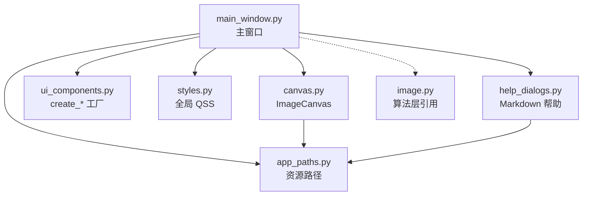
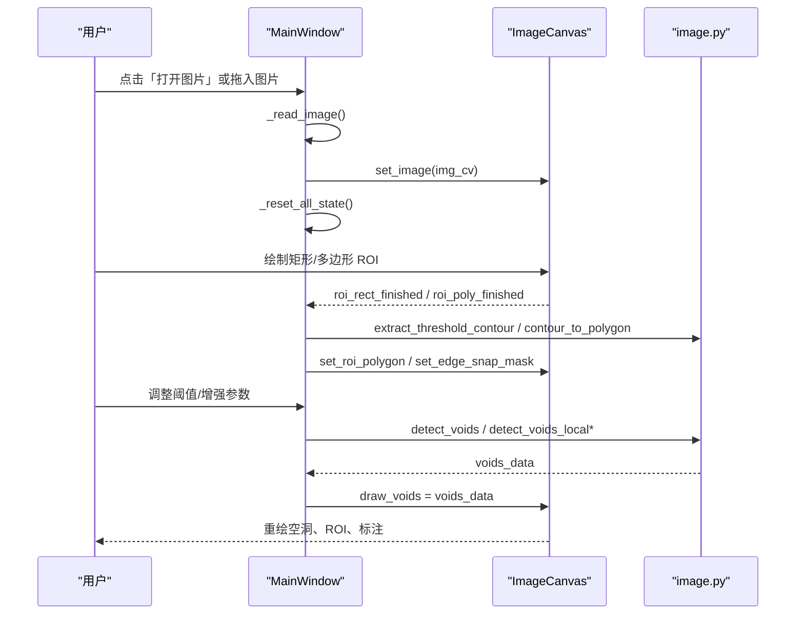
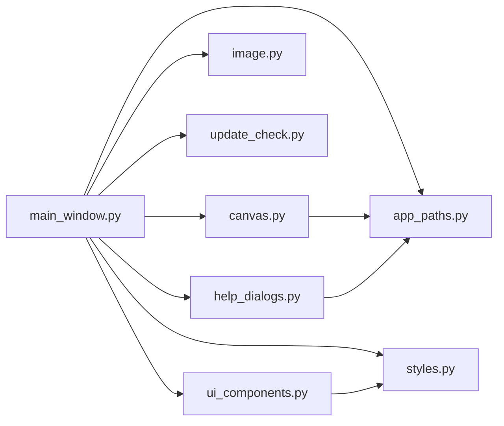
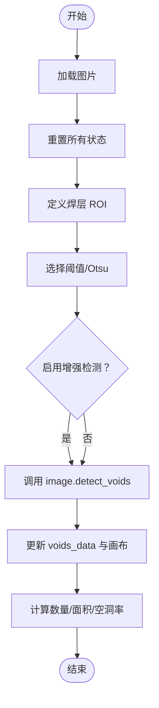
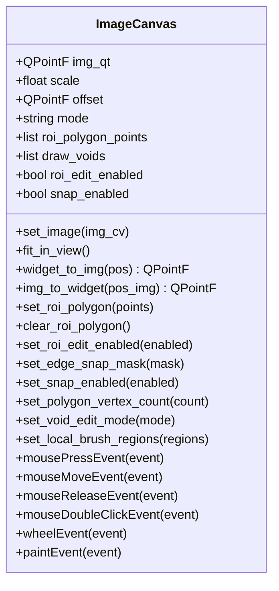
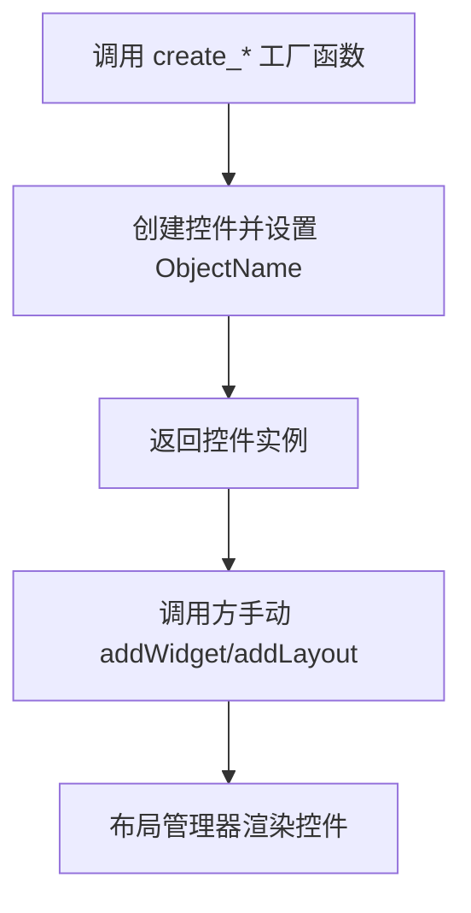
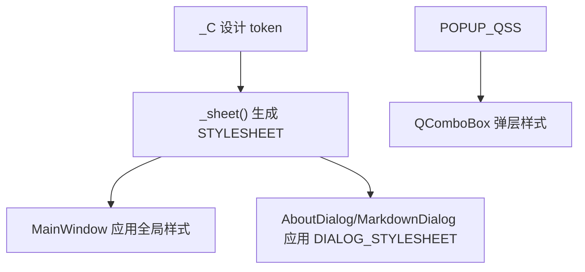
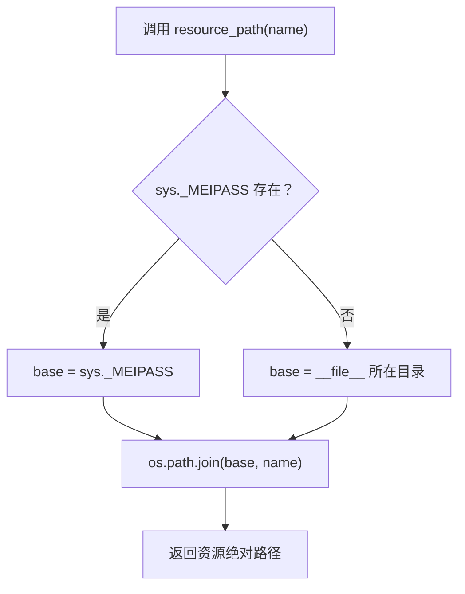
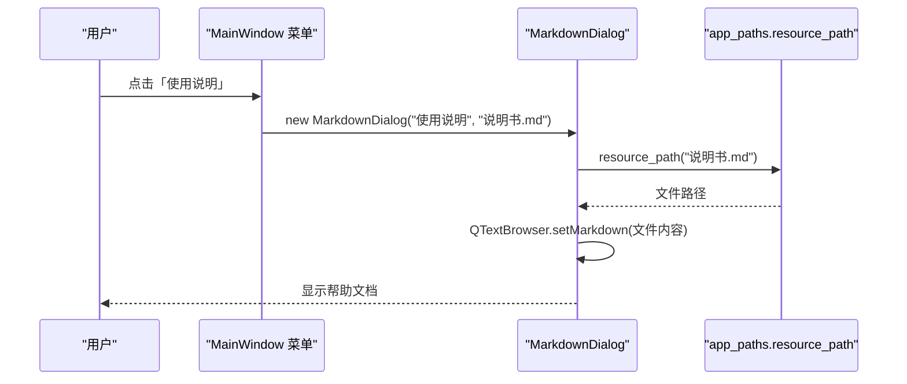

# 核心模块详解

<cite>
**本文引用的文件**   
- [main_window.py](file://main_window.py)
- [canvas.py](file://canvas.py)
- [ui_components.py](file://ui_components.py)
- [styles.py](file://styles.py)
- [app_paths.py](file://app_paths.py)
- [help_dialogs.py](file://help_dialogs.py)
</cite>

## 目录
1. [引言](#引言)
2. [项目结构定位](#项目结构定位)
3. [核心组件总览](#核心组件总览)
4. [架构与依赖关系](#架构与依赖关系)
5. [详细模块分析](#详细模块分析)
6. [接口摘要与典型用法](#接口摘要与典型用法)
7. [常见问题与修复建议](#常见问题与修复建议)
8. [性能与交互特性](#性能与交互特性)
9. [结论](#结论)

## 引言
本文件聚焦 Aurascope 的六个核心支撑模块：主窗口、图像画布、UI 控件工厂、全局样式、路径解析与离线帮助。它们共同构成「GUI 层 → Canvas 绘制层 → 算法层」中 GUI 侧的基础设施，负责应用生命周期、Tab 导航、菜单工具栏、拖拽导入、撤销栈、更新检查集成、坐标转换、缩放锚点、右键平移、多边形 ROI 编辑、空洞/轮廓绘制、QSS 设计 token、打包路径与 Markdown 文档加载。

Aurascope 是 PyQt6 + OpenCV + NumPy + Pandas 的单机桌面应用；代码结构以实际源码为准，业务主线包括空洞分析、缺陷面积多 ROI、物料计数、测距、剪切力、图像拼接与批量示教。本文只深入讲解指定模块，不展开其他 Tab 的具体实现。

## 项目结构定位
这六个模块处于 Aurascope 的「入口与主窗口 → 页面 → Canvas 绘制层 → 算法层」分层中的前两层：

**图表来源**
- [main_window.py:24-48](file://main_window.py#L24-L48)
- [canvas.py:9-10](file://canvas.py#L9-L10)
- [help_dialogs.py:8-13](file://help_dialogs.py#L8-L13)

**章节来源**
- [main_window.py:1-50](file://main_window.py#L1-L50)
- [canvas.py:1-30](file://canvas.py#L1-L30)
- [ui_components.py:1-10](file://ui_components.py#L1-L10)
- [styles.py:1-25](file://styles.py#L1-L25)
- [app_paths.py:1-12](file://app_paths.py#L1-L12)
- [help_dialogs.py:1-14](file://help_dialogs.py#L1-L14)

## 核心组件总览

| 模块 | 主要职责 | 对外暴露的关键能力 | 主要耦合对象 |
|---|---|---|---|
| `main_window.py` | 主窗口生命周期、Tab 管理、菜单/工具栏、拖拽导入、ROI 与空洞检测流程、撤销栈、更新检查集成 | `MainWindow`、`load_image`、`calculate_voids`、`push_undo`、`on_undo`、`check_updates_manual` | `canvas.ImageCanvas`、`image.*`、`update_check.UpdateChecker`、`help_dialogs`、`ui_components`、`styles`、`app_paths` |
| `canvas.py` | 图像显示、坐标转换、滚轮缩放、右键平移、标定线、矩形/多边形 ROI、边缘吸附、空洞/笔刷渲染、信号发射 | `ImageCanvas`、`set_image`、`widget_to_img`、`img_to_widget`、`fit_in_view`、各类 pyqtSignal | `app_paths.resource_path`、`ui_components.attach_empty_button` |
| `ui_components.py` | 按钮/标签/分组框/折叠区域等 UI 工厂函数、空状态提示、剪贴板复制、下拉弹层样式注入 | `create_primary_button`、`create_secondary_button`、`create_groupbox`、`CollapsibleSection`、`style_combo_popups`、`copy_bgr_to_clipboard` | `styles.POPUP_QSS` |
| `styles.py` | 全局 QSS、设计 token、对话框样式、下拉弹层样式 | `STYLESHEET`、`DIALOG_STYLESHEET`、`POPUP_QSS` | 无运行时依赖，被多个模块 import |
| `app_paths.py` | 源码运行与 PyInstaller 打包下的资源路径、应用目录、用户数据目录、日志目录、构建日期 | `resource_path`、`app_dir`、`local_data_dir`、`log_dir`、`build_date` | Python `sys`、`os` |
| `help_dialogs.py` | 「关于」窗口与 Markdown 帮助窗口 | `MarkdownDialog`、`AboutDialog` | `app_paths`、`app_version`、`recipe.recipe_dir`、`ui_components` |

**章节来源**
- [main_window.py:53-157](file://main_window.py#L53-L157)
- [canvas.py:13-94](file://canvas.py#L13-L94)
- [ui_components.py:34-242](file://ui_components.py#L34-L242)
- [styles.py:45-515](file://styles.py#L45-L515)
- [app_paths.py:8-41](file://app_paths.py#L8-L41)
- [help_dialogs.py:20-132](file://help_dialogs.py#L20-L132)

## 架构与依赖关系

### 主窗口与画布协作
主窗口负责业务状态和算法调用，画布负责像素级绘制和用户交互。两者通过方法调用与信号解耦：

**图表来源**
- [main_window.py:737-769](file://main_window.py#L737-L769)
- [main_window.py:940-1004](file://main_window.py#L940-L1004)
- [main_window.py:1199-1253](file://main_window.py#L1199-L1253)
- [canvas.py:123-140](file://canvas.py#L123-L140)
- [canvas.py:350-544](file://canvas.py#L350-L544)

### 模块间依赖方向
- `main_window.py` 依赖 `canvas.ImageCanvas`、`image.*`、`update_check.UpdateChecker`、`help_dialogs`、`ui_components`、`styles`、`app_paths`。
- `canvas.py` 仅依赖 `app_paths.resource_path` 和 `ui_components.attach_empty_button`。
- `help_dialogs.py` 依赖 `app_paths`、`app_version`、`recipe.recipe_dir`、`ui_components`。
- `ui_components.py` 依赖 `styles.POPUP_QSS`。
- `styles.py` 不依赖本项目其他模块。
- `app_paths.py` 不依赖本项目其他模块。

**图表来源**
- [main_window.py:24-48](file://main_window.py#L24-L48)
- [canvas.py:9-10](file://canvas.py#L9-L10)
- [help_dialogs.py:8-13](file://help_dialogs.py#L8-L13)
- [ui_components.py:425-459](file://ui_components.py#L425-L459)

**章节来源**
- [main_window.py:24-48](file://main_window.py#L24-L48)
- [canvas.py:9-10](file://canvas.py#L9-L10)
- [help_dialogs.py:8-13](file://help_dialogs.py#L8-L13)
- [ui_components.py:425-459](file://ui_components.py#L425-L459)

## 详细模块分析

### `main_window.py`：主窗口生命周期、Tab 切换、菜单与工具栏、拖拽导入、撤销栈、更新检查集成

#### 生命周期与初始化
- `__init__` 设置窗口标题、尺寸、接受拖拽、图标、核心数据字段、检测配方状态、自动 ROI 标志，并创建 `UpdateChecker`。
- `init_ui` 创建 `QTabWidget`、根布局、各 Tab，并把「空洞分析」Tab 拆分为左侧侧边栏与右侧 `ImageCanvas`。
- `_restore_window_state` 从 `QSettings` 恢复几何、窗口状态、当前 Tab 与各 Splitter 尺寸；`closeEvent` 保存这些状态。

#### Tab 切换与模块导航
- 顶部品牌区使用 `QButtonGroup` 为每个 Tab 生成一个可检查按钮，点击后调用 `tab_widget.setCurrentIndex(i)`。
- `currentChanged` 信号同步按钮选中态，隐藏原生 `QTabBar`，改用自定义页头导航。

#### 菜单与最近打开
- 「文件」菜单提供「打开图片…」「最近打开」「退出」。
- 「帮助」菜单提供「使用说明」「更新日志」「检查更新…」「关于 Aurascope」。
- 最近打开列表持久化到 `QSettings('Aurascope', 'Aurascope')`，区分图片和批次文件夹。

#### 拖拽导入
- `dragEnterEvent` 接受本地 URL。
- `dropEvent` 根据拖入内容分流：
  - 文件夹 → 切换到「示教/批量」并调用 `teach_batch_tab.load_folder`。
  - 单张图片 → 切换到「ROI」并调用 `area_tab.load_image`。
  - 多张图片 → 切换到「图像拼接」并调用 `stitching_tab.add_images`。
  - 非图片 → 弹出警告。

#### 撤销栈
- 使用 `self.undo_stack = []` 与 `undo_limit = 30` 维护空洞结果快照。
- `push_undo` 深拷贝 `voids_data`，超过限制时丢弃最早条目。
- `on_undo` 弹出栈顶并刷新指标。
- 关键操作如自动 Otsu、面积过滤、边界腐蚀、局部阈值确认都会先调用 `push_undo`。

#### 更新检查集成
- 启动时连接 `update_checker.update_found` 与 `check_finished`。
- 非 offscreen 环境延迟 1.5 秒自动检查。
- 手动检查通过「帮助 → 检查更新…」触发，失败或已是最新版本会给出提示。
- 发现新版本时弹窗，支持「前往下载」「忽略本次更新」「稍后」；忽略版本写入 `QSettings`。

#### 空洞检测流程
- `calculate_voids` 读取当前阈值、增强选项、圆度过滤、Canny 验证、ROI 腐蚀量，调用 `image.detect_voids`。
- 结果写入 `canvas.draw_voids`，计算空洞率并更新结果面板。
- 另有 `detect_voids_local` 与 `detect_voids_local_brush` 两个在主窗口内定义的局部阈值检测函数，属于已知技术债：现行行为应以 `image.py` 为准，两份待合并。

**图表来源**
- [main_window.py:737-769](file://main_window.py#L737-L769)
- [main_window.py:1199-1253](file://main_window.py#L1199-L1253)

**章节来源**
- [main_window.py:53-157](file://main_window.py#L53-L157)
- [main_window.py:181-248](file://main_window.py#L181-L248)
- [main_window.py:257-350](file://main_window.py#L257-L350)
- [main_window.py:352-392](file://main_window.py#L352-L392)
- [main_window.py:684-727](file://main_window.py#L684-L727)
- [main_window.py:823-842](file://main_window.py#L823-L842)
- [main_window.py:1325-1337](file://main_window.py#L1325-L1337)
- [main_window.py:1705-1820](file://main_window.py#L1705-L1820)
- [main_window.py:1823-1918](file://main_window.py#L1823-L1918)

### `canvas.py`：ImageCanvas 基类、坐标转换、缩放锚点、右键平移、多边形 ROI、空洞/轮廓绘制、信号暴露

#### 坐标转换与视图适配
- `set_image` 将 OpenCV BGR/灰度图转为 Qt `QImage`，清空 ROI 与边缘吸附掩码，调用 `fit_in_view` 自适应显示。
- `fit_in_view` 按控件宽高与原图宽高比例计算初始缩放与居中偏移。
- `widget_to_img` 把鼠标控件坐标映射到图像坐标，并裁剪到图像范围。
- `img_to_widget` 把图像坐标映射回屏幕坐标，用于文本标注位置计算。

#### 滚轮缩放与右键平移
- `wheelEvent` 处理多种模式：
  - 局部笔刷模式下：Ctrl+滚轮调半径，Shift+滚轮调已确认区域阈值，无修饰键在 placed 态继续调半径。
  - 添加空洞模式下：Ctrl+滚轮调节 Otsu 阈值偏移。
  - 默认模式：以鼠标位置为锚点缩放，同时修正 X/Y 偏移。
- `mouseMoveEvent` 中若按住右键，则用 `offset += delta` 实现平移。

#### 已知问题：Y 轴缩放漂移
- 默认缩放逻辑先计算 `img_pos_before`，再乘以新 `scale` 得到 `new_offset_x`；随后又单独计算 `img_y_before` 并得到 `new_offset_y`。
- 由于 Y 方向重新基于旧 scale 计算，而不是沿用同一锚点公式，缩放时会出现 Y 轴视觉漂移。
- 这是已知实现缺陷，不应描述为正确设计。

#### 多边形 ROI 编辑与边缘吸附
- `roi_edit_enabled` 控制是否进入 ROI 顶点/边编辑模式。
- 左键点击靠近顶点时拖动顶点；靠近边时整段移动；双击边插入顶点；Delete 删除选中顶点。
- 释放左键时若开启边缘吸附，会把顶点或边的端点吸附到 `edge_snap_mask` 中亮度最高的邻域像素。
- `set_polygon_vertex_count` 使用长度加权采样对多边形顶点数进行重采样。

#### 空洞与轮廓绘制
- `draw_voids` 列表包含空洞 ID、面积、包围盒、中心、多边形点等。
- 绘制空洞轮廓、可选红色填充、编号标签、校准线、ROI 预览、局部笔刷圆环与阈值标签。
- 删除模式下高亮悬停空洞，便于精准点击删除。

#### 信号暴露
- `calib_drawn`：标定线完成。
- `roi_poly_finished`：多边形 ROI 完成。
- `roi_rect_changed` / `roi_rect_finished`：矩形 ROI 变化与完成。
- `roi_polygon_edited`：多边形编辑后回调。
- `void_delete_at` / `void_add_polygon`：删除/添加空洞。
- `void_selected_for_local`：选中空洞进行局部阈值调节。
- `void_local_region_confirmed` / `void_local_threshold_changed` / `void_local_region_removed`：局部笔刷区域确认、阈值调整、删除。
- `empty_import`：空画布「导入图片」按钮。

**图表来源**
- [canvas.py:13-94](file://canvas.py#L13-L94)
- [canvas.py:123-164](file://canvas.py#L123-L164)
- [canvas.py:166-208](file://canvas.py#L166-L208)
- [canvas.py:350-544](file://canvas.py#L350-L544)
- [canvas.py:626-706](file://canvas.py#L626-L706)
- [canvas.py:708-943](file://canvas.py#L708-L943)

**章节来源**
- [canvas.py:13-94](file://canvas.py#L13-L94)
- [canvas.py:123-164](file://canvas.py#L123-L164)
- [canvas.py:166-208](file://canvas.py#L166-L208)
- [canvas.py:350-544](file://canvas.py#L350-L544)
- [canvas.py:626-706](file://canvas.py#L626-L706)
- [canvas.py:708-943](file://canvas.py#L708-L943)

### `ui_components.py`：create_* 工厂函数只创建控件不加入布局的强制约定

#### 工厂函数约定
- `create_primary_button`、`create_secondary_button`、`create_success_button`、`create_danger_button`、`create_nav_button` 只创建按钮并设置 `ObjectName`，必要时连接回调，返回控件。
- `create_step_title`、`create_info_label`、`create_success_label`、`create_card_title`、`create_card_subtitle`、`create_stat_value`、`create_success_value`、`create_error_value`、`create_warning_box`、`create_error_label`、`create_blue_label`、`create_count_result` 同理。
- `create_slider_with_label` 返回 `(slider, label)` 元组。
- `create_tool_buttons` 返回 `(layout, btn_poly, btn_rect)`。
- **强制约定**：这些函数不创建布局，也不把控件加入布局；调用方必须显式 `addWidget` 或 `addLayout`。

#### create_groupbox 的尺寸策略要求
- `create_groupbox` 固定设置 `QSizePolicy.Policy.Expanding, QSizePolicy.Policy.Preferred`。
- 如果调用方覆盖该策略，可能导致控件被静默裁剪，因此应保留该尺寸策略。

#### 其他重要能力
- `attach_empty_button` 在空画布中央下方挂主按钮，并通过事件过滤器随画布 resize 保持居中。
- `attach_empty_hint` 在表格为空时显示覆盖视口的引导文字。
- `enable_click_sort` 让表格点击表头后才启用排序。
- `copy_bgr_to_clipboard` 把 OpenCV BGR/灰度/BGRA 图像复制到系统剪贴板。
- `style_combo_popups` 遍历 widget 下所有 `QComboBox`，直接给其 view 设置 `POPUP_QSS`，并移除焦点委托的高亮边框。

**图表来源**
- [ui_components.py:34-78](file://ui_components.py#L34-L78)
- [ui_components.py:187-242](file://ui_components.py#L187-L242)
- [ui_components.py:384-394](file://ui_components.py#L384-L394)

**章节来源**
- [ui_components.py:11-31](file://ui_components.py#L11-L31)
- [ui_components.py:34-78](file://ui_components.py#L34-L78)
- [ui_components.py:101-132](file://ui_components.py#L101-L132)
- [ui_components.py:135-184](file://ui_components.py#L135-L184)
- [ui_components.py:187-242](file://ui_components.py#L187-L242)
- [ui_components.py:321-381](file://ui_components.py#L321-L381)
- [ui_components.py:384-459](file://ui_components.py#L384-L459)

### `styles.py`：全局 QSS、Preferred/Expanding 尺寸策略要求

#### 设计 Token
- 中性色、主色、语义色、字体族、字阶、间距、圆角、交互态均以注释契约形式声明。
- `_C` 字典集中颜色变量，`_sheet()` 生成完整 QSS。
- 导出 `STYLESHEET`、`DIALOG_STYLESHEET`、`POPUP_QSS`。

#### 全局样式覆盖范围
- QMainWindow/QDialog 背景、QWidget 字体与颜色、Tooltip、TabBar、菜单栏、应用页头、卡片、分割线、文字层级、按钮、输入框、ComboBox、SpinBox、CheckBox、Table、List、Menu、ProgressBar、Slider、ScrollBar、Splitter、GroupBox、CollapseBody 等。

#### Preferred/Expanding 尺寸策略要求
- `create_groupbox` 使用 `Expanding, Preferred`，保证分组框在垂直方向扩展、水平方向优先自然宽度。
- 若调用方修改该策略，可能破坏布局预期，导致控件被裁剪或占满空间。

**图表来源**
- [styles.py:27-42](file://styles.py#L27-L42)
- [styles.py:45-515](file://styles.py#L45-L515)
- [styles.py:515-555](file://styles.py#L515-L555)

**章节来源**
- [styles.py:1-25](file://styles.py#L1-L25)
- [styles.py:27-42](file://styles.py#L27-L42)
- [styles.py:45-515](file://styles.py#L45-L515)
- [styles.py:515-555](file://styles.py#L515-L555)

### `app_paths.py`：源码运行与 PyInstaller 打包下的路径解析

#### resource_path
- 打包 onefile 模式：`sys._MEIPASS` 指向解包临时目录。
- 源码运行：取本文件所在目录。
- 返回 `base/name`，供 logo、Markdown 文档等资源访问。

#### app_dir / local_data_dir / log_dir
- `app_dir`：打包后取 `sys.executable` 同级目录，源码运行取本文件目录。
- `local_data_dir`：Windows 下优先 `LOCALAPPDATA`，否则 `~\AppData\Local`，子目录 `Aurascope`。
- `log_dir`：`local_data_dir/logs`。

#### build_date
- 打包后取 exe 修改时间，源码运行取本文件修改时间，格式化为 `YYYY-MM-DD`。

**图表来源**
- [app_paths.py:8-11](file://app_paths.py#L8-L11)

**章节来源**
- [app_paths.py:1-41](file://app_paths.py#L1-L41)

### `help_dialogs.py`：Markdown 帮助文档加载

#### MarkdownDialog
- 构造时接收 `title`、`filename`、`parent`。
- 使用 `QTextBrowser` 打开外部链接。
- 通过 `resource_path(filename)` 读取 Markdown；若找不到文件，显示纯文本错误提示。
- 底部提供关闭按钮。

#### AboutDialog
- 展示版本、构建日期、许可、联系信息。
- 显示数据目录与日志目录，并提供「打开」按钮。
- 提供「复制版本信息」按钮，把版本、构建日期、数据目录、日志目录写入剪贴板。

**图表来源**
- [main_window.py:238-248](file://main_window.py#L238-L248)
- [help_dialogs.py:20-43](file://help_dialogs.py#L20-L43)
- [app_paths.py:8-11](file://app_paths.py#L8-L11)

**章节来源**
- [help_dialogs.py:1-132](file://help_dialogs.py#L1-L132)

## 接口摘要与典型用法

### main_window.py
| 接口 | 类型 | 作用 | 典型用法 |
|---|---|---|---|
| `MainWindow.__init__` | 构造函数 | 初始化窗口、Tab、更新检查、撤销栈 | `app = QApplication([]); mw = MainWindow(); mw.show()` |
| `load_image` | 方法 | 打开图片、读取图像、重置状态、启用步骤 | 用户点击「点击上传 SEM 图片」 |
| `calculate_voids` | 方法 | 根据 ROI、阈值、增强参数调用算法并刷新结果 | 滑块或复选框变化后触发 |
| `push_undo` | 方法 | 保存空洞结果快照 | 自动 Otsu、面积过滤、边界腐蚀、局部阈值确认后调用 |
| `on_undo` | 方法 | 恢复上一个空洞快照 | Ctrl+Z 或「撤销」按钮 |
| `check_updates_manual` | 方法 | 主动检查更新 | 「帮助 → 检查更新…」 |

**章节来源**
- [main_window.py:53-157](file://main_window.py#L53-L157)
- [main_window.py:737-769](file://main_window.py#L737-L769)
- [main_window.py:1199-1253](file://main_window.py#L1199-L1253)
- [main_window.py:1325-1337](file://main_window.py#L1325-L1337)
- [main_window.py:694-705](file://main_window.py#L694-L705)

### canvas.py
| 接口 | 类型 | 作用 | 典型用法 |
|---|---|---|---|
| `ImageCanvas.set_image` | 方法 | 设置 OpenCV 图像并自适应视图 | 主窗口加载图片后调用 |
| `ImageCanvas.widget_to_img` | 方法 | 控件坐标→图像坐标 | 鼠标事件中判断点击位置 |
| `ImageCanvas.img_to_widget` | 方法 | 图像坐标→控件坐标 | 绘制空洞编号、校准线文字 |
| `ImageCanvas.fit_in_view` | 方法 | 初始缩放与居中 | 设置图像后调用 |
| `ImageCanvas.set_roi_polygon` | 方法 | 设置可编辑 ROI 多边形 | 多边形 ROI 确认后调用 |
| `ImageCanvas.set_void_edit_mode` | 方法 | 切换删除/添加/局部笔刷/普通模式 | 主窗口工具按钮切换 |
| `ImageCanvas.wheelEvent` | 重写 | 缩放、局部笔刷半径/阈值调节 | 用户滚轮操作 |
| `ImageCanvas.paintEvent` | 重写 | 绘制图像、ROI、空洞、标注 | Qt 自动调用 |

**章节来源**
- [canvas.py:123-164](file://canvas.py#L123-L164)
- [canvas.py:166-208](file://canvas.py#L166-L208)
- [canvas.py:350-544](file://canvas.py#L350-L544)
- [canvas.py:626-706](file://canvas.py#L626-L706)
- [canvas.py:708-943](file://canvas.py#L708-L943)

### ui_components.py
| 接口 | 类型 | 作用 | 典型用法 |
|---|---|---|---|
| `create_primary_button` | 函数 | 创建主按钮 | 侧边栏「点击上传 SEM 图片」 |
| `create_secondary_button` | 函数 | 创建次要按钮 | 「划线标定」「多边形框选」 |
| `create_groupbox` | 函数 | 创建分组框 | 「调节缺陷区域识别阈值」 |
| `CollapsibleSection.addWidget` | 方法 | 向折叠区域添加控件 | 「高级设置」内部控件 |
| `style_combo_popups` | 函数 | 给所有 QComboBox 弹层应用 POPUP_QSS | 主窗口初始化时调用 |
| `copy_bgr_to_clipboard` | 函数 | 复制 OpenCV 图像到剪贴板 | 截图/导出功能复用 |

**章节来源**
- [ui_components.py:34-78](file://ui_components.py#L34-L78)
- [ui_components.py:238-242](file://ui_components.py#L238-L242)
- [ui_components.py:321-381](file://ui_components.py#L321-L381)
- [ui_components.py:396-459](file://ui_components.py#L396-L459)

### styles.py
| 接口 | 类型 | 作用 | 典型用法 |
|---|---|---|---|
| `STYLESHEET` | 常量 | 全局 QSS | 主窗口或应用启动时设置 |
| `DIALOG_STYLESHEET` | 常量 | 对话框背景样式 | AboutDialog/MarkdownDialog |
| `POPUP_QSS` | 常量 | QComboBox 弹层样式 | `style_combo_popups` |

**章节来源**
- [styles.py:45-515](file://styles.py#L45-L515)
- [styles.py:515-555](file://styles.py#L515-L555)

### app_paths.py
| 接口 | 类型 | 作用 | 典型用法 |
|---|---|---|---|
| `resource_path` | 函数 | 获取资源文件路径 | 加载 logo、Markdown 文档 |
| `app_dir` | 函数 | 获取程序目录 | 构建信息、资源定位 |
| `local_data_dir` | 函数 | 获取用户可写数据目录 | 配置、缓存 |
| `log_dir` | 函数 | 获取日志目录 | 日志落盘 |
| `build_date` | 函数 | 获取构建日期 | 「关于」窗口显示 |

**章节来源**
- [app_paths.py:8-41](file://app_paths.py#L8-L41)

### help_dialogs.py
| 接口 | 类型 | 作用 | 典型用法 |
|---|---|---|---|
| `MarkdownDialog` | 类 | 显示随包 Markdown 文档 | 主窗口「使用说明」「更新日志」 |
| `AboutDialog` | 类 | 显示版本、构建日期、目录信息 | 主窗口「关于 Aurascope」 |

**章节来源**
- [help_dialogs.py:20-132](file://help_dialogs.py#L20-L132)

## 常见问题与修复建议

### 1. Y 轴缩放漂移
- **现象**：滚轮缩放时，图像在 Y 方向出现视觉漂移，锚点不完全稳定。
- **原因**：`wheelEvent` 中 X 与 Y 偏移计算方式不一致，Y 方向未沿用同一锚点公式。
- **修复建议**：统一使用鼠标图像坐标作为锚点，分别计算 `new_offset_x` 与 `new_offset_y`，避免重复基于旧 scale 推导 Y 偏移。
- **影响范围**：所有使用 `ImageCanvas` 的 Tab。

**章节来源**
- [canvas.py:695-706](file://canvas.py#L695-L706)

### 2. create_* 工厂函数未加入布局
- **现象**：按钮、标签、分组框创建后不可见或布局异常。
- **原因**：工厂函数只创建控件，不加入布局。
- **修复建议**：调用方必须显式 `addWidget` 或 `addLayout`；不要假设工厂函数会完成布局。

**章节来源**
- [ui_components.py:34-78](file://ui_components.py#L34-L78)
- [ui_components.py:187-242](file://ui_components.py#L187-L242)

### 3. create_groupbox 尺寸策略被覆盖
- **现象**：分组框内容被裁剪或占满整个容器。
- **原因**：`create_groupbox` 固定使用 `Expanding, Preferred`，覆盖后会破坏布局契约。
- **修复建议**：保留默认尺寸策略；如需定制，应在外层布局中调整，而非直接替换 groupbox 的策略。

**章节来源**
- [ui_components.py:238-242](file://ui_components.py#L238-L242)

### 4. QComboBox 弹层样式不生效
- **现象**：下拉弹层露出原生灰框、滚动条箭头、选中项裁切。
- **原因**：QComboBox 弹层是独立窗口，全局 QSS 不一定命中。
- **修复建议**：使用 `style_combo_popups(widget)` 直接给每个 `QComboBox.view()` 设置 `POPUP_QSS`，并移除焦点委托的高亮边框。

**章节来源**
- [ui_components.py:425-459](file://ui_components.py#L425-L459)
- [styles.py:520-555](file://styles.py#L520-L555)

### 5. 资源路径在打包后找不到
- **现象**：logo、Markdown 文档、图标无法加载。
- **原因**：直接使用相对路径或硬编码路径，未走 `resource_path`。
- **修复建议**：所有资源路径统一通过 `app_paths.resource_path` 获取。

**章节来源**
- [app_paths.py:8-11](file://app_paths.py#L8-L11)
- [canvas.py:39-46](file://canvas.py#L39-L46)
- [help_dialogs.py:33-37](file://help_dialogs.py#L33-L37)

### 6. Markdown 文档缺失
- **现象**：Markdown 帮助窗口显示「未找到文档」纯文本。
- **原因**：打包或运行环境中缺少对应 `.md` 文件。
- **修复建议**：确保 `说明书.md`、`CHANGELOG.md` 等随包分发；或在 `MarkdownDialog` 中增加更明确的错误提示。

**章节来源**
- [help_dialogs.py:33-37](file://help_dialogs.py#L33-L37)

### 7. 主窗口内局部阈值检测函数与 image.py 重复
- **现象**：`detect_voids_local` 与 `detect_voids_local_brush` 在 `main_window.py` 中实现，而 `image.py` 也有算法实现。
- **原因**：历史技术债，尚未合并。
- **修复建议**：以 `image.py` 为权威实现，逐步迁移主窗口内的副本，并补充测试。

**章节来源**
- [main_window.py:1705-1820](file://main_window.py#L1705-L1820)
- [main_window.py:1823-1918](file://main_window.py#L1823-L1918)

## 性能与交互特性

### 渲染性能
- `ImageCanvas.paintEvent` 每次重绘都执行 QPainter 变换、阴影、图像绘制、ROI 多边形、空洞轮廓、文本标注。
- 大量顶点 ROI 已优化为按需显示手柄，避免上百个顶点挤成一片。
- 局部笔刷渲染仅在 `lb_confirmed`、`lb_state` 有效时绘制。

### 交互复杂度
- 主窗口维护多套状态：ROI、空洞、局部阈值区域、撤销栈、增强参数、Tab 切换、Splitter 尺寸。
- Canvas 维护图像坐标、缩放、偏移、编辑模式、笔刷状态、悬停空洞、悬停顶点。
- 信号驱动解耦：Canvas 发射信号，主窗口消费信号并调用算法或更新 UI。

### 已知限制
- Y 轴缩放漂移。
- 主窗口内存在 `detect_voids_local` 与 `detect_voids_local_brush` 两套局部阈值检测实现，与 `image.py` 存在重复。
- Canny 边缘校验在部分分支中可能出现 `edge_map` 未初始化或条件分支差异，导致校验静默失效。
- `chk_roi_overlay` 相关状态在多处切换，需确保 `canvas.show_roi_overlay` 与 `canvas.overlay_mask` 同步。
- 大图增强检测若无进度提示，长时间计算时用户体验较差。

**章节来源**
- [canvas.py:708-943](file://canvas.py#L708-L943)
- [main_window.py:1199-1253](file://main_window.py#L1199-L1253)
- [main_window.py:1705-1820](file://main_window.py#L1705-L1820)
- [main_window.py:1823-1918](file://main_window.py#L1823-L1918)

## 结论
这六个模块构成了 Aurascope GUI 层的骨架：`main_window.py` 编排应用生命周期与业务流，`canvas.py` 提供统一的图像交互与绘制能力，`ui_components.py` 规范控件创建与布局契约，`styles.py` 提供全局设计 token 与 QSS，`app_paths.py` 统一资源路径，`help_dialogs.py` 提供离线帮助与版本信息。

在实际使用中，应严格遵守以下约定：
1. 所有资源路径通过 `app_paths.resource_path` 获取。
2. 所有 `create_*` 工厂函数只创建控件，调用方必须手动加入布局。
3. `create_groupbox` 必须保留 `Expanding, Preferred` 尺寸策略。
4. QComboBox 弹层样式通过 `style_combo_popups` 注入。
5. 以 `image.py` 为算法权威实现，逐步清理 `main_window.py` 内的重复检测函数。
6. 修复 `canvas.py` 中 Y 轴缩放漂移，统一缩放锚点计算。
7. 对 Canny 边缘校验、`chk_roi_overlay` 状态同步、大图增强检测进度等已知问题持续改进。