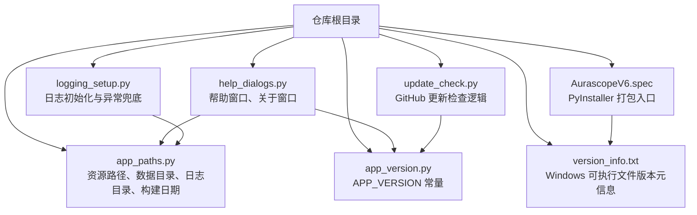
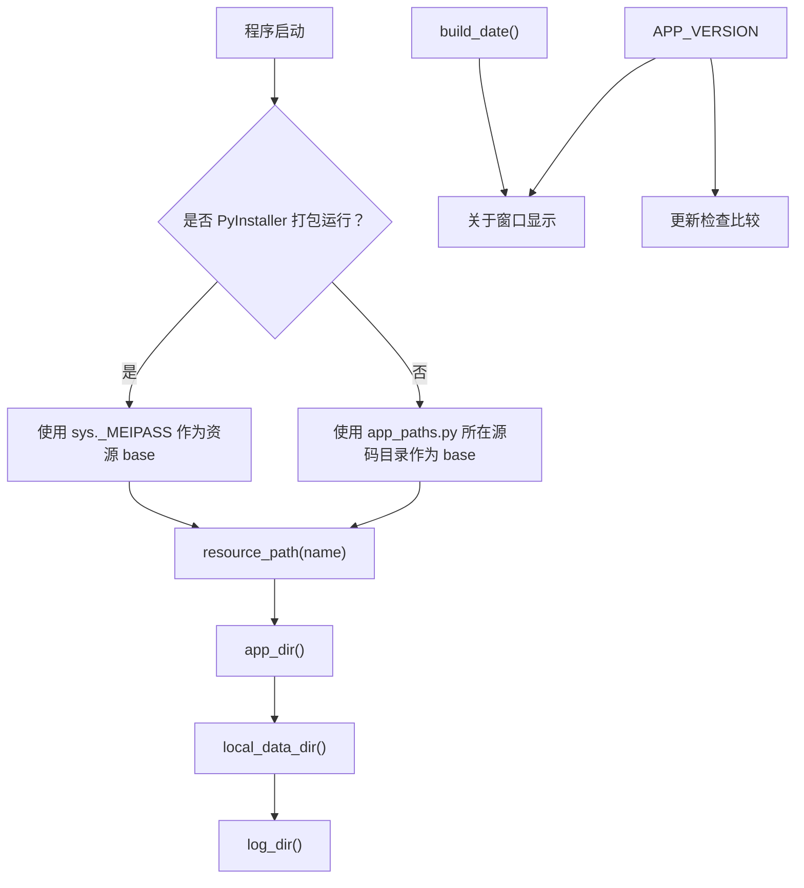
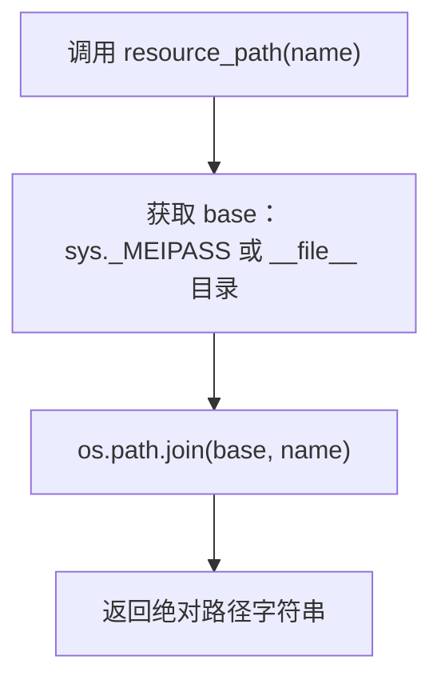
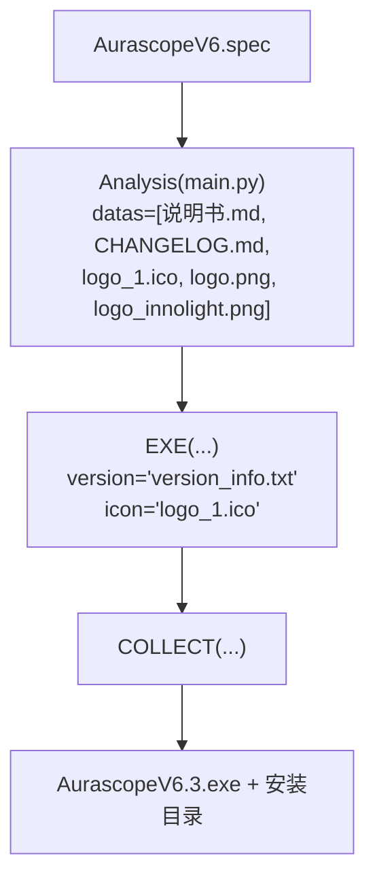
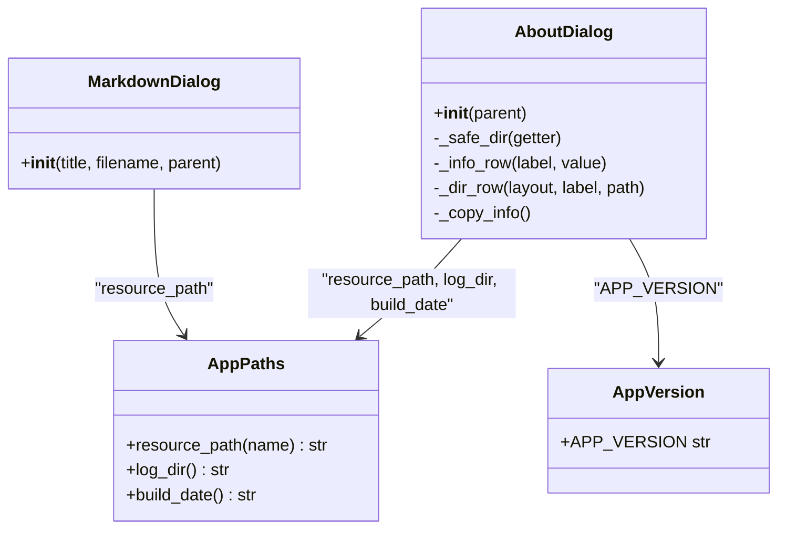
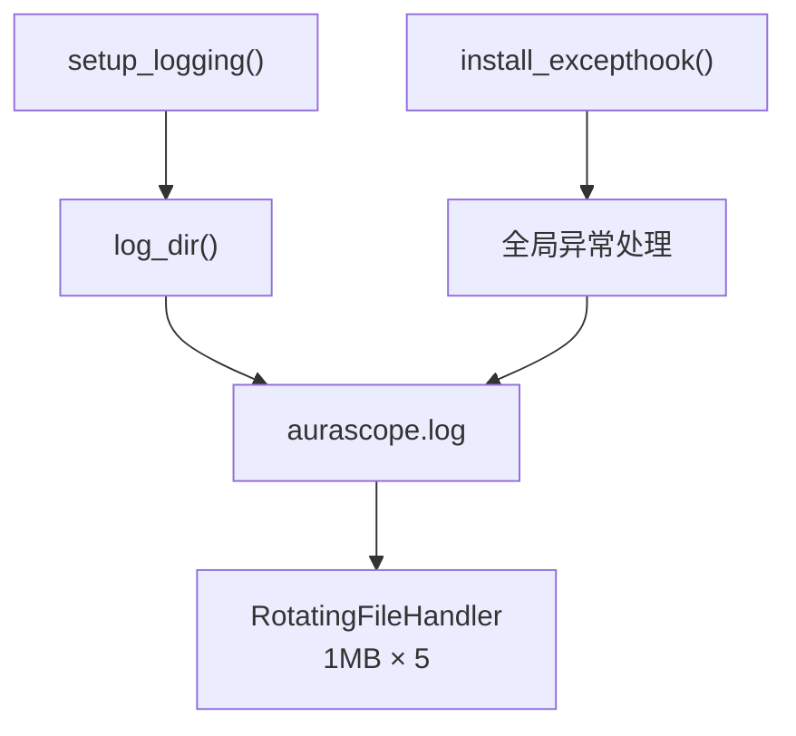
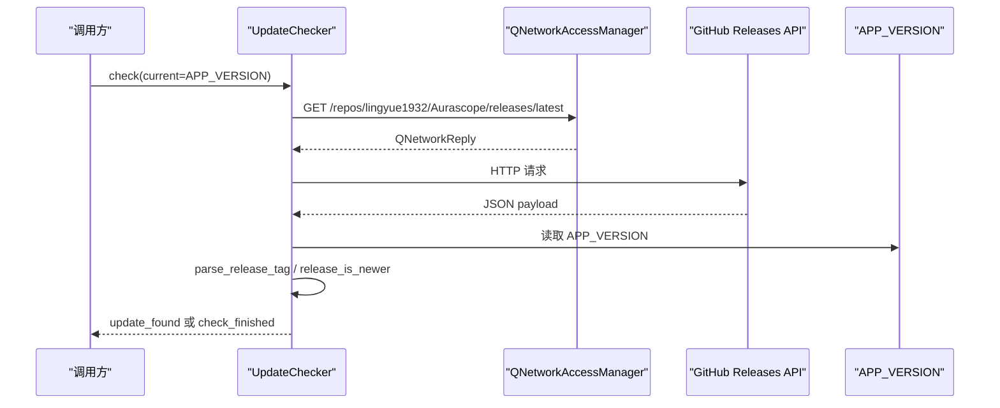
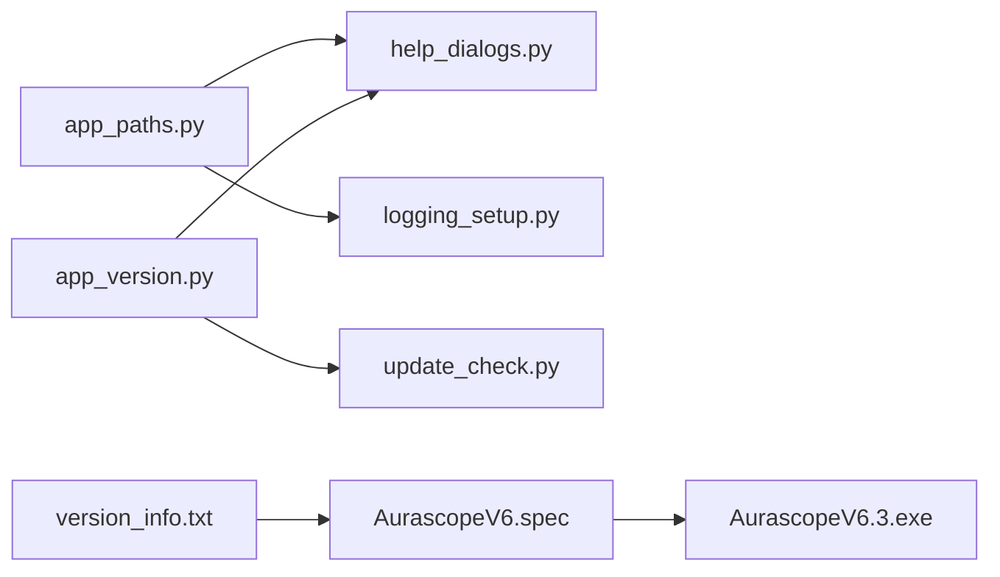

# 资源路径与版本管理

<cite>
**本文引用的文件**   
- [app_paths.py](file://app_paths.py)
- [app_version.py](file://app_version.py)
- [version_info.txt](file://version_info.txt)
- [AurascopeV6.spec](file://AurascopeV6.spec)
- [help_dialogs.py](file://help_dialogs.py)
- [logging_setup.py](file://logging_setup.py)
- [update_check.py](file://update_check.py)
</cite>

## 目录
1. [引言](#引言)
2. [项目结构定位](#项目结构定位)
3. [核心组件总览](#核心组件总览)
4. [架构概览](#架构概览)
5. [详细组件分析](#详细组件分析)
6. [依赖关系分析](#依赖关系分析)
7. [性能与打包行为](#性能与打包行为)
8. [典型调用示例](#典型调用示例)
9. [常见问题排查](#常见问题排查)
10. [结论](#结论)

## 引言
本文聚焦 Aurascope 在「源码运行」和「PyInstaller 打包」两种环境下，如何解析资源路径、用户数据目录、日志目录，以及如何读取应用版本号。重点说明：
- `app_paths.py` 如何通过 `sys._MEIPASS`、`sys.frozen`、`__file__` 区分运行环境。
- `app_version.py` 与 `version_info.txt` 分别承担运行时版本常量与 Windows 可执行文件元信息。
- `AurascopeV6.spec` 作为 PyInstaller 打包入口，把 Markdown、图标等资源注入最终产物。
- `help_dialogs.py`、`logging_setup.py`、`update_check.py` 对路径与版本模块的依赖方式。

## 项目结构定位
从仓库根目录看，资源路径与版本相关代码集中在根级 Python 文件和配置文件中：
- 路径与构建信息：`app_paths.py`
- 运行时版本常量：`app_version.py`
- Windows 可执行文件版本元信息：`version_info.txt`
- PyInstaller 打包配置：`AurascopeV6.spec`
- 使用路径/版本的 UI 与工具模块：`help_dialogs.py`、`logging_setup.py`、`update_check.py`

**图表来源**
- [app_paths.py:1-42](file://app_paths.py#L1-L42)
- [app_version.py:1-4](file://app_version.py#L1-L4)
- [version_info.txt:1-28](file://version_info.txt#L1-L28)
- [AurascopeV6.spec:1-68](file://AurascopeV6.spec#L1-L68)
- [help_dialogs.py:1-132](file://help_dialogs.py#L1-L132)
- [logging_setup.py:1-88](file://logging_setup.py#L1-L88)
- [update_check.py:1-112](file://update_check.py#L1-L112)

**章节来源**
- [app_paths.py:1-42](file://app_paths.py#L1-L42)
- [app_version.py:1-4](file://app_version.py#L1-L4)
- [version_info.txt:1-28](file://version_info.txt#L1-L28)
- [AurascopeV6.spec:1-68](file://AurascopeV6.spec#L1-L68)
- [help_dialogs.py:1-132](file://help_dialogs.py#L1-L132)
- [logging_setup.py:1-88](file://logging_setup.py#L1-L88)
- [update_check.py:1-112](file://update_check.py#L1-L112)

## 核心组件总览
| 模块 | 主要职责 | 关键函数或常量 | 返回类型或用途 |
|---|---|---|---|
| `app_paths.py` | 提供资源路径、程序目录、用户数据目录、日志目录、构建日期 | `resource_path(name)`、`app_dir()`、`local_data_dir()`、`log_dir()`、`build_date()` | 字符串路径或日期字符串 |
| `app_version.py` | 提供统一的应用版本号常量 | `APP_VERSION` | 字符串，如 `6.3.0` |
| `version_info.txt` | 定义 PyInstaller 生成的 Windows 可执行文件的版本元信息 | `VSVersionInfo`、`FileVersion`、`ProductVersion` 等 | 供 PyInstaller 写入 `.exe` 属性 |
| `AurascopeV6.spec` | PyInstaller 打包入口，声明数据来源、图标、版本文件、输出目录名 | `Analysis`、`EXE`、`COLLECT`、`version='version_info.txt'` | 生成 `AurascopeV6.3.exe` 及安装目录 |
| `help_dialogs.py` | 显示离线 Markdown 文档、关于窗口中的版本/构建日期/目录 | 使用 `resource_path`、`log_dir`、`build_date`、`APP_VERSION` | 界面展示与用户操作 |
| `logging_setup.py` | 初始化滚动日志、安装全局异常钩子 | 使用 `log_dir()` | 返回日志文件路径 |
| `update_check.py` | 异步检查 GitHub Releases 新版本 | 使用 `APP_VERSION` | 比较当前版本与远程版本 |

**章节来源**
- [app_paths.py:1-42](file://app_paths.py#L1-L42)
- [app_version.py:1-4](file://app_version.py#L1-L4)
- [version_info.txt:1-28](file://version_info.txt#L1-L28)
- [AurascopeV6.spec:1-68](file://AurascopeV6.spec#L1-L68)
- [help_dialogs.py:1-132](file://help_dialogs.py#L1-L132)
- [logging_setup.py:1-88](file://logging_setup.py#L1-L88)
- [update_check.py:1-112](file://update_check.py#L1-L112)

## 架构概览
Aurascope 的资源访问与版本读取可以抽象为三层：
1. **环境层**：判断是否由 PyInstaller 打包运行，决定 base 目录。
2. **路径服务层**：`app_paths.py` 暴露统一接口，隐藏源码目录与 `_MEIPASS` 差异。
3. **业务层**：帮助窗口、日志、更新检查等模块只关心“我要一个路径或版本号”，不关心底层实现。

**图表来源**
- [app_paths.py:8-41](file://app_paths.py#L8-L41)
- [app_version.py:1-4](file://app_version.py#L1-L4)
- [help_dialogs.py:8-10](file://help_dialogs.py#L8-L10)
- [update_check.py:15-18](file://update_check.py#L15-L18)

## 详细组件分析

### `app_paths.py`：资源路径与构建信息
该模块是资源访问的统一入口，核心设计是：**调用方传入相对名称，模块根据运行环境拼接绝对路径**。

#### 关键函数与语义
| 函数 | 参数 | 返回值 | 行为说明 |
|---|---|---|---|
| `resource_path(name)` | `name`：资源文件名或相对路径 | `str` | 打包后优先取 `sys._MEIPASS`，否则取本文件所在目录；再拼接 `name` |
| `app_dir()` | 无 | `str` | 打包后取 `sys.executable` 所在目录，源码运行取 `__file__` 所在目录 |
| `local_data_dir()` | 无 | `str` | 取 `LOCALAPPDATA` 或 `~\AppData\Local`，拼接 `Aurascope`，并创建目录 |
| `log_dir()` | 无 | `str` | 在 `local_data_dir()` 下创建 `logs` 子目录并返回 |
| `build_date()` | 无 | `str` | 打包后取 exe 修改时间，源码运行取本文件修改时间，格式为 `YYYY-MM-DD` |

#### `sys._MEIPASS` 的行为差异
- **PyInstaller 单文件或 onedir 模式**：打包时资源会被解包到临时目录，`sys._MEIPASS` 指向该临时目录。此时 `resource_path('logo.png')` 会先查 `_MEIPASS/logo.png`。
- **源码运行**：`sys._MEIPASS` 不存在，`getattr(sys, '_MEIPASS', ...)` 回退到 `os.path.dirname(os.path.abspath(__file__))`，即 `app_paths.py` 所在目录。
- **注意**：`AurascopeV6.spec` 使用的是 onedir 模式（`exclude_binaries=True`），但 `resource_path` 仍通过 `_MEIPASS` 兼容单文件场景，因此同一套路径逻辑可同时覆盖两种打包形态。

#### 构建日期逻辑
`build_date()` 会根据是否 frozen 选择目标文件：
- 打包后：`sys.executable`
- 源码运行：`os.path.abspath(__file__)`
然后取修改时间并格式化为日期；若获取失败则返回短横线占位符。

**图表来源**
- [app_paths.py:8-11](file://app_paths.py#L8-L11)

**章节来源**
- [app_paths.py:1-42](file://app_paths.py#L1-L42)

### `app_version.py`：运行时版本常量
该模块非常简单，只导出一个字符串常量：
- `APP_VERSION = '6.3.0'`

它被用于：
- 窗口标题、关于窗口显示
- 更新检查中作为当前版本基准

需要注意：这个常量是 Python 层运行时版本，而 `version_info.txt` 是 Windows 可执行文件元信息层版本。两者应保持一致，但来源不同。

**章节来源**
- [app_version.py:1-4](file://app_version.py#L1-L4)

### `version_info.txt`：Windows 可执行文件版本元信息
该文件定义 PyInstaller 写入 `.exe` 的版本信息，包括：
- `filevers`、`prodvers`：数字版号
- `FileVersion`、`ProductVersion`：字符串版号
- `CompanyName`、`FileDescription`、`ProductName`、`LegalCopyright`、`OriginalFilename` 等元信息

当 PyInstaller 使用 `version='version_info.txt'` 时，生成的 `AurascopeV6.3.exe` 会在 Windows 文件属性中显示这些内容。

**章节来源**
- [version_info.txt:1-28](file://version_info.txt#L1-L28)

### `AurascopeV6.spec`：PyInstaller 打包入口
该 spec 文件负责把 Python 脚本、Markdown 文档、图标等资源打包成可分发应用。

关键点：
- 入口脚本：`main.py`
- 数据文件：`说明书.md`、`CHANGELOG.md`、`logo_1.ico`、`logo.png`、`logo_innolight.png`
- 输出名称：`AurascopeV6.3`
- 版本文件：`version='version_info.txt'`
- 图标：`icon=['logo_1.ico']`
- 排除依赖：`PySide6`、`PySide2`、`pandas`、`matplotlib`
- 启动图：`splash_boot.png`

spec 注释还解释了为什么不用单文件模式：实测 onedir 启动更快，且避免每次双击都解包大体积临时目录。

**图表来源**
- [AurascopeV6.spec:13-67](file://AurascopeV6.spec#L13-L67)

**章节来源**
- [AurascopeV6.spec:1-68](file://AurascopeV6.spec#L1-L68)

### `help_dialogs.py`：帮助与关于窗口的路径依赖
该模块直接依赖 `app_paths.py` 和 `app_version.py`：
- 导入 `resource_path`、`log_dir`、`build_date`
- 导入 `APP_VERSION`
- `MarkdownDialog` 用 `resource_path(filename)` 打开随包 Markdown
- `AboutDialog` 用 `resource_path('logo_innolight.png')` 加载图标
- `AboutDialog` 显示 `APP_VERSION`、`build_date()`、数据目录、日志目录

**图表来源**
- [help_dialogs.py:8-10](file://help_dialogs.py#L8-L10)
- [help_dialogs.py:20-43](file://help_dialogs.py#L20-L43)
- [help_dialogs.py:46-132](file://help_dialogs.py#L46-L132)
- [app_paths.py:8-41](file://app_paths.py#L8-L41)
- [app_version.py:1-4](file://app_version.py#L1-L4)

**章节来源**
- [help_dialogs.py:1-132](file://help_dialogs.py#L1-L132)

### `logging_setup.py`：日志路径依赖
该模块依赖 `app_paths.log_dir()`：
- `setup_logging()` 将日志文件放在 `log_dir()/aurascope.log`
- `log_file()` 返回当前日志文件路径
- 全局异常钩子会把未捕获异常写入日志，并提供“打开日志”按钮

**图表来源**
- [logging_setup.py:10-31](file://logging_setup.py#L10-L31)
- [logging_setup.py:72-88](file://logging_setup.py#L72-L88)

**章节来源**
- [logging_setup.py:1-88](file://logging_setup.py#L1-L88)

### `update_check.py`：版本比较依赖
该模块依赖 `app_version.APP_VERSION`：
- `release_is_newer(tag, current=APP_VERSION)` 比较远程 tag 与当前版本
- `UpdateChecker.check(current=APP_VERSION)` 默认使用模块常量作为当前版本
- 网络请求失败或 JSON 解析失败会记录警告日志，不会抛出到主线程

**图表来源**
- [update_check.py:15-18](file://update_check.py#L15-L18)
- [update_check.py:34-42](file://update_check.py#L34-L42)
- [update_check.py:74-112](file://update_check.py#L74-L112)

**章节来源**
- [update_check.py:1-112](file://update_check.py#L1-L112)

## 依赖关系分析
从路径与版本角度看，依赖方向如下：

- `help_dialogs.py` 同时依赖 `app_paths.py` 和 `app_version.py`。
- `logging_setup.py` 仅依赖 `app_paths.py`。
- `update_check.py` 仅依赖 `app_version.py`。
- `version_info.txt` 被 `AurascopeV6.spec` 引用，不参与运行时 Python 导入。
- `app_paths.py` 不依赖其他业务模块，属于基础设施层。

**图表来源**
- [app_paths.py:1-42](file://app_paths.py#L1-L42)
- [app_version.py:1-4](file://app_version.py#L1-L4)
- [version_info.txt:1-28](file://version_info.txt#L1-L28)
- [AurascopeV6.spec:13-67](file://AurascopeV6.spec#L13-L67)
- [help_dialogs.py:8-10](file://help_dialogs.py#L8-L10)
- [logging_setup.py:10](file://logging_setup.py#L10)
- [update_check.py:15](file://update_check.py#L15)

**章节来源**
- [app_paths.py:1-42](file://app_paths.py#L1-L42)
- [app_version.py:1-4](file://app_version.py#L1-L4)
- [version_info.txt:1-28](file://version_info.txt#L1-L28)
- [AurascopeV6.spec:13-67](file://AurascopeV6.spec#L13-L67)
- [help_dialogs.py:8-10](file://help_dialogs.py#L8-L10)
- [logging_setup.py:10](file://logging_setup.py#L10)
- [update_check.py:15](file://update_check.py#L15)

## 性能与打包行为
- `AurascopeV6.spec` 明确说明：单文件模式每次双击都要把约 100MB 内容解包到 `%TEMP%\_MEIxxxx`，实测从双击到 `main()` 写日志约 11.5 秒；onedir 模式直接读安装目录，同一台机器降到约 0.7 秒。
- `resource_path` 本身只做 `getattr` 和 `os.path.join`，开销极小；真正影响性能的是资源文件是否存在、磁盘 IO 以及 Qt 加载图片。
- `build_date()` 会调用 `os.path.getmtime`，属于一次性启动期开销，通常可忽略。
- `logging_setup.setup_logging()` 使用 `RotatingFileHandler`，单文件 1MB、最多 5 个备份，避免日志无限增长。

**章节来源**
- [AurascopeV6.spec:1-10](file://AurascopeV6.spec#L1-L10)
- [app_paths.py:8-41](file://app_paths.py#L8-L41)
- [logging_setup.py:15-31](file://logging_setup.py#L15-L31)

## 典型调用示例
以下示例描述“如何在运行时获取资源路径、配置文件目录、帮助文档路径”，不直接粘贴代码，而是给出调用方式和预期结果。

### 示例一：获取随包图标路径
- 调用：`resource_path('logo_innolight.png')`
- 源码运行：返回 `app_paths.py` 所在目录下 `logo_innolight.png` 的绝对路径。
- PyInstaller 打包后：返回 `_MEIPASS` 临时目录下的 `logo_innolight.png` 路径。
- 使用场景：`help_dialogs.AboutDialog` 用该路径加载图标。

**章节来源**
- [app_paths.py:8-11](file://app_paths.py#L8-L11)
- [help_dialogs.py:59-63](file://help_dialogs.py#L59-L63)

### 示例二：获取用户可写数据目录
- 调用：`local_data_dir()`
- 行为：
  - 优先使用环境变量 `LOCALAPPDATA`
  - 否则使用 `~\AppData\Local`
  - 拼接 `Aurascope`
  - 自动创建目录
- 返回：Windows 上类似 `C:\Users\<用户名>\AppData\Local\Aurascope` 的路径字符串。
- 使用场景：配方目录、用户缓存、扩展配置等。

**章节来源**
- [app_paths.py:21-26](file://app_paths.py#L21-L26)

### 示例三：获取日志目录
- 调用：`log_dir()`
- 行为：在 `local_data_dir()` 下创建 `logs` 子目录并返回。
- 返回：类似 `...\Aurascope\logs` 的路径字符串。
- 使用场景：`logging_setup.setup_logging()` 写入 `aurascope.log`。

**章节来源**
- [app_paths.py:29-32](file://app_paths.py#L29-L32)
- [logging_setup.py:15-31](file://logging_setup.py#L15-L31)

### 示例四：获取帮助文档路径
- 调用：`resource_path('说明书.md')`
- 源码运行：返回源码根目录下的 `说明书.md`。
- PyInstaller 打包后：返回 `_MEIPASS` 下对应 Markdown 文件路径。
- 使用场景：`help_dialogs.MarkdownDialog` 打开随包 Markdown。

**章节来源**
- [app_paths.py:8-11](file://app_paths.py#L8-L11)
- [AurascopeV6.spec:17-21](file://AurascopeV6.spec#L17-L21)
- [help_dialogs.py:33-37](file://help_dialogs.py#L33-L37)

### 示例五：获取版本号
- 调用：`APP_VERSION`
- 返回：字符串 `6.3.0`
- 使用场景：
  - `help_dialogs.AboutDialog` 显示版本
  - `update_check.UpdateChecker` 比较远程版本

**章节来源**
- [app_version.py:1-4](file://app_version.py#L1-L4)
- [help_dialogs.py:75-77](file://help_dialogs.py#L75-L77)
- [update_check.py:34-42](file://update_check.py#L34-L42)

### 示例六：获取构建日期
- 调用：`build_date()`
- 返回：`YYYY-MM-DD` 格式的日期字符串，例如 `2026-01-01`；若无法获取则返回 `—`。
- 使用场景：`help_dialogs.AboutDialog` 显示构建日期。

**章节来源**
- [app_paths.py:35-41](file://app_paths.py#L35-L41)
- [help_dialogs.py:76-77](file://help_dialogs.py#L76-L77)

## 常见问题排查

### 问题一：打包后找不到图片或 Markdown
**现象**
- 双击 `AurascopeV6.3.exe` 后，关于窗口图标空白。
- 点击帮助文档提示“未找到文档”。

**可能原因**
- `AurascopeV6.spec` 的 `datas` 中没有包含对应文件。
- 资源文件名大小写不一致。
- 源码运行和打包运行使用的 base 目录不同。

**排查步骤**
1. 确认 `AurascopeV6.spec` 的 `datas` 列表中包含所需文件，例如 `logo.png`、`logo_innolight.png`、`说明书.md`。
2. 确认调用方使用 `resource_path('文件名')`，而不是硬编码源码目录。
3. 在打包环境中检查 `_MEIPASS` 临时目录是否存在对应文件。
4. 如果只在源码运行正常、打包后异常，重点检查 spec 的 `datas` 配置。

**章节来源**
- [AurascopeV6.spec:17-21](file://AurascopeV6.spec#L17-L21)
- [app_paths.py:8-11](file://app_paths.py#L8-L11)
- [help_dialogs.py:33-37](file://help_dialogs.py#L33-L37)

### 问题二：Windows 7+ 下路径反斜杠处理异常
**现象**
- 日志目录或数据目录路径显示异常。
- 某些控件或外部工具无法正确打开路径。

**可能原因**
- Windows 路径分隔符为反斜杠，Python 的 `os.path.join` 会自动处理。
- 如果手动拼接字符串或使用正斜杠，可能在某些 Windows 工具中出现显示或兼容性差异。
- `local_data_dir()` 中使用了 `r'~\AppData\Local'`，这是 Windows 风格路径。

**排查步骤**
1. 不要手动拼接路径，统一使用 `os.path.join` 或 `app_paths` 提供的函数。
2. 打印实际路径，确认是否为 Windows 期望的反斜杠形式。
3. 如果路径来自日志或错误消息，注意日志格式化可能转义反斜杠，不代表实际文件系统路径错误。

**章节来源**
- [app_paths.py:21-26](file://app_paths.py#L21-L26)
- [app_paths.py:29-32](file://app_paths.py#L29-L32)

### 问题三：版本号显示异常
**现象**
- 关于窗口显示版本号不是预期值。
- Windows 文件属性中的版本信息与 Python 层不一致。

**可能原因**
- `app_version.APP_VERSION` 与 `version_info.txt` 中的 `FileVersion`、`ProductVersion` 不一致。
- 只更新了其中一个，没有同步发布。
- PyInstaller 打包时没有正确引用 `version_info.txt`。

**排查步骤**
1. 检查 `app_version.py` 中的 `APP_VERSION`。
2. 检查 `version_info.txt` 中的 `filevers`、`prodvers`、`FileVersion`、`ProductVersion`。
3. 检查 `AurascopeV6.spec` 中是否设置 `version='version_info.txt'`。
4. 重新打包后，右键查看 `.exe` 文件属性，确认 Windows 版本信息已更新。

**章节来源**
- [app_version.py:1-4](file://app_version.py#L1-L4)
- [version_info.txt:1-28](file://version_info.txt#L1-L28)
- [AurascopeV6.spec:55-56](file://AurascopeV6.spec#L55-L56)

### 问题四：日志目录为空或无法写入
**现象**
- 启动后没有 `aurascope.log`。
- 日志目录不存在。

**可能原因**
- `local_data_dir()` 或 `log_dir()` 创建目录失败。
- 当前用户对 `LOCALAPPDATA` 或 `~\AppData\Local` 没有写入权限。
- 程序以受限账户运行。

**排查步骤**
1. 检查 `LOCALAPPDATA` 环境变量是否存在。
2. 检查 `C:\Users\<用户名>\AppData\Local\Aurascope\logs` 是否被创建。
3. 尝试以普通用户身份运行，避免管理员权限导致的权限模型差异。
4. 查看 `logging_setup.py` 的全局异常钩子是否能捕获路径相关异常。

**章节来源**
- [app_paths.py:21-32](file://app_paths.py#L21-L32)
- [logging_setup.py:15-31](file://logging_setup.py#L15-L31)
- [logging_setup.py:72-88](file://logging_setup.py#L72-L88)

### 问题五：更新检查不生效
**现象**
- 没有检测到新版本。
- 网络请求失败但没有明显提示。

**可能原因**
- 本机无法访问 GitHub。
- `APP_VERSION` 与远程 tag 不一致。
- 远程 release 是 draft 或 prerelease。
- JSON 解析失败。

**排查步骤**
1. 确认本机网络可达 `api.github.com`。
2. 检查 `APP_VERSION` 是否与本地构建一致。
3. 检查 GitHub Release 是否为正式 release。
4. 查看日志中是否有“检查更新失败”或“检查更新解析失败”的警告。

**章节来源**
- [update_check.py:1-112](file://update_check.py#L1-L112)
- [app_version.py:1-4](file://app_version.py#L1-L4)

## 结论
Aurascope 的资源路径与版本管理机制可以概括为：
- `app_paths.py` 是运行时路径基础设施，屏蔽源码目录与 PyInstaller `_MEIPASS` 的差异。
- `app_version.py` 提供 Python 层统一版本号，`version_info.txt` 提供 Windows 可执行文件元信息。
- `AurascopeV6.spec` 负责把 Markdown、图标等资源打入最终应用，并把 `version_info.txt` 写入 `.exe`。
- `help_dialogs.py`、`logging_setup.py`、`update_check.py` 分别消费路径服务和版本常量，保持业务层与路径实现解耦。

在实际维护中，建议：
- 新增随包资源时，同步更新 `AurascopeV6.spec` 的 `datas`。
- 修改版本号时，同步更新 `app_version.py` 和 `version_info.txt`。
- 所有资源访问统一走 `resource_path`，避免硬编码路径。
- 所有用户数据写入统一走 `local_data_dir()` 或 `log_dir()`，避免权限问题。