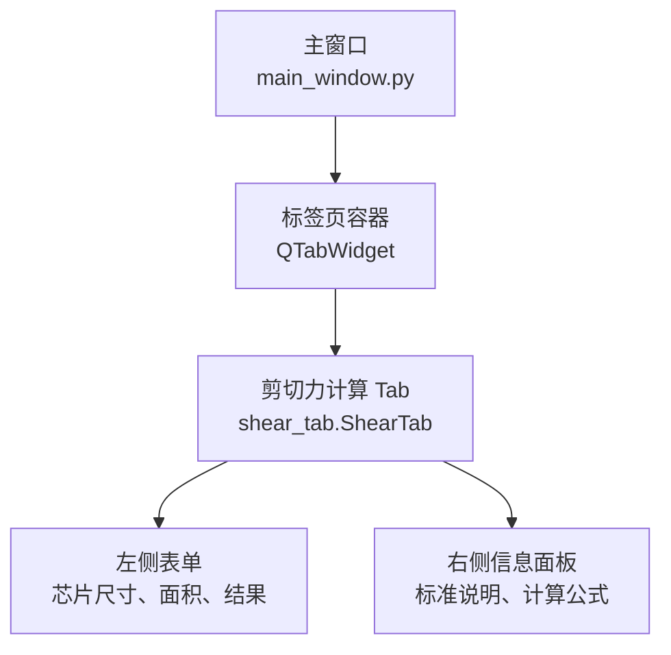
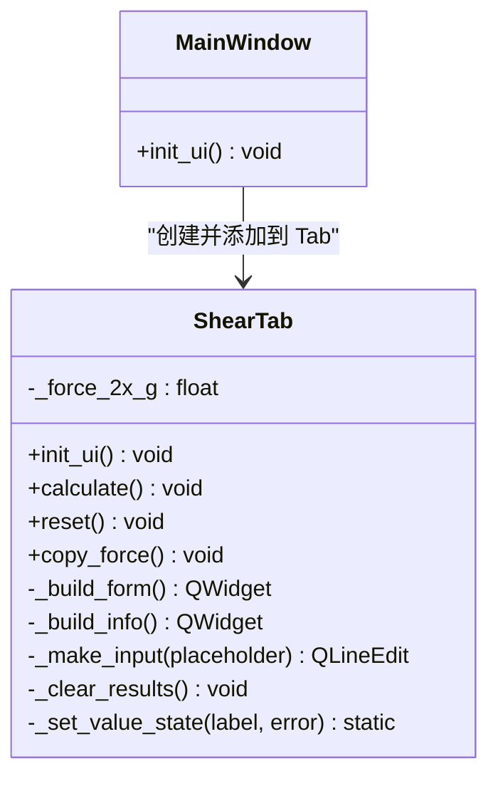
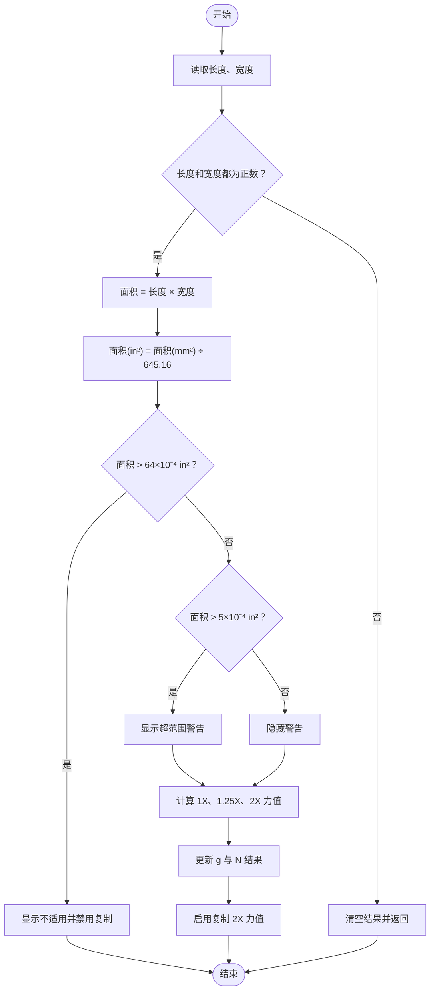
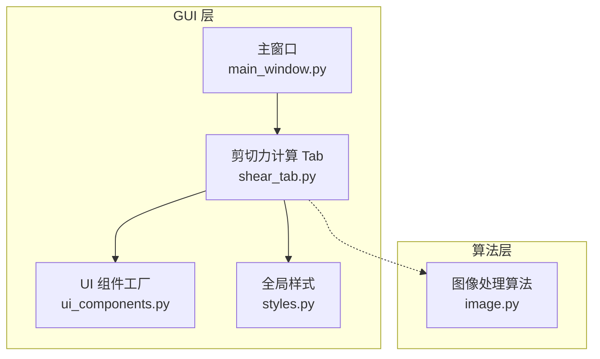

# 剪切力计算页面

<cite>
**本文引用的文件**   
- [shear_tab.py](file://shear_tab.py)
- [main_window.py](file://main_window.py)
- [README.md](file://README.md)
- [PROJECT_CONCEPTION.md](file://PROJECT_CONCEPTION.md)
</cite>

## 目录
1. [简介](#简介)
2. [项目结构与入口](#项目结构与入口)
3. [核心组件与界面布局](#核心组件与界面布局)
4. [操作步骤](#操作步骤)
5. [输入参数与公式说明](#输入参数与公式说明)
6. [1X / 1.25X / 2X 档位含义与适用场景](#1x--125x--2x-档位含义与适用场景)
7. [最小用例：典型封装参数](#最小用例典型封装参数)
8. [结果查看、复制与导出](#结果查看复制与导出)
9. [错误处理与注意事项](#错误处理与注意事项)
10. [架构与依赖关系](#架构与依赖关系)
11. [常见问题排查](#常见问题排查)
12. [结论](#结论)

## 简介
剪切力计算页面用于按 MIL-STD-883H Method 2019.9 标准，根据芯片尺寸估算预覆金锡（Preform/Pre-coated）焊料区的剪切力要求值。该页面不涉及图像导入、图像处理或空洞检测，仅做纯数值计算；实际工程判定仍需以正式测试报告为准。

在 Aurascope 主窗口中，剪切力计算是独立功能模块之一，位于顶部导航条的「剪切力计算」Tab。

**章节来源**
- [README.md:7-14](file://README.md#L7-L14)
- [PROJECT_CONCEPTION.md:28-36](file://PROJECT_CONCEPTION.md#L28-L36)

## 项目结构与入口
Aurascope 的主窗口由 `main_window.py` 装配，其中创建并注册了多个 Tab，包括剪切力计算 Tab。剪切力计算的具体 UI 和计算逻辑集中在 `shear_tab.py` 中的 `ShearTab` 类。

**图表来源**
- [main_window.py:138-140](file://main_window.py#L138-L140)
- [shear_tab.py:22-35](file://shear_tab.py#L22-L35)

**章节来源**
- [main_window.py:138-140](file://main_window.py#L138-L140)
- [shear_tab.py:22-35](file://shear_tab.py#L22-L35)

## 核心组件与界面布局
ShearTab 采用左右两栏布局：

| 区域 | 作用 | 关键控件 |
|---|---|---|
| 左侧表单 | 输入芯片长度、宽度，显示面积与三个力值档位 | 长度输入框、宽度输入框、面积显示、1X/1.25X/2X 结果卡片、一键清零按钮、复制 2X 力值按钮 |
| 右侧信息面板 | 说明参考标准、适用范围、面积范围限制与计算公式 | 标准说明文本、计算公式文本 |

**图表来源**
- [shear_tab.py:22-28](file://shear_tab.py#L22-L28)
- [shear_tab.py:29-35](file://shear_tab.py#L29-L35)
- [shear_tab.py:205-284](file://shear_tab.py#L205-L284)
- [main_window.py:138-140](file://main_window.py#L138-L140)

**章节来源**
- [shear_tab.py:29-144](file://shear_tab.py#L29-L144)
- [shear_tab.py:155-201](file://shear_tab.py#L155-L201)
- [shear_tab.py:205-284](file://shear_tab.py#L205-L284)

## 操作步骤
请按以下顺序使用剪切力计算页面：

1. 打开 Aurascope 主程序。
2. 在主窗口顶部导航条点击「剪切力计算」。
3. 在左侧表单中输入芯片长度和宽度，单位均为毫米。
4. 系统自动计算面积，并显示平方毫米与平方英寸两个面积值。
5. 查看下方三个力值卡片：
   - 1X 最小力值
   - 1.25X 测试力值
   - 2X 测试力值
6. 如需快速记录 2X 力值，点击「复制 2X 力值 (g)」，结果会复制到系统剪贴板。
7. 如需重新输入，点击「一键清零」清空输入并重置结果。

注意：
- 输入框支持小数，但只接受正数。
- 非正数、空输入或非数字输入不会触发有效计算，结果会回到初始状态。
- 当面积超过计算器适用上限时，结果区会显示「不适用」，并提示该计算器不再适用。

**章节来源**
- [shear_tab.py:60-87](file://shear_tab.py#L60-L87)
- [shear_tab.py:89-136](file://shear_tab.py#L89-L136)
- [shear_tab.py:146-151](file://shear_tab.py#L146-L151)
- [shear_tab.py:205-253](file://shear_tab.py#L205-L253)
- [shear_tab.py:276-284](file://shear_tab.py#L276-L284)

## 输入参数与公式说明

### 输入字段

| 字段 | 物理含义 | 单位 | 是否必填 | 说明 |
|---|---|---:|---:|---|
| 长度 | 芯片焊料区长度方向尺寸 | 毫米 | 是 | 必须为正数 |
| 宽度 | 芯片焊料区宽度方向尺寸 | 毫米 | 是 | 必须为正数 |
| 面积 | 由长度 × 宽度换算得到 | 平方毫米、平方英寸 | 自动计算 | 用于判断是否进入线性插值区间 |

### 计算公式与常量

代码中使用的关键常量和计算步骤如下：

| 名称 | 值或规则 | 含义 |
|---|---:|---|
| MM2_PER_IN2 | 645.16 | 平方毫米到平方英寸换算系数 |
| MAX_AREA_IN2 | 64×10⁻⁴ in² | 计算器适用面积上限 |
| WARN_AREA_IN2 | 5×10⁻⁴ in² | 超出标准推荐范围的警告阈值 |
| FORCE_FACTOR | 0.04 / 0.0001 | 对应标准中约 0.04 kgf 每 1.0×10⁻⁴ in² 的比例因子 |
| 1X 力值 | 面积(in²) × FORCE_FACTOR × 1000 | 得到克值 |
| N 力值 | 力值(g) ÷ 1000 × 9.8 | 将克转换为牛顿 |

**图表来源**
- [shear_tab.py:16-19](file://shear_tab.py#L16-L19)
- [shear_tab.py:205-253](file://shear_tab.py#L205-L253)

**章节来源**
- [shear_tab.py:16-19](file://shear_tab.py#L16-L19)
- [shear_tab.py:205-253](file://shear_tab.py#L205-L253)

## 1X / 1.25X / 2X 档位含义与适用场景

| 档位 | 代码中的乘数 | 页面显示 | 含义与用途 |
|---:|---:|---|---|
| 1X | 1.0 | 1X 最小力值 | 基于面积比例得到的基础最小剪切力要求 |
| 1.25X | 1.25 | 1.25X 测试力值 | 在基础最小力值上提高 25%，常用于更严格的测试条件 |
| 2X | 2.0 | 2X 测试力值 | 在基础最小力值上提高 100%，页面提供一键复制功能，便于快速记录 |

这三个档位不是用户手动选择的下拉选项，而是同时显示的计算结果。用户不需要选择档位，只需输入芯片尺寸，页面就会自动给出三个力值。

从业务角度看：
- 1X 更接近标准中按面积比例推导的最小要求。
- 1.25X 和 2X 可理解为测试强度等级，适用于需要更高剪切力裕度的验证场景。
- 具体选用哪个档位应结合产品规范、客户要求和可靠性策略，而不是只看软件输出。

**章节来源**
- [shear_tab.py:89-125](file://shear_tab.py#L89-L125)
- [shear_tab.py:242-250](file://shear_tab.py#L242-L250)
- [PROJECT_CONCEPTION.md:28-36](file://PROJECT_CONCEPTION.md#L28-L36)

## 最小用例：典型封装参数

下面给出一组可直接在页面中尝试的典型封装参数示例。该示例仅用于演示操作流程和单位一致性，不代表任何真实产品的合格判定。

| 参数 | 示例值 | 单位 |
|---|---:|---:|
| 长度 | 2.0 | mm |
| 宽度 | 1.5 | mm |

预期行为：

1. 输入长度 2.0，宽度 1.5。
2. 面积约为 3.000000 平方毫米。
3. 面积换算为平方英寸后，小于 5×10⁻⁴ in²，因此不出现超范围警告。
4. 页面显示 1X、1.25X、2X 三个力值，单位分别为克和牛顿。
5. 点击「复制 2X 力值 (g)」，可将 2X 力值的克数复制到剪贴板。

如果希望看到警告提示，可以把长度和宽度设置得更大，使面积超过 5×10⁻⁴ in²；如果继续增大到超过 64×10⁻⁴ in²，则结果区会显示「不适用」。

**章节来源**
- [shear_tab.py:217-253](file://shear_tab.py#L217-L253)
- [shear_tab.py:281-284](file://shear_tab.py#L281-L284)

## 结果查看、复制与导出

### 查看结果
- 面积显示区会同时展示平方毫米和平方英寸。
- 每个力值卡片包含：
  - 档位名称
  - 克值
  - 牛顿值

### 复制 2X 力值
点击「复制 2X 力值 (g)」后，程序会把当前计算的 2X 力值（单位 g）写入系统剪贴板。该功能仅在成功计算出有效 2X 力值后启用。

### 导出结果
当前剪切力计算页面没有独立的导出按钮或导出文件功能。若需要保留结果，建议：
- 使用截图工具保存页面截图；
- 复制 2X 力值后粘贴到 Excel、Word 或测试记录表中；
- 如需结构化数据，可在外部表格中记录长度、宽度、面积、1X/1.25X/2X 的 g 与 N 值。

**章节来源**
- [shear_tab.py:89-136](file://shear_tab.py#L89-L136)
- [shear_tab.py:242-253](file://shear_tab.py#L242-L253)
- [shear_tab.py:281-284](file://shear_tab.py#L281-L284)

## 错误处理与注意事项

### 非法输入处理
- 输入为空、非数字、负数或零时，页面会清空结果，恢复默认提示文字。
- 输入框使用浮点数校验器，允许最多三位小数，范围 0.0 到 99999.0。

### 面积范围处理
- 面积小于等于 5×10⁻⁴ in²：正常计算，无警告。
- 面积大于 5×10⁻⁴ in² 但不超过 64×10⁻⁴ in²：显示「超出标准推荐范围，仅供参考」警告。
- 面积大于 64×10⁻⁴ in²：显示「此计算器不适用」，三个力值显示为「不适用」，复制按钮禁用。

### 重要注意事项
1. **单位必须一致**：长度和宽度都必须使用毫米。若原始数据是微米或其他单位，请先换算成毫米再输入。
2. **芯片尺寸代表焊料区尺寸**：该计算器假设输入的是预覆金锡焊料区的矩形近似尺寸，不是芯片裸片 die 尺寸。
3. **键合点数量不参与计算**：当前实现只使用长度和宽度计算面积，不接收键合点数量作为输入。
4. **结果仅供参考**：该页面是辅助计算工具，不能替代正式剪切力测试报告。
5. **不适用于超大焊料区**：面积超过 64×10⁻⁴ in² 时，标准要求最低 2.5 kgf，本计算器明确标记为不适用。
6. **不涉及图像处理**：剪切力计算页面不加载图片、不调用 OpenCV、不执行空洞检测。

**章节来源**
- [shear_tab.py:146-151](file://shear_tab.py#L146-L151)
- [shear_tab.py:205-253](file://shear_tab.py#L205-L253)
- [shear_tab.py:255-274](file://shear_tab.py#L255-L274)
- [PROJECT_CONCEPTION.md:28-36](file://PROJECT_CONCEPTION.md#L28-L36)

## 架构与依赖关系
剪切力计算页面的技术边界很清晰：它属于 GUI 层，不包含图像算法。其依赖关系如下：

说明：
- `main_window.py` 负责创建 `ShearTab` 并将其加入主窗口 Tab。
- `shear_tab.py` 负责表单、结果显示、计算逻辑和剪贴板复制。
- `ui_components.py` 提供按钮、标题、警告框等通用 UI 控件。
- `styles.py` 提供颜色和设计 token。
- 剪切力计算不依赖 `image.py` 的图像处理函数，二者解耦。

**图表来源**
- [main_window.py:45-49](file://main_window.py#L45-L49)
- [main_window.py:138-140](file://main_window.py#L138-L140)
- [shear_tab.py:3-13](file://shear_tab.py#L3-L13)

**章节来源**
- [main_window.py:45-49](file://main_window.py#L45-L49)
- [main_window.py:138-140](file://main_window.py#L138-L140)
- [shear_tab.py:3-13](file://shear_tab.py#L3-L13)

## 常见问题排查

| 现象 | 可能原因 | 处理方法 |
|---|---|---|
| 结果始终显示 0.0 g / 0.0000 N | 未输入长度或宽度，或输入为空 | 输入正数长度和宽度 |
| 输入负数后结果被清空 | 负数被视为非法输入 | 改为正数 |
| 输入 0 后结果被清空 | 0 不是正数，不符合物理意义 | 输入大于 0 的值 |
| 结果全部显示「不适用」 | 面积超过 64×10⁻⁴ in² | 确认输入是否为毫米；如确实为大焊料区，应参考正式标准或测试报告 |
| 出现「超出标准推荐范围，仅供参考」 | 面积超过 5×10⁻⁴ in² | 检查封装尺寸是否符合预期；结果仍可查看，但需谨慎解读 |
| 「复制 2X 力值 (g)」按钮不可用 | 尚未计算出有效 2X 力值 | 先输入合法尺寸并等待自动计算完成 |
| 复制内容不是期望值 | 之前计算过其他尺寸，但未刷新 | 重新输入新尺寸，再点击复制 |
| 单位看起来不对 | 输入单位不是毫米 | 先将微米、密耳等单位换算为毫米 |

**章节来源**
- [shear_tab.py:146-151](file://shear_tab.py#L146-L151)
- [shear_tab.py:205-253](file://shear_tab.py#L205-L253)
- [shear_tab.py:276-284](file://shear_tab.py#L276-L284)

## 结论
剪切力计算页面是一个轻量、专注的辅助工具：用户只需输入芯片焊料区的长度和宽度，即可得到 1X、1.25X、2X 三个力值档位，并快速复制 2X 力值。它严格遵循 MIL-STD-883H Method 2019.9 的面积-力值映射思路，但对大焊料区明确标记为不适用。

使用时请牢记三点：
1. 输入单位必须统一为毫米。
2. 非正数和非法输入会被拒绝，结果会回到初始状态。
3. 页面输出是参考值，不能替代正式剪切力测试报告。