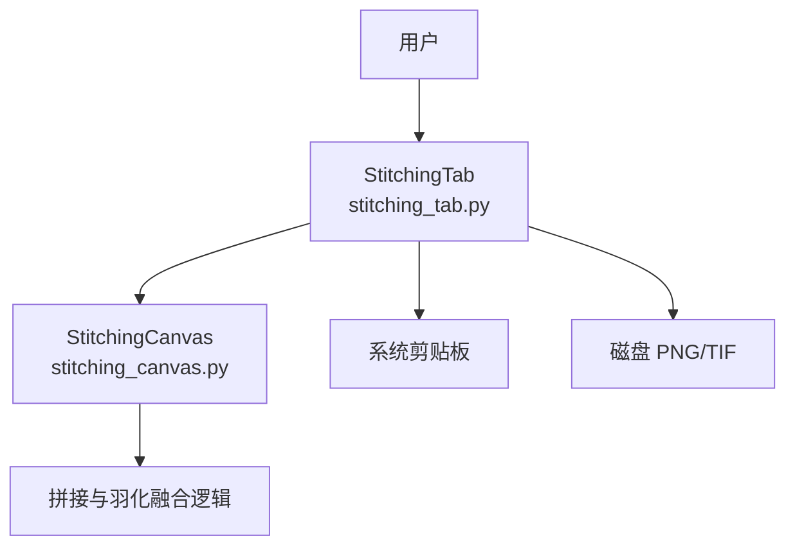
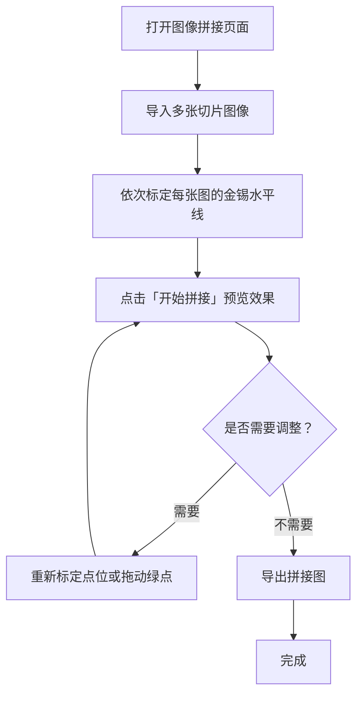
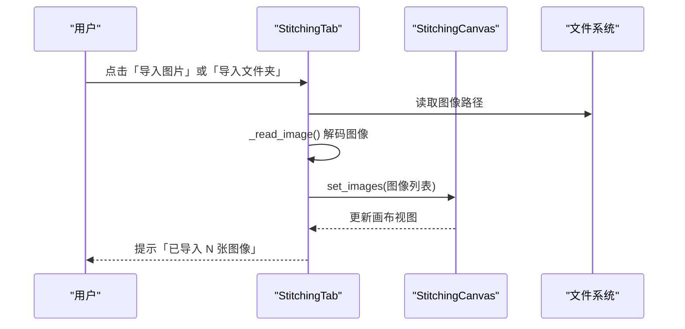
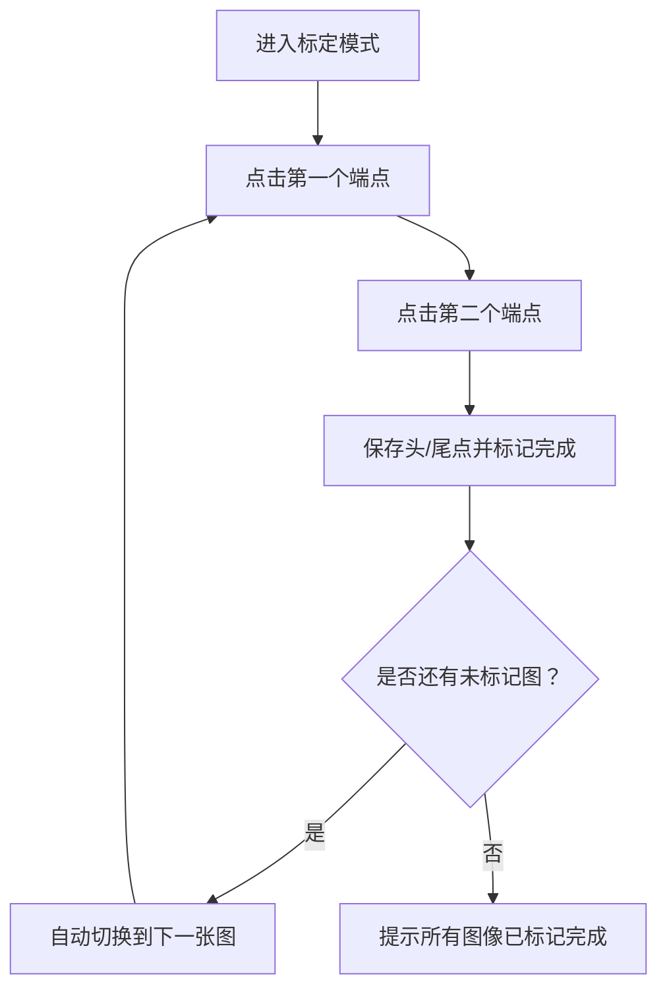
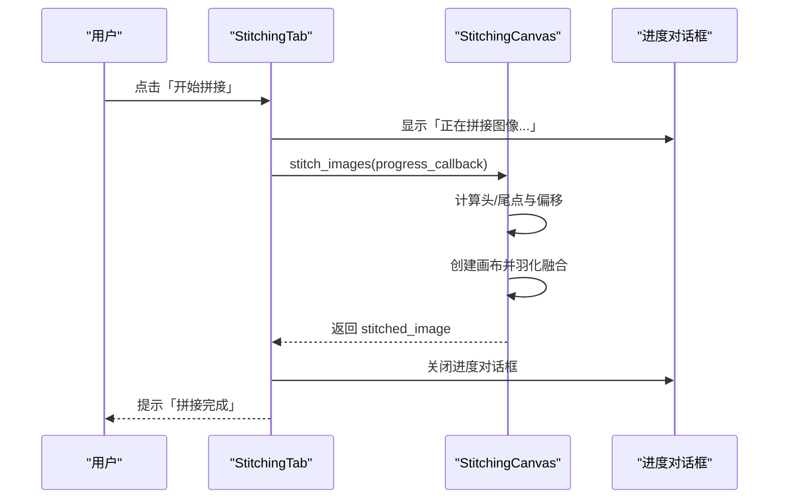
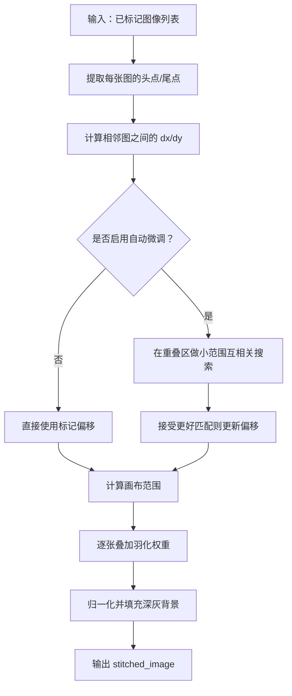
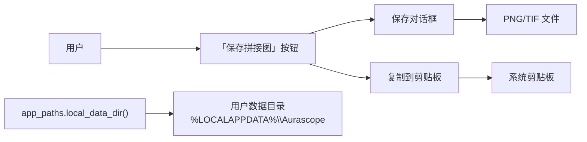
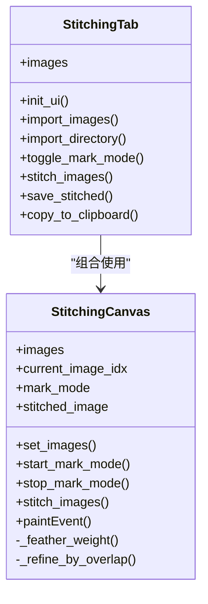
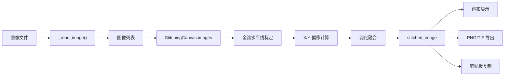

# 图像拼接页面

<cite>
**本文引用的文件**   
- [stitching_tab.py](file://stitching_tab.py)
- [stitching_canvas.py](file://stitching_canvas.py)
- [app_paths.py](file://app_paths.py)
- [README.md](file://README.md)
- [PROJECT_CONCEPTION.md](file://PROJECT_CONCEPTION.md)
</cite>

## 目录
1. [简介](#简介)
2. [页面定位与入口](#页面定位与入口)
3. [操作流程总览](#操作流程总览)
4. [导入多张切片图像](#导入多张切片图像)
5. [标定金锡水平线](#标定金锡水平线)
6. [预览拼接效果](#预览拼接效果)
7. [调整拼接参数（如有）](#调整拼接参数如有)
8. [生成拼接图](#生成拼接图)
9. [导出标注图](#导出标注图)
10. [最小用例：两张相邻切片](#最小用例两张相邻切片)
11. [常见问题与排错](#常见问题与排错)
12. [性能与内存建议](#性能与内存建议)
13. [架构与依赖关系](#架构与依赖关系)
14. [结论](#结论)

## 简介
图像拼接页面用于把多张 SEM/X 光切片按金锡焊料边缘对齐，并融合成一张大图。该功能面向微电子封装产线的失效分析与工艺验证场景：工程师先导入相邻切片，再在每张图上标出金锡水平线作为对齐基准，最后生成可用于空洞分析、报告截图或进一步检测的拼接结果。

从项目整体看，Aurascope 是面向半自动化视觉检测的桌面工具；图像拼接属于其业务主线之一，与空洞分析、缺陷面积、物料计数、测距、剪切力等模块并列。

**章节来源**
- [README.md:1-15](file://README.md#L1-L15)
- [PROJECT_CONCEPTION.md:1-14](file://PROJECT_CONCEPTION.md#L1-L14)

## 页面定位与入口
图像拼接页面由两个核心文件组成：

| 文件 | 职责 | 用户可见行为 |
|---|---|---|
| `stitching_tab.py` | 拼接 Tab 的侧边栏 UI、图像导入/列表管理、标定模式切换、拼接控制、状态提示、导出与剪贴板复制 | 用户点击“导入图片”“开始标定”“开始拼接”“保存拼接图”等按钮 |
| `stitching_canvas.py` | 拼接画布组件，负责当前图像显示、金锡水平线绘制与拖拽、缩放平移、拼接算法执行和拼接结果渲染 | 用户在图上点击两点、拖动绿点、滚轮缩放、右键平移 |

**图表来源**
- [stitching_tab.py:26-135](file://stitching_tab.py#L26-L135)
- [stitching_canvas.py:22-73](file://stitching_canvas.py#L22-L73)

**章节来源**
- [stitching_tab.py:26-46](file://stitching_tab.py#L26-L46)
- [stitching_canvas.py:22-56](file://stitching_canvas.py#L22-L56)

## 操作流程总览
推荐按以下顺序使用图像拼接页面：

1. **导入多张切片图像**：支持逐个选择文件或整个文件夹。
2. **依次标定每张图的金锡水平线**：进入标定模式后，在当前图上点击两个端点。
3. **预览拼接效果**：点击“开始拼接”，画布会显示融合后的拼接图。
4. **调整拼接参数（如有）**：当前实现没有可调参数；如需微调，可重新标定点位。
5. **生成拼接图**：拼接完成后，画布右上角显示分辨率信息。
6. **导出标注图**：可选择保存到磁盘，或直接复制到剪贴板粘贴到 PPT/Word。

[本图为概念流程，不直接映射具体源码结构]

## 导入多张切片图像
### 操作方式
- **导入图片**：弹出文件选择器，支持多选 `.tif`、`.tiff`、`.png`、`.jpg`、`.jpeg`、`.bmp`。
- **导入文件夹**：自动扫描所选文件夹中支持的图像文件并按文件名排序加载。
- **追加导入**：外部调用可通过 `add_images(paths)` 追加路径列表。

### 内部处理要点
- 已存在的路径会被去重，不会重复加载同一文件。
- TIF/TIFF 优先尝试 `tifffile` 读取，失败时回退到 OpenCV 解码。
- 非 `uint8` 图像会归一化到 `uint8`。
- 导入成功后，侧边栏显示“已导入：N 张”，并在画布上设置图像列表。

**图表来源**
- [stitching_tab.py:160-217](file://stitching_tab.py#L160-L217)
- [stitching_tab.py:219-260](file://stitching_tab.py#L219-L260)
- [stitching_canvas.py:58-73](file://stitching_canvas.py#L58-L73)

**章节来源**
- [stitching_tab.py:160-217](file://stitching_tab.py#L160-L217)
- [stitching_tab.py:219-260](file://stitching_tab.py#L219-L260)

## 标定金锡水平线
### 为什么需要标定金锡水平线
金锡水平线的作用是确定相邻切片之间的对齐基准。SEM/X 光切片通常沿金锡焊料边缘连续采集，因此相邻图中对应位置的金锡端点在物理空间上是同一个特征点。通过标定这些端点，程序可以计算第 i 张图的“尾部点”与第 i+1 张图的“头部点”之间的 X/Y 偏移，从而让多张切片在水平和垂直方向都对齐，而不是只按整幅宽度硬接。

### 端点选取规则
根据拼接算法的实现，端点按图像坐标中的 x 值区分“头部”和“尾部”：

| 图像位置 | 应标定的端点 | 说明 |
|---|---|---|
| 第一张图 | 金锡右端（尾部） | 实际以 x 较大的点为尾 |
| 中间图 | 金锡左端（头部）与右端（尾部） | 分别对应相邻两对对齐点 |
| 最后一张图 | 金锡左端（头部） | 实际以 x 较小的点为头 |

如果只标了一个点，程序会把该点同时当作头和尾；但为保证相邻图对齐，建议始终标出两个端点。

### 操作步骤
1. 确保至少已导入两张图像。
2. 点击侧边栏“开始标定”。
3. 在当前图像上点击第一个端点。
4. 点击第二个端点，完成该图的水平线标定。
5. 程序会自动切换到下一张图继续标定。
6. 所有图都标完后，界面提示“所有图像已标记完成”。

### 撤销与重标
- **拖动调整**：在非标定模式下，已标定的绿色端点附近会出现可拖拽圆点；拖动后可重新触发拼接。
- **逐张切换**：使用键盘左右箭头或左侧图像列表切换当前图。
- **退出标定模式**：再次点击“结束标定”，或按 ESC。
- **清空重做**：点击“清空”可移除全部图像及拼接结果，需二次确认。

**图表来源**
- [stitching_canvas.py:142-174](file://stitching_canvas.py#L142-L174)
- [stitching_canvas.py:285-292](file://stitching_canvas.py#L285-L292)
- [stitching_tab.py:299-325](file://stitching_tab.py#L299-L325)

**章节来源**
- [stitching_canvas.py:142-174](file://stitching_canvas.py#L142-L174)
- [stitching_canvas.py:285-292](file://stitching_canvas.py#L285-L292)
- [stitching_tab.py:299-325](file://stitching_tab.py#L299-L325)

## 预览拼接效果
点击“开始拼接”后，程序会：

1. 检查是否至少有两条已标记水平线。
2. 计算每张图的头/尾点。
3. 计算相邻图之间的 X/Y 偏移。
4. 创建包含负偏移的画布范围。
5. 对重叠区域进行线性羽化融合。
6. 将未覆盖区域填充为深灰背景。
7. 在画布上显示拼接结果，并显示分辨率信息。

**图表来源**
- [stitching_tab.py:329-363](file://stitching_tab.py#L329-L363)
- [stitching_canvas.py:294-403](file://stitching_canvas.py#L294-L403)

**章节来源**
- [stitching_tab.py:329-363](file://stitching_tab.py#L329-L363)
- [stitching_canvas.py:294-403](file://stitching_canvas.py#L294-L403)

## 调整拼接参数（如有）
当前图像拼接页面**没有暴露可调参数**。拼接逻辑中的自动微调开关 `STITCH_AUTO_REFINE` 默认关闭，且不在 UI 中提供选项。若拼接效果不理想，推荐做法是：

- 回到标定步骤，重新选择更准确的金锡端点。
- 拖动已标定的绿色端点进行微调。
- 重新点击“开始拼接”。

这意味着“参数调整”在用户层面等价于“重新标定或修正端点”。

**章节来源**
- [stitching_canvas.py:15-19](file://stitching_canvas.py#L15-L19)
- [stitching_canvas.py:424-480](file://stitching_canvas.py#L424-L480)

## 生成拼接图
拼接图的核心生成过程位于 `stitching_canvas.py` 的 `stitch_images()` 方法中。关键步骤包括：

| 步骤 | 行为 | 目的 |
|---|---|---|
| 提取头尾点 | 按 x 坐标区分 head/tail | 确定相邻图的对齐特征点 |
| 计算原点偏移 | 前一张尾点 ≈ 后一张头点 | 得到每张图片在最终画布上的左上角坐标 |
| 可选微调 | `_refine_by_overlap()` 在重叠区做互相关搜索 | 修正手抖导致的微小错位（默认关闭） |
| 计算画布范围 | 考虑负偏移和各图宽高 | 保证拼接图能容纳所有切片 |
| 羽化融合 | 只在有重叠的一侧加权重 | 避免接缝明显和最外缘淡出 |
| 背景填充 | 未覆盖区域填深灰 | 明确显示拼接边界 |

**图表来源**
- [stitching_canvas.py:318-403](file://stitching_canvas.py#L318-L403)
- [stitching_canvas.py:405-480](file://stitching_canvas.py#L405-L480)

**章节来源**
- [stitching_canvas.py:318-403](file://stitching_canvas.py#L318-L403)
- [stitching_canvas.py:405-480](file://stitching_canvas.py#L405-L480)

## 导出标注图
### 导出产物
图像拼接页面的导出产物是**拼接后的标注图**，即已经按金锡水平线对齐并完成羽化融合的图像。它不是原始切片的简单拼接，而是经过对齐、融合、背景填充的结果图。

### 保存方式
- **保存拼接图（并复制）**：弹出保存对话框，支持 PNG 和 TIF/TIFF；保存成功后还会尝试复制到剪贴板。
- **仅复制到剪贴板**：不落盘，直接把拼接图转换为 `QImage` 并写入系统剪贴板，适合粘贴到 PPT、Word 或聊天窗口。

### 用户数据目录位置
应用的用户数据目录由 `app_paths.py` 的 `local_data_dir()` 解析：

- 基础目录：`LOCALAPPDATA` 环境变量，或 `~\AppData\Local`。
- 用户数据目录：`...\Aurascope`。
- 日志目录：`...\Aurascope\logs`。

注意：当前“保存拼接图”功能默认让用户选择保存位置，并不强制写入 `local_data_dir()`；但 `local_data_dir()` 是该项目统一的用户可写数据目录接口，后续若扩展“自动保存拼接结果”功能，应优先复用该路径。

**图表来源**
- [stitching_tab.py:385-447](file://stitching_tab.py#L385-L447)
- [app_paths.py:21-32](file://app_paths.py#L21-L32)

**章节来源**
- [stitching_tab.py:385-447](file://stitching_tab.py#L385-L447)
- [app_paths.py:21-32](file://app_paths.py#L21-L32)

## 最小用例：两张相邻切片
以下是一个可直接复现的最小操作序列：

1. 启动 Aurascope，进入图像拼接页面。
2. 点击“导入图片”，选择两张相邻的 SEM/X 光切片。
3. 点击“开始标定”。
4. 在第一张图上点击金锡右端（尾部）。
5. 在同一张图上点击金锡左端（头部）。
6. 程序自动切换到第二张图。
7. 在第二张图上点击金锡左端（头部）。
8. 点击“结束标定”。
9. 点击“开始拼接”。
10. 等待进度条完成，查看画布上的拼接结果。
11. 点击“保存拼接图（并复制）”，选择保存位置并确认。
12. 如需粘贴到报告，直接在文档中 Ctrl+V。

这个用例的关键约束是：两张图必须共享一个金锡特征点，即第一张的尾部点和第二张的头部点对应同一物理位置。

**章节来源**
- [stitching_tab.py:160-217](file://stitching_tab.py#L160-L217)
- [stitching_tab.py:299-325](file://stitching_tab.py#L299-L325)
- [stitching_tab.py:329-363](file://stitching_tab.py#L329-L363)
- [stitching_canvas.py:318-403](file://stitching_canvas.py#L318-L403)

## 常见问题与排错
### 水平线方向不一致导致错位
**现象**：拼接后出现横向错位、斜缝或上下错位。  
**原因**：头/尾点选反，或相邻图的金锡端点不对应同一物理位置。  
**解决**：
- 确保第一张图标的是金锡右端（x 较大），最后一张图标的是金锡左端（x 较小）。
- 中间图必须同时标出头点和尾点。
- 拖动绿色端点修正，然后重新拼接。

**章节来源**
- [stitching_canvas.py:318-341](file://stitching_canvas.py#L318-L341)

### 只标了一个点
**现象**：拼接结果可能异常，因为单点被同时当作头和尾。  
**原因**：误操作或金锡端点不明显。  
**解决**：重新标定，尽量标出两个端点。

**章节来源**
- [stitching_canvas.py:322-331](file://stitching_canvas.py#L322-L331)

### 拼接后出现暗边或最外缘变淡
**现象**：拼接图最外侧边缘颜色偏暗。  
**原因**：羽化权重设计为只在有重叠的一侧过渡，避免整张图边缘淡出；但若端点偏差导致重叠判断异常，可能出现边缘问题。  
**解决**：修正端点后重新拼接。

**章节来源**
- [stitching_canvas.py:405-422](file://stitching_canvas.py#L405-L422)

### 自动微调反而改坏对齐
**现象**：开启自动微调后，原本对齐良好的结果出现偏移。  
**原因**：代码注释明确指出，在真实 SEM 纹理上，自动微调可能把完全对齐的结果改坏。  
**现状**：`STITCH_AUTO_REFINE` 默认关闭，因此普通用户不会遇到此问题。

**章节来源**
- [stitching_canvas.py:15-19](file://stitching_canvas.py#L15-L19)
- [stitching_canvas.py:424-480](file://stitching_canvas.py#L424-L480)

### 无法复制或粘贴到 PPT/Word
**现象**：保存成功但剪贴板为空，或粘贴失败。  
**原因**：系统剪贴板不可用、图像格式转换异常、或目标应用不支持粘贴该类型图像。  
**排查**：
- 使用“仅复制到剪贴板”单独测试。
- 检查系统剪贴板是否正常。
- 尝试粘贴到其他支持图像的应用。

**章节来源**
- [stitching_tab.py:413-447](file://stitching_tab.py#L413-L447)

## 性能与内存建议
### 大图拼接的性能建议
- **减少同时导入的图片数量**：每张图都会以 NumPy 数组形式驻留内存，拼接时还会创建浮点累加数组和权重数组。
- **优先使用 PNG/TIF 而非超大 TIFF**：TIF 支持较好，但超大 TIFF 仍会占用较多内存。
- **避免反复重标重拼**：每次拼接都会重建画布并融合所有图像。
- **关闭自动微调**：默认已关闭；若未来开放开关，应保持关闭除非确实需要内容级微调。
- **合理分批次拼接**：如果一次要拼接几十张图，建议分批处理，避免单次生成超宽大图。

### 内存占用因素
| 因素 | 影响 |
|---|---|
| 图像数量 | 越多，累积内存越高 |
| 图像尺寸 | 越大，NumPy 数组和融合缓冲区越大 |
| 拼接画布大小 | 含负偏移和重叠融合，可能比单张大很多 |
| 羽化权重数组 | 每张图都会生成权重图参与累加 |
| 自动微调 | 会增加局部模板匹配的计算量（默认关闭） |

**章节来源**
- [stitching_canvas.py:349-396](file://stitching_canvas.py#L349-L396)
- [stitching_canvas.py:424-480](file://stitching_canvas.py#L424-L480)

## 架构与依赖关系
### 类关系

**图表来源**
- [stitching_tab.py:26-135](file://stitching_tab.py#L26-L135)
- [stitching_canvas.py:22-73](file://stitching_canvas.py#L22-L73)

### 数据流

**图表来源**
- [stitching_tab.py:197-260](file://stitching_tab.py#L197-L260)
- [stitching_canvas.py:58-73](file://stitching_canvas.py#L58-L73)
- [stitching_canvas.py:294-403](file://stitching_canvas.py#L294-L403)
- [stitching_tab.py:385-447](file://stitching_tab.py#L385-L447)

**章节来源**
- [stitching_tab.py:26-135](file://stitching_tab.py#L26-L135)
- [stitching_canvas.py:22-73](file://stitching_canvas.py#L22-L73)
- [stitching_canvas.py:294-403](file://stitching_canvas.py#L294-L403)

## 结论
图像拼接页面通过“导入切片 → 标定金锡水平线 → 预览拼接 → 导出标注图”的闭环，把多张 SEM/X 光切片对齐融合成一张可用大图。其核心正确性依赖于用户正确选择金锡端点：头尾点必须对应相邻图中的同一物理位置，否则会出现错位、斜缝或上下偏移。

对于大多数用户，推荐保持默认设置，不启用自动微调；若结果不理想，优先重新标定端点或拖动绿点修正。导出产物为拼接后的标注图，可直接用于报告、演示或进一步的空洞分析。

**章节来源**
- [stitching_tab.py:26-447](file://stitching_tab.py#L26-L447)
- [stitching_canvas.py:22-602](file://stitching_canvas.py#L22-L602)
- [app_paths.py:21-32](file://app_paths.py#L21-L32)