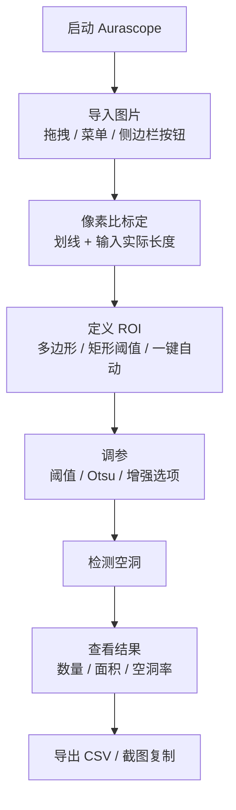
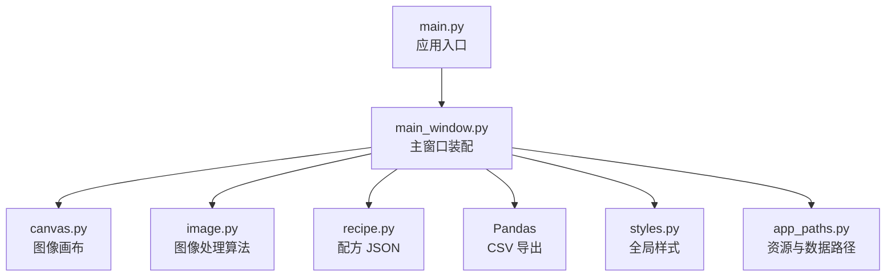

# 快速开始

<cite>
**本文引用的文件**   
- [README.md](file://README.md)
- [PROJECT_CONCEPTION.md](file://PROJECT_CONCEPTION.md)
- [requirements.txt](file://requirements.txt)
- [main.py](file://main.py)
- [app_paths.py](file://app_paths.py)
- [main_window.py](file://main_window.py)
- [canvas.py](file://canvas.py)
- [image.py](file://image.py)
- [recipe.py](file://recipe.py)
</cite>

## 目录
1. [项目定位与约束](#项目定位与约束)
2. [运行环境与安装](#运行环境与安装)
3. [启动方式](#启动方式)
4. [首次打开图片的最小流程](#首次打开图片的最小流程)
5. [单张图片空洞检测示例](#单张图片空洞检测示例)
6. [界面入口与操作约定](#界面入口与操作约定)
7. [产物 CSV 位置与关键字段](#产物-csv-位置与关键字段)
8. [常见问题与已知限制](#常见问题与已知限制)
9. [附录：模块依赖关系](#附录模块依赖关系)

## 项目定位与约束

Aurascope 是面向微电子封装产线的半自动化视觉检测桌面工具，核心目标是替代人工目检和手算。它把重复性高、容易出错的量化工作标准化，工程师负责最终决策。

当前覆盖的业务主线包括：
- 金锡焊料空洞率检测
- 缺陷面积测量（多 ROI）
- 物料计数
- 剪切力计算
- 图像拼接
- 批量示教与批量检测

产品约束如下：
- 单机运行，不联网，不收集用户数据
- 纯 CPU 计算，不依赖 GPU
- 兼容 Windows 7+
- 算法逻辑集中在 image.py，GUI 层不得内联实现图像算法

这些约束来自项目构思说明与 README 的技术栈描述；实际代码结构以 main_window.py、canvas.py、image.py、recipe.py 为准。

**章节来源**
- [README.md:1-41](file://README.md#L1-L41)
- [PROJECT_CONCEPTION.md:3-14](file://PROJECT_CONCEPTION.md#L3-L14)
- [PROJECT_CONCEPTION.md:103-108](file://PROJECT_CONCEPTION.md#L103-L108)

## 运行环境与安装

### 环境要求
- Python 3.10+
- Windows 7+
- PyQt6
- OpenCV
- NumPy
- Pandas
- tifffile

### 安装步骤
在仓库根目录执行：
```bash
pip install -r requirements.txt
```

requirements.txt 中声明的最低版本为：
- PyQt6>=6.4.0
- opencv-python>=4.8.0
- numpy>=1.24.0
- pandas>=1.5.0
- tifffile>=2023.7.8

tifffile 用于读取 TIF/TIFF 图像；若读取失败，main_window.py 会回退到 OpenCV 解码路径。

**章节来源**
- [README.md:18-41](file://README.md#L18-L41)
- [requirements.txt:1-6](file://requirements.txt#L1-L6)
- [main_window.py:771-821](file://main_window.py#L771-L821)

## 启动方式

启动命令：
```bash
python main.py
```

main.py 的职责是：
- 设置日志与异常钩子
- 创建 QApplication
- 启用 HighDPI PassThrough
- 加载全局样式表 styles.py
- 设置窗口图标
- 实例化并显示 MainWindow

资源路径由 app_paths.py 提供，支持源码运行与 PyInstaller 打包两种 base 目录。

**章节来源**
- [README.md:29-33](file://README.md#L29-L33)
- [main.py:1-44](file://main.py#L1-L44)
- [app_paths.py:8-18](file://app_paths.py#L8-L18)

## 首次打开图片的最小流程

对首次接触 Aurascope 的微电子检测工程师，推荐按以下顺序操作：

1. **导入图片**
   - 拖拽 PNG/JPG/BMP/TIF 到主窗口
   - 或点击「空洞分析」侧边栏的「点击上传 SEM 图片」
   - 或通过菜单「文件 → 打开图片…」

2. **像素比标定**
   - 点击「划线标定」
   - 在图上画一条参考线
   - 输入标尺实际长度（单位 μm）
   - 成功后状态栏显示像素比

3. **定义 ROI**
   - 使用「多边形框选」手动绘制焊料区域
   - 或使用「矩形框+阈值」框选后调阈值确认
   - 也可点击「一键自动 ROI」先框选大致区域再自动提取边界

4. **调参**
   - 调整「识别阈值」
   - 可点击「自动 (Otsu)」自动计算阈值
   - 根据需要开启 CLAHE、形态学去噪、圆度过滤、Canny 边缘验证

5. **检测**
   - 调整阈值时会自动触发 calculate_voids
   - 查看左侧结果区中的空洞数量、总面积、空洞率

6. **查看结果与导出**
   - 点击「导出数据」查看详细表格
   - 点击「截图复制」将叠加图复制到剪贴板
   - 通过导出对话框保存 CSV

注意：如果只完成空洞检测而不做像素比标定，软件仍可输出像素级结果，但微米级面积和空洞率换算可能不准确。



[本图为概念流程图，不直接映射具体源码文件]

**章节来源**
- [main_window.py:230-287](file://main_window.py#L230-L287)
- [main_window.py:736-769](file://main_window.py#L736-L769)
- [main_window.py:865-905](file://main_window.py#L865-L905)
- [main_window.py:906-1031](file://main_window.py#L906-L1031)
- [main_window.py:1198-1274](file://main_window.py#L1198-L1274)
- [main_window.py:1615-1688](file://main_window.py#L1615-L1688)

## 单张图片空洞检测示例

下面以一张金锡焊料 SEM 图为例，演示完整操作。

### 前置条件
- 已安装 Python 3.10+ 及 requirements.txt 依赖
- 已执行 `python main.py`
- 已准备好一张 PNG/JPG/BMP/TIF 图片

### 操作步骤

| 步骤 | 操作 | 目的 | 预期结果 |
|------|------|------|----------|
| 1 | 拖入图片到主窗口 | 载入图像 | 右侧画布显示图片，左侧控件可用 |
| 2 | 点击「划线标定」并在图上画参考线 | 建立像素与实际尺寸关系 | 弹出输入框，输入 μm 后显示像素比 |
| 3 | 点击「多边形框选」或「矩形框+阈值」 | 定义焊料 ROI | 绿色蒙版显示选区 |
| 4 | 点击「自动 (Otsu)」或拖动「识别阈值」滑块 | 确定空洞二值化阈值 | 红色空洞轮廓出现在图上 |
| 5 | 观察左侧结果区 | 查看统计 | 显示空洞数量、总面积、空洞率 |
| 6 | 点击「导出数据」 | 查看逐空洞明细 | 弹出表格，包含 ID、面积、长宽、圆度等 |
| 7 | 点击「导出 CSV」 | 保存检测结果 | 选择路径后生成 CSV |

### 关键参数说明

- **识别阈值**：控制空洞二值化的明暗分界
- **面积过滤**：最小/最大像素面积，用于排除噪声或过大伪影
- **边界腐蚀**：将 ROI 边界向内收缩，断开边界伪影与空洞连通
- **CLAHE 对比度增强**：改善光照不均图像的局部对比度
- **形态学去噪**：开运算去除小噪声
- **圆度过滤**：根据面积与周长计算圆度，筛除非圆形噪点
- **Canny 边缘验证**：空洞轮廓需与真实图像边缘有一定重合比例

### 结果解读

- 若像素比未标定，面积显示为像素值
- 若像素比已标定，面积显示为 μm²
- 空洞率 = 所有空洞像素面积之和 ÷ ROI 像素面积
- 导出 CSV 前建议先完成像素比标定，否则微米级字段无物理意义

**章节来源**
- [main_window.py:736-769](file://main_window.py#L736-L769)
- [main_window.py:865-905](file://main_window.py#L865-L905)
- [main_window.py:906-1031](file://main_window.py#L906-L1031)
- [main_window.py:1198-1274](file://main_window.py#L1198-L1274)
- [main_window.py:1615-1688](file://main_window.py#L1615-L1688)

## 界面入口与操作约定

### 主窗口 Tab 布局
MainWindow 装配了多个业务 Tab：
- ROI（缺陷面积）
- 空洞分析
- 示教/批量
- 剪切力计算
- 物料计数
- 图像拼接

空洞分析 Tab 采用左右分割布局：
- 左侧：侧边栏控件（导入、标定、ROI、检测、结果、导出）
- 右侧：ImageCanvas 图像画布

### 图片导入方式
- 拖拽单张图片 → 进入 ROI 页
- 拖拽多张图片 → 进入图像拼接页
- 拖拽文件夹 → 进入示教/批量页
- 菜单「文件 → 打开图片…」→ 进入 ROI 页

### 画布交互约定
ImageCanvas 统一提供：
- 滚轮缩放
- 右键平移
- 原图坐标 ↔ 屏幕坐标转换
- 多边形 ROI 编辑
- 校准线绘制
- 空洞轮廓渲染
- 局部笔刷区域渲染

### 重要 UI 约定
- styles.py 提供全局 QSS 与设计 token
- ui_components.py 的 create_* 工厂函数只创建控件、不加入布局
- create_groupbox() 必须使用 Preferred/Expanding 尺寸策略，否则控件被静默裁剪
- Canvas 层为 QWidget + QPainter 自绘

**章节来源**
- [main_window.py:96-149](file://main_window.py#L96-L149)
- [main_window.py:230-287](file://main_window.py#L230-L287)
- [main_window.py:394-479](file://main_window.py#L394-L479)
- [canvas.py:13-29](file://canvas.py#L13-L29)
- [canvas.py:152-164](file://canvas.py#L152-L164)

## 产物 CSV 位置与关键字段

### 导出入口
空洞分析页的「导出数据」按钮会先弹出详细表格；CSV 导出由 show_detail_table 内部调用 export_csv 触发。

export_csv 的行为：
- 文件名默认格式：`空洞分析_YYYYMMDD_HHMMSS.csv`
- 通过 QFileDialog.getSaveFileName 让用户选择保存路径
- 若 pixel_scale > 0，则按像素比换算微米级字段
- 若 pixel_scale == 0，则 fallback 使用 1.0 作为换算比例

### 关键字段
CSV 中每行对应一个空洞，主要字段包括：
- id：空洞编号
- area_um：空洞面积（μm²）
- max_l：外接矩形较长边（μm）
- min_l：外接矩形较短边（μm）
- roundness：圆度

当像素比未标定时，这些微米字段基于像素值换算，不代表真实物理尺寸。

### 产物位置
CSV 不会自动写入固定目录，而是由用户在导出对话框中选择保存位置。  
配方 JSON 才默认写入 recipes/ 目录；两者不要混淆。

**章节来源**
- [main_window.py:1622-1688](file://main_window.py#L1622-L1688)
- [recipe.py:69-96](file://recipe.py#L69-L96)

## 常见问题与已知限制

### 常见问题
- **TIF 无法打开**：检查 tifffile 是否安装；main_window.py 会尝试 tifffile.imread，失败后回退到 cv2.imdecode
- **标定线太短**：finish_calibration 会拒绝小于 5 像素的标定线
- **未检测到有效边界**：矩形阈值 ROI 需要能提取到有效轮廓，否则提示重新框选或调整阈值
- **未定义 ROI 就检测**：calculate_voids 会直接返回，不会报错
- **未定义 ROI 就自动 Otsu**：auto_otsu_threshold 会提示先定义焊层 ROI

### 已知限制
根据项目交接清单与源码现状，以下问题属于已知技术债或已知行为：
- main_window.py 内存在 detect_voids_local 副本，现行行为以 image.py 为准，两份待合并
- Canny 边缘验证中 edge_map 初始化逻辑存在隐患，可能导致校验静默失效
- chk_roi_overlay 被重复创建，属于 UI 状态管理问题
- canvas.py 滚轮缩放的 Y 轴锚点存在漂移问题，不要把现状写成正确设计
- select_for_local 为无 UI 入口的死代码
- 大图增强检测没有进度提示

这些限制不应影响基础空洞检测流程，但在复杂场景下可能影响结果稳定性。

**章节来源**
- [main_window.py:771-821](file://main_window.py#L771-L821)
- [main_window.py:873-905](file://main_window.py#L873-L905)
- [main_window.py:984-1004](file://main_window.py#L984-L1004)
- [main_window.py:1198-1274](file://main_window.py#L1198-L1274)
- [image.py:228-234](file://image.py#L228-L234)
- [canvas.py:626-706](file://canvas.py#L626-L706)

## 附录：模块依赖关系

Aurascope 的代码分层如下：
- GUI 层：main.py、main_window.py、各 Tab 页面
- Canvas 绘制层：canvas.py 及各业务画布
- 算法层：image.py
- 数据导出层：Pandas → CSV
- 配方层：recipe.py



**图表来源**
- [main.py:1-44](file://main.py#L1-L44)
- [main_window.py:1-50](file://main_window.py#L1-L50)
- [canvas.py:1-11](file://canvas.py#L1-L11)
- [image.py:1-12](file://image.py#L1-L12)
- [recipe.py:1-19](file://recipe.py#L1-L19)
- [app_paths.py:1-11](file://app_paths.py#L1-L11)

**章节来源**
- [PROJECT_CONCEPTION.md:77-108](file://PROJECT_CONCEPTION.md#L77-L108)
- [main_window.py:1-50](file://main_window.py#L1-L50)
- [image.py:1-12](file://image.py#L1-L12)
- [canvas.py:1-11](file://canvas.py#L1-L11)
- [recipe.py:1-19](file://recipe.py#L1-L19)