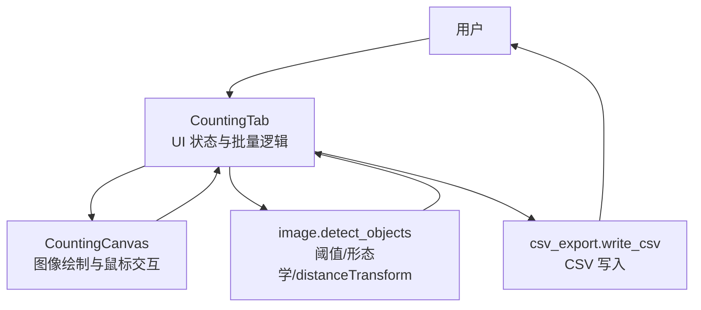
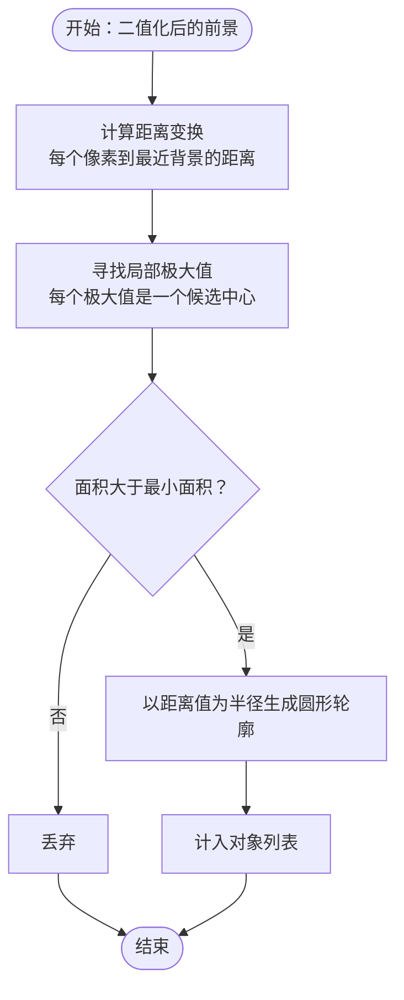
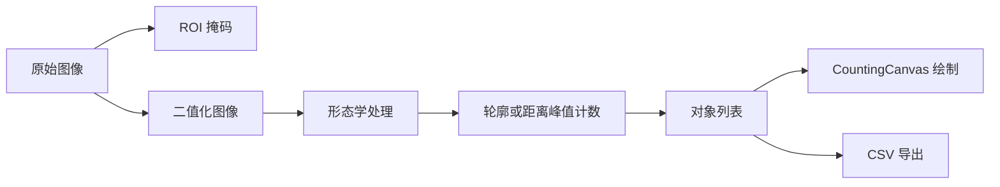
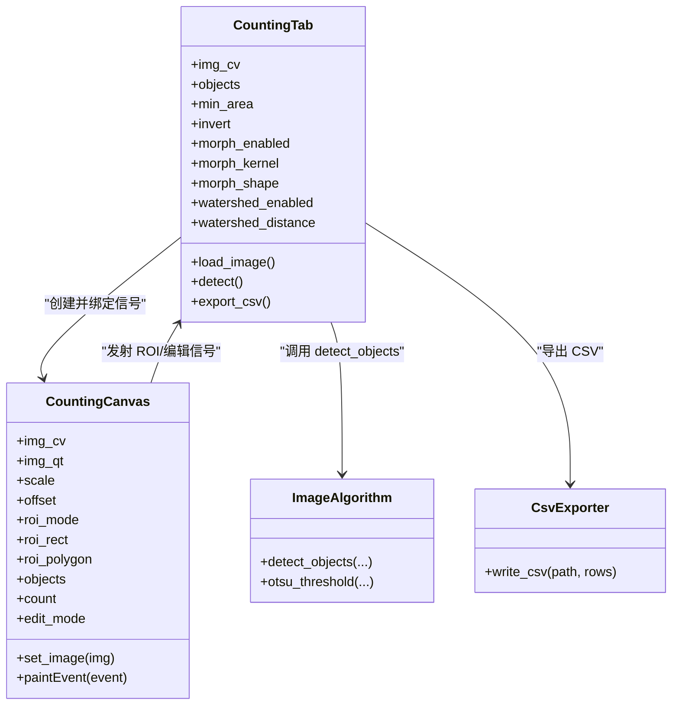

# 物料计数页面

<cite>
**本文引用的文件**   
- [counting_tab.py](file://counting_tab.py)
- [counting_canvas.py](file://counting_canvas.py)
- [image.py](file://image.py)
- [csv_export.py](file://csv_export.py)
- [README.md](file://README.md)
- [PROJECT_CONCEPTION.md](file://PROJECT_CONCEPTION.md)
</cite>

## 目录
1. [简介](#简介)
2. [页面职责分工](#页面职责分工)
3. [使用流程](#使用流程)
4. [距离变换局部极大值计数原理](#距离变换局部极大值计数原理)
5. [结果字段与可视化对应关系](#结果字段与可视化对应关系)
6. [最小用例：对含多个 Submount 的图片自动计数并导出](#最小用例对含多个-submount-的图片自动计数并导出)
7. [常见问题与调整建议](#常见问题与调整建议)
8. [架构与依赖关系](#架构与依赖关系)
9. [结论](#结论)

## 简介
物料计数页面用于蓝膜上 LD / Submount 等离散物料的来料点数。用户导入图片后框选检测区域，调节二值化、形态学去噪和距离峰值分离参数，系统自动输出每个物体的编号、面积、中心坐标、外接矩形等信息；用户可手动添加遗漏或删除误检，最终导出 CSV。

该功能属于 Aurascope 的四大业务主线之一，面向产线与仓管人员替代人工点数，核心目标是“可复现、少出错、可手工修正”。

**章节来源**
- [README.md:7-14](file://README.md#L7-L14)
- [PROJECT_CONCEPTION.md:38-45](file://PROJECT_CONCEPTION.md#L38-L45)

## 页面职责分工
物料计数页面由两个主要文件组成，职责清晰分层：

| 文件 | 角色 | 主要职责 |
|---|---|---|
| `counting_tab.py` | UI 控制层 | 管理图片、ROI、检测参数、防抖重算、对象列表、结果统计与 CSV 导出；调用算法层 `image.detect_objects` |
| `counting_canvas.py` | 可视化交互层 | 显示原图、绘制 ROI、绘制检测结果多边形、处理缩放/平移、响应鼠标进行框选、添加、删除 |
| `image.py` | 算法层 | 实现 CLAHE 增强、阈值、形态学、轮廓提取、distanceTransform 局部极大值计数、连通域分析 |
| `csv_export.py` | 数据导出层 | 用标准库 csv 写入 UTF-8-SIG CSV，保证 Excel 打开不乱码 |

**图表来源**
- [counting_tab.py:19-171](file://counting_tab.py#L19-L171)
- [counting_canvas.py:10-16](file://counting_canvas.py#L10-L16)
- [image.py:491-632](file://image.py#L491-L632)
- [csv_export.py:27-51](file://csv_export.py#L27-L51)

**章节来源**
- [counting_tab.py:19-171](file://counting_tab.py#L19-L171)
- [counting_canvas.py:10-56](file://counting_canvas.py#L10-L56)
- [PROJECT_CONCEPTION.md:77-107](file://PROJECT_CONCEPTION.md#L77-L107)

## 使用流程
下面按实际操作顺序说明。

### 第一步：导入图片
1. 点击左侧边栏「上传图片」。
2. 选择 PNG、JPG、JPEG、BMP、TIF 格式图片。
3. 图片加载成功后，画布会自适应显示，右侧检测控件暂时禁用，直到完成 ROI 框选。

此时 `CountingCanvas` 负责把 OpenCV BGR 图像转为 Qt 图像并执行初始缩放；`CountingTab` 清空已有对象列表，避免旧结果干扰。

**章节来源**
- [counting_tab.py:181-196](file://counting_tab.py#L181-L196)
- [counting_canvas.py:42-56](file://counting_canvas.py#L42-L56)

### 第二步：框选 ROI
有两种 ROI 模式：

| 模式 | 操作方式 | 适用场景 |
|---|---|---|
| 矩形框选 | 点击「矩形框选」，在画布上拖拽拉出蓝色矩形 | 整张蓝膜或规则区域 |
| 多边形框选 | 点击「多边形框选」，依次点击顶点，闭合第一个点或双击结束 | 不规则检测区 |

完成 ROI 后，侧边栏检测控件启用，系统自动开始计数。若没有有效 ROI，对象列表会被清空并同步到画布。

**章节来源**
- [counting_tab.py:74-89](file://counting_tab.py#L74-L89)
- [counting_tab.py:198-234](file://counting_tab.py#L198-L234)
- [counting_tab.py:289-296](file://counting_tab.py#L289-L296)
- [counting_canvas.py:87-105](file://counting_canvas.py#L87-L105)
- [counting_canvas.py:113-122](file://counting_canvas.py#L113-L122)

### 第三步：调节二值化与形态学参数
进入「检测设置」后，可调参数如下：

| 控件 | 含义 | 调整建议 |
|---|---|---|
| 检测亮色物体 | 是否把较亮的 Submount/LD 作为目标 | 默认勾选；若背景更亮则取消 |
| 二值化阈值 | 灰度阈值，低于或高于该值被归为目标 | 先点「自动阈值 Otsu」，再微调 |
| 自动阈值 Otsu | 基于 ROI 内像素分布计算最佳阈值 | 光照不均时优先使用 |
| 最小面积 | 过滤小于该像素面积的噪声 | 过小会保留噪点，过大可能吞掉小物料 |
| 形态学去噪 | 开运算 + 闭运算清理毛刺、填补空洞 | 粘连严重时适当增大核大小 |
| 核大小 | 形态学结构元素尺寸 | 必须为奇数，偶数会自动减一 |
| 形状 | 椭圆、矩形、十字 | 一般保持椭圆即可 |
| 距离峰值计数 | 启用 distanceTransform 局部极大值分离粘连 | 相邻物体粘连时开启 |
| 最小间距 | 控制距离峰值分离保守程度 | 越大越保守，但可能漏掉紧密相邻物 |

注意：所有参数变化都会触发 150ms 防抖延迟后重新检测，避免拖动滑块时界面卡顿。

**章节来源**
- [counting_tab.py:91-148](file://counting_tab.py#L91-L148)
- [counting_tab.py:321-361](file://counting_tab.py#L321-L361)
- [counting_tab.py:363-365](file://counting_tab.py#L363-L365)

### 第四步：执行计数
点击任意参数控件或完成 ROI 后，`CountingTab.detect()` 启动定时器，实际计算在 `_do_detect()` 中执行：

1. 根据当前 ROI 生成全图掩码。
2. 将原图转灰度。
3. 读取阈值、最小面积、形态学开关、watershed 开关等参数。
4. 调用 `image.detect_objects` 得到对象列表。
5. 同步到 `CountingCanvas` 并重绘。
6. 更新侧边栏「数量」标签。

**章节来源**
- [counting_tab.py:363-423](file://counting_tab.py#L363-L423)
- [image.py:491-632](file://image.py#L491-L632)

### 第五步：查看计数结果
成功计数后，画布上每个对象会显示：

- 半透明红色多边形覆盖层
- 白色编号
- 右上角总数标签

对象坐标、面积、外接矩形都保存在 `CountingTab.objects` 列表中，供后续导出和手动编辑使用。

**章节来源**
- [counting_canvas.py:201-214](file://counting_canvas.py#L201-L214)
- [counting_canvas.py:251-263](file://counting_canvas.py#L251-L263)
- [counting_tab.py:416-423](file://counting_tab.py#L416-L423)

### 第六步：手动增删修正
手动编辑分为两种模式：

| 模式 | 作用 | 操作 |
|---|---|---|
| 添加遗漏 | 补测漏掉的 Submount/LD | 点击「添加遗漏」，在画布上点击目标位置 |
| 删除多选 | 删除误检对象 | 点击「删除多选」，悬停高亮后点击删除 |

添加操作会在点击位置生成一个半径约 8 像素的圆形多边形，计算其面积、外接矩形和中心坐标，并追加到对象列表。删除操作通过多边形包含测试判断点击点落在哪个对象内部。

**章节来源**
- [counting_tab.py:152-160](file://counting_tab.py#L152-L160)
- [counting_tab.py:236-287](file://counting_tab.py#L236-L287)
- [counting_tab.py:246-253](file://counting_tab.py#L246-L253)
- [counting_canvas.py:146-154](file://counting_canvas.py#L146-L154)

### 第七步：导出 CSV
点击「导出 CSV」后弹出保存对话框，默认文件名带时间戳。程序遍历当前对象列表，写出编号、面积、中心 X/Y、宽度、高度五列。

如果没有任何对象，会提示“没有数据可导出”。

**章节来源**
- [counting_tab.py:425-445](file://counting_tab.py#L425-L445)
- [csv_export.py:27-51](file://csv_export.py#L27-L51)

## 距离变换局部极大值计数原理
本节面向用户解释，不展开数学推导。

当 Submount/LD 彼此靠近甚至粘连时，普通轮廓提取会把它们当成一个大块，导致欠计数。距离变换的思路是：

1. 先把图像二值化，让目标变成白色前景。
2. 对每个前景像素计算它离最近背景像素的距离。
3. 物体中心附近距离最大，边缘附近距离接近零。
4. 寻找这些距离图中的“局部极大值”，每个极大值代表一个潜在物体中心。
5. 以极大值为中心，用距离值作为半径画出近似圆形轮廓。
6. 过滤太小或不符合最小面积要求的轮廓。

对用户来说，这个功能可以理解为：**系统先找每个物体的中心点，再用中心点到边缘的距离估计物体大小，从而把粘在一起的物体拆开**。

「最小间距」越大，系统越保守，只接受相距较远的峰值；太小则容易把一个物体识别成多个峰值，造成过计数。

**图表来源**
- [image.py:544-572](file://image.py#L544-L572)

**章节来源**
- [PROJECT_CONCEPTION.md:40-44](file://PROJECT_CONCEPTION.md#L40-L44)
- [image.py:544-572](file://image.py#L544-L572)

## 结果字段与可视化对应关系
### 导出 CSV 字段
| 字段名 | 含义 | 单位或说明 |
|---|---|---|
| 编号 | 对象 ID，从 1 开始递增 | 人工修正后会重新分配 |
| 面积(像素) | 对象多边形的像素面积 | 不是物理面积，需标定后才能换算 |
| 中心X | 对象中心横坐标 | 原始图像坐标系下的像素值 |
| 中心Y | 对象中心纵坐标 | 原始图像坐标系下的像素值 |
| 宽度 | 对象外接矩形宽度 | 像素 |
| 高度 | 对象外接矩形高度 | 像素 |

### 与画布可视化的对应关系
- **编号**：画布上每个对象多边形内部的白色数字。
- **中心X / 中心Y**：画布上编号文字所在位置对应的原始图像坐标。
- **宽度 / 高度**：对象外接矩形的宽高，不是多边形边界框的实际测量值，而是 `cv2.boundingRect` 的结果。
- **面积(像素)**：对象多边形面积，distanceTransform 模式下为圆形近似多边形面积，轮廓模式下为真实轮廓面积。
- **掩码**：用户框选的 ROI 不参与导出，但会影响哪些区域参与计数。
- **原始图**：画布背景即为导入的原图，所有坐标均相对于原始图分辨率，而不是屏幕像素。

**图表来源**
- [counting_tab.py:390-412](file://counting_tab.py#L390-L412)
- [image.py:527-572](file://image.py#L527-L572)
- [counting_canvas.py:184-214](file://counting_canvas.py#L184-L214)
- [counting_tab.py:434-445](file://counting_tab.py#L434-L445)

**章节来源**
- [counting_tab.py:425-445](file://counting_tab.py#L425-L445)
- [counting_canvas.py:201-214](file://counting_canvas.py#L201-L214)
- [image.py:567-570](file://image.py#L567-L570)

## 最小用例：对含多个 Submount 的图片自动计数并导出
以下是一个可直接照做的最小流程：

1. 启动 Aurascope，进入「物料计数」页面。
2. 点击「上传图片」，选择一张包含多个 Submount 的蓝膜图片。
3. 点击「矩形框选」，拖拽出一个覆盖全部 Submount 的蓝色矩形。
4. 等待自动计数完成，观察画布上的红色多边形和编号。
5. 如果背景有噪点，调低「二值化阈值」或提高「最小面积」。
6. 如果相邻 Submount 粘连成一个块，勾选「距离峰值计数（分离粘连物体）」，并把「最小间距」调到 10 左右。
7. 如果某个 Submount 没被检测到，点击「添加遗漏」，在其中心点击一次。
8. 如果某个噪点被误检，点击「删除多选」，悬停到误检对象后点击删除。
9. 确认结果满意后，点击「导出 CSV」，保存到常用目录。
10. 用 Excel 打开 CSV，核对编号、面积、中心坐标是否与图片一致。

预期产物：
- 一个 `.csv` 文件，编码为 UTF-8-SIG，Excel 双击打开不会乱码。
- 文件路径由用户在保存对话框中选择，不在软件内部固定目录。

**章节来源**
- [counting_tab.py:181-196](file://counting_tab.py#L181-L196)
- [counting_tab.py:289-296](file://counting_tab.py#L289-L296)
- [counting_tab.py:321-361](file://counting_tab.py#L321-L361)
- [counting_tab.py:425-445](file://counting_tab.py#L425-L445)
- [csv_export.py:1-8](file://csv_export.py#L1-L8)

## 常见问题与调整建议

### 背景噪声导致过计数
**现象**：空白背景出现很多小红点，编号远多于实际 Submount 数量。

**原因**：二值化阈值过低，或最小面积太小，把噪声当成了物体。

**建议**：
- 先点击「自动阈值 Otsu」。
- 提高「二值化阈值」，使背景变黑、目标变白。
- 提高「最小面积」，过滤小噪点。
- 开启「形态学去噪」，适当增大核大小。
- 关闭「距离峰值计数」，因为噪声通常不会产生稳定的距离极大值。

**章节来源**
- [counting_tab.py:96-148](file://counting_tab.py#L96-L148)
- [counting_tab.py:330-351](file://counting_tab.py#L330-L351)
- [image.py:527-540](file://image.py#L527-L540)

### 相邻物体粘连导致欠计数
**现象**：两个或多个 Submount 连在一起，只计为一个对象。

**原因**：普通轮廓提取无法区分粘连区域。

**建议**：
- 勾选「距离峰值计数（分离粘连物体）」。
- 逐步增大「最小间距」，直到粘连物体被拆成多个编号。
- 如果拆分过度，减小「最小间距」。
- 配合形态学去噪，先清理毛刺再分离。

**章节来源**
- [counting_tab.py:133-145](file://counting_tab.py#L133-L145)
- [counting_tab.py:353-361](file://counting_tab.py#L353-L361)
- [image.py:544-572](file://image.py#L544-L572)

### ROI 过小
**现象**：部分 Submount 未被框选，计数偏少。

**建议**：
- 重新框选更大的矩形或多边形。
- 使用「重新框选」重置 ROI。
- 确保 ROI 至少包含所有待测物体。

**章节来源**
- [counting_tab.py:219-234](file://counting_tab.py#L219-L234)
- [counting_tab.py:373-388](file://counting_tab.py#L373-L388)

### ROI 过大
**现象**：背景噪声增多，计数偏多。

**建议**：
- 缩小 ROI，只框选有 Submount 的区域。
- 提高「二值化阈值」和「最小面积」。
- 开启形态学去噪。
- 必要时关闭「距离峰值计数」，避免背景伪峰值。

**章节来源**
- [counting_tab.py:390-412](file://counting_tab.py#L390-L412)
- [image.py:542-543](file://image.py#L542-L543)

### 手动编辑后编号不连续
**现象**：删除中间对象后，编号可能出现跳跃。

**说明**：编号是对象创建时的自增 ID，删除不会重新排序。这是正常行为，不影响面积、坐标和导出结果。

**章节来源**
- [counting_tab.py:275-286](file://counting_tab.py#L275-L286)

## 架构与依赖关系
物料计数页面的代码依赖方向严格遵循项目约定：GUI 层不内联实现图像算法，算法集中在 `image.py`，Canvas 层只做绘制与交互。

**图表来源**
- [counting_tab.py:19-171](file://counting_tab.py#L19-L171)
- [counting_canvas.py:10-56](file://counting_canvas.py#L10-L56)
- [image.py:491-632](file://image.py#L491-L632)
- [csv_export.py:27-51](file://csv_export.py#L27-L51)

**章节来源**
- [PROJECT_CONCEPTION.md:77-107](file://PROJECT_CONCEPTION.md#L77-L107)
- [counting_tab.py:10-16](file://counting_tab.py#L10-L16)
- [counting_canvas.py:1-8](file://counting_canvas.py#L1-L8)

## 结论
物料计数页面把“导入图片 → 框选 ROI → 调参 → 自动计数 → 手动修正 → 导出 CSV”这一重复性任务标准化。`counting_tab.py` 负责状态管理与业务流程，`counting_canvas.py` 负责图像可视化与鼠标交互，`image.py` 负责二值化、形态学与 distanceTransform 局部极大值计数，`csv_export.py` 负责稳定导出。

对于蓝膜上 LD / Submount 的来料点数，推荐先用 Otsu 自动阈值确定基础效果，再根据噪声和粘连情况分别调整形态学去噪与距离峰值分离参数；最后通过手动添加和删除完成最终决策。这样既能减少人工点数错误，又能保留工程师的最终控制权。