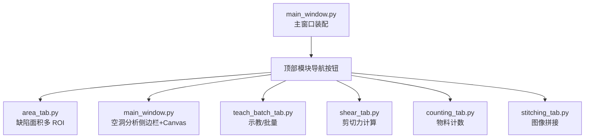

# 用户手册

<cite>
**本文引用的文件**   
- [README.md](file://README.md)
- [PROJECT_CONCEPTION.md](file://PROJECT_CONCEPTION.md)
- [说明书.md](file://说明书.md)
- [main.py](file://main.py)
- [main_window.py](file://main_window.py)
- [app_paths.py](file://app_paths.py)
- [styles.py](file://styles.py)
- [ui_components.py](file://ui_components.py)
- [area_tab.py](file://area_tab.py)
- [area_canvas.py](file://area_canvas.py)
- [counting_tab.py](file://counting_tab.py)
- [counting_canvas.py](file://counting_canvas.py)
- [measure_tab.py](file://measure_tab.py)
- [measure_canvas.py](file://measure_canvas.py)
- [shear_tab.py](file://shear_tab.py)
- [stitching_tab.py](file://stitching_tab.py)
</cite>

## 目录
1. [简介](#简介)
2. [项目结构与导航起点](#项目结构与导航起点)
3. [通用交互约定](#通用交互约定)
4. [空洞分析页面](#空洞分析页面)
5. [缺陷面积多 ROI 页面](#缺陷面积多-roi-页面)
6. [物料计数页面](#物料计数页面)
7. [距离测量页面](#距离测量页面)
8. [剪切力计算页面](#剪切力计算页面)
9. [图像拼接页面](#图像拼接页面)
10. [示教/批量检测页面](#示教批量检测页面)
11. [导出产物与数据字段说明](#导出产物与数据字段说明)
12. [常见问题与排错](#常见问题与排错)
13. [结论](#结论)

## 简介
Aurascope 是面向微电子封装产线的半自动化视觉检测与数据分析桌面工具。它把金锡焊料空洞率检测、芯片剪切力标准校核、蓝膜物料计数、微观尺寸测量和图像拼接等重复性工作标准化，让工程师通过导入图片、框选区域、调节参数得到可复现的检测结果，并导出 CSV、标注图或配方 JSON。

产品定位不是“全自动 AI 判断”，而是替代人工目检和手算：工程师负责最终决策，软件负责减少误判、提高一致性和报告产出效率。

**章节来源**
- [README.md:1-15](file://README.md#L1-L15)
- [PROJECT_CONCEPTION.md:1-14](file://PROJECT_CONCEPTION.md#L1-L14)

## 项目结构与导航起点
主窗口由 `main_window.py` 装配，顶部品牌栏提供七个业务模块入口；默认打开第一个标签页「ROI」，即缺陷面积多 ROI 页面。

| 顶部按钮 | 对应 Tab | 主要用途 |
|---|---|---|
| ROI | 缺陷面积多 ROI | 多 ROI 阈值检测、缺陷统计、距离测量 |
| 空洞分析 | 独立 Canvas + 侧边栏 | 金锡焊料空洞率检测、局部阈值、增强过滤 |
| 示教/批量 | TeachBatchTab | 快速示教、完整示教、批量检测、配方管理 |
| 剪切力计算 | ShearTab | MIL-STD-883H Method 2019.9 剪切力要求计算 |
| 物料计数 | CountingTab | 蓝膜 LD / Submount 离散物料计数 |
| 图像拼接 | StitchingTab | 多张切片按金锡水平线拼接 |

**图表来源**
- [main_window.py:96-149](file://main_window.py#L96-L149)
- [main_window.py:181-223](file://main_window.py#L181-L223)

**章节来源**
- [main_window.py:53-149](file://main_window.py#L53-L149)
- [main_window.py:181-223](file://main_window.py#L181-L223)
- [README.md:42-64](file://README.md#L42-L64)

## 通用交互约定
所有画布类组件都遵循以下约定：

| 操作 | 行为 | 注意事项 |
|---|---|---|
| 拖拽导入图片 | 单张图片进入 ROI 页；多张图片进入图像拼接；文件夹进入示教/批量 | 支持 PNG/JPG/BMP/TIF |
| 滚轮缩放 | 以鼠标位置为锚点缩放 | 当前实现存在 Y 轴漂移已知问题，不要视为正确设计 |
| 右键拖拽 | 平移图像 | 左键拖拽 ROI 时若被右键打断，不会提交意外区域 |
| 多边形 ROI | 点击添加顶点，双击闭合；ESC 取消 | 空洞分析页还保留多边形编辑模式 |
| Ctrl+Z | 撤销空洞分析中的手动增删 | 最多 30 步 |
| ESC | 取消草图、退出添加预览或工具模式 | 不执行破坏性操作 |
| Shift+滚轮 | 调节局部笔刷区域阈值（空洞分析） | 仅空洞分析局部阈值生效 |
| Delete | 删除选中顶点（空洞分析多边形编辑） | 不影响 ROI 本身 |

注意：`canvas.py` 中 ImageCanvas 的滚轮缩放存在 Y 轴漂移已知问题；文档不应把它描述为“以锚点为中心的正确缩放”。实际体验应以源码为准。

**章节来源**
- [main_window.py:257-287](file://main_window.py#L257-L287)
- [area_canvas.py:332-340](file://area_canvas.py#L332-L340)
- [area_canvas.py:215-330](file://area_canvas.py#L215-L330)
- [PROJECT_CONCEPTION.md:55-60](file://PROJECT_CONCEPTION.md#L55-L60)

## 空洞分析页面
### 入口位置
- 顶部导航栏第二个按钮：**空洞分析**。
- 也可从「帮助 → 使用说明」查看该页流程。

### 关键控件
- **点击上传 SEM 图片**：加载单张 SEM/X 光图。
- **比例尺标定**：划线后输入实际长度（μm）。
- **多边形框选 / 矩形框+阈值**：定义焊料层 ROI。
- **自动 (Otsu)**：对当前矩形框区域自动计算识别阈值。
- **确认选区 / 重置/清除选区**：完成或清空 ROI。
- **一键自动 ROI**：拖出大致区域后自动提取边界多边形。
- **识别阈值滑块**：手动调整空洞检测阈值。
- **编号 / 红色填充**：控制结果可视化。
- **面积过滤**：最小/最大像素面积。
- **删除 / 添加 / 撤销**：手动修正空洞。
- **高级设置**：CLAHE、形态学去噪、圆度过滤、Canny 边缘验证、局部阈值调节。
- **截图复制 / 导出数据**：结果导出入口。

### 操作步骤
1. 点击「点击上传 SEM 图片」选择 PNG/JPG/BMP/TIF。
2. 点击「划线标定」在图上画参考线，输入实际长度（μm）。
3. 使用「多边形框选」或「矩形框+阈值」划定焊料区域；必要时用「一键自动 ROI」。
4. 点击「自动 (Otsu)」或拖动「识别阈值」进行空洞检测。
5. 开启「编号」「红色填充」查看结果。
6. 使用「删除」点击误检，「添加」单击空洞内部触发局部 Otsu，Ctrl+滚轮调偏移，双击确认。
7. 点击「截图复制」到剪贴板，点击「导出数据」查看明细并导出 CSV。

### 参数含义
- **识别阈值**：二值化分界值，越大越难检出暗色空洞。
- **CLAHE 对比度**：增强局部对比度，适合光照不均 SEM 图。
- **形态学去噪**：开闭运算去除小噪声。
- **圆度过滤**：根据轮廓面积与周长筛除非圆形噪点。
- **Canny 边缘验证**：空洞轮廓需与真实图像边缘重合，否则过滤。
- **局部阈值**：对特定区域覆盖全局阈值，解决局部亮度差异。

### 结果查看方式
- 右侧画布显示原图、ROI 蒙版、空洞轮廓、编号与填充。
- 左侧结果区显示空洞率、数量、面积等信息。
- 「导出数据」弹出表格，可复制到外部表格软件。

### 导出格式
- **截图复制**：系统剪贴板，可直接粘贴到 PPT/Word。
- **CSV 明细**：包含空洞编号、像素面积、实际面积、质心坐标、来源等字段。

### 最小可复现用例
1. 打开任意 SEM 金锡焊料图。
2. 划线标定 10 μm。
3. 矩形框选焊料区，拖动阈值后点击「确认选区」。
4. 点击「自动 (Otsu)」。
5. 勾选「编号」和「红色填充」。
6. 点击「导出数据」保存 CSV。

**章节来源**
- [main_window.py:110-129](file://main_window.py#L110-L129)
- [main_window.py:394-668](file://main_window.py#L394-L668)
- [说明书.md:66-83](file://说明书.md#L66-L83)

## 缺陷面积多 ROI 页面
### 入口位置
- 默认首页：**ROI**。
- 也可通过「文件 → 打开图片」直接进入该页。

### 关键控件
- **导入图片**
- **比例尺标定 / 清除标定**
- **距离测量 / 删除测距 / 清空测距**
- **矩形框选 / 多边形框选**
- **删除当前 ROI / 清空全部 ROI**
- **检测全部 ROI / 停止并清空**
- **检测亮色缺陷 / 二值化阈值 / 自动阈值 (Otsu) / 最小面积**
- **添加遗漏 / 删除误检**
- **ROI 总表 / 当前 ROI 缺陷明细**
- **导出 CSV / 导出距离 CSV**

### 操作步骤
1. 点击「导入图片」加载 SEM/X 光图。
2. 可选：点击「划线标定」输入实际长度和单位。
3. 点击「矩形框选」或「多边形框选」绘制一个或多个 ROI。
4. 点击「检测全部 ROI」开始阈值检测。
5. 切换「添加遗漏」后单击预览、双击确认；切换「删除误检」后点击目标删除。
6. 点击「距离测量」依次点击两点记录距离。
7. 点击「导出 CSV」输出全部 ROI 缺陷数据；点击「导出距离 CSV」输出测距记录。

### 参数含义
- **检测亮色缺陷**：True 表示检测亮色孔洞，False 表示检测暗色孔洞。
- **二值化阈值**：灰度图中区分前景与背景的分界值。
- **最小面积**：忽略小于该像素面积的连通域。
- **单位**：nm/µm/mm/cm/m，用于将 px² 换算为实际面积。

### 结果查看方式
- **ROI 总表**：每行一个 ROI，显示状态、阈值、亮/暗、最小面积、缺陷数、总面积。
- **当前 ROI 缺陷明细**：显示编号、像素面积、实际面积、来源。
- **距离统计表**：序号、实际距离、像素距离。

### 导出格式
- **缺陷 CSV**：列包括 ROI 编号、缺陷编号、像素面积、实际面积、面积单位、质心 x/y、来源。
- **距离 CSV**：序号、距离（实际单位）、距离(px)、起点 X/Y、终点 X/Y、约束。

### 最小可复现用例
1. 导入一张含多个焊料区的 SEM 图。
2. 分别绘制两个矩形 ROI。
3. 设置阈值为 127，勾选「检测亮色缺陷」，最小面积设为 1。
4. 点击「检测全部 ROI」。
5. 点击「导出 CSV」。

**章节来源**
- [area_tab.py:110-324](file://area_tab.py#L110-L324)
- [area_tab.py:342-431](file://area_tab.py#L342-L431)
- [area_tab.py:502-543](file://area_tab.py#L502-L543)
- [area_tab.py:659-800](file://area_tab.py#L659-L800)
- [area_canvas.py:85-340](file://area_canvas.py#L85-L340)

## 物料计数页面
### 入口位置
- 顶部导航栏第五个按钮：**物料计数**。

### 关键控件
- **上传图片**
- **矩形框选 / 多边形框选**
- **重新框选**
- **检测亮色物体 / 二值化阈值 / 自动阈值 (Otsu)**
- **最小面积（像素）**
- **形态学去噪 / 核大小 / 形状**
- **距离峰值计数（分离粘连物体）/ 最小间距**
- **添加遗漏 / 删除多选**
- **恢复默认设置**
- **数量结果 / 导出 CSV**

### 操作步骤
1. 点击「上传图片」选择蓝膜上 LD/Submount 图。
2. 框选检测区域。
3. 调节二值化阈值、亮/暗物体、最小面积、形态学去噪、距离峰值计数。
4. 使用「添加遗漏」或「删除多选」手动修正。
5. 点击「导出 CSV」保存计数数据。

### 参数含义
- **检测亮色物体**：True 表示亮色物料，False 表示暗色物料。
- **形态学核大小**：必须为奇数，偶数会自动减 1。
- **形态学形状**：椭圆、矩形、十字。
- **距离峰值计数**：基于 distanceTransform 找局部极大值，适合近似圆形物料分离。
- **最小间距**：启用距离峰值计数后生效。

### 结果查看方式
- 右上角叠加数字编号显示每个物料。
- 左侧大号标签显示总数。
- 导出 CSV 包含编号、面积(像素)、中心 X/Y、宽度、高度。

### 导出格式
- **CSV**：编号、面积(像素)、中心X、中心Y、宽度、高度。

### 最小可复现用例
1. 导入蓝膜物料图。
2. 矩形框选整张图。
3. 点击「自动阈值 (Otsu)」。
4. 勾选「形态学去噪」，核大小设为 3。
5. 点击「导出 CSV」。

**章节来源**
- [counting_tab.py:19-179](file://counting_tab.py#L19-L179)
- [counting_tab.py:363-414](file://counting_tab.py#L363-L414)
- [counting_tab.py:425-447](file://counting_tab.py#L425-L447)
- [counting_canvas.py:10-185](file://counting_canvas.py#L10-L185)

## 距离测量页面
### 入口位置
- 代码注释说明距离测量已并入 ROI Tab；仓库仍保留独立的 `measure_tab.py` 与 `measure_canvas.py`，但主窗口未挂载该独立 Tab。
- 用户应优先使用 **ROI 页面的距离测量功能**；独立 MeasureTab 可作为历史实现参考。

### 关键控件
- **打开图片**
- **划线标定 / 清除**
- **测量模式 / 撤销 / 全部清除**
- **统计卡片**
- **测量数据表格**
- **导出 CSV**

### 操作步骤
1. 点击「打开图片」。
2. 点击「划线标定」画出参考线，输入实际长度。
3. 点击「测量模式」，依次点击两点。
4. 查看统计卡片与表格。
5. 点击「导出 CSV」。

### 参数含义
- **像素比**：像素与实际长度的换算关系。
- **7° 吸附**：接近水平或垂直的线段自动对齐。

### 结果查看方式
- 表格显示序号、距离(μm)、距离(px)。
- 统计卡片显示最小、最大、平均、总距离。

### 导出格式
- **CSV**：序号、距离(μm)、距离(px)、起点X/Y、终点X/Y。

### 最小可复现用例
1. 打开一张带标尺的 SEM 图。
2. 划线标定 50 μm。
3. 点击「测量模式」，测量两条水平线。
4. 点击「导出 CSV」。

**章节来源**
- [main_window.py:42-43](file://main_window.py#L42-L43)
- [measure_tab.py:22-132](file://measure_tab.py#L22-L132)
- [measure_tab.py:227-321](file://measure_tab.py#L227-L321)
- [measure_canvas.py:10-188](file://measure_canvas.py#L10-L188)

## 剪切力计算页面
### 入口位置
- 顶部导航栏第四个按钮：**剪切力计算**。

### 关键控件
- **长度（mm）**
- **宽度（mm）**
- **一键清零**
- **面积显示**
- **1X / 1.25X / 2X 力值卡片**
- **复制 2X 力值 (g)**

### 操作步骤
1. 输入芯片长度与宽度（mm）。
2. 自动计算面积（mm² / in²）。
3. 查看 1X / 1.25X / 2X 的最小剪切力要求。
4. 点击「复制 2X 力值 (g)」复制结果。

### 参数含义
- **面积 < 5×10⁻⁴ in²**：按比例计算。
- **5×10⁻⁴ ~ 64×10⁻⁴ in²**：线性插值过渡区。
- **> 64×10⁻⁴ in²**：标准要求最低 2.5 kgf，本计算器不适用。

### 结果查看方式
- 左右两栏分别显示表单与标准说明。
- 三个结果卡片分别显示克和牛顿值。
- 超出适用范围时显示警告框。

### 导出格式
- 无文件导出；支持复制 2X 力值到剪贴板。

### 最小可复现用例
1. 输入长度 1.0 mm，宽度 1.0 mm。
2. 查看 2X 测试力值。
3. 点击「复制 2X 力值 (g)」。

**章节来源**
- [shear_tab.py:22-144](file://shear_tab.py#L22-L144)
- [shear_tab.py:205-285](file://shear_tab.py#L205-L285)
- [PROJECT_CONCEPTION.md:28-36](file://PROJECT_CONCEPTION.md#L28-L36)

## 图像拼接页面
### 入口位置
- 顶部导航栏第六个按钮：**图像拼接**。

### 关键控件
- **导入图片 / 导入文件夹**
- **图像列表**
- **移除 / 清空**
- **开始标定 / 结束标定**
- **开始拼接**
- **发送到空洞分析**
- **保存拼接图（并复制）/ 仅复制到剪贴板**

### 操作步骤
1. 导入多张图片，或选择文件夹批量导入。
2. 点击「开始标定」，依次在每张图上标记金锡水平线（两点）。
3. 点击「开始拼接」。
4. 点击「保存到磁盘」或「仅复制到剪贴板」。
5. 如需继续空洞分析，点击「发送到空洞分析」。

### 参数含义
- **水平线**：两张相邻切片之间靠金锡水平线对齐。
- **至少两张已标记**：未满足条件时无法拼接。

### 结果查看方式
- 左侧显示已导入数量和已标记数量。
- 拼接完成后显示拼接图宽高。
- 剪贴板可用于直接粘贴到 PPT/Word。

### 导出格式
- **PNG / TIF**：保存拼接图到磁盘。
- **剪贴板**：BGR/灰度 numpy 转 QImage 后复制。

### 最小可复现用例
1. 导入两张相邻 SEM 切片。
2. 点击「开始标定」，在每张图上标记一条水平线。
3. 点击「开始拼接」。
4. 点击「仅复制到剪贴板」，粘贴到 Word。

**章节来源**
- [stitching_tab.py:26-135](file://stitching_tab.py#L26-L135)
- [stitching_tab.py:329-447](file://stitching_tab.py#L329-L447)

## 示教/批量检测页面
### 入口位置
- 顶部导航栏第三个按钮：**示教/批量**。
- 拖入批次文件夹也会自动进入该页。

### 关键控件
- **快速示教（两步）**
- **完整示教（高级）**
- **配方下拉**
- **开始批量**
- **结果区**：总空洞率、逐图数据、缩略图、单图修正
- **导出**：CSV、标注图、汇总大图、金锡拼接图

### 操作步骤
1. 选择批次文件夹。
2. 快速示教：自动识别焊层区域，点选 2~3 个典型空洞学习。
3. 完整示教：样板图 → 点选空洞 → 焊层区域 → 比例尺 → 学习。
4. 保存配方到 `recipes/`。
5. 选择配方后点击「开始批量」。
6. 导出 CSV、标注图、汇总大图或金锡拼接图。

### 参数含义
- **配方 JSON**：保存检测参数、ROI、比例尺、学习结果等。
- **快速示教**：适合常见批次快速上手。
- **完整示教**：适合复杂样本或需要稳定配方的场景。

### 结果查看方式
- 批量结果区显示总体空洞率。
- 逐图缩略图可点击修正。
- 导出产物落盘到 recipes 同级或本地数据目录。

### 导出格式
- **CSV**：逐图空洞率与明细。
- **标注图**：单图检测结果覆盖层。
- **汇总大图**：多张结果合并展示。
- **金锡拼接图**：来自图像拼接结果。
- **配方 JSON**：保存在 `recipes/`。

### 最小可复现用例
1. 准备一个包含若干 SEM 图的文件夹。
2. 点击「快速示教（两步）」选择该文件夹。
3. 点选 2 个空洞完成学习。
4. 点击「开始批量」。
5. 导出 CSV。

**章节来源**
- [说明书.md:85-91](file://说明书.md#L85-L91)
- [main_window.py:131-133](file://main_window.py#L131-L133)
- [main_window.py:261-287](file://main_window.py#L261-L287)

## 导出产物与数据字段说明
### CSV 字段对照
| 页面 | 文件名示例 | 关键字段 |
|---|---|---|
| 缺陷面积多 ROI | `defect_*.csv` | ROI 编号、缺陷编号、像素面积、实际面积、面积单位、质心 x/y、来源 |
| 缺陷面积多 ROI 距离 | `distance_*.csv` | 序号、距离(实际单位)、距离(px)、起点 X/Y、终点 X/Y、约束 |
| 物料计数 | `计数_*.csv` | 编号、面积(像素)、中心X、中心Y、宽度、高度 |
| 距离测量 | `测量数据_*.csv` | 序号、距离(μm)、距离(px)、起点 X/Y、终点 X/Y |
| 空洞分析 | 通过「导出数据」导出 | 空洞编号、像素面积、实际面积、质心坐标、来源 |

### 其他产物
| 产物 | 生成位置 | 说明 |
|---|---|---|
| 截图 | 系统剪贴板 | 空洞分析、图像拼接均可复制 |
| 拼接图 | 用户选择路径 | PNG 或 TIF |
| 配方 JSON | `recipes/` 或 `%LOCALAPPDATA%\Aurascope\recipes` | 检测参数与学习结果 |
| 日志 | `%LOCALAPPDATA%\Aurascope\logs\aurascope.log` | 滚动保留 5 份 |

### 路径解析
- `app_paths.py` 统一处理资源路径、应用目录、本地数据目录、日志目录。
- 打包后取 exe 同级目录；源码运行取脚本所在目录。
- 配方不可写时回退到 LOCALAPPDATA。

**章节来源**
- [area_tab.py:31-36](file://area_tab.py#L31-L36)
- [area_tab.py:502-543](file://area_tab.py#L502-L543)
- [counting_tab.py:425-447](file://counting_tab.py#L425-L447)
- [measure_tab.py:302-321](file://measure_tab.py#L302-L321)
- [stitching_tab.py:385-447](file://stitching_tab.py#L385-L447)
- [app_paths.py:8-42](file://app_paths.py#L8-L42)
- [说明书.md:121-126](file://说明书.md#L121-L126)

## 常见问题与排错
### 图像加载失败
- 确认格式为 PNG/JPG/BMP/TIF。
- 路径不含异常字符。
- 多页 TIF 不支持。
- 16 位图像会被归一化到 8 位，不改变图像尺寸。

### 检测不准
- 先确认 ROI 是否正确。
- 再调阈值或使用 Otsu。
- 必要时启用增强检测与局部阈值。
- 空洞分析中 Canny 边缘验证可过滤非边缘空洞。

### 界面卡顿
- 缩小图像尺寸。
- 降低形态学核大小。
- 阈值滑块拖动时只预览，松手后才重跑。

### 更新检查失败
- 公司网络可能限制 GitHub 访问。
- 可手动下载新版本 exe 替换。

### 已知限制
- 空洞分析侧边栏内存在 `detect_voids_local` 副本，属已知技术债；现行行为以 `image.py` 为准。
- `edge_map` 未初始化可能导致 Canny 校验静默失效。
- `chk_roi_overlay` 被重复创建。
- 滚轮缩放存在 Y 轴漂移。
- `select_for_local` 为无 UI 入口的死代码。
- 大图增强检测无进度提示。

**章节来源**
- [说明书.md:145-151](file://说明书.md#L145-L151)
- [PROJECT_CONCEPTION.md:77-108](file://PROJECT_CONCEPTION.md#L77-L108)

## 结论
Aurascope 的操作主线很明确：导入图片 → 标定 → 框选 ROI → 调参检测 → 手动修正 → 导出结果。七个页面共享拖拽导入、滚轮缩放、右键平移、多边形 ROI 编辑等交互约定；不同页面侧重不同业务：空洞分析强调局部阈值与增强过滤，缺陷面积多 ROI 强调多区域参数隔离与 CSV 明细，物料计数强调离散物体计数与手动增删，距离测量强调标定与 7° 吸附，剪切力计算是纯数值计算器，图像拼接强调水平线对齐，示教/批量强调配方复用。

用户只需记住：图片进 ROI，多图进拼接，文件夹进批量；导出首选 CSV，截图走剪贴板，配方存 recipes。遇到异常先看日志，再核对 ROI 与阈值。