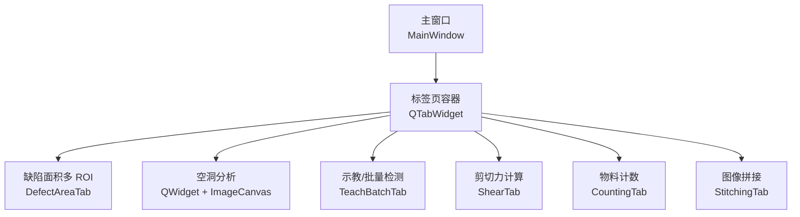
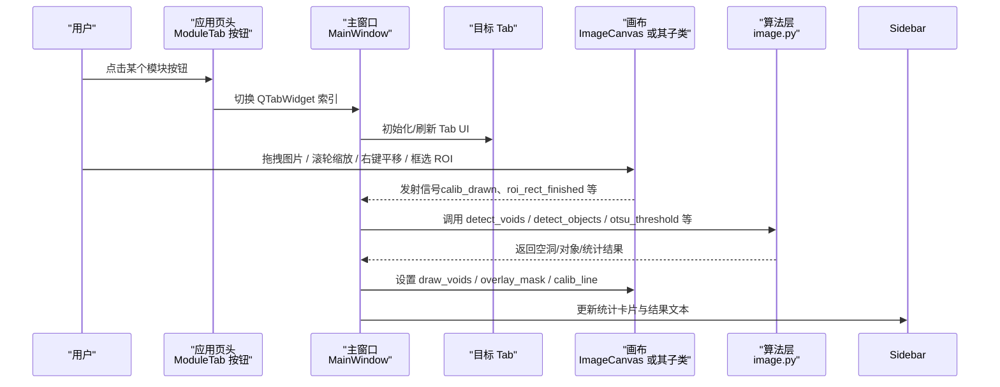
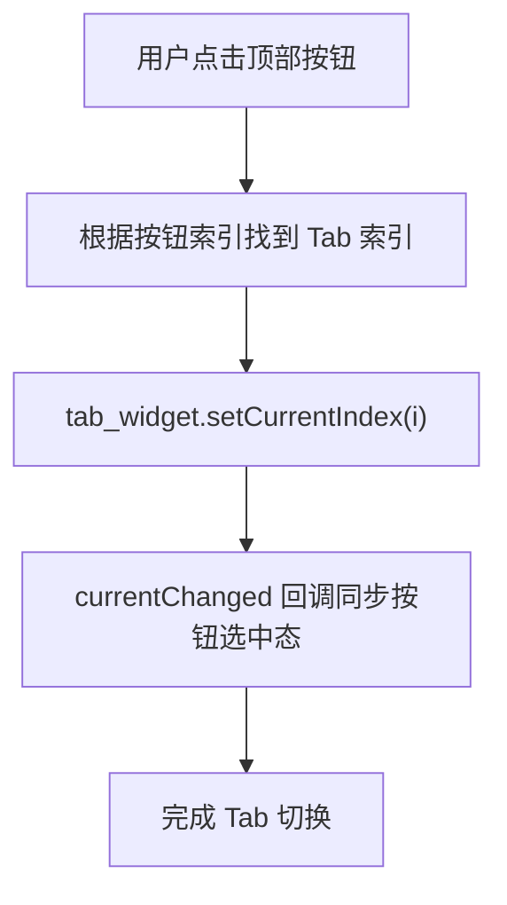
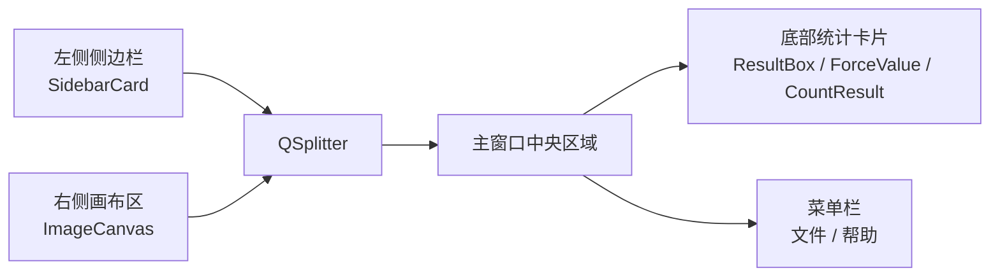
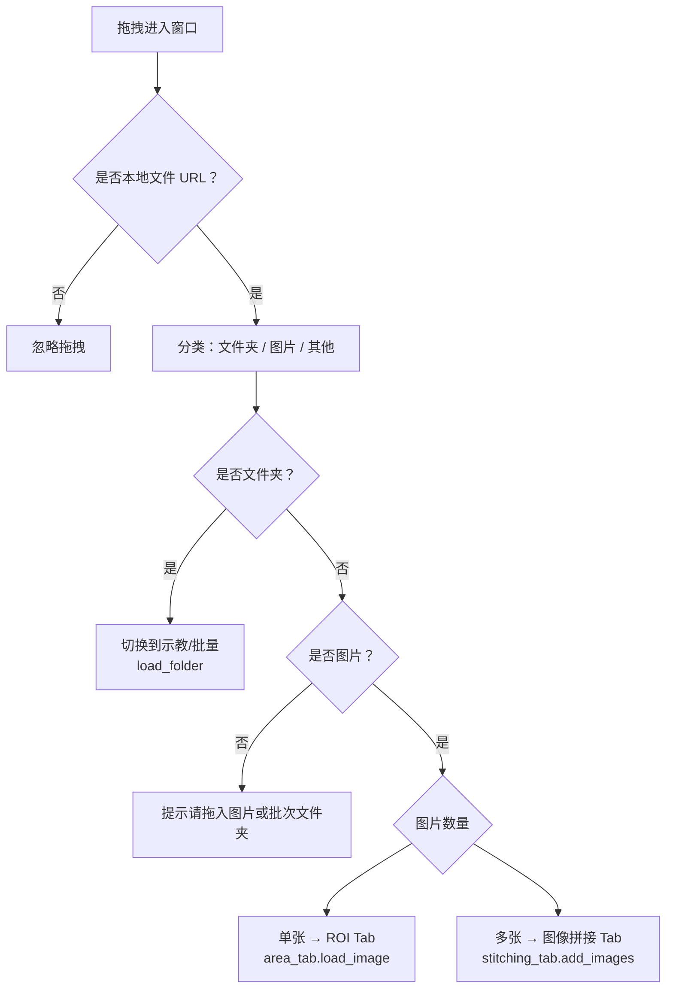
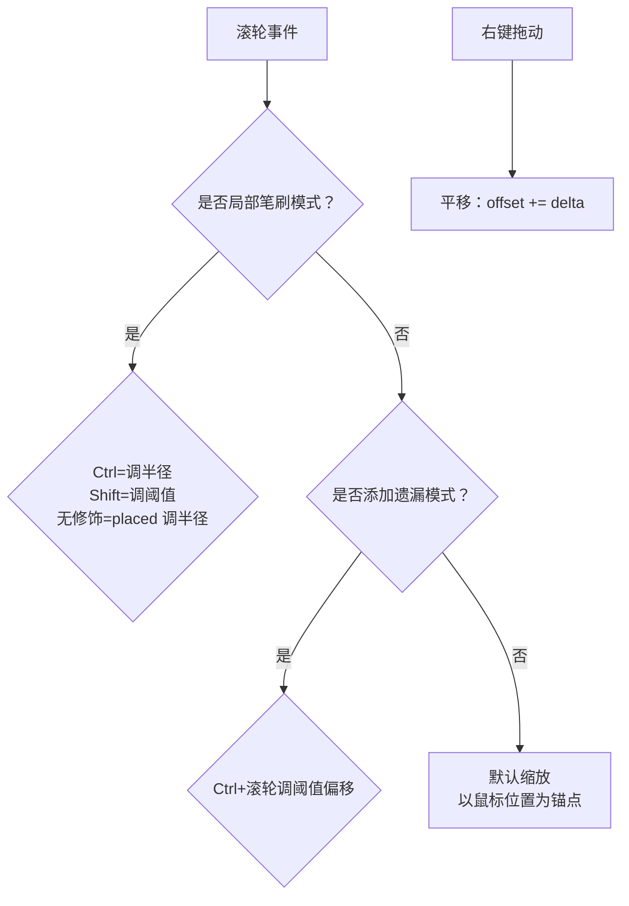
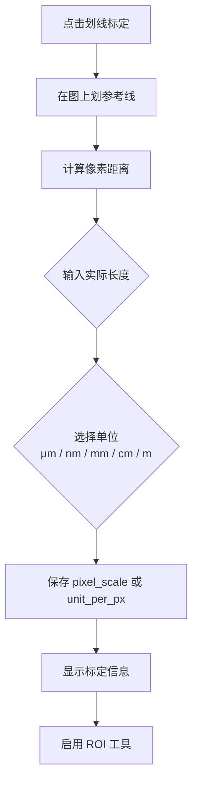
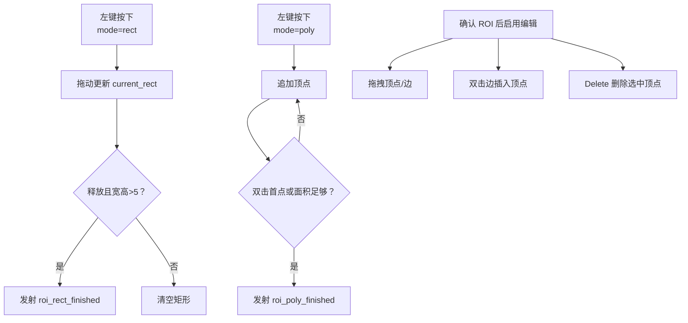
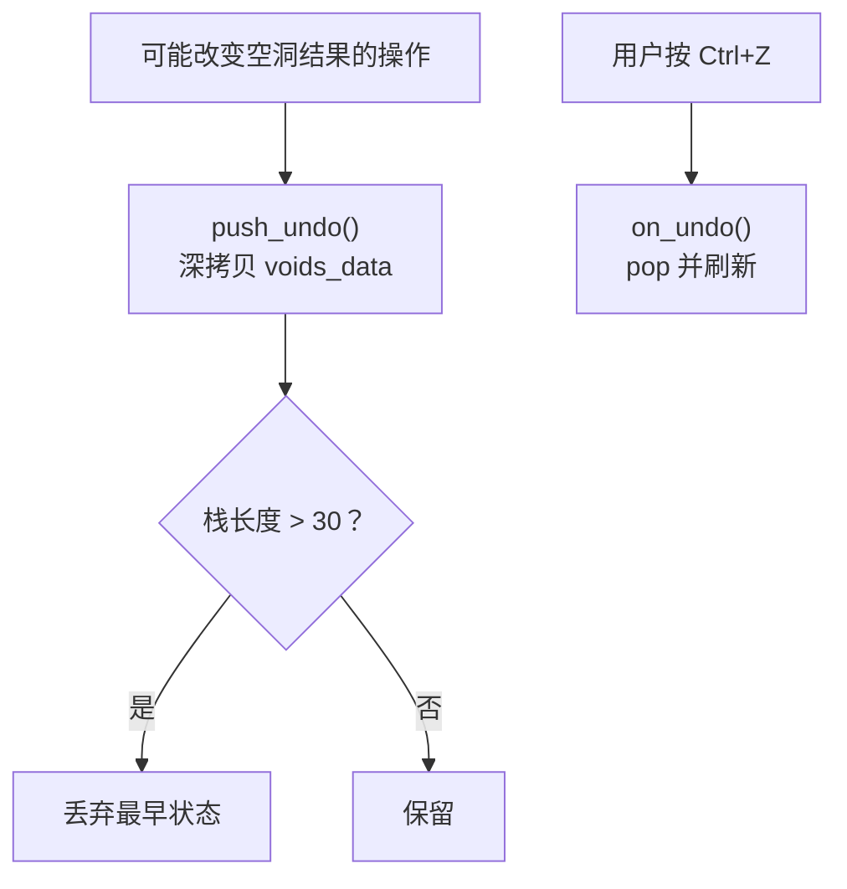
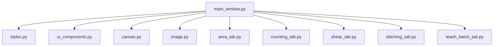

# 界面布局与通用交互

<cite>
**本文引用的文件**   
- [main_window.py](file://main_window.py)
- [canvas.py](file://canvas.py)
- [area_tab.py](file://area_tab.py)
- [counting_tab.py](file://counting_tab.py)
- [shear_tab.py](file://shear_tab.py)
- [stitching_tab.py](file://stitching_tab.py)
- [teach_batch_tab.py](file://teach_batch_tab.py)
- [styles.py](file://styles.py)
- [ui_components.py](file://ui_components.py)
- [README.md](file://README.md)
- [PROJECT_CONCEPTION.md](file://PROJECT_CONCEPTION.md)
</cite>

## 目录
1. [引言](#引言)
2. [项目结构](#项目结构)
3. [核心组件](#核心组件)
4. [架构总览](#架构总览)
5. [详细组件分析](#详细组件分析)
6. [依赖关系分析](#依赖关系分析)
7. [性能注意事项](#性能注意事项)
8. [故障排查指南](#故障排查指南)
9. [结论](#结论)

## 引言
Aurascope 是面向微电子封装产线的半自动化视觉检测桌面工具，采用 PyQt6 + OpenCV + NumPy + Pandas。产品定位不是“全自动 AI 判断”，而是把重复、易错的量化流程标准化：工程师负责最终决策，软件提供可复现的参数化操作、结果导出和批量能力。

从入口到主窗口再到各功能 Tab，整体遵循「GUI 层 → Canvas 绘制层 → image.py 算法层 → 配方/导出」的分层约定；GUI 不得内联实现图像算法。仓库 README 与 PROJECT_CONCEPTION 明确了模块范围、技术栈与分层约束，本文在此基础上统一描述主窗口布局、顶部模块按钮导航、侧边栏/画布区/底部统计卡片/菜单栏的职责，以及拖拽导入、滚轮缩放、右键平移、撤销、像素比标定、ROI 编辑、进度条与取消等通用交互规范。

**章节来源**
- [README.md:1-76](file://README.md#L1-L76)
- [PROJECT_CONCEPTION.md:1-143](file://PROJECT_CONCEPTION.md#L1-L143)

## 项目结构
主窗口 main_window.py 通过 QTabWidget 装配六个功能页：缺陷面积多 ROI、空洞分析、示教/批量检测、剪切力计算、物料计数、图像拼接。默认首页是缺陷面积多 ROI；空洞分析页使用左侧侧边栏 + ImageCanvas 的左右分割布局；其他 Tab 各自维护自己的侧边栏与画布或表单。

**图表来源**
- [main_window.py:101-148](file://main_window.py#L101-L148)

**章节来源**
- [main_window.py:54-154](file://main_window.py#L54-L154)
- [README.md:42-64](file://README.md#L42-L64)

## 核心组件
- 自绘标题栏：品牌名、版本号、“文件”“帮助”菜单、最小化/最大化/关闭按钮，替代系统标题栏。
- 应用页头：由 main_window.py 动态生成一组 ModuleTab 按钮，对应每个 Tab 文本，点击后切换当前 Tab。
- 左侧侧边栏：空洞分析与多数业务 Tab 共用“上传/框选/参数/结果/导出”的纵向步骤式面板。
- 右侧画布区：ImageCanvas 及其子类负责原图显示、坐标转换、缩放平移、ROI 与检测结果绘制。
- 底部统计卡片：空洞分析的结果文本框、剪切力的力值卡片、计数的数量标签等，用于展示关键指标。
- 菜单栏：挂在自绘标题栏上，包含“打开图片…、最近打开、退出、使用说明、更新日志、检查更新、关于”。

顶部模块按钮与 Tab 的映射如下：

| 顶部按钮 | 对应 Tab | 主要职责 |
|---|---|---|
| ROI | 缺陷面积多 ROI | 多 ROI 阈值检测、距离测量、CSV 导出 |
| 空洞分析 | 空洞分析 | SEM/X 光焊料空洞率检测、局部阈值笔刷、Canny 边缘验证、圆度过滤 |
| 示教/批量 | 示教/批量检测 | 样板学习、快速示教、整批检测、汇总 CSV |
| 剪切力计算 | 剪切力计算 | 按 MIL-STD-883H Method 2019.9 计算芯片剪切力要求 |
| 物料计数 | 物料计数 | 蓝膜 LD/Submount 离散物料计数 |
| 图像拼接 | 图像拼接 | 标记水平线、拼接多图、导出并复制到剪贴板 |

**章节来源**
- [main_window.py:187-218](file://main_window.py#L187-L218)
- [main_window.py:224-242](file://main_window.py#L224-L242)
- [main_window.py:109-148](file://main_window.py#L109-L148)

## 架构总览
Aurascope 的界面与数据流可以概括为：用户通过主窗口顶部按钮或侧边栏控件触发行为，主窗口协调 Tab 状态、Canvas 模式与 image.py 算法调用，再把结果写回侧边栏统计、画布覆盖层或 CSV。

**图表来源**
- [main_window.py:101-154](file://main_window.py#L101-L154)
- [main_window.py:722-734](file://main_window.py#L722-L734)
- [canvas.py:13-28](file://canvas.py#L13-L28)
- [main_window.py:1271-1305](file://main_window.py#L1271-L1305)

## 详细组件分析

### 顶部模块按钮与 Tab 导航
主窗口在 init_ui 中创建 QTabWidget，并按顺序添加六个 Tab。随后隐藏原生 TabBar，改用 _build_app_header 生成的 QPushButton 列表作为模块导航。每个按钮的文本取自 tab_widget.tabText(index)，点击时直接调用 tab_widget.setCurrentIndex(i)。currentChanged 信号再同步 module_buttons 的 checked 状态，保证按钮高亮与当前 Tab 一致。

**图表来源**
- [main_window.py:192-218](file://main_window.py#L192-L218)

**章节来源**
- [main_window.py:101-154](file://main_window.py#L101-L154)
- [main_window.py:192-223](file://main_window.py#L192-L223)

### 左侧侧边栏、右侧画布区、底部统计卡片、菜单栏的职责
- 左侧侧边栏：空洞分析页通过 _create_sidebar 构造 SidebarCard，内部用 QScrollArea + QVBoxLayout 承载上传、比例尺标定、缺陷区域定义、缺陷识别、结果、截图与导出数据等操作。其他 Tab 也复用类似结构，但具体控件不同。
- 右侧画布区：空洞分析页使用 QSplitter 将 sidebar 与 ImageCanvas 并列，stretchFactor(0,0)、stretchFactor(1,1)，初始 sizes([360,640])。
- 底部统计卡片：空洞分析页 result_box 以 ResultBox 样式显示空洞数量、总面积、空洞率；剪切力 Tab 用 ResultCard 展示 1X/1.25X/2X 力值；物料计数 Tab 用 create_count_result 显示数量。
- 菜单栏：_build_menu 挂载“文件”和“帮助”两个菜单，其中“文件”含“打开图片…”“最近打开”“退出”，“帮助”含使用说明、更新日志、检查更新、关于。

**图表来源**
- [main_window.py:119-128](file://main_window.py#L119-L128)
- [main_window.py:446-531](file://main_window.py#L446-L531)
- [main_window.py:224-242](file://main_window.py#L224-L242)
- [main_window.py:1291-1305](file://main_window.py#L1291-L1305)
- [shear_tab.py:90-133](file://shear_tab.py#L90-L133)
- [counting_tab.py:167-171](file://counting_tab.py#L167-L171)

**章节来源**
- [main_window.py:119-128](file://main_window.py#L119-L128)
- [main_window.py:446-531](file://main_window.py#L446-L531)
- [main_window.py:224-242](file://main_window.py#L224-L242)
- [main_window.py:1291-1305](file://main_window.py#L1291-L1305)

### 拖拽导入图片
MainWindow.setAcceptDrops(True)，dropEvent 会解析拖入路径：
- 文件夹：切换到“示教/批量”Tab，调用 teach_batch_tab.load_folder。
- 单张图片：切换到“ROI”Tab，调用 area_tab.load_image。
- 多张图片：切换到“图像拼接”Tab，调用 stitching_tab.add_images。
- 非图片路径：弹出警告提示。

dragEnterEvent 仅接受有 URL 的 MIME 数据，不限制扩展名；实际类型校验在 dropEvent 中按 exts 列表进行。

**图表来源**
- [main_window.py:309-339](file://main_window.py#L309-L339)
- [stitching_tab.py:191-195](file://stitching_tab.py#L191-L195)

**章节来源**
- [main_window.py:309-339](file://main_window.py#L309-L339)

### 文件菜单打开图片
“文件”菜单中的“打开图片…”动作 open_image_in_roi 会先切换到 ROI Tab，再调用 area_tab.load_image()。最近打开菜单则分别支持图片和批次文件夹，图片走 area_tab.load_image，批次走 teach_batch_tab.load_folder。

**章节来源**
- [main_window.py:224-242](file://main_window.py#L224-L242)
- [main_window.py:305-307](file://main_window.py#L305-L307)
- [main_window.py:391-402](file://main_window.py#L391-L402)

### 滚轮缩放与右键平移
ImageCanvas.mousePressEvent/mouseMoveEvent/wheelEvent 实现了统一的画布交互：
- 滚轮缩放：默认以鼠标位置为锚点调整 scale，并重新计算 offset，使鼠标指向的图像坐标保持不变。
- 右键平移：按住右键拖动时累加 offset，光标变为 ClosedHandCursor，释放后恢复箭头。
- 局部笔刷模式下的滚轮：Ctrl+滚轮调半径，Shift+滚轮调已确认区域的阈值，无修饰键时在 placed 态继续调半径。
- 添加遗漏模式下的滚轮：Ctrl+滚轮调节 Otsu 阈值偏移。

已知限制：canvas.py 的 wheelEvent 在 Y 轴方向存在漂移问题，不应把现状描述为正确设计。修复时应确保 X/Y 两个方向的缩放锚点计算对称，避免放大后画面上下偏移。

**图表来源**
- [canvas.py:626-706](file://canvas.py#L626-L706)
- [canvas.py:440-508](file://canvas.py#L440-L508)

**章节来源**
- [canvas.py:350-508](file://canvas.py#L350-L508)
- [canvas.py:626-706](file://canvas.py#L626-L706)

### 像素比标定的入口与单位含义
空洞分析页的标定入口是侧边栏“比例尺标定”下的“划线标定”按钮。用户在 ImageCanvas 上划一条参考线，finish_calibration 计算像素距离，弹出对话框输入实际长度（单位 μm），然后保存 pixel_scale = 像素数 / 实际微米数。标定成功后显示“1 μm = x.xx px”，并启用 ROI 工具。

缺陷面积多 ROI 页的标定更完整：area_tab.py 支持 nm/µm/mm/cm/m 五种单位，calibrate 方法把 length/distance 换算成 unit_per_px，并在 UI 显示“已标定：1 单位 = xx px”。未标定时，面积统计以像素为单位，标注“未标定”。

**图表来源**
- [main_window.py:917-956](file://main_window.py#L917-L956)
- [area_tab.py:380-431](file://area_tab.py#L380-L431)

**章节来源**
- [main_window.py:917-956](file://main_window.py#L917-L956)
- [area_tab.py:380-431](file://area_tab.py#L380-L431)

### ROI 编辑：矩形框选、多边形顶点增删、闭合确认
- 矩形框选：ImageCanvas.mode='rect'，左键按下记录 drag_start_img，拖动中不断发射 roi_rect_changed，释放时若宽高大于 5 像素则发射 roi_rect_finished。空洞分析页 prepare_layer_threshold 接收矩形后进入阈值预览；确认后将阈值二值轮廓转多边形，写入 roi_polygon_pts 并启用 ROI 编辑。
- 多边形框选：mode='poly'，左键依次加点，双击首点或满足最小面积条件后发射 roi_poly_finished。
- 顶点增删：ROI 编辑开启后，左键拖拽顶点或边移动顶点；双击边插入新顶点；Delete 删除选中顶点；当顶点少于 3 个时禁止删除。
- 闭合确认：多边形模式下双击首点闭合；矩形模式下释放左键且尺寸有效即闭合。

**图表来源**
- [canvas.py:420-439](file://canvas.py#L420-L439)
- [canvas.py:510-541](file://canvas.py#L510-L541)
- [canvas.py:546-624](file://canvas.py#L546-L624)
- [main_window.py:992-1057](file://main_window.py#L992-L1057)

**章节来源**
- [canvas.py:420-624](file://canvas.py#L420-L624)
- [main_window.py:959-1057](file://main_window.py#L959-L1057)

### 撤销栈行为
主窗口在 init_ui 中初始化 undo_stack 和 undo_limit=30，并绑定 Ctrl+Z 快捷键到 on_undo。push_undo 会把 voids_data 深拷贝进栈，超过 30 步时丢弃最早状态。on_undo 弹出最后一个状态并刷新空洞指标。

触发 push_undo 的典型场景包括：自动 Otsu 设置阈值、面积过滤变化、ROI 边界腐蚀量变化、恢复默认设置、手动添加/删除空洞、局部笔刷确认等。注意：并非所有用户操作都会入栈，例如纯显示开关 toggle_visuals/toggle_roi_overlay 不会入栈。

**图表来源**
- [main_window.py:159-177](file://main_window.py#L159-L177)
- [main_window.py:1377-1389](file://main_window.py#L1377-L1389)
- [main_window.py:1313-1340](file://main_window.py#L1313-L1340)
- [main_window.py:1415-1452](file://main_window.py#L1415-L1452)

**章节来源**
- [main_window.py:159-177](file://main_window.py#L159-L177)
- [main_window.py:1377-1389](file://main_window.py#L1377-L1389)

### 进度条与取消
图像拼接 Tab 使用 QProgressDialog 显示拼接进度，并在拼接完成后关闭。示教/批量检测 Tab 使用独立的 BatchWorker(QThread) 执行批量任务，线程发出 progress(idx,total,filename)、tile_done、finished、failed 信号，UI 层更新进度条、缩略图胶片条和结果表。worker.cancel() 可中断循环。

需要注意：文档作者提示“大图增强检测无进度提示”属于已知限制之一；本文只描述现有实现，不虚构尚未存在的进度机制。

**章节来源**
- [stitching_tab.py:329-363](file://stitching_tab.py#L329-L363)
- [teach_batch_tab.py:82-158](file://teach_batch_tab.py#L82-L158)

### styles.py 的全局 QSS 与 ui_components.py 的 create_* 工厂函数对 UI 外观的影响
styles.py 集中定义了 Aurascope 的设计 token：中性色、主色 accent、语义色 success/danger/warning、字体族、字号层级、间距、圆角、按钮状态、表格、滚动条、进度条、滑块、分组框、分隔条等。STYLESHEET 是主窗口全局 QSS，DIALOG_STYLESHEET 是对话框背景，POPUP_QSS 专门处理 QComboBox 弹层。

ui_components.py 的 create_primary_button、create_secondary_button、create_success_button、create_danger_button、create_nav_button 等工厂函数只负责创建控件并设置 objectName，不加入布局；调用方必须手动 addWidget。create_groupbox 强制使用 Expanding/Preferred 尺寸策略，否则控件可能被静默裁剪。CollapsibleSection 提供折叠头部与内容容器，配合 styles.py 的 CollapseBody 样式。

编码强制约定：
- 颜色、字号、圆角、间距应从 styles.py 的 token 取值，不允许散写硬编码颜色。
- 所有 create_* 工厂函数创建的控件必须由调用方添加到布局。
- create_groupbox() 必须保持 Preferred/Expanding 尺寸策略。
- QComboBox 弹层需通过 style_combo_popups 应用 POPUP_QSS，否则在某些风格下会出现灰框、裁切等问题。

**章节来源**
- [styles.py:1-577](file://styles.py#L1-L577)
- [ui_components.py:35-79](file://ui_components.py#L35-L79)
- [ui_components.py:239-243](file://ui_components.py#L239-L243)
- [ui_components.py:322-382](file://ui_components.py#L322-L382)
- [ui_components.py:426-460](file://ui_components.py#L426-L460)

## 依赖关系分析
主窗口依赖多个 Tab 类、Canvas、image.py 算法、styles、ui_components、app_paths、recipe、help_dialogs、update_check 等。Canvas 层统一继承 QWidget 并提供坐标转换、缩放平移、ROI 编辑；业务逻辑集中在 Tab 层，算法调用集中在 image.py。

**图表来源**
- [main_window.py:25-51](file://main_window.py#L25-L51)
- [main_window.py:31-35](file://main_window.py#L31-L35)

**章节来源**
- [main_window.py:25-51](file://main_window.py#L25-L51)

## 性能注意事项
- 空洞分析页的增强检测、CLAHE、形态学去噪、Canny 边缘验证、圆度过滤都可能带来额外 CPU 开销，应结合 README 与 PROJECT_CONCEPTION 中“纯 CPU 计算、不依赖 GPU”的定位理解其性能边界。
- 批量检测使用独立线程 BatchWorker，避免阻塞 GUI；但大图像掩码和空洞点集属于“重数据”，代码注释明确要求线程结果中剥离 HEAVY_KEYS，防止常驻内存膨胀。
- 缺陷面积多 ROI 的检测防抖间隔为 150ms，避免频繁重算。
- 滚动条、滑块、进度条、表格等 UI 组件的样式由 styles.py 控制，应避免在业务代码中重复绘制复杂效果。

[本节为通用性能建议，不直接分析具体源码片段]

## 故障排查指南
- 拖拽导入无效：检查是否为本地文件 URL，以及扩展名是否在 PNG/JPG/BMP/TIF 列表中；文件夹会被路由到示教/批量，单图到 ROI，多图到图像拼接。
- 标定失败：空洞分析页要求标定线长度大于 5 像素；area_tab.py 要求至少 10 像素，且实际长度必须大于 0，单位必须是 nm/µm/mm/cm/m。
- ROI 无法闭合：矩形宽高不大于 5 像素会被视为无效；多边形面积过小或自相交时会提示无效。
- 撤销无效：确认操作是否调用了 push_undo；纯显示开关如 toggle_visuals/toggle_roi_overlay 不会入栈。
- 下拉弹层样式异常：需要调用 style_combo_popups 应用 POPUP_QSS，否则 QComboBox 弹层可能不受全局 QSS 影响。
- 画布缩放 Y 轴漂移：这是 canvas.py 的已知问题，不应视为正确设计；修复时应检查 wheelEvent 中 X/Y 缩放锚点计算是否对称。

**章节来源**
- [main_window.py:309-339](file://main_window.py#L309-L339)
- [main_window.py:925-956](file://main_window.py#L925-L956)
- [area_tab.py:409-431](file://area_tab.py#L409-L431)
- [canvas.py:535-541](file://canvas.py#L535-L541)
- [canvas.py:602-610](file://canvas.py#L602-L610)
- [canvas.py:626-706](file://canvas.py#L626-L706)
- [ui_components.py:426-460](file://ui_components.py#L426-L460)

## 结论
Aurascope 的主窗口以顶部模块按钮作为一级导航，以左侧侧边栏作为操作流程入口，以右侧画布作为图像与 ROI 的可视化中心，以底部统计卡片展示关键指标，以自绘标题栏承载菜单与窗口控制。通用交互围绕拖拽导入、文件菜单、滚轮缩放、右键平移、像素比标定、ROI 编辑、撤销栈、进度条与取消展开。

开发和维护时应遵守以下原则：
- 顶部按钮只负责切换 Tab，不承载业务逻辑。
- Canvas 层专注绘制与坐标交互，业务逻辑留在 Tab 层。
- 算法实现集中在 image.py，GUI 不得内联图像处理。
- 所有外观通过 styles.py 的 token 与 ui_components.py 的工厂函数统一构建。
- 已知限制如 canvas.py 滚轮缩放 Y 轴漂移、部分大图像增强检测缺少进度提示，应在后续迭代中修复，而不是当作正确设计传播。

[本节为总结性内容，不直接分析具体源码片段]