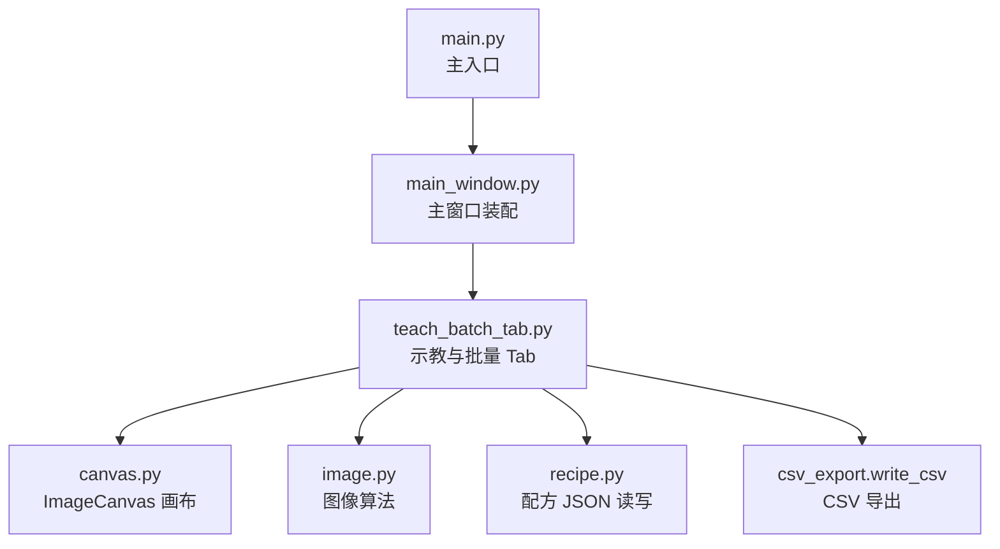
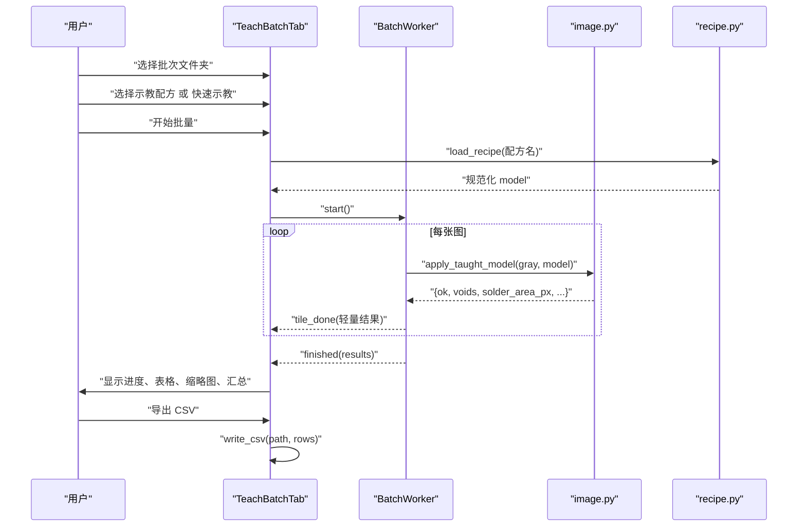
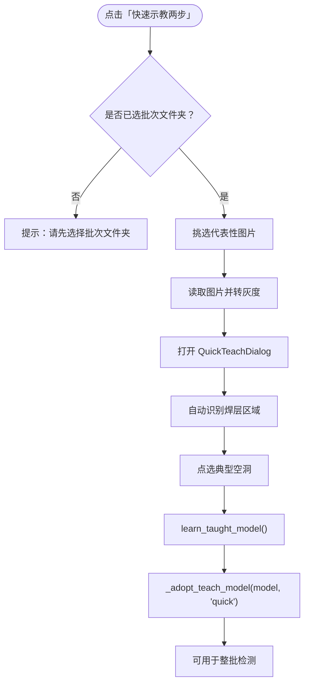
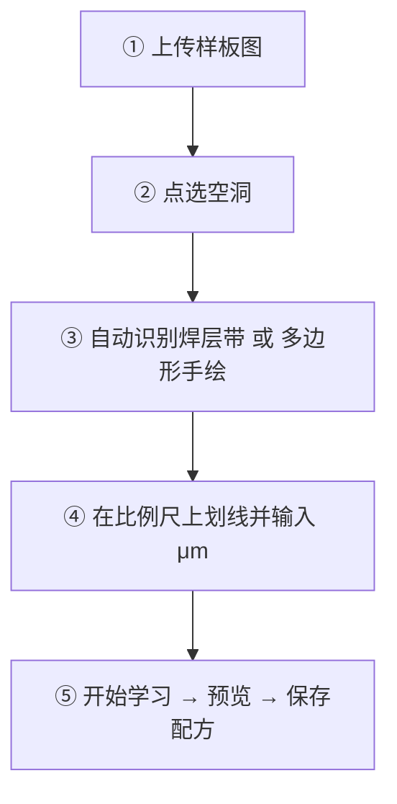
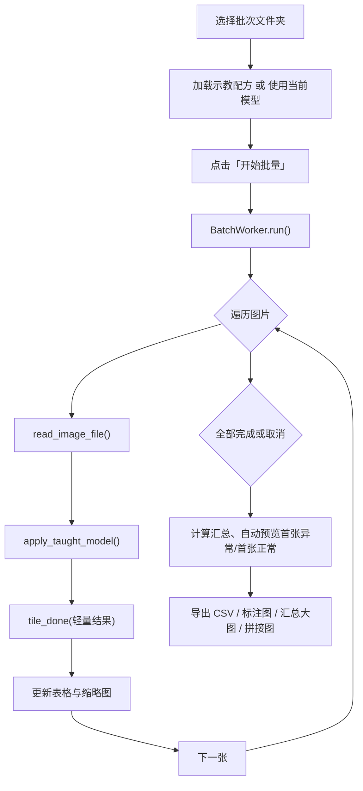
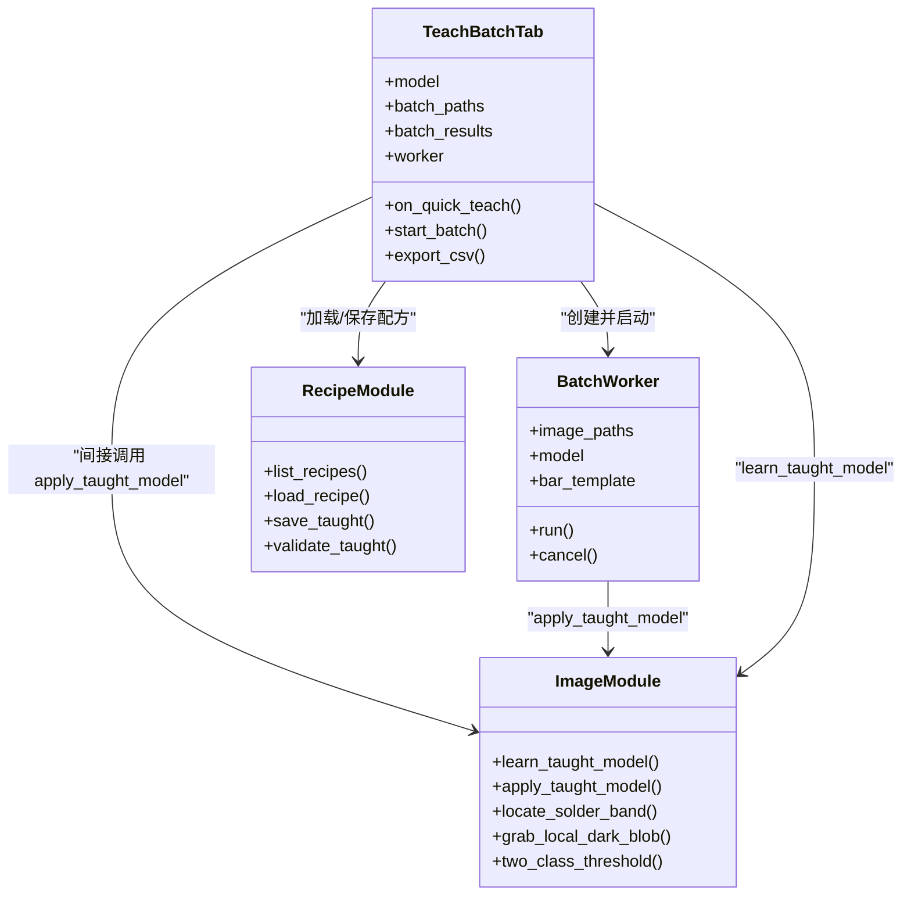

# 示教与批量检测页面

<cite>
**本文引用的文件**   
- [teach_batch_tab.py](file://teach_batch_tab.py)
- [recipe.py](file://recipe.py)
- [image.py](file://image.py)
- [README.md](file://README.md)
- [PROJECT_CONCEPTION.md](file://PROJECT_CONCEPTION.md)
</cite>

## 目录
1. [简介](#简介)
2. [项目结构定位](#项目结构定位)
3. [核心组件](#核心组件)
4. [架构总览](#架构总览)
5. [两种示教模式](#两种示教模式)
6. [批量检测流程](#批量检测流程)
7. [配方 JSON 结构说明](#配方-json-结构说明)
8. [最小用例](#最小用例)
9. [依赖关系分析](#依赖关系分析)
10. [性能与已知限制](#性能与已知限制)
11. [故障排查](#故障排查)
12. [结论](#结论)

## 简介
本页面面向「金锡焊料空洞率检测」的示教与批量检测用户。它负责：
- 两步快速示教：自动选代表性图，自动识别焊层区域，点选空洞后直接学习并复用；
- 完整五步示教：样板图 → 点选空洞 → 焊层区域 → 比例尺 → 学习保存；
- 批量文件夹处理：选择批次文件夹、加载/保存示教配方、执行批量任务、查看进度与取消、导出 CSV；
- 配方管理：以 `recipes/*.taught.json` 形式落盘，由 `recipe.py` 负责读写与 schema 校验。

该页面是 Aurascope 七条业务主线之一：**批量示教**。其 GUI 逻辑集中在 `teach_batch_tab.py`，算法实现集中在 `image.py`，配方持久化集中在 `recipe.py`。

**章节来源**
- [README.md:1-80](file://README.md#L1-L80)
- [PROJECT_CONCEPTION.md:17-27](file://PROJECT_CONCEPTION.md#L17-L27)

## 项目结构定位
从仓库根看，与本页面直接相关的文件如下：

**图示来源**
- [teach_batch_tab.py:34-51](file://teach_batch_tab.py#L34-L51)
- [README.md:42-64](file://README.md#L42-L64)

**章节来源**
- [teach_batch_tab.py:1-53](file://teach_batch_tab.py#L1-L53)
- [README.md:42-64](file://README.md#L42-L64)

## 核心组件
| 组件 | 职责 | 关键行为 |
|---|---|---|
| `TeachBatchTab` | 示教与批量页面的主控件 | 构建左栏控制区、右侧 ImageCanvas、下方结果区；管理快速示教、完整示教、批量状态 |
| `BatchWorker` | 批量检测线程 | 顺序遍历图片、读取灰度、调用 `apply_taught_model`、发射进度/单图结果/完成信号 |
| `read_image_file` | 批量线程专用图片读取 | 支持 TIF/TIFF、16bit 归一化为 uint8、失败返回 None |
| `QuickTeachDialog`（外部模块） | 快速示教弹窗 | 自动识别焊层区域 + 点选空洞 + 学习模型 |
| `learn_taught_model` / `apply_taught_model` | 示教学习与批量套用 | 统计焊层/背景/空洞三类灰度，输出 schema v2 模型或检测结果 |
| `locate_solder_band` | 按阈值定位焊层带 | 二值化 → 形态学 → 连通域 → 几何先验择带 → 孔洞填充 → 薄结构剔除 |
| `grab_local_dark_blob` | 点击抓暗核 | 以点击灰度锚定生长阈值，提取局部暗斑掩码 |
| `validate_taught` / `save_taught` / `load_recipe` | 示教配方校验与持久化 | 校验字段范围、补默认值、写 `.taught.json` |

**章节来源**
- [teach_batch_tab.py:56-159](file://teach_batch_tab.py#L56-L159)
- [teach_batch_tab.py:201-238](file://teach_batch_tab.py#L201-L238)
- [image.py:1092-1134](file://image.py#L1092-L1134)
- [image.py:1182-1330](file://image.py#L1182-L1330)
- [image.py:1333-1353](file://image.py#L1333-L1353)
- [recipe.py:271-348](file://recipe.py#L271-L348)
- [recipe.py:385-404](file://recipe.py#L385-L404)
- [recipe.py:452-462](file://recipe.py#L452-L462)

## 架构总览
TeachBatchTab 作为 GUI 编排者，不内联图像算法；实际空洞检测、焊层定位、统计学习都在 `image.py`。

**图示来源**
- [teach_batch_tab.py:1401-1453](file://teach_batch_tab.py#L1401-L1453)
- [teach_batch_tab.py:106-158](file://teach_batch_tab.py#L106-L158)
- [recipe.py:452-462](file://recipe.py#L452-L462)
- [image.py:1333-1353](file://image.py#L1333-L1353)

## 两种示教模式

### 两步快速示教
适合日常检测：操作最少、自动程度最高。

流程要点：
1. 必须先选择批次文件夹；
2. 点击「快速示教（两步）」；
3. 程序从批次中挑选一张代表性图（优先纯数字命名切片，按 p90 接近整批中位数）；
4. 打开快速示教弹窗：焊层区域已自动识别，用户可手绘或拖顶点微调；
5. 在图上点选 2~3 个典型空洞；
6. 点完自动学习，得到当前生效模型；
7. 可直接开始批量，也可保存为配方供下次复用。

关键点：
- 快速示教模型写入 `self.model`，并通过 `_adopt_teach_model(model, 'quick')` 标记来源；
- 切换批次文件夹会清空快速示教模型，避免误用到其他器件；
- 快速示教完成后，底部提示条显示 `t_焊层`、`t_空洞`、点选个数。

**图示来源**
- [teach_batch_tab.py:1292-1328](file://teach_batch_tab.py#L1292-L1328)
- [teach_batch_tab.py:1330-1382](file://teach_batch_tab.py#L1330-L1382)
- [teach_batch_tab.py:240-264](file://teach_batch_tab.py#L240-L264)

**章节来源**
- [teach_batch_tab.py:470-478](file://teach_batch_tab.py#L470-L478)
- [teach_batch_tab.py:1292-1382](file://teach_batch_tab.py#L1292-L1382)
- [teach_batch_tab.py:1384-1399](file://teach_batch_tab.py#L1384-L1399)

### 完整五步示教
当快速示教不适用时使用，逐步完善参数。

五个步骤：
1. **上传样板图**：选择一张 SEM/X 光图；
2. **点选空洞**：在图上点几个明显空洞，系统抓取暗核掩码；
3. **定义焊层区域**：
   - 「自动识别焊层带」：基于空洞锚点反推两类分离阈值，再定位焊层带；
   - 「多边形手绘」：手动沿焊层边界画一圈；
   - 「编辑顶点」：拖动顶点、双击加点、Delete 删点；
4. **标定比例尺**：在 SEM 比例尺上划线，输入实际 μm 值，得到 px_per_um 和条棒模板；
5. **学习并保存**：
   - 过滤不在焊层带内的点选；
   - 调用 `learn_taught_model` 生成 schema v2 模型；
   - 在样板图上回放绿掩码 + 空洞标注；
   - 可选「保存为示教配方」。

**图示来源**
- [teach_batch_tab.py:349-448](file://teach_batch_tab.py#L349-L448)
- [teach_batch_tab.py:820-906](file://teach_batch_tab.py#L820-L906)
- [teach_batch_tab.py:964-1062](file://teach_batch_tab.py#L964-L1062)
- [teach_batch_tab.py:1066-1122](file://teach_batch_tab.py#L1066-L1122)
- [teach_batch_tab.py:1126-1235](file://teach_batch_tab.py#L1126-L1235)

**章节来源**
- [teach_batch_tab.py:349-448](file://teach_batch_tab.py#L349-L448)
- [teach_batch_tab.py:820-906](file://teach_batch_tab.py#L820-L906)
- [teach_batch_tab.py:964-1062](file://teach_batch_tab.py#L964-L1062)
- [teach_batch_tab.py:1066-1122](file://teach_batch_tab.py#L1066-L1122)
- [teach_batch_tab.py:1126-1235](file://teach_batch_tab.py#L1126-L1235)

## 批量检测流程

### 操作流程
1. **选择目标文件夹**：点击「选择批次文件夹」，程序扫描后缀为 PNG/JPG/JPEG/BMP/TIF/TIFF 的图片；
2. **加载或保存配方**：
   - 下拉框列出 `kind='taught'` 的示教配方；
   - 若文件夹名与已有配方同名，会自动选中并提示；
   - 也可通过快速示教或完整示教保存新配方；
3. **执行批量任务**：点击「开始批量」；
4. **查看进度条与取消**：
   - 进度条显示百分比；
   - 当前文件名显示在「当前图片」标签；
   - 点击「取消」设置 `_batch_canceled = True` 并调用 `worker.cancel()`；
5. **查看结果**：
   - 结果表：图片、金锡面积(px²)、空洞数、空洞率(%)、警告；
   - 缩略图胶片条：异常图红边提示；
   - 汇总信息：总空洞率、块均值、范围、总面积等；
6. **导出检测结果**：
   - 导出 CSV；
   - 导出当前/全部标注图；
   - 导出汇总大图；
   - 导出/查看金锡拼接图。

**图示来源**
- [teach_batch_tab.py:1251-1288](file://teach_batch_tab.py#L1251-L1288)
- [teach_batch_tab.py:1401-1453](file://teach_batch_tab.py#L1401-L1453)
- [teach_batch_tab.py:1455-1463](file://teach_batch_tab.py#L1455-L1463)
- [teach_batch_tab.py:1465-1546](file://teach_batch_tab.py#L1465-L1546)
- [teach_batch_tab.py:1855-1901](file://teach_batch_tab.py#L1855-L1901)

**章节来源**
- [teach_batch_tab.py:1251-1288](file://teach_batch_tab.py#L1251-L1288)
- [teach_batch_tab.py:1401-1546](file://teach_batch_tab.py#L1401-L1546)
- [teach_batch_tab.py:1855-1901](file://teach_batch_tab.py#L1855-L1901)

## 配方 JSON 结构说明

### 存储位置
示教配方 JSON 的实际落盘位置由 `recipe.py._recipe_root()` 决定：
- 环境变量 `AURASCOPE_RECIPE_DIR` 存在时，使用该绝对路径；
- frozen 打包后，优先取 exe 同级目录下的 `recipes/`；
- 源码运行时，优先取 `recipe.py` 所在目录下的 `recipes/`；
- 如果首选目录不可写，回退到 `app_paths.local_data_dir()/recipes/`。

因此，`recipes/*.taught.json` 不一定永远在源码根目录下；打包后可能在安装目录，也可能在用户数据目录。

**章节来源**
- [recipe.py:69-89](file://recipe.py#L69-L89)
- [recipe.py:115-120](file://recipe.py#L115-L120)

### Schema 版本与类型
- 示教模型使用 schema v3，`type='taught'`；
- 普通参数型配方走 v1 分支；
- `normalize_recipe` 会根据 `type` 分流到 `validate_taught` 或 v1 规范化。

**章节来源**
- [recipe.py:241-258](file://recipe.py#L241-L258)
- [recipe.py:271-348](file://recipe.py#L271-L348)

### 关键字段含义
| 顶层字段 | 含义 |
|---|---|
| `schema_version` | 配方 schema 版本，示教模型为 3 |
| `type` | `'taught'` 表示示教模型 |
| `name` | 配方名称，用于 UI 显示与文件名 |
| `note` | 备注，快速示教会记录点选个数，完整示教会记录样板图文件名 |
| `updated` | 更新时间 |
| `solder` | 焊层类灰度统计与阈值 |
| `background` | 背景类灰度统计 |
| `void` | 空洞判定参数：阈值、面积上下限、圆度、深度容差等 |
| `px_per_um` | 像素/微米 |
| `band` | 焊层带定位参数：长宽比、面积占比、形态学核、厚度过滤、桥接窗口 |
| `band_ref` | 示教模板的归一化几何基准 |
| `band_tol` | 几何偏差容忍度 |
| `scale_bar` | 比例尺配置：水平方向、明暗、长度、实际 μm |
| `diagnostics` | 诊断信息：焊层/背景可分性、周边同灰度占比等 |

**章节来源**
- [recipe.py:290-348](file://recipe.py#L290-L348)

### 阈值参数
- `solder.threshold`：焊层类与背景类的分离阈值，范围 0~255；
- `void.threshold`：空洞暗核阈值，可为空；
- `void.min_area`：空洞面积下限，0 表示自动（按带面积 0.02%，下限 12px²）；
- `void.max_area`：空洞面积上限，None 表示自动（按带面积 30%）；
- `void.min_roundness`：圆度过滤，0~1；
- `void.depth_offset`：深度容差，正值更包容偏浅暗斑。

**章节来源**
- [recipe.py:307-323](file://recipe.py#L307-L323)
- [teach_batch_tab.py:495-538](file://teach_batch_tab.py#L495-L538)

### 形态学参数
- `band.open_kernel`：开运算核大小，默认 5，范围 1~21；
- `band.min_thickness_px`：竖向最小厚度，剔除挂在本体上的薄碎片，默认 8；
- `band.bridge_win_px`：贴边空洞缺口桥接窗口，-1 表示自动。

这些参数影响 `locate_solder_band` 的形态学处理与薄结构剔除。

**章节来源**
- [recipe.py:326-335](file://recipe.py#L326-L335)
- [image.py:894-1046](file://image.py#L894-L1046)

### ROI 配置
示教模型不存固定 ROI 多边形，而是存「示教模型」：焊层/空洞灰度统计 + 分离阈值 + 比例尺模板。批量时逐图自适应定位焊层带。

但 v1 参数型配方仍保留 `roi` 字段，由 `validate_roi` 清洗：
- `polygon`：多边形顶点列表；
- `layer_threshold`：层阈值；
- `vertices`：顶点数。

**章节来源**
- [recipe.py:203-225](file://recipe.py#L203-L225)
- [teach_batch_tab.py:12-14](file://teach_batch_tab.py#L12-L14)

### 局部阈值区域
`detect_voids_local` 支持传入 `local_regions`，每个区域为 `(x, y, w, h, local_thresh)`，在全局阈值基础上覆盖局部二值化。但该函数在 TeachBatchTab 的批量流程中未被直接调用；当前批量主要走 `apply_taught_model` → `locate_solder_band` → `detect_voids_in_band`。

**章节来源**
- [image.py:328-422](file://image.py#L328-L422)

### 导出选项
批量结果导出 CSV 包含：
- 图片名、金锡面积(px²)、金锡面积(μm²)、空洞数、空洞面积(px²)、空洞率(%)；
- `t_空洞`、空洞面积上下限、未计入大/小暗斑数；
- 比例尺识别状态、厚度过滤剔除比例、面积口径、警告。

汇总行追加总金锡面积、总空洞面积、总空洞率、均值±标准差。

**章节来源**
- [teach_batch_tab.py:1855-1901](file://teach_batch_tab.py#L1855-L1901)

## 最小用例
以下是一个最小可复现的用户流程：

1. 准备一张 SEM/X 光图片，例如 `sample.png`；
2. 启动 Aurascope，进入「示教与批量检测」页；
3. 点击「快速示教（两步）」；
4. 如果尚未选择批次文件夹，先点击「选择批次文件夹」，选择包含 `sample.png` 的目录；
5. 在弹出的快速示教对话框中：
   - 确认焊层区域已自动识别；
   - 在图上点选 2~3 个典型空洞；
   - 点击确定；
6. 程序学习模型并显示底部提示条；
7. 点击「保存为示教配方」，输入配方名，例如 `my_recipe`；
8. 再次点击「开始批量」，程序会使用当前模型对同一文件夹中的图片执行批量检测；
9. 等待进度条完成，查看结果表与缩略图；
10. 点击「导出 CSV」，得到批量检测结果。

注意：
- 快速示教模型保存在内存中，不会自动落盘；只有显式保存后才出现在配方下拉框；
- 如果只有一张图片，快速示教仍可运行，但「批量」意义有限；
- 如果后续要批量处理不同产品，应分别保存不同配方。

**章节来源**
- [teach_batch_tab.py:1330-1382](file://teach_batch_tab.py#L1330-L1382)
- [teach_batch_tab.py:1211-1235](file://teach_batch_tab.py#L1211-L1235)
- [teach_batch_tab.py:1401-1546](file://teach_batch_tab.py#L1401-L1546)

## 依赖关系分析

**图示来源**
- [teach_batch_tab.py:82-159](file://teach_batch_tab.py#L82-L159)
- [teach_batch_tab.py:1126-1162](file://teach_batch_tab.py#L1126-L1162)
- [teach_batch_tab.py:1401-1453](file://teach_batch_tab.py#L1401-L1453)
- [recipe.py:137-166](file://recipe.py#L137-L166)
- [recipe.py:271-348](file://recipe.py#L271-L348)
- [image.py:1182-1330](file://image.py#L1182-L1330)
- [image.py:1333-1353](file://image.py#L1333-L1353)

**章节来源**
- [teach_batch_tab.py:82-159](file://teach_batch_tab.py#L82-L159)
- [teach_batch_tab.py:1126-1162](file://teach_batch_tab.py#L1126-L1162)
- [teach_batch_tab.py:1401-1453](file://teach_batch_tab.py#L1401-L1453)
- [recipe.py:137-166](file://recipe.py#L137-L166)
- [recipe.py:271-348](file://recipe.py#L271-L348)
- [image.py:1182-1330](file://image.py#L1182-L1330)
- [image.py:1333-1353](file://image.py#L1333-L1353)

## 性能与已知限制

### 性能特征
- 批量检测使用 `QThread` 顺序处理，避免 GUI 阻塞；
- 每处理 10 个轮廓调用一次 `_pump_events()`，让界面有机会刷新；
- 批量线程只传轻量结果，剥离 `band_mask` 与 `voids` 点集，避免几十张 4K 图的掩码常驻内存；
- 需要叠加图时按需重算，而不是全程缓存重型对象；
- 结果区缩略图使用 `make_thumb` 生成，便于一眼看出问题。

**章节来源**
- [teach_batch_tab.py:82-159](file://teach_batch_tab.py#L82-L159)
- [image.py:14-25](file://image.py#L14-L25)
- [image.py:238-240](file://image.py#L238-L240)
- [image.py:375-377](file://image.py#L375-L377)

### 已知限制
根据项目约定与代码现状，需特别注意：

1. **大图增强检测无进度提示**  
   批量线程有进度信号，但 `image.py` 内部增强检测循环的 `_pump_events()` 仅每 10 个轮廓触发一次；对于超大图，用户可能感觉长时间无响应。

2. **Canny 边缘验证静默失效风险**  
   `image.py` 中存在两份空洞检测函数：`detect_voids` 与 `detect_voids_local`。文档要求以 `image.py` 为准，且 `main_window.py` 内另有一份 `detect_voids_local` 副本属技术债，待合并。此外，`edge_map` 在某些分支未初始化时可能导致 Canny 校验静默失效。

3. **配方字段扩展需同时更新 schema**  
   新增示教模型字段必须写入 `recipe.validate_taught` 的返回值，否则旧配方加载或手改 JSON 时可能被丢弃或报错。

4. **UI 层约束**  
   Canvas 层统一为 QWidget + QPainter 自绘，共享原图坐标↔屏幕坐标转换、滚轮缩放、右键平移、多边形 ROI 编辑约定；`canvas.py` 存在 Y 轴漂移的已知问题，不要把现状写成正确设计。

5. **GUI 工厂函数约定**  
   `ui_components.create_*` 只创建控件、不加入布局；`create_groupbox()` 必须使用 Preferred/Expanding 尺寸策略，否则控件被静默裁剪。

**章节来源**
- [image.py:14-25](file://image.py#L14-L25)
- [image.py:228-234](file://image.py#L228-L234)
- [image.py:366-370](file://image.py#L366-L370)
- [recipe.py:271-348](file://recipe.py#L271-L348)
- [PROJECT_CONCEPTION.md:77-107](file://PROJECT_CONCEPTION.md#L77-L107)

## 故障排查

| 现象 | 可能原因 | 处理建议 |
|---|---|---|
| 快速示教提示「请先选择批次文件夹」 | 未调用 `pick_folder` 或 `load_folder` | 先点击「选择批次文件夹」 |
| 自动识别焊层带失败 | 空洞点选不足、ROI 无效、阈值分离失败 | 改用「多边形手绘」，或重新点选空洞 |
| 学习失败 | 焊层区域太小、点选不在焊层带内 | 检查 ROI 是否有效，确保点选在焊层带内 |
| 批量检测无结果 | 未选择批次文件夹、未加载示教配方 | 检查左栏文件夹与配方下拉框 |
| 批量检测卡住 | 大图增强检测耗时 | 等待；必要时减少图片数量或调整参数 |
| 批量检测无法取消 | 当前图片正在解码或算法循环未到达事件泵 | 等待当前图处理结束；程序会在循环中检查 `_cancel` |
| 导出 PNG 失败 | DLP/加密软件改写文件头、路径不可写 | 查看错误提示，把目录加入白名单 |
| 配方保存失败 | 配方名为空、recipes 目录不可写 | 检查名称，确认 `AURASCOPE_RECIPE_DIR` 或默认 recipes 目录可写 |
| 批量 CSV 为空 | 所有图片处理失败 | 查看「警告」列，检查比例尺识别、模型阈值、图片可读性 |

**章节来源**
- [teach_batch_tab.py:1251-1288](file://teach_batch_tab.py#L1251-L1288)
- [teach_batch_tab.py:1401-1453](file://teach_batch_tab.py#L1401-L1453)
- [teach_batch_tab.py:1455-1463](file://teach_batch_tab.py#L1455-L1463)
- [teach_batch_tab.py:1855-1901](file://teach_batch_tab.py#L1855-L1901)
- [teach_batch_tab.py:2298-2394](file://teach_batch_tab.py#L2298-L2394)
- [recipe.py:385-404](file://recipe.py#L385-L404)

## 结论
TeachBatchTab 是 Aurascope 中连接「工程师示教」与「产线批量检测」的关键页面。它把复杂的图像算法封装成两个直观模式：
- 快速示教适合日常重复检测，两步即可得到可复用的示教模型；
- 完整示教适合首次调试或快速示教不适用的场景，逐步完善焊层区域、比例尺与诊断信息。

配方以 `recipes/*.taught.json` 形式落盘，由 `recipe.py` 负责 schema 校验与默认值补齐；实际算法由 `image.py` 提供，TeachBatchTab 只负责交互编排。批量检测采用线程 + 进度信号 + 轻量结果传递的方式，兼顾性能与用户体验。

使用时请牢记：
- 先选批次文件夹，再选配方或做快速示教；
- 快速示教模型只在内存中生效，保存后才出现在配方库；
- 批量结果可在表格中核对，并可人工修正单图的金锡区域与空洞；
- 最终导出 CSV 作为量化报告，PNG 汇总图与拼接图作为可视化报告。