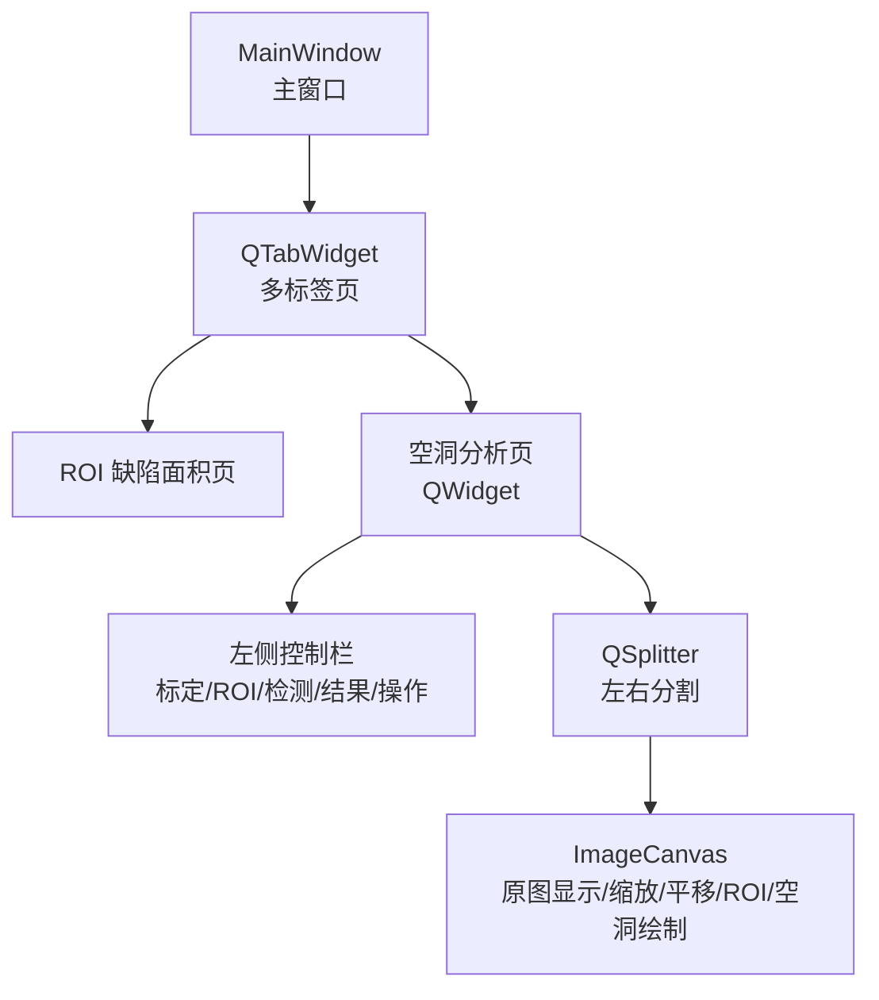
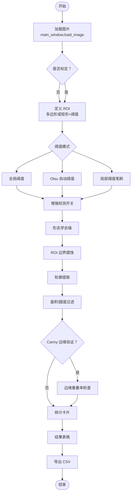

# 空洞分析页面

<cite>
**本文引用的文件**   
- [main_window.py](file://main_window.py)
- [canvas.py](file://canvas.py)
- [image.py](file://image.py)
- [README.md](file://README.md)
</cite>

## 目录
1. [简介](#简介)
2. [入口与页面结构](#入口与页面结构)
3. [用户操作步骤](#用户操作步骤)
4. [关键参数说明](#关键参数说明)
5. [结果表字段与 CSV 输出](#结果表字段与-csv-输出)
6. [核心组件职责](#核心组件职责)
7. [算法流程与依赖关系](#算法流程与依赖关系)
8. [最小可复现用例](#最小可复现用例)
9. [常见问题与排查](#常见问题与排查)
10. [已知限制与技术债](#已知限制与技术债)
11. [结论](#结论)

## 简介
空洞分析页面是 Aurascope 的「金锡焊料 X 光 / SEM 图空洞率检测」功能模块，支持像素比标定、ROI 定义、全局阈值/Otsu/局部阈值调节、Canny 边缘验证、圆度过滤、面积过滤、统计卡片、结果表格以及 CSV 导出。项目为 PyQt6 + OpenCV + NumPy + Pandas（通过 `csv_export.write_csv`）单机桌面应用，不联网、不收集用户数据、纯 CPU 计算，兼容 Windows 7+。

**章节来源**
- [README.md:1-15](file://README.md#L1-L15)

## 入口与页面结构
空洞分析页面以 Tab 形式挂载在主窗口中：
- 主窗口在初始化 UI 时创建 `analysis_tab`，并把 `ImageCanvas` 作为右侧画布、侧边栏作为左侧控制面板。
- 该 Tab 标题为「空洞分析」。
- 导入图片后，侧边栏启用「比例尺标定」「缺陷区域定义」「缺陷识别」「结果」「操作」等步骤控件。

**图表来源**
- [main_window.py:113-132](file://main_window.py#L113-L132)
- [main_window.py:451-536](file://main_window.py#L451-L536)
- [main_window.py:727-739](file://main_window.py#L727-L739)

**章节来源**
- [main_window.py:113-132](file://main_window.py#L113-L132)
- [main_window.py:451-536](file://main_window.py#L451-L536)

## 用户操作步骤

### 第一步：导入图片
- 点击侧边栏「点击上传 SEM 图片」，或通过菜单「文件 → 打开图片…」。
- 程序调用 `load_image()`，读取 PNG/JPG/BMP/TIF/TIFF，加载到 `ImageCanvas`。
- 导入成功后，侧边栏步骤按钮启用，但 ROI 和空洞检测相关控件仍禁用，直到完成 ROI。

**章节来源**
- [main_window.py:794-826](file://main_window.py#L794-L826)
- [main_window.py:828-878](file://main_window.py#L828-L878)

### 第二步：像素比标定
- 点击「划线标定」，进入标定模式。
- 在原图上拖拽一条线，表示已知物理长度。
- 输入实际长度（单位 μm），程序根据像素距离计算像素比 `pixel_scale = 像素数 / 微米数`。
- 标定成功后，显示「标定成功：1 μm = x.xx px」，并启用 ROI 工具。

**章节来源**
- [main_window.py:922-962](file://main_window.py#L922-L962)

### 第三步：定义 ROI
ROI 有两种方式：

| 方式 | 交互 | 用途 |
|---|---|---|
| 多边形框选 | 左键逐点绘制，闭合首点后确认 | 精确勾勒焊层边界 |
| 矩形框+阈值 | 拖出矩形，拖动滑块预览二值化效果，点击「确认选区」 | 快速定位焊层带 |

确认后：
- 生成 ROI 掩码 `roi_mask`。
- 生成半透明绿色蒙版 `overlay_mask` 覆盖在原图上。
- 计算焊层像素面积 `solder_area_px`。
- 若已标定，显示 μm²；否则显示像素面积。
- 自动执行一次 Otsu 阈值计算，并启用空洞检测控件。

**章节来源**
- [main_window.py:981-1095](file://main_window.py#L981-L1095)
- [main_window.py:1097-1169](file://main_window.py#L1097-L1169)
- [main_window.py:1203-1227](file://main_window.py#L1203-L1227)

### 第四步：选择阈值模式
当前页面提供三种阈值路径：

| 模式 | 触发方式 | 行为 |
|---|---|---|
| 全局阈值 | 直接拖动「识别阈值」滑块 | 对整张灰度图使用固定阈值 |
| Otsu | 点击「自动 (Otsu)」 | 基于 ROI 内灰度分布自动计算阈值 |
| 局部阈值 | 开启「局部阈值调节」笔刷模式 | 在全局阈值基础上，对圆形笔刷区域覆盖独立阈值 |

注意：
- 「自动 (Otsu)」按钮绑定的是全局阈值 Otsu，不是 ROI 区域阈值。
- ROI 区域的「自动 (Otsu)」位于「调节缺陷区域识别阈值」组，用于焊层边界提取。
- 空洞检测的「自动 (Otsu)」位于「空洞检测设置」组，用于空洞二值化。

**章节来源**
- [main_window.py:593-725](file://main_window.py#L593-L725)
- [main_window.py:1318-1331](file://main_window.py#L1318-L1331)

### 第五步：调节阈值参数
默认检测流程由 `calculate_voids()` 驱动，主要参数包括：

| 参数 | 控件 | 含义 |
|---|---|---|
| 识别阈值 | 滑块 | 全局阈值，暗色空洞使用 `THRESH_BINARY_INV` |
| 面积过滤 | 最小/最大面积 | 过滤过小或过大的连通域 |
| 边界腐蚀 | 边界腐蚀（px） | 将 ROI 向内腐蚀，断开边界伪影与空洞连通 |
| CLAHE 对比度增强 | 勾选 + 对比度滑块 | 提升局部对比度后再阈值化 |
| 形态学去噪 | 勾选 | 对二值图做开运算去噪 |
| 圆度过滤 | 数值输入 | 圆度低于阈值的结果被剔除 |
| Canny 边缘验证 | 勾选 | 要求空洞轮廓与 Canny 边缘有足够重叠 |
| 局部阈值 | 局部阈值调节笔刷 | 对圆形区域覆盖独立阈值 |

**章节来源**
- [main_window.py:1256-1285](file://main_window.py#L1256-L1285)
- [main_window.py:1333-1345](file://main_window.py#L1333-L1345)

### 第六步：启用 Canny 边缘验证与圆度过滤
- 在「高级设置」中勾选「Canny 边缘验证」。
- 设置「圆度过滤」为非零值，例如 0.3~0.7，用于排除非圆形噪声。
- 这两个选项仅在「启用增强检测」开启时生效。

Canny 校验逻辑：
1. 对灰度图高斯模糊。
2. 计算 Canny 边缘图。
3. 用 ROI 掩码裁剪边缘图。
4. 把空洞轮廓转成掩膜。
5. 计算空洞掩膜与边缘图的交集占比。
6. 若交集占比小于阈值（默认 0.3），则丢弃该空洞。

**章节来源**
- [image.py:228-264](file://image.py#L228-L264)

### 第七步：执行检测
点击「自动 (Otsu)」或直接调整阈值滑块，都会触发 `calculate_voids()`：
- 将彩色图转为灰度图。
- 调用 `image.detect_voids()`。
- 将结果写入 `voids_data`。
- 将空洞列表同步到 `canvas.draw_voids`。
- 刷新统计卡片与右上角空洞率文字。

**章节来源**
- [main_window.py:1256-1310](file://main_window.py#L1256-L1310)

### 第八步：查看统计卡片与表格
- 统计卡片显示空洞数量、总面积（μm² 或像素）、空洞率。
- 点击「导出数据」弹出「空洞详细数据」对话框。
- 表格列：序号、面积(μm²)、最大长度(μm)、最大宽度(μm)、圆度(0-1)。
- 点击「导出 Excel (CSV)」保存 CSV。

**章节来源**
- [main_window.py:1679-1758](file://main_window.py#L1679-L1758)

### 第九步：导出 CSV 与标注图
- CSV 导出路径由系统保存对话框决定，默认文件名含时间戳。
- 截图复制通过「截图复制」按钮，将当前画布内容复制到剪贴板。
- 如需保留标注图，可在导出前截图并粘贴到外部图像软件。

**章节来源**
- [main_window.py:1672-1758](file://main_window.py#L1672-L1758)

## 关键参数说明

| 参数 | 类型 | 默认值 | 作用 | 调参建议 |
|---|---|---:|---|---|
| 全局阈值 | 整数 0–255 | 80 | 对灰度图做反二值化，暗空洞变白 | 太小误检多，太大漏检 |
| Otsu | 自动 | — | 基于 ROI 灰度直方图自动求阈值 | 适合背景较均匀的图片 |
| 形态学开运算 | 布尔 + 核大小 | 开启，椭圆核 | 去除小噪声、断开细连接 | 核过大可能吞掉小空洞 |
| ROI 边界腐蚀 | 像素 | 3 | 收缩 ROI，避免边界伪影被算作空洞 | 过大可能切掉贴边空洞 |
| Canny 低阈值 | 硬编码 | 30 | Canny 边缘检测下限 | 代码未暴露控件 |
| Canny 高阈值 | 硬编码 | 100 | Canny 边缘检测上限 | 代码未暴露控件 |
| 最小面积 | 整数 | 1 | 过滤小连通域 | 提高可减少噪声 |
| 最大面积 | 整数或不限 | 不限 | 过滤大连通域 | 提高可排除大块伪影 |
| 圆度阈值 | 浮点 0–1 | 0.0 | 圆度低于阈值丢弃 | 接近 1 更圆，0 关闭 |
| 局部阈值区域 | 圆形笔刷 | 无 | 对指定圆形区域覆盖独立阈值 | 半径双击确认，Shift+滚轮调阈值 |

**章节来源**
- [main_window.py:593-725](file://main_window.py#L593-L725)
- [main_window.py:1256-1345](file://main_window.py#L1256-L1345)
- [image.py:200-286](file://image.py#L200-L286)

## 结果表字段与 CSV 输出

### 检测结果内部字段
空洞检测返回的每个对象包含以下字段：

| 字段 | 类型 | 含义 |
|---|---|---|
| `id` | 整数 | 从 1 开始的连续编号 |
| `area_px` | 浮点/整数 | 空洞像素面积 |
| `rect` | 元组 `(x, y, w, h)` | 空洞外接矩形 |
| `cx` | 浮点 | 质心 X 坐标 |
| `cy` | 浮点 | 质心 Y 坐标 |
| `points` | 列表 | 轮廓点集，按全图像素坐标存储 |
| `manual` | 布尔 | 是否为手动添加的空洞 |

**章节来源**
- [image.py:275-283](file://image.py#L275-L283)
- [main_window.py:1446-1454](file://main_window.py#L1446-L1454)

### 界面表格字段
「空洞详细数据」对话框中的表格列：

| 列名 | 计算方式 |
|---|---|
| 序号 | `v['id']` |
| 面积(μm²) | `area_px / pixel_scale²`，未标定时按像素 |
| 最大长度(μm) | `max(w_um, h_um)` |
| 最大宽度(μm) | `min(w_um, h_um)` |
| 圆度(0-1) | `calculate_roundness(points, area_px)` |

**章节来源**
- [main_window.py:1697-1725](file://main_window.py#L1697-L1725)
- [image.py:312-326](file://image.py#L312-L326)

### CSV 输出字段
当前 `export_csv()` 导出的 CSV 包含：

| CSV 列名 | 含义 |
|---|---|
| 序号 | 空洞编号 |
| 面积(μm²) | 换算后的面积 |
| 最大长度(μm) | 外接矩形较长边 |
| 圆度 | 圆度值 |
| Center_X | 质心 X |
| Center_Y | 质心 Y |

CSV 路径由用户在选择保存对话框中决定，默认文件名格式为 `空洞分析_YYYYMMDD_HHMMSS.csv`。

**章节来源**
- [main_window.py:1729-1758](file://main_window.py#L1729-L1758)

## 核心组件职责

### main_window.py：UI 装配与业务编排
- 负责 Tab 页面组装、侧边栏控件创建、信号连接。
- 管理图片加载、标定、ROI、空洞检测、统计更新、撤销栈、导出。
- 调用 `image.py` 中的算法函数，但不内联实现图像处理逻辑。

**章节来源**
- [main_window.py:54-98](file://main_window.py#L54-L98)
- [main_window.py:451-536](file://main_window.py#L451-L536)
- [main_window.py:727-739](file://main_window.py#L727-L739)

### canvas.py：图像显示与交互
- 继承 `QWidget`，使用 `QPainter` 自绘。
- 提供原图显示、缩放、平移、ROI 多边形编辑、矩形框选、标定线绘制。
- 渲染 ROI 绿色蒙版、空洞轮廓、编号、局部笔刷区域、空洞率文字。
- 通过 pyqtSignal 向主窗口发送交互事件。

**章节来源**
- [canvas.py:13-84](file://canvas.py#L13-L84)
- [canvas.py:113-153](file://canvas.py#L113-L153)
- [canvas.py:339-695](file://canvas.py#L339-L695)
- [canvas.py:697-927](file://canvas.py#L697-L927)

### image.py：唯一算法实现层
- 提供阈值、Otsu、形态学、轮廓、圆度、Canny 边缘验证、空洞检测、ROI 判断、示教模型等函数。
- GUI 层不得内联实现图像算法；所有空洞检测最终应调用本文件函数。

**章节来源**
- [image.py:27-70](file://image.py#L27-L70)
- [image.py:180-197](file://image.py#L180-L197)
- [image.py:200-286](file://image.py#L200-L286)
- [image.py:312-326](file://image.py#L312-L326)

## 算法流程与依赖关系

**图表来源**
- [main_window.py:1256-1310](file://main_window.py#L1256-L1310)
- [image.py:200-286](file://image.py#L200-L286)

## 最小可复现用例

以下用例假设你已经安装依赖并运行 `python main.py`：

1. 启动 Aurascope。
2. 点击「空洞分析」标签页。
3. 点击「点击上传 SEM 图片」，选择一张金锡焊料 X 光或 SEM 图。
4. 点击「划线标定」，在图上拖出一条已知长度的线，输入实际长度（例如 50 μm）。
5. 点击「多边形框选」，沿焊层边界逐点绘制，闭合首点确认。
6. 点击「自动 (Otsu)」，观察阈值滑块变化。
7. 保持「启用增强检测」开启，勾选「形态学去噪」。
8. 根据需要调整「圆度过滤」，例如设为 0.3。
9. 勾选「Canny 边缘验证」。
10. 拖动「识别阈值」滑块，观察空洞轮廓变化。
11. 点击「导出数据」，查看统计表格。
12. 点击「导出 Excel (CSV)」，选择保存路径。
13. 如需标注图，点击「截图复制」，粘贴到外部图像软件。

预期结果：
- 画布上出现红色空洞轮廓。
- 统计卡片显示空洞数量、面积、空洞率。
- 结果表格列出每个空洞的面积、尺寸、圆度。
- CSV 文件包含序号、面积、长度、圆度、中心坐标。

**章节来源**
- [main_window.py:794-826](file://main_window.py#L794-L826)
- [main_window.py:922-962](file://main_window.py#L922-L962)
- [main_window.py:981-1095](file://main_window.py#L981-L1095)
- [main_window.py:1318-1331](file://main_window.py#L1318-L1331)
- [main_window.py:1679-1758](file://main_window.py#L1679-L1758)

## 常见问题与排查

### 问题一：无空洞
**可能原因：**
- 阈值过高，暗空洞未被二值化。
- ROI 未定义或 ROI 掩码为空。
- 最小面积过滤过大。
- 圆度过滤过高，圆形空洞被剔除。
- Canny 边缘验证过严，空洞因边缘不足被丢弃。

**排查方法：**
1. 确认 ROI 已确认且绿色蒙版可见。
2. 降低「识别阈值」，观察二值化效果。
3. 将「最小面积」设为 1，「最大面积」设为不限。
4. 将「圆度过滤」设为 0.0。
5. 暂时取消「Canny 边缘验证」，确认是否因边缘校验导致空结果。

**章节来源**
- [main_window.py:1256-1310](file://main_window.py#L1256-L1310)
- [image.py:200-286](file://image.py#L200-L286)

### 问题二：误检过多
**可能原因：**
- 阈值过低，背景噪声被当作空洞。
- 形态学去噪未开启或核太小。
- ROI 边界腐蚀不足，边界伪影被计入。
- 未启用 Canny 边缘验证。

**排查方法：**
1. 提高「识别阈值」。
2. 勾选「形态学去噪」，适当增大核大小。
3. 增加「边界腐蚀（px）」，断开边界连通。
4. 启用「Canny 边缘验证」，提高边缘匹配要求。

**章节来源**
- [main_window.py:654-725](file://main_window.py#L654-L725)
- [image.py:216-226](file://image.py#L216-L226)

### 问题三：Canny 校验静默失效
**现象：**
- 勾选了「Canny 边缘验证」，但结果与未勾选时一致。
- 日志或界面没有报错，也没有提示校验失败。

**原因：**
- 在部分分支中，`edge_map` 未初始化就参与 Canny 校验，导致条件分支跳过或行为不符合预期。
- 这是 handoff 清单中记录的已知技术债之一。

**排查方法：**
1. 先关闭 Canny 校验，确认基础空洞检测正常。
2. 逐步开启增强检测、CLAHE、形态学，观察变化。
3. 若仍异常，优先以 `image.detect_voids()` 的行为为准，因为它是统一算法层。
4. 后续修复应确保 Canny 校验前始终初始化 `edge_map`，并在校验失败时给出明确反馈。

**章节来源**
- [image.py:228-264](file://image.py#L228-L264)
- [handoff.md:已知限制](file://handoff.md)

### 问题四：edge_map 未初始化
**现象：**
- 某些局部阈值或笔刷分支中，Canny 校验逻辑访问未初始化的 `edge_map`。
- 可能导致校验分支被跳过，或抛出异常后被上层吞掉。

**排查方法：**
1. 检查调用路径是否经过 `detect_voids_local_brush` 或 `main_window.py` 内的本地副本。
2. 确认 `enhanced_edge_verify` 传入值与 UI 勾选状态一致。
3. 临时关闭 Canny 校验，确认是否为该分支导致。
4. 修复目标：统一由 `image.py` 负责 edge_map 初始化，GUI 层只传递开关。

**章节来源**
- [main_window.py:1879-1974](file://main_window.py#L1879-L1974)
- [image.py:228-264](file://image.py#L228-L264)

### 问题五：缩放后坐标漂移
**现象：**
- 滚轮缩放时，Y 轴存在已知漂移。
- ROI 顶点吸附、局部笔刷位置可能出现轻微偏差。

**原因：**
- `canvas.py` 的 `wheelEvent` 中缩放锚点计算存在 Y 轴偏移问题。
- 这是已知限制，不应视为正确设计。

**排查方法：**
1. 缩放后重新放置笔刷或重新确认 ROI。
2. 重要测量场景建议在 1:1 缩放下操作。
3. 后续修复应修正缩放锚点的 Y 坐标计算。

**章节来源**
- [canvas.py:615-695](file://canvas.py#L615-L695)

## 已知限制与技术债

| 问题 | 影响 | 当前状态 |
|---|---|---|
| 重复的 `detect_voids_local` | GUI 层与算法层存在两份局部阈值实现 | 已知技术债，待合并 |
| `edge_map` 未初始化 | Canny 校验可能静默失效 | 已知技术债 |
| `chk_roi_overlay` 被重复创建 | UI 状态可能不一致 | 已知技术债 |
| 滚轮缩放 Y 轴漂移 | 缩放后坐标不准确 | 已知限制 |
| `select_for_local` 为无 UI 入口的死代码 | 无法通过界面触发 | 已知技术债 |
| 大图增强检测无进度提示 | 长耗时操作无反馈 | 已知限制 |

**章节来源**
- [handoff.md:已知限制](file://handoff.md)

## 结论
空洞分析页面的用户流程是「导入图片 → 像素比标定 → 定义 ROI → 选择阈值模式 → 调节参数 → 可选 Canny 与圆度过滤 → 执行检测 → 查看统计与表格 → 导出 CSV」。  
核心职责划分清晰：`main_window.py` 负责 UI 与业务流程编排，`canvas.py` 负责图像显示与交互，`image.py` 是唯一算法实现层。  
当前需要重点关注的技术债是 `main_window.py` 中存在的 `detect_voids_local` 副本与 `edge_map` 初始化问题。文档使用者应以 `image.py` 的行为为准，并在调试时优先关闭 Canny 校验、缩小 ROI、降低阈值、放宽面积与圆度过滤进行隔离排查。