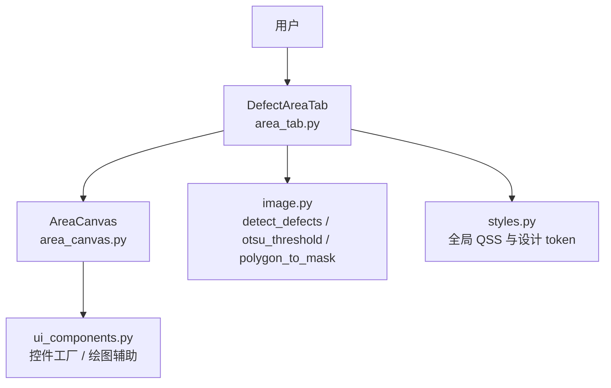
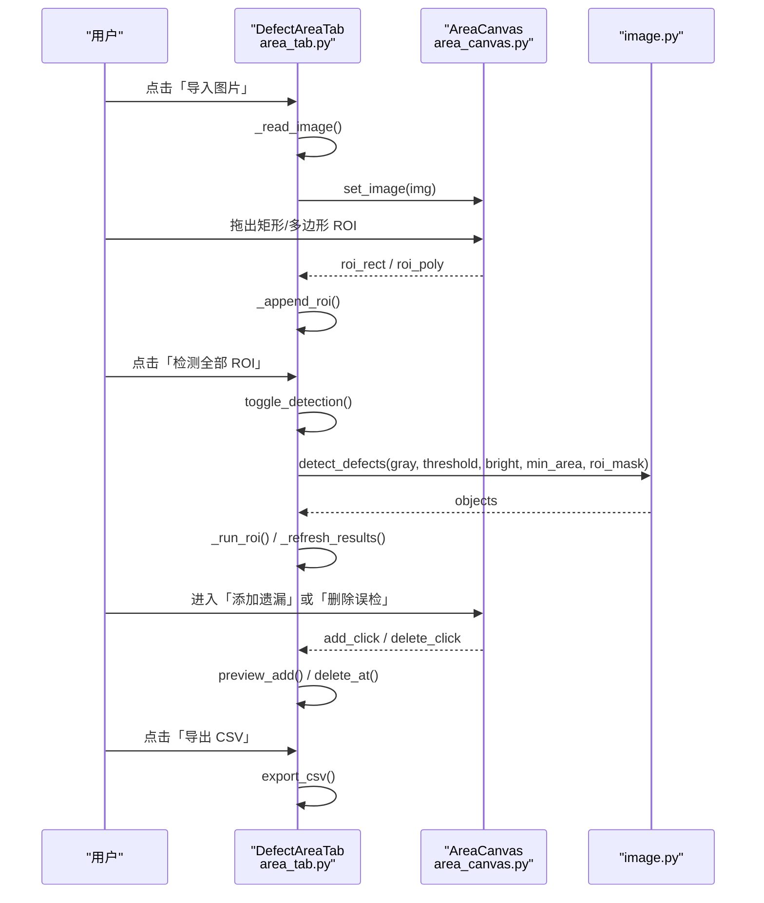
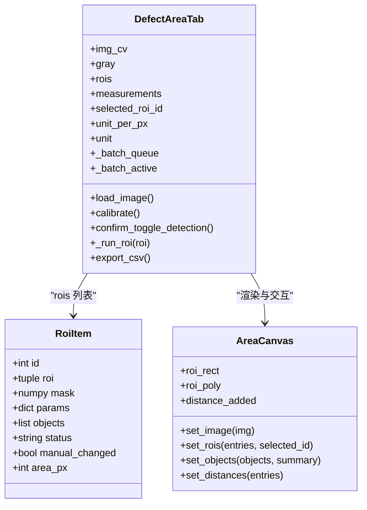
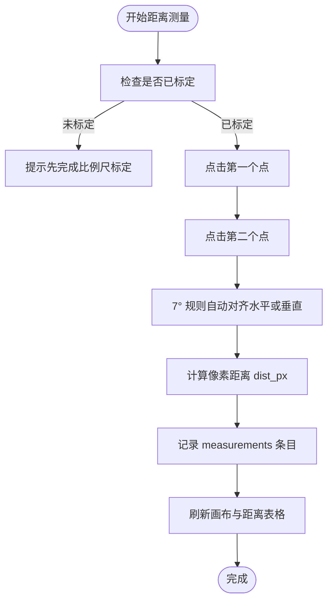
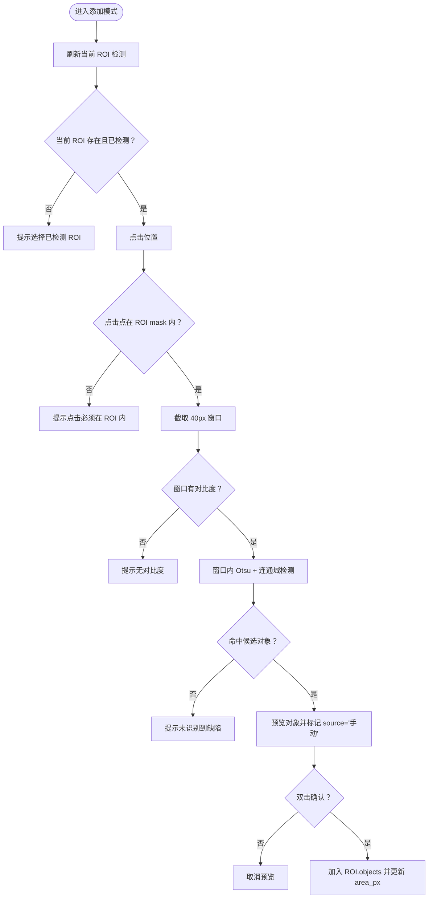
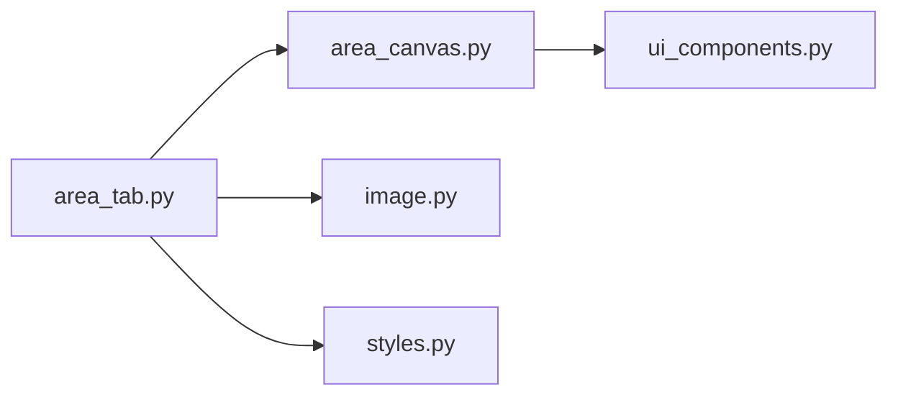

# 缺陷面积多 ROI 页面

<cite>
**本文引用的文件**   
- [area_tab.py](file://area_tab.py)
- [area_canvas.py](file://area_canvas.py)
- [image.py](file://image.py)
- [ui_components.py](file://ui_components.py)
- [styles.py](file://styles.py)
- [handoff.md](file://handoff.md)
</cite>

## 目录
1. [简介](#简介)
2. [项目结构](#项目结构)
3. [核心组件](#核心组件)
4. [架构总览](#架构总览)
5. [详细组件分析](#详细组件分析)
6. [依赖关系分析](#依赖关系分析)
7. [性能与大图处理](#性能与大图处理)
8. [最小用例：两个 ROI 导出合并 CSV](#最小用例两个-roi-导出合并-csv)
9. [已知限制与排查建议](#已知限制与排查建议)
10. [结论](#结论)

## 简介
本手册面向「缺陷面积多 ROI」页面，说明用户如何导入图片、标定像素比、添加多个矩形或多边形 ROI、为每个 ROI 设置独立阈值参数、批量检测、手动修正遗漏或误检对象，并查看每 ROI 的面积统计与距离测量，最终导出合并 CSV。

该页面的业务逻辑由 `area_tab.py` 控制，专用画布由 `area_canvas.py` 提供；图像算法（阈值分割、连通域/轮廓提取、Otsu 自动阈值、距离换算等）统一在 `image.py` 中实现。UI 契约以技能文档 `.qoder/skills/roi-page-ui-design/SKILL.md` 为准；若该文件不存在于当前仓库，则不得据此虚构交互细节，应以源码实际行为为准。

## 项目结构
缺陷面积多 ROI 功能涉及三层：
- GUI 层：`area_tab.py` 负责控件布局、状态管理、ROI 列表、批量检测调度、CSV 导出。
- 画布层：`area_canvas.py` 负责原图显示、缩放平移、ROI 绘制、对象掩膜叠加、距离线绘制与鼠标交互。
- 算法层：`image.py` 提供 `detect_defects`、`otsu_threshold`、`polygon_to_mask` 等函数。



**图表来源**
- [area_tab.py:110-150](file://area_tab.py#L110-L150)
- [area_canvas.py:85-130](file://area_canvas.py#L85-L130)
- [image.py:425-488](file://image.py#L425-L488)

**章节来源**
- [area_tab.py:1-30](file://area_tab.py#L1-L30)
- [area_canvas.py:1-15](file://area_canvas.py#L1-L15)
- [image.py:1-12](file://image.py#L1-L12)

## 核心组件
- `DefectAreaTab`：维护图片、灰度图、ROI 列表、检测结果、距离测量、批量队列、单位换算和 UI 刷新。
- `AreaCanvas`：继承自 `QWidget`，负责坐标变换、缩放平移、ROI 与对象绘制、距离线交互。
- `image.detect_defects`：按亮/暗缺陷进行二值化、可选 ROI 掩膜、连通域统计、外轮廓提取，返回带局部 mask 的对象列表。
- `image.otsu_threshold`：基于 ROI 内像素计算 Otsu 阈值。
- `image.polygon_to_mask`：将多边形顶点填充为整幅图像的 uint8 掩膜。

**章节来源**
- [area_tab.py:110-150](file://area_tab.py#L110-L150)
- [area_canvas.py:85-130](file://area_canvas.py#L85-L130)
- [image.py:180-197](file://image.py#L180-L197)
- [image.py:425-488](file://image.py#L425-L488)

## 架构总览
下图展示一次典型「批量检测 + 手动修正 + 导出」流程。



**图表来源**
- [area_tab.py:342-378](file://area_tab.py#L342-L378)
- [area_tab.py:561-590](file://area_tab.py#L561-L590)
- [area_tab.py:751-800](file://area_tab.py#L751-L800)
- [area_tab.py:821-847](file://area_tab.py#L821-L847)
- [area_tab.py:1029-1096](file://area_tab.py#L1029-L1096)
- [area_tab.py:1116-1166](file://area_tab.py#L1116-L1166)
- [image.py:425-488](file://image.py#L425-L488)

## 详细组件分析

### 数据流与用户操作顺序
1. **导入图片**  
   调用 `_read_image()` 解码 PNG/JPG/BMP/TIF，支持单页二维灰度、RGB、RGBA；16 位图像会按最大值归一化到 8 位。导入时不执行连通域检测，也不创建 ROI。

2. **像素比标定**  
   选择「划线标定」后在画布上拖动两点；短于 10px 会被拒绝。确认后弹出对话框输入实际长度和单位，计算 `unit_per_px = 实际长度 / 像素距离`，并在画布上显示标定线。

3. **添加多个 ROI**  
   - 矩形：拖拽生成 `(x, y, w, h)`，宽高至少为 6px。
   - 多边形：双击结束，至少 3 个顶点，且多边形面积不能为 0。
   每个 ROI 通过 `_append_roi()` 生成独立数据结构，并立即自动检测一次。

4. **为每个 ROI 设置独立参数**  
   切换 ROI 时，阈值滑块、亮/暗开关、最小面积会同步到当前 ROI 的 `params`。拖动阈值时防抖，松开后才重跑当前 ROI。

5. **批量检测**  
   「检测全部 ROI」会把所有 ROI 的状态设为 `pending`，清空已有对象，然后按队列逐个调用 `_run_roi()`，并通过状态栏提示进度。

6. **手动修正**  
   - 添加遗漏：在当前已检测 ROI 内点击，取 40px 窗口重新检测，匹配最近对象后预览，双击确认。
   - 删除误检：按对象 mask 命中删除，仅影响当前 ROI。

7. **查看面积统计与距离测量**  
   - ROI 表格显示每个 ROI 的状态、阈值、亮/暗、最小面积、缺陷数、总面积。
   - 下方明细表显示当前 ROI 的缺陷编号、像素面积、实际面积、来源。
   - 距离测量记录在全局 `measurements` 列表中，可导出单独的距离 CSV。

8. **导出 CSV**  
   缺陷面积 CSV 汇总所有 ROI 的所有对象；距离测量有独立导出入口。

**章节来源**
- [area_tab.py:53-92](file://area_tab.py#L53-L92)
- [area_tab.py:342-431](file://area_tab.py#L342-L431)
- [area_tab.py:561-590](file://area_tab.py#L561-L590)
- [area_tab.py:600-683](file://area_tab.py#L600-L683)
- [area_tab.py:751-847](file://area_tab.py#L751-L847)
- [area_tab.py:1029-1114](file://area_tab.py#L1029-L1114)
- [area_tab.py:1116-1166](file://area_tab.py#L1116-L1166)

### 多 ROI 数据结构与状态隔离
`rois` 是 `DefectAreaTab` 的核心数据结构，每个元素代表一个 ROI，关键字段如下：

| 字段 | 类型 | 含义 | 是否随 ROI 隔离 |
|---|---|---|---|
| `id` | int | 自增 ROI 编号 | 是 |
| `roi` | tuple | `('rect', (x,y,w,h))` 或 `('poly', points)` | 是 |
| `mask` | numpy uint8 | 与灰度图同形的 0/255 掩膜 | 是 |
| `params` | dict | `threshold`、`bright`、`min_area` | 是 |
| `objects` | list | 当前 ROI 检测到的缺陷对象 | 是 |
| `status` | str | `pending`、`active`、`error` | 是 |
| `manual_changed` | bool | 是否发生过手动增删 | 是 |
| `area_px` | int | 当前 ROI 所有对象的像素面积之和 | 是 |

关键隔离规则：
- 每个 ROI 有自己的 `mask`、`params`、`objects`、`status`。
- 切换 ROI 时，`_sync_parameter_widgets()` 把 UI 控件同步到当前 ROI 的 `params`。
- 批量检测时，每个 ROI 独立调用 `detect_defects(..., roi['mask'])`。
- 手动修正只修改当前 ROI 的 `objects`、`manual_changed` 和 `area_px`。
- 全局 `self.objects` 只是用于界面展示的扁平视图，由 `_refresh_results()` 从各 ROI 的 `objects` 拼接而成。



**图表来源**
- [area_tab.py:110-150](file://area_tab.py#L110-L150)
- [area_tab.py:659-683](file://area_tab.py#L659-L683)
- [area_tab.py:914-978](file://area_tab.py#L914-L978)
- [area_canvas.py:85-130](file://area_canvas.py#L85-L130)

**章节来源**
- [area_tab.py:659-683](file://area_tab.py#L659-L683)
- [area_tab.py:914-978](file://area_tab.py#L914-L978)

### 距离测量与物理单位换算
距离测量不绑定某个 ROI，而是全局记录。每次测量保存以下字段：

| 字段 | 含义 |
|---|---|
| `id` | 自增序号 |
| `p1` | 起点像素坐标 |
| `p2` | 终点像素坐标 |
| `dist_px` | 像素距离 |
| `constraint` | `h` 水平、`v` 垂直、空自由 |

物理距离换算公式为：

```
物理距离 = dist_px × unit_per_px
```

其中 `unit_per_px` 来自标定步骤：`unit_per_px = 实际长度 / 像素距离`。导出距离 CSV 的列包括序号、物理距离、像素距离、起点 X/Y、终点 X/Y、约束类型。



**图表来源**
- [area_tab.py:409-431](file://area_tab.py#L409-L431)
- [area_tab.py:444-500](file://area_tab.py#L444-L500)
- [area_tab.py:502-543](file://area_tab.py#L502-L543)
- [area_canvas.py:52-65](file://area_canvas.py#L52-L65)

**章节来源**
- [area_tab.py:409-543](file://area_tab.py#L409-L543)
- [area_canvas.py:52-65](file://area_canvas.py#L52-L65)

### 手动修正流程
手动修正分为「添加遗漏」和「删除误检」。添加流程的关键判断如下：



**图表来源**
- [area_tab.py:1025-1096](file://area_tab.py#L1025-L1096)
- [area_tab.py:95-107](file://area_tab.py#L95-L107)

**章节来源**
- [area_tab.py:95-107](file://area_tab.py#L95-L107)
- [area_tab.py:1025-1096](file://area_tab.py#L1025-L1096)

### 导出格式
缺陷面积 CSV 使用固定列名：

| 列名 | 含义 |
|---|---|
| ROI编号 | ROI 的 `id` |
| 缺陷编号 | 对象在该 ROI 中的 `id` |
| 像素面积 | `area_px` |
| 实际面积 | 未标定时为空；否则为 `area_px × unit_per_px²` |
| 面积单位 | 未标定时为「未标定」；否则为 `µm²`、`mm²` 等 |
| 质心x_px | 对象质心 x 坐标 |
| 质心y_px | 对象质心 y 坐标 |
| 来源 | 「自动」或「手动」 |

距离测量 CSV 使用列名：序号、距离（物理单位）、距离(px)、起点X、起点Y、终点X、终点Y、约束。

**章节来源**
- [area_tab.py:31-36](file://area_tab.py#L31-L36)
- [area_tab.py:502-543](file://area_tab.py#L502-L543)
- [area_tab.py:1116-1166](file://area_tab.py#L1116-L1166)

## 依赖关系分析
- `area_tab.py` 依赖 `area_canvas.AreaCanvas` 进行可视化与交互。
- `area_tab.py` 依赖 `image.detect_defects`、`image.otsu_threshold`、`image.polygon_to_mask` 进行图像处理。
- `area_canvas.py` 依赖 `ui_components.paint_empty_state` 显示空状态。
- GUI 设计 token 和全局样式由 `styles.py` 提供，控件工厂由 `ui_components.py` 提供。



**图表来源**
- [area_tab.py:21-28](file://area_tab.py#L21-L28)
- [area_canvas.py:12](file://area_canvas.py#L12)

**章节来源**
- [area_tab.py:21-28](file://area_tab.py#L21-L28)
- [area_canvas.py:1-15](file://area_canvas.py#L1-L15)

## 性能与大图处理
- 批量检测采用队列逐 ROI 执行，并通过状态栏提示「正在检测 ROI X/Y」，但不会阻塞整个 GUI 主循环。
- 算法层 `image.py` 内部有 `_pump_events()`，在长循环中尝试调用 `QApplication.processEvents()`，以便在无阻塞场景下让界面有机会刷新。
- 当前实现没有独立的进度条或百分比进度；对于大图增强检测，用户可能感觉界面长时间无响应，这是已知限制之一。
- ROI 数量较多时，每个 ROI 都会执行一次连通域检测，并生成对象列表与局部 mask；同时 `_refresh_results()` 会重建全局对象列表和多个表格项，因此 ROI 数量、对象数量和图像尺寸都会影响性能。
- 推荐实践：
  - 先缩小 ROI 范围，避免全图检测。
  - 合理设置最小面积，减少小噪声对象。
  - 对差异较大的区域分别建 ROI，而不是用一个超大 ROI 覆盖全图。
  - 批量检测完成后，再对单个 ROI 调参重跑，避免频繁触发全量刷新。

**章节来源**
- [area_tab.py:803-847](file://area_tab.py#L803-L847)
- [area_tab.py:914-978](file://area_tab.py#L914-L978)
- [image.py:14-24](file://image.py#L14-L24)
- [image.py:462-488](file://image.py#L462-L488)

## 最小用例：两个 ROI 导出合并 CSV
目标：同一张图片上有两类不同密度的空洞，分别用两个 ROI 检测，并导出合并 CSV。

操作步骤：
1. 打开「缺陷面积多 ROI」页面，点击「导入图片」。
2. 如果需要进行物理单位统计，使用「划线标定」画出已知长度线段，输入实际长度和单位。
3. 选择「矩形框选」，在密度较低的空洞区域拖出一个 ROI。
4. 调整「二值化阈值」和「检测亮色缺陷」开关，使该 ROI 能稳定检出低密度空洞。
5. 再次选择「矩形框选」，在密度较高的空洞区域拖出第二个 ROI。
6. 切换到第二个 ROI，调整其阈值和最小面积，使其适合高密度空洞。
7. 点击「检测全部 ROI」，等待状态栏提示全部完成。
8. 如需修正，可在任一 ROI 上使用「添加遗漏」或「删除误检」。
9. 点击「导出 CSV」，得到包含两个 ROI 所有缺陷的合并文件。
10. 如需导出距离测量，使用「导出距离 CSV」，该文件与缺陷面积 CSV 分开。

预期结果：
- 合并 CSV 中第一列为 ROI 编号，第二列为缺陷编号，第三列为像素面积，第四列为实际面积（若已标定），第五列为面积单位，第六、七列为质心坐标，第八列为来源。
- 两个 ROI 的结果在同一文件中，可通过「ROI编号」区分。

**章节来源**
- [area_tab.py:342-431](file://area_tab.py#L342-L431)
- [area_tab.py:561-683](file://area_tab.py#L561-L683)
- [area_tab.py:751-847](file://area_tab.py#L751-L847)
- [area_tab.py:1116-1166](file://area_tab.py#L1116-L1166)

## 已知限制与排查建议
根据仓库现有代码与历史交接清单，以下问题属于已知限制或技术债：

| 类别 | 现象 | 原因或现状 | 排查建议 |
|---|---|---|---|
| 重复实现 | `main_window.py` 中存在 `detect_voids_local` 副本 | 与 `image.py` 中的空洞检测逻辑重复 | 以 `image.py` 为准；后续应合并，避免两份逻辑漂移 |
| Canny 校验静默失效 | edge_map 未初始化导致边缘验证跳过 | 部分分支中 `edge_map` 未赋值即参与条件判断 | 检查增强检测路径；若需边缘校验，确保 edge_map 正确初始化 |
| 大图增强检测无进度提示 | 用户无法看到百分比进度 | 只有状态栏文字提示，无独立进度条 | 接受现状；必要时增加进度回调或线程任务 |
| ROI 数量较多 | 界面刷新慢、检测耗时 | 每个 ROI 都执行完整检测并重建表格 | 分批检测、缩小 ROI、提高最小面积 |
| 滚轮缩放 Y 轴漂移 | canvas.py 存在 Y 轴漂移已知问题 | 缩放锚点计算存在偏差 | 暂不依赖该修复；注意放大后纵向偏移 |
| select_for_local 死代码 | 无 UI 入口 | 代码存在但未被使用 | 清理或接入功能前不要视为可用能力 |
| chk_roi_overlay 重复创建 | 控件可能被重复创建 | UI 构建逻辑存在问题 | 检查控件生命周期，避免重复 addWidget |
| 手动添加重复计数 | 添加对象会与已有对象像素重叠 | 已有 `_overlaps` 检查，但仍需关注边界情况 | 添加失败时检查 ROI mask 和阈值 |

此外，UI 契约方面：
- 缺陷面积页的 UI 权威契约是 `.qoder/skills/roi-page-ui-design/SKILL.md`；若该文件不存在，不得据此虚构按钮文案、布局或交互。
- 全局样式由 `styles.py` 提供，控件工厂由 `ui_components.py` 提供；`create_groupbox()` 必须使用合适的尺寸策略，否则控件可能被裁剪。

**章节来源**
- [handoff.md](file://handoff.md)
- [area_tab.py:95-107](file://area_tab.py#L95-L107)
- [area_tab.py:1029-1096](file://area_tab.py#L1029-L1096)
- [image.py:228-234](file://image.py#L228-L234)

## 结论
缺陷面积多 ROI 页面以 `area_tab.py` 为核心控制器，通过 `area_canvas.py` 提供统一的图像交互体验，并以 `image.py` 作为唯一算法实现层。多 ROI 的数据结构以 `rois` 列表为中心，每个 ROI 拥有独立的 mask、参数、对象集合和状态，从而实现 ROI 间检测与手动修正的隔离。

用户应按「导入图片 → 标定 → 添加多个 ROI → 设置独立参数 → 批量检测 → 手动修正 → 查看统计 → 导出 CSV」的顺序操作。若需要物理单位面积或距离测量，必须先完成比例尺标定。导出产物包括合并缺陷面积 CSV 和独立距离测量 CSV。

已知限制主要集中在大图增强检测缺少明确进度提示、部分算法分支存在技术债、以及滚动缩放与 UI 控件生命周期方面的历史问题。未来改进应优先收敛重复算法实现、完善错误路径初始化，并为批量任务提供更清晰的进度反馈。