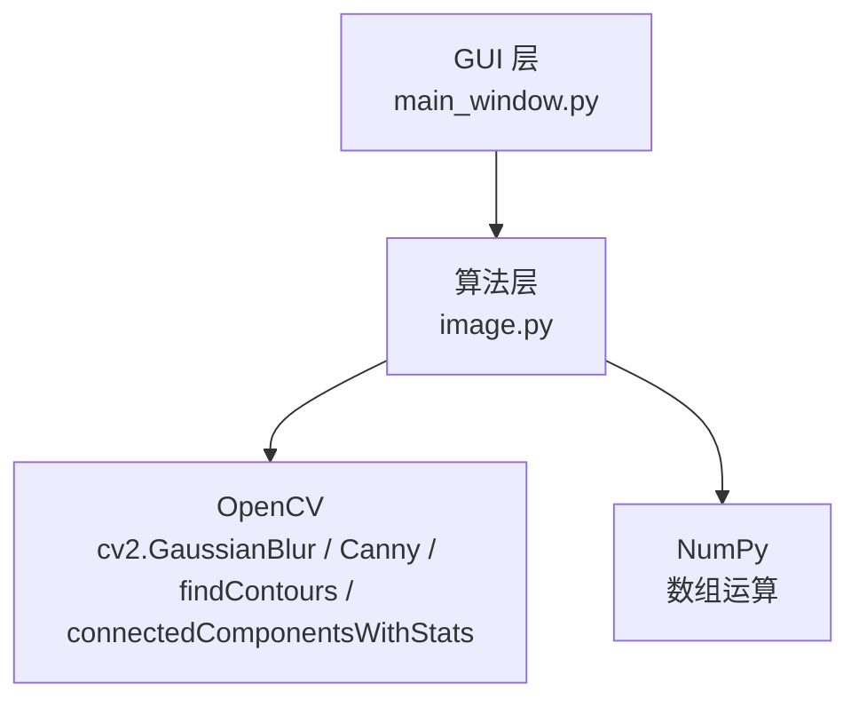
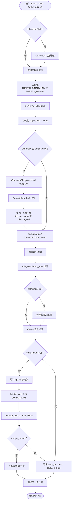
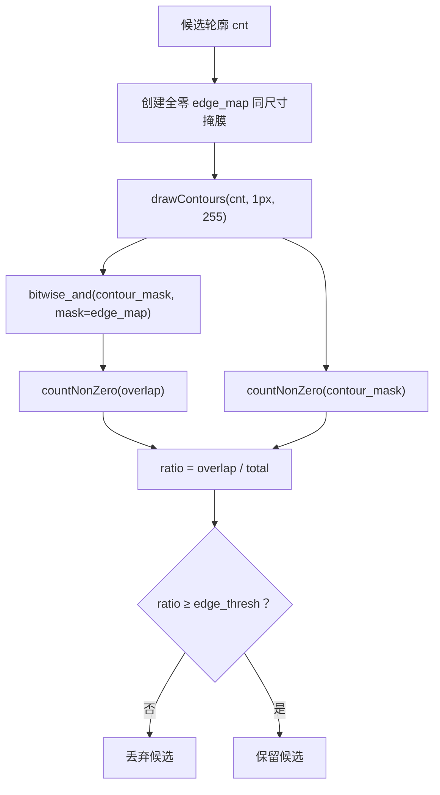
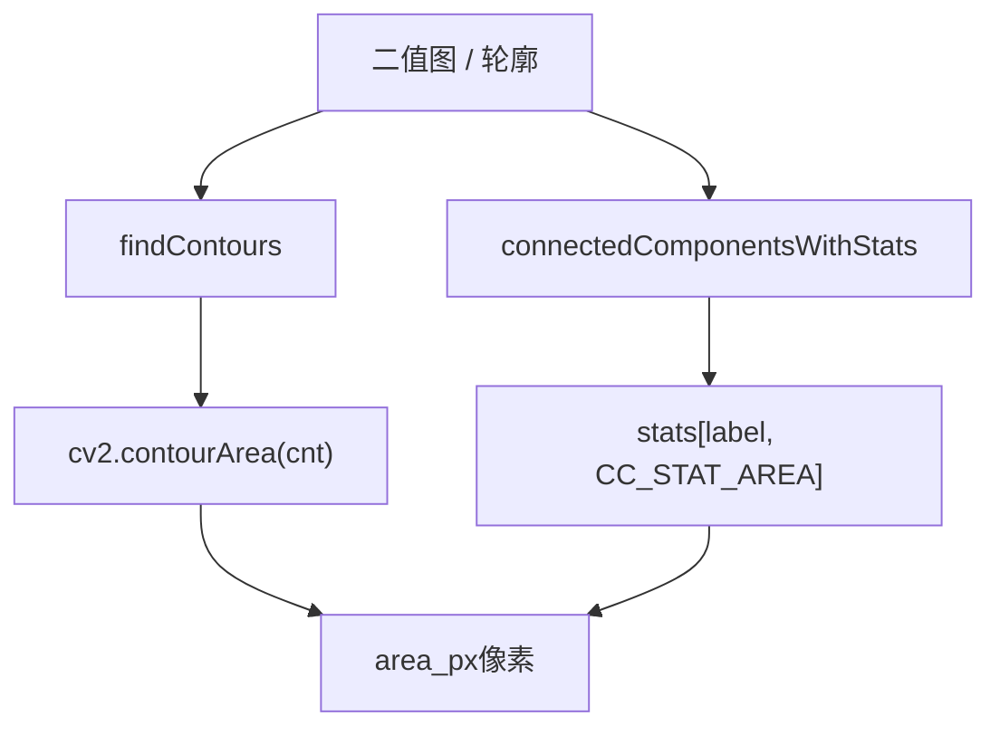
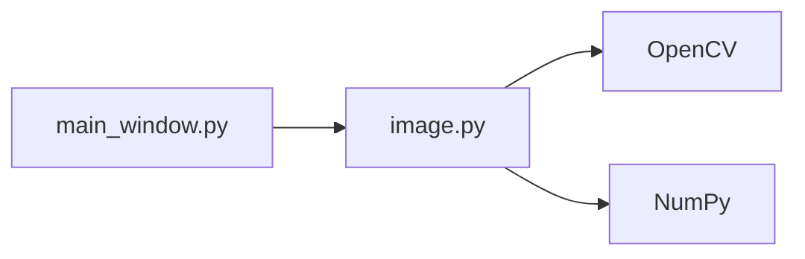

# Canny 边缘校验与面积统计

<cite>
**本文引用的文件**   
- [image.py](file://image.py)
- [main_window.py](file://main_window.py)
</cite>

## 目录
1. [引言](#引言)
2. [项目结构定位](#项目结构定位)
3. [核心组件](#核心组件)
4. [架构总览](#架构总览)
5. [详细组件分析](#详细组件分析)
6. [依赖关系分析](#依赖关系分析)
7. [性能考虑](#性能考虑)
8. [故障排查指南](#故障排查指南)
9. [结论](#结论)

## 引言
本文聚焦 image.py 中的 Canny 边缘校验与面积统计机制，说明以下目标：
- edge_verify 的完整处理流程：高斯模糊 → Canny 边缘检测 → 与 ROI/interior_mask 做按位与 → 对每个候选轮廓绘制 1px 掩膜 → 计算 overlap_pixels / total_pixels，若小于 edge_thresh（默认 0.3）则丢弃该空洞或对象。
- 该机制的业务目的：验证空洞/缺陷是否确实位于真实边缘上，避免把均匀暗区误判为空洞。
- detect_voids() 与 detect_objects() 中 edge_map 初始化的差异，以及 enhanced=False 时 edge_map 为 None、Canny 校验被静默跳过的已知限制。
- area_px 的来源：findContours 路径使用 cv2.contourArea(cnt)，connectedComponentsWithStats 路径使用 stats[label, CC_STAT_AREA]，两者均为像素单位。
- 调试建议：临时关闭 edge_verify 观察是否因边缘过弱导致漏检；调整 edge_thresh 降低阈值可放宽要求。

## 项目结构定位
Aurascope 是 PyQt6 + OpenCV + NumPy + Pandas 的单机桌面应用。根据仓库约定，图像算法实现集中在 image.py，GUI 层不得内联实现图像算法。空洞分析、缺陷面积、物料计数等主业务线最终调用 image.py 中的 detect_voids、detect_defects、detect_objects 等函数。

**图表来源**
- [image.py:1-11](file://image.py#L1-L11)
- [main_window.py:1879-1906](file://main_window.py#L1879-L1906)

**章节来源**
- [image.py:1-11](file://image.py#L1-L11)
- [main_window.py:1879-1906](file://main_window.py#L1879-L1906)

## 核心组件
本节从业务角度梳理与 Canny 边缘校验和面积统计直接相关的三个入口：
- detect_voids：空洞检测，支持 enhanced、CLAHE、形态学去噪、ROI 腐蚀、圆度过滤、edge_verify 与 edge_thresh。
- detect_voids_local：local threshold 版本，存在与 detect_voids 重复的实现，属于已知技术债；现行行为以 image.py 为准。
- detect_objects：物料计数，复用空洞检测核心逻辑，同样支持 enhanced、形态学、圆度、edge_verify、edge_thresh，但 ROI 约束语义不同。
- detect_defects：基于连通域的面积统计，area_px 来自 CC_STAT_AREA。

**章节来源**
- [image.py:200-286](file://image.py#L200-L286)
- [image.py:328-422](file://image.py#L328-L422)
- [image.py:425-488](file://image.py#L425-L488)
- [image.py:491-632](file://image.py#L491-L632)

## 架构总览
下图展示 edge_verify 在空洞检测与对象检测中的位置：enhanced 控制 CLAHE 与形态学增强，edge_verify 控制 Canny 边缘图生成与轮廓边缘覆盖率判断。

**图表来源**
- [image.py:200-286](file://image.py#L200-L286)
- [image.py:491-632](file://image.py#L491-L632)

## 详细组件分析

### edge_verify 工作流程
edge_verify 的核心目标是确认一个候选空洞或对象是否落在真实边缘上。其关键步骤如下：

1. **高斯模糊**  
   对 processed 图像执行 `GaussianBlur(processed, (5, 5), 1.0)`，抑制噪声，使 Canny 更关注稳定边缘。

2. **Canny 边缘检测**  
   使用 `Canny(blurred, 30, 100)` 得到二值边缘图。低阈值 30、高阈值 100 用于平衡敏感性与抗噪性。

3. **与 ROI 或 interior_mask 做按位与**  
   - detect_voids：edge_map 与 roi_mask 做按位与，确保只保留用户指定 ROI 内的边缘。
   - detect_voids_local：edge_map 与 interior_mask 做按位与，因为该路径先对 roi_mask 做了腐蚀得到 interior_mask。
   - detect_objects：当前实现未对 edge_map 再做一次 ROI/interior_mask 裁剪，仅保留全局 Canny 结果。

4. **对每个轮廓绘制 1px 轮廓掩膜**  
   用 `cv2.drawContours(contour_mask, [cnt], -1, 255, 1)` 生成与原图同尺寸的 1px 宽轮廓掩膜。

5. **计算 overlap_pixels / total_pixels**  
   - overlap_pixels：`cv2.bitwise_and(contour_mask, contour_mask, mask=edge_map)` 的非零像素数。
   - total_pixels：contour_mask 的非零像素数。
   - 若 total_pixels > 0 且 ratio < edge_thresh（默认 0.3），则丢弃该候选。

**图表来源**
- [image.py:255-263](file://image.py#L255-L263)
- [image.py:392-399](file://image.py#L392-L399)
- [image.py:602-610](file://image.py#L602-L610)

**章节来源**
- [image.py:228-233](file://image.py#L228-L233)
- [image.py:255-263](file://image.py#L255-L263)
- [image.py:366-370](file://image.py#L366-L370)
- [image.py:392-399](file://image.py#L392-L399)
- [image.py:576-580](file://image.py#L576-L580)
- [image.py:602-610](file://image.py#L602-L610)

### detect_voids 与 detect_objects 中 edge_map 初始化的差异
两个函数都遵循“enhanced 且 edge_verify 时才创建 edge_map”的模式，但细节不同：

| 函数 | 输入图像 | 高斯模糊输入 | Canny 输出 | 后续掩码操作 |
|---|---|---|---|---|
| detect_voids | processed（CLAHE 后） | processed | Canny(blurred, 30, 100) | bitwise_and(edge_map, edge_map, mask=roi_mask) |
| detect_voids_local | gray_img（CLAHE 后） | gray_img | Canny(blurred, 30, 100) | bitwise_and(edge_map, edge_map, mask=interior_mask) |
| detect_objects | processed（CLAHE 后） | processed | Canny(blurred, 30, 100) | 无额外 ROI/interior_mask 裁剪 |

这意味着：
- detect_voids 的 edge_map 被限制在 roi_mask 范围内。
- detect_voids_local 的 edge_map 被限制在 interior_mask 范围内。
- detect_objects 的 edge_map 是全局边缘图，没有显式再与 roi_mask 做按位与。

此外，三者都在 enhanced=False 时跳过 edge_map 创建，edge_map 保持为 None。此时即使 edge_verify=True，条件 `enhanced and edge_verify and edge_map is not None` 也会失败，Canny 校验被静默跳过。这是 handoff.md 记录的已知限制之一。

**章节来源**
- [image.py:228-233](file://image.py#L228-L233)
- [image.py:366-370](file://image.py#L366-L370)
- [image.py:576-580](file://image.py#L576-L580)
- [image.py:255-263](file://image.py#L255-L263)
- [image.py:392-399](file://image.py#L392-L399)
- [image.py:602-610](file://image.py#L602-L610)

### area_px 的来源与单位
area_px 表示对象的像素面积，不是物理面积。它有两个主要来源：

1. **findContours 路径**  
   在 detect_voids、detect_voids_local、detect_objects 中，area 通过 `cv2.contourArea(cnt)` 计算，单位为像素。

2. **connectedComponentsWithStats 路径**  
   在 detect_defects 中，area 通过 `stats[label, cv2.CC_STAT_AREA]` 获取，单位也是像素。

因此，area_px 是 OpenCV 内部计算的像素级面积，适合用于 min_area/max_area 过滤、排序、可视化标注；若需要微米或其他物理单位，应由上层根据 px_per_um 换算。

**图表来源**
- [image.py:241-241](file://image.py#L241-L241)
- [image.py:378-378](file://image.py#L378-L378)
- [image.py:588-588](file://image.py#L588-L588)
- [image.py:469-469](file://image.py#L469-L469)

**章节来源**
- [image.py:241-241](file://image.py#L241-L241)
- [image.py:378-378](file://image.py#L378-L378)
- [image.py:469-469](file://image.py#L469-L469)
- [image.py:588-588](file://image.py#L588-L588)

### 为什么需要 Canny 边缘校验
空洞检测通常基于“暗区”二值化。如果图像中存在大面积均匀暗区，而不是真正的空洞边界，二值化可能把这些区域也识别为空洞。Canny 边缘校验的作用就是增加一层几何真实性检查：

- 如果候选轮廓的边缘像素很少与 Canny 边缘重合，说明它可能只是均匀暗区，而非真实边缘。
- 当 overlap_pixels / total_pixels < edge_thresh 时，丢弃该候选。
- 默认 edge_thresh=0.3 意味着至少 30% 的轮廓像素需要与 Canny 边缘重叠。

这能有效减少把背景暗区、阴影、污渍误判为空洞的概率。

**章节来源**
- [image.py:255-263](file://image.py#L255-L263)
- [image.py:392-399](file://image.py#L392-L399)
- [image.py:602-610](file://image.py#L602-L610)

## 依赖关系分析
image.py 作为算法层，依赖 OpenCV 和 NumPy；main_window.py 作为 GUI 层，负责 UI 配置与调用算法。

**图表来源**
- [image.py:1-11](file://image.py#L1-L11)
- [main_window.py:1879-1906](file://main_window.py#L1879-L1906)

**章节来源**
- [image.py:1-11](file://image.py#L1-L11)
- [main_window.py:1879-1906](file://main_window.py#L1879-L1906)

## 性能考虑
- GaussianBlur 与 Canny 只在 enhanced 且 edge_verify 时执行，避免不必要的计算。
- 长循环中使用 `_pump_events()` 每 10 个轮廓刷新一次界面事件，防止 GUI 卡顿。
- detect_defects 使用 connectedComponentsWithStats 一次性获得多个连通域的面积、bbox、质心，比逐轮廓分配整幅掩膜更高效。
- detect_objects 的 watershed_enabled 分支会提前返回，不再走常规 findContours 路径，避免重复计算。

[本节为通用性能讨论，不直接分析具体代码行，故不附“章节来源”]

## 故障排查指南
当出现空洞或对象漏检时，可按以下步骤排查：

1. **临时关闭 edge_verify**  
   将 edge_verify 设为 False，观察是否恢复检出。如果关闭后能检出，说明问题很可能出在边缘过弱，Canny 无法检测到足够边缘。

2. **调整 edge_thresh**  
   默认值为 0.3。若怀疑边缘校验过于严格，可降低 edge_thresh，例如降到 0.1~0.2，放宽“轮廓像素必须与 Canny 边缘重叠”的要求。

3. **检查 enhanced 设置**  
   如果 enhanced=False，edge_map 会被初始化为 None，Canny 校验被静默跳过。此时 edge_verify=True 也不会生效。若要启用 Canny 校验，需同时开启 enhanced。

4. **检查 ROI 与 interior_mask**  
   - detect_voids 使用 roi_mask 裁剪 edge_map。
   - detect_voids_local 使用 interior_mask 裁剪 edge_map。
   - 如果 ROI 过小或腐蚀过度，可能导致 edge_map 中没有有效边缘，从而误判。

5. **检查图像质量**  
   如果图像本身对比度低、噪声大，CLAHE 与形态学可能不足以产生清晰边缘。可尝试调整 clahe_clip_limit、morph_kernel 或阈值。

6. **区分 detect_voids 与 detect_objects 的行为差异**  
   detect_objects 不会像 detect_voids 那样对 edge_map 再做一次 roi_mask 裁剪。若期望对象检测也受 ROI 约束，应确认调用方是否正确传入 roi_mask，并注意当前实现中 edge_map 是全局边缘图。

**章节来源**
- [image.py:228-233](file://image.py#L228-L233)
- [image.py:255-263](file://image.py#L255-L263)
- [image.py:366-370](file://image.py#L366-L370)
- [image.py:392-399](file://image.py#L392-L399)
- [image.py:576-580](file://image.py#L576-L580)
- [image.py:602-610](file://image.py#L602-L610)

## 结论
Canny 边缘校验是 Aurascope 空洞与对象检测中的一道重要防线。它通过高斯模糊、Canny 边缘检测、ROI/interior_mask 裁剪、1px 轮廓掩膜与 overlap 比例判断，帮助系统区分“真实边缘上的空洞/对象”和“均匀暗区”。area_px 统一以像素为单位，来源于 OpenCV 的轮廓面积或连通域面积统计。

在实际使用中，若发现漏检，优先检查 enhanced 与 edge_verify 的组合、edge_thresh 的严格程度、ROI 与 interior_mask 的有效性，以及图像本身的边缘质量。对于 detect_objects，还需注意其 edge_map 未像 detect_voids 那样显式裁剪到 roi_mask，这是实现层面的差异，应在调参与集成时明确预期。

[本节为总结性内容，不直接分析具体文件，故不附“章节来源”]