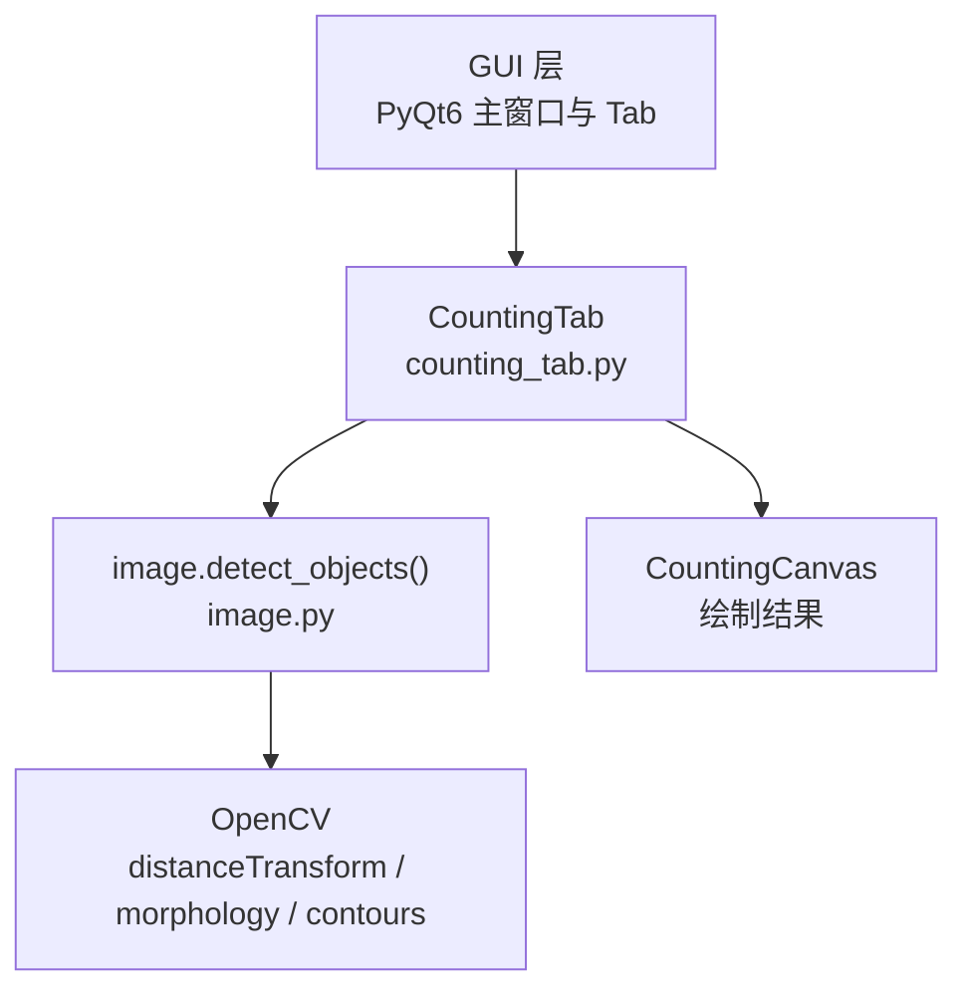
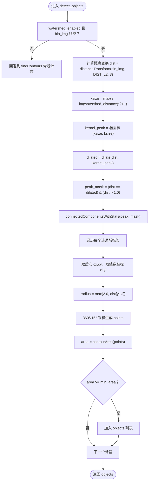
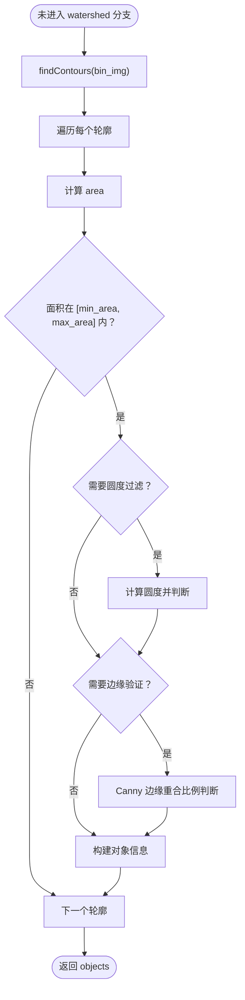
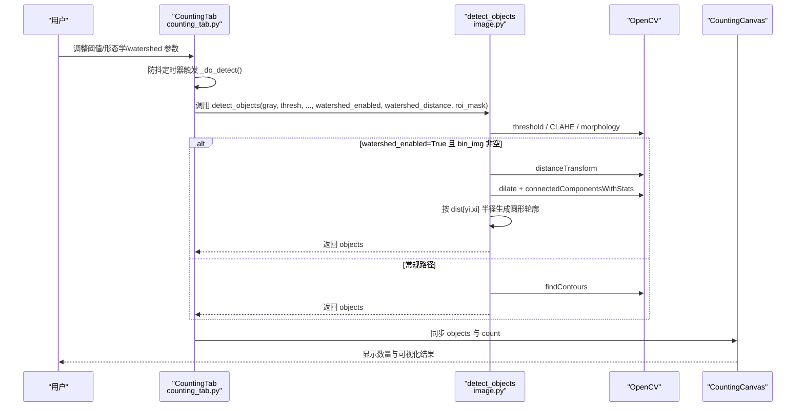
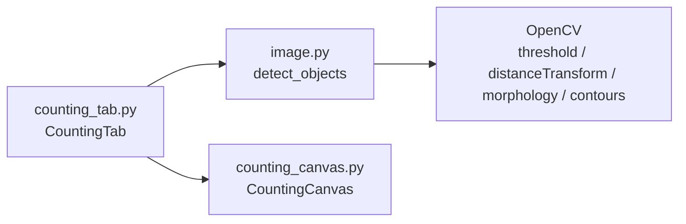

# distanceTransform 局部极大值计数

<cite>
**本文引用的文件**   
- [image.py](file://image.py)
- [counting_tab.py](file://counting_tab.py)
- [README.md](file://README.md)
- [PROJECT_CONCEPTION.md](file://PROJECT_CONCEPTION.md)
</cite>

## 目录
1. [引言](#引言)
2. [项目结构](#项目结构)
3. [核心组件](#核心组件)
4. [架构总览](#架构总览)
5. [详细组件分析](#详细组件分析)
6. [依赖关系分析](#依赖关系分析)
7. [性能考虑](#性能考虑)
8. [故障排查指南](#故障排查指南)
9. [结论](#结论)

## 引言
本文聚焦 `image.py` 中 `detect_objects()` 的 `watershed_enabled` 分支，说明其基于距离变换与形态学膨胀的「局部极大值种子点」计数方法。该方法适用于蓝膜上 LD、Submount 等近似圆形且容易粘连的物料：先对二值掩膜做距离变换，再用椭圆核膨胀找局部极大值作为种子点，随后按每个峰值处的 `dist[yi,xi]` 半径生成 360°/15° 采样点的圆形轮廓，并用 `cv2.contourArea` 估算面积后计数。

## 项目结构
Aurascope 是面向微电子封装产线的半自动化视觉检测桌面应用，采用 PyQt6 + OpenCV + NumPy + Pandas 技术栈；算法逻辑集中在 `image.py`，GUI 层通过 Tab 页面调用该模块。物料计数功能对应 `counting_tab.py` / `counting_canvas.py`，其中参数最终传入 `image.detect_objects()`。

**图表来源**
- [counting_tab.py:19-36](file://counting_tab.py#L19-L36)
- [counting_tab.py:395-412](file://counting_tab.py#L395-L412)
- [image.py:491-507](file://image.py#L491-L507)

**章节来源**
- [README.md:1-14](file://README.md#L1-L14)
- [PROJECT_CONCEPTION.md:38-45](file://PROJECT_CONCEPTION.md#L38-L45)
- [counting_tab.py:19-36](file://counting_tab.py#L19-L36)

## 核心组件
本节重点解析 `detect_objects()` 在启用 `watershed_enabled=True` 时的处理路径。

### 入口与参数
`detect_objects()` 是图像算法层的统一入口之一，负责阈值化、可选 CLAHE 增强、形态学开闭运算、ROI 掩膜裁剪，以及两种计数策略：

| 参数 | 含义 | 默认值 | 行为说明 |
|---|---|---:|---|
| `gray_img` | 输入灰度图 | 必填 | 后续二值化与距离变换的基础 |
| `thresh_val` | 二值化阈值 | 必填 | 结合 `invert` 决定亮/暗物体 |
| `min_area` | 最小面积过滤 | 1 | 单位像素，用于过滤噪声或过小对象 |
| `max_area` | 最大面积过滤 | `None` | 关闭时不限制上限 |
| `enhanced` | 是否启用增强流程 | `False` | 控制 CLAHE、Canny 边缘验证等 |
| `clahe_enabled` | 是否启用 CLAHE | `True` | 需 `enhanced=True` 才生效 |
| `morph_enabled` | 是否启用形态学去噪 | `True` | 开运算 + 闭运算 |
| `morph_kernel` | 形态学核尺寸 | 3 | 影响开闭核大小 |
| `morph_shape` | 形态学核形状 | `cv2.MORPH_ELLIPSE` | 椭圆核更贴合圆形物体 |
| `min_roundness` | 圆度下限 | 0.0 | 非 watershed 分支使用 |
| `edge_verify` | Canny 边缘验证 | `False` | 非 watershed 分支使用 |
| `edge_thresh` | 边缘重合阈值 | 0.3 | 非 watershed 分支使用 |
| `invert` | 反相开关 | `False` | `True` 表示检测亮色物体 |
| `watershed_enabled` | 启用距离峰值计数 | `False` | 本专题关注分支 |
| `watershed_distance` | 最小峰值间距（像素） | 0.5 | 控制膨胀核大小与峰值分离强度 |
| `roi_mask` | ROI 掩膜 | `None` | 与二值图做位与，限定检测区域 |

**章节来源**
- [image.py:491-526](file://image.py#L491-L526)

### 预处理阶段
无论是否启用 watershed，函数都会执行以下通用步骤：

1. **CLAHE 增强**：当 `enhanced=True` 且 `clahe_enabled=True` 时，先用 CLAHE 提升对比度。
2. **阈值化**：根据 `invert` 选择 `THRESH_BINARY_INV` 或 `THRESH_BINARY`，得到 `bin_img`。
3. **形态学处理**：若 `enhanced=True`、`morph_enabled=True` 且 `morph_kernel > 1`，先做开运算再闭合，有助于去除细小噪声并连接断裂边缘。
4. **ROI 掩膜**：若提供 `roi_mask`，则用位与操作把检测范围限制在 ROI 内。

这些步骤为后续的 watershed 分支和常规轮廓分支提供干净的二值输入。

**章节来源**
- [image.py:527-544](file://image.py#L527-L544)

### watershed_enabled 分支：距离变换与局部极大值
当满足以下条件时进入该分支：

- `watershed_enabled=True`
- `cv2.countNonZero(bin_img) > 0`，即二值图中至少有一个前景像素

进入后的关键流程如下：

**图表来源**
- [image.py:544-572](file://image.py#L544-L572)

#### 关键变量与计算
- **距离变换**：`dist = cv2.distanceTransform(bin_img, cv2.DIST_L2, 3)`  
  对二值前景中的每个像素计算到最近背景像素的距离，数值越大说明离边界越远，适合用来定位物体中心。
- **膨胀核尺寸**：`ksize = max(3, int(watershed_distance) * 2 + 1)`  
  这里把 `watershed_distance` 当作“最小峰值间距”的像素尺度，并通过 `*2+1` 构造对称奇数核尺寸。
- **局部极大值掩膜**：`peak_mask = np.uint8((dist == dilated) & (dist > 1.0))`  
  - `(dist == dilated)` 表示该位置是膨胀后的局部最大值。
  - `dist > 1.0` 用于过滤极小噪声峰值，避免把单个像素抖动或微小毛刺当成有效种子点。
- **连通域统计**：`cv2.connectedComponentsWithStats(peak_mask)` 提取每个峰值连通域的质心。
- **半径估计**：`radius = max(2.0, dist[yi, xi])`  
  以峰值处距离值作为半径下界，同时保证最小半径为 2.0，避免太小导致面积被过滤。
- **圆形轮廓生成**：从 0° 到 360°，步长 15°，共 24 个点，用极坐标公式生成 `points`。
- **面积估算**：`cv2.contourArea(np.array(pts, dtype=np.int32))` 对多边形近似圆求面积，再与 `min_area` 比较。

#### 为什么用 `dist > 1.0` 过滤噪声峰值
距离变换结果中，靠近二值边界的像素距离接近 0，而孤立噪声点或边缘毛刺可能产生很小的局部极大值。设置 `dist > 1.0` 可以剔除这类低置信度峰值，只保留具有一定“内部深度”的种子点，从而降低误检率。

#### 为什么用 360°/15° 采样生成 points 并用 `contourArea` 估算面积
- 360°/15° 采样生成 24 个均匀角度点，构成一个近似圆的多边形，计算量远低于完整轮廓拟合。
- 使用 `cv2.contourArea` 可以把这个多边形当作轮廓来计算面积，从而复用统一的面积过滤逻辑 `min_area`。
- 对于近似圆形物料，这种半径法能稳定给出合理的面积估计；对于严重非圆物体，该分支的面积只是近似值，实际业务中应优先确保二值化与形态学预处理质量。

**章节来源**
- [image.py:544-572](file://image.py#L544-L572)

### 回退路径：findContours 常规计数
如果 `watershed_enabled=False`，或者 `bin_img` 为空，则跳过距离峰值分支，直接走常规轮廓计数：

1. `cv2.findContours(bin_img, RETR_EXTERNAL, CHAIN_APPROX_SIMPLE)` 提取外部轮廓。
2. 可选圆度过滤：当 `enhanced=True` 且 `min_roundness > 0` 时，计算圆度并丢弃低于阈值的轮廓。
3. 可选 Canny 边缘验证：当 `enhanced=True` 且 `edge_verify=True` 时，检查轮廓与 Canny 边缘的重合比例。
4. 计算面积、外接矩形、质心、顶点，并加入结果列表。

**图表来源**
- [image.py:574-632](file://image.py#L574-L632)

**章节来源**
- [image.py:574-632](file://image.py#L574-L632)

## 架构总览
下图展示物料计数从 UI 到算法再到绘制的整体数据流，并标注 watershed 分支的关键节点。

**图表来源**
- [counting_tab.py:395-412](file://counting_tab.py#L395-L412)
- [image.py:491-632](file://image.py#L491-L632)

## 详细组件分析

### 参数调优指南

#### watershed_distance
- **作用**：控制最小峰值间距，间接决定膨胀核 `ksize = max(3, int(watershed_distance)*2+1)` 的大小。
- **经验范围**：文档注释建议 3–50 像素；仓库默认值为 0.5，但形态学核尺寸会取 `max(3, ...)`，因此实际最小核尺寸为 3。
- **调参方向**：
  - 值越大 → 核越大 → 峰值之间更容易被合并 → 计数更保守，检出更少。
  - 值越小 → 核越小 → 更多局部极大值被保留 → 可能把单个物体拆成多个，也可能引入噪声峰值。
- **适用场景**：LD、Submount 等近似圆形、密度适中、存在轻微粘连的物料。

#### morph_kernel 与形态学预处理
- 形态学开运算可去除细小噪声，闭运算可连接断裂边缘。
- 若二值图已经较干净，可适当减小 `morph_kernel`；若粘连严重，可适度增大，但要避免过度闭合导致相邻物体完全融合。

#### min_area
- watershed 分支中，圆形轮廓面积由 `cv2.contourArea` 计算，再与 `min_area` 比较。
- 若发现大量小碎片，可提高 `min_area`；若漏掉小物体，可降低该值。

#### invert
- `invert=True` 表示检测亮色物体，`invert=False` 表示检测暗色物体。
- 蓝膜上的 LD/Submount 通常比背景更亮或更暗，应根据实际图像灰度分布选择。

#### roi_mask
- 提供 ROI 掩膜后，二值图会与掩膜做位与，只在该区域内进行距离变换与计数。
- 推荐先框选物料密集区域，减少大图开销并提高稳定性。

**章节来源**
- [image.py:504-522](file://image.py#L504-L522)
- [image.py:544-572](file://image.py#L544-L572)
- [counting_tab.py:25-32](file://counting_tab.py#L25-L32)
- [counting_tab.py:395-412](file://counting_tab.py#L395-L412)

### 与 findContours 路径的切换条件
切换逻辑位于 `detect_objects()` 中：

| 条件 | 分支 | 行为 |
|---|---|---|
| `watershed_enabled=True` 且 `cv2.countNonZero(bin_img) > 0` | distanceTransform 局部极大值分支 | 使用距离变换 + 膨胀找峰值，按半径生成圆形轮廓计数 |
| `watershed_enabled=False` 或 `bin_img` 为空 | findContours 常规分支 | 直接对二值图做轮廓提取，支持圆度与边缘验证 |

这意味着：即使启用了 watershed，如果二值图没有前景像素，也会回退到常规路径；反之，如果禁用 watershed，则始终走常规路径。

**章节来源**
- [image.py:544-574](file://image.py#L544-L574)

### 数据结构与复杂度
- **距离变换**：时间复杂度与二值图像素数相关，空间复杂度也随图像尺寸增长。
- **膨胀与连通域**：形态学膨胀和 `connectedComponentsWithStats` 同样与像素规模线性相关。
- **峰值循环**：外层循环次数等于峰值连通域数量，内层固定 24 次角度采样，复杂度较低。
- **总体复杂度**：主要瓶颈在 `distanceTransform`，尤其在超大图上显著。

**章节来源**
- [image.py:544-572](file://image.py#L544-L572)

## 依赖关系分析
`counting_tab.py` 是物料计数的 UI 控制器，负责保存用户参数、防抖重算、同步画布；`image.py` 是唯一算法实现层。二者依赖方向如下：

**图表来源**
- [counting_tab.py:10-16](file://counting_tab.py#L10-L16)
- [counting_tab.py:395-412](file://counting_tab.py#L395-L412)
- [image.py:491-632](file://image.py#L491-L632)

**章节来源**
- [counting_tab.py:10-16](file://counting_tab.py#L10-L16)
- [counting_tab.py:395-412](file://counting_tab.py#L395-L412)

## 性能考虑
- **distanceTransform 开销显著**：该函数会对整幅二值图逐像素计算距离，大图上 CPU 消耗明显。
- **推荐优化**：
  - 先做 ROI 裁剪：通过 `roi_mask` 或上层逻辑先裁剪感兴趣区域，再传给 `detect_objects()`。
  - 降采样：对超大图先缩小分辨率，完成计数后再映射回原图坐标。
  - 合理设置 `watershed_distance`：过大的核会增加膨胀计算量，但不一定提升精度。
- **UI 防抖**：`CountingTab` 使用单发定时器 `_detect_timer` 做参数调整防抖，避免频繁重跑。

**章节来源**
- [image.py:544-572](file://image.py#L544-L572)
- [counting_tab.py:30-36](file://counting_tab.py#L30-L36)

## 故障排查指南

| 现象 | 可能原因 | 排查与处理 |
|---|---|---|
| 计数结果为 0 | `bin_img` 为空，或 `watershed_enabled=False` | 检查阈值、`invert`、CLAHE、形态学参数；确认 `watershed_enabled` 是否为 True |
| 单个物体被拆成多个 | `watershed_distance` 过小，峰值过多 | 增大 `watershed_distance`，使膨胀核更大，合并邻近峰值 |
| 粘连物体未被分开 | `watershed_distance` 过大或形态学闭合过度 | 适当减小 `watershed_distance`，或调整形态学核尺寸 |
| 出现大量噪声计数 | `dist > 1.0` 过滤不够强，或二值图噪声多 | 改进二值化与形态学预处理，必要时提高 `min_area` |
| 大图像处理很慢 | 全图 distanceTransform | 使用 ROI 掩膜或先降采样 |
| 面积异常偏小 | 半径太小或轮廓采样不足 | 检查 `dist[yi,xi]` 是否接近 0，适当提高 `min_area` |

**章节来源**
- [image.py:544-572](file://image.py#L544-L572)
- [image.py:574-632](file://image.py#L574-L632)

## 结论
`detect_objects()` 的 `watershed_enabled` 分支为蓝膜上 LD、Submount 等近似圆形且易粘连的物料提供了一种轻量级分离方案：通过距离变换定位物体中心，用形态学膨胀控制峰值间距，再以半径生成圆形轮廓并估算面积。相比完整分水岭算法，它计算量更小、参数更少，适合产线快速调试。

在实际使用中，应优先保证二值化质量，再通过 `watershed_distance`、`morph_kernel`、`min_area`、`invert` 和 `roi_mask` 微调。对于超大图，务必结合 ROI 裁剪或降采样，避免 distanceTransform 成为性能瓶颈。现行行为以 `image.py` 为准，GUI 层仅负责参数传递与结果可视化。