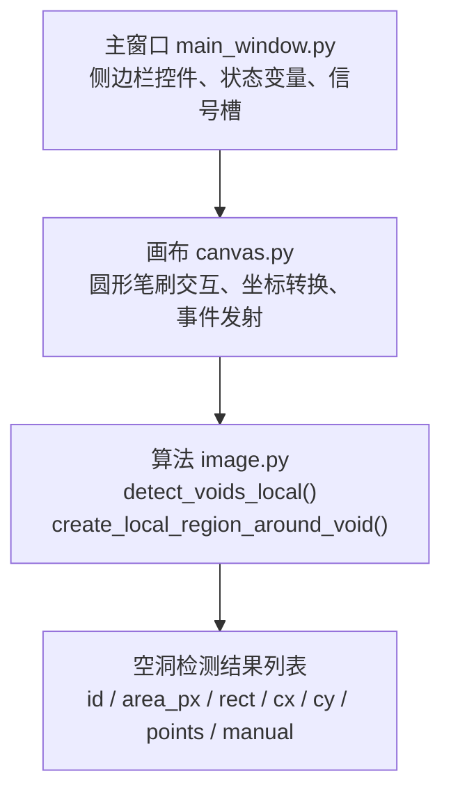
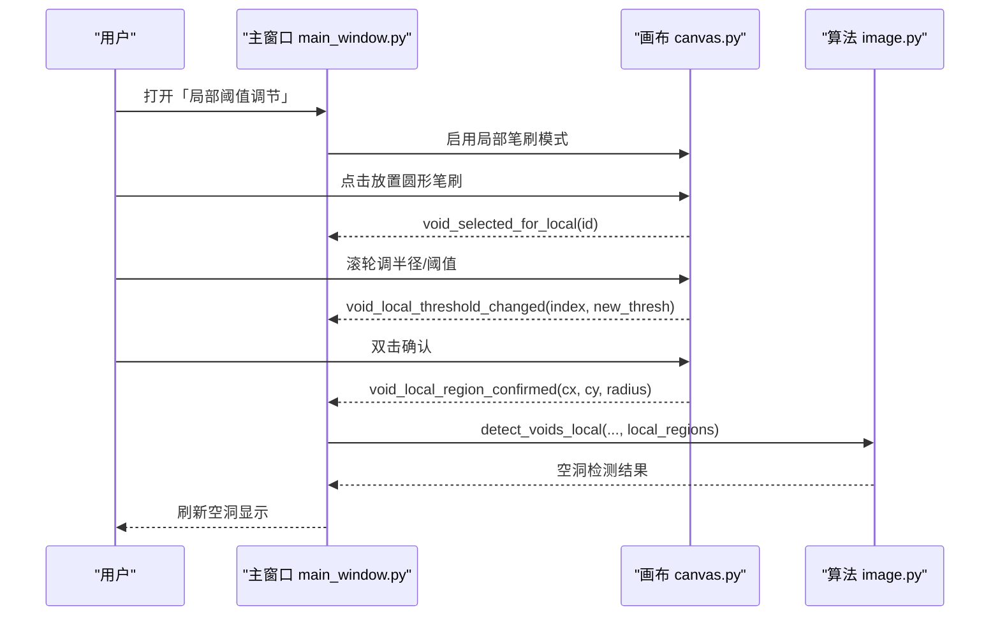
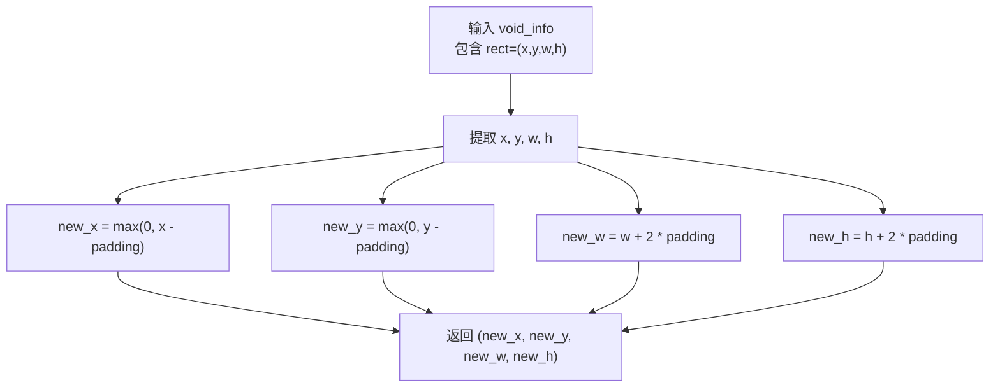
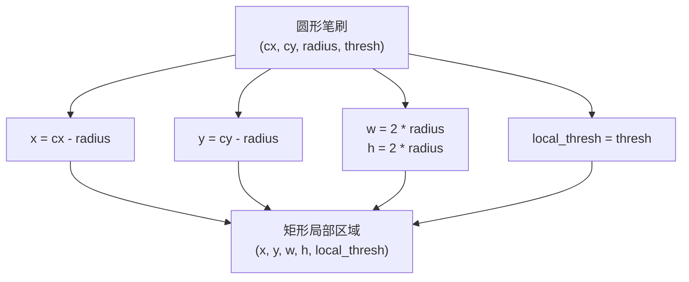
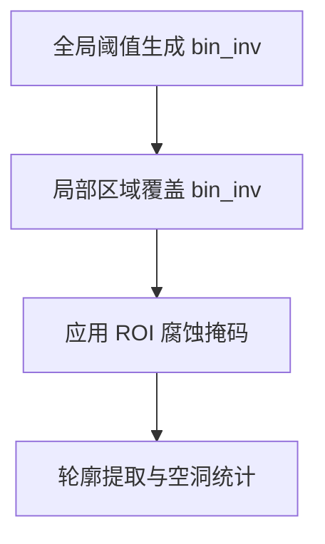
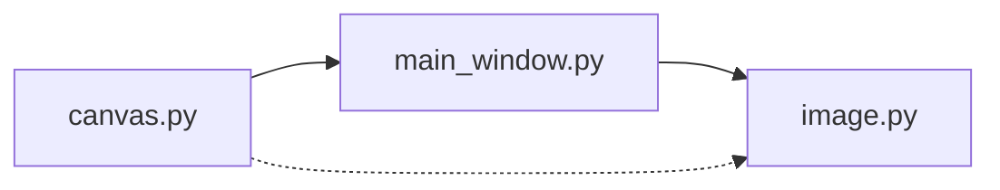

# 局部阈值笔刷区域处理

<cite>
**本文引用的文件**   
- [image.py](file://image.py)
- [main_window.py](file://main_window.py)
- [canvas.py](file://canvas.py)
- [README.md](file://README.md)
- [PROJECT_CONCEPTION.md](file://PROJECT_CONCEPTION.md)
</cite>

## 目录
1. [引言](#引言)
2. [项目结构定位](#项目结构定位)
3. [业务背景与用户流程](#业务背景与用户流程)
4. [核心数据结构 local_regions](#核心数据结构-local_regions)
5. [detect_voids_local() 处理流程](#detect_voids_local-处理流程)
6. [create_local_region_around_void() 快速示教辅助](#create_local_region_around_void-快速示教辅助)
7. [UI 笔刷坐标到 local_regions 的转换约定](#ui-笔刷坐标到-local_regions-的转换约定)
8. [全局阈值与局部阈值的组合优先级](#全局阈值与局部阈值的组合优先级)
9. [依赖关系与已知技术债](#依赖关系与已知技术债)
10. [性能分析与优化建议](#性能分析与优化建议)
11. [常见问题排查](#常见问题排查)
12. [结论](#结论)

## 引言
本文聚焦 Aurascope 空洞分析模块中的「局部阈值笔刷区域处理」，围绕 `image.py` 中两个关键函数展开：

- `detect_voids_local(gray_img, roi_mask, global_thresh_val, local_regions=None, ...)`
- `create_local_region_around_void(void_info, padding=20)`

该功能用于在金锡焊料 X 光 / SEM 图像上，当全局阈值无法统一应对光照不均时，允许用户在特定区域设置更高或更低的局部阈值，从而改善空洞检测稳定性。文档同时说明 UI 层（Canvas）如何把圆形笔刷交互转换为算法层接受的矩形局部区域，以及主窗口中存在的两份 `detect_voids_local` 副本这一技术债。

## 项目结构定位
Aurascope 是面向微电子封装产线的半自动化视觉检测桌面应用，当前实现为 PyQt6 + OpenCV + NumPy + Pandas 的单机工具，不联网、不收集用户数据、纯 CPU 计算，兼容 Windows 7+。

从架构分层看，局部阈值笔刷区域处理涉及三层：

| 层级 | 职责 | 相关文件 |
|---|---|---|
| GUI 层 | 按钮、滑块、提示文本、信号槽连接 | `main_window.py` |
| Canvas 绘制层 | 圆形笔刷预览、放置、半径调整、阈值调整、删除、渲染已确认区域 | `canvas.py` |
| 算法层 | 全局阈值二值化、局部区域覆盖、形态学去噪、轮廓提取、空洞结果输出 | `image.py` |



**图表来源**
- [main_window.py:179-184](file://main_window.py#L179-L184)
- [canvas.py:23-26](file://canvas.py#L23-L26)
- [image.py:328-422](file://image.py#L328-L422)

**章节来源**
- [README.md:1-14](file://README.md#L1-L14)
- [PROJECT_CONCEPTION.md:19-26](file://PROJECT_CONCEPTION.md#L19-L26)

## 业务背景与用户流程
金锡焊料表面在 SEM 或 X 光图像中常出现光照不均：同一张图上不同区域的灰度分布差异较大，单一全局阈值容易漏检暗区空洞或误检亮区噪声。为此，产品提供「局部阈值笔刷」能力：

1. 用户先通过全局阈值获得基础空洞检测结果。
2. 进入「局部阈值调节」模式后，在图像上点击放置圆形笔刷。
3. 使用滚轮调整笔刷半径和局部阈值。
4. 双击确认笔刷区域；Shift+滚轮可调整阈值；右键双击可删除已确认区域。
5. 系统把圆形笔刷转换为矩形局部区域，并调用 `detect_voids_local()` 重新检测。
6. 最终空洞结果基于「全局阈值掩码 + 局部区域覆盖后的掩码」生成。



**图表来源**
- [main_window.py:736-739](file://main_window.py#L736-L739)
- [canvas.py:23-26](file://canvas.py#L23-L26)
- [image.py:328-422](file://image.py#L328-L422)

**章节来源**
- [PROJECT_CONCEPTION.md:19-26](file://PROJECT_CONCEPTION.md#L19-L26)
- [main_window.py:711-717](file://main_window.py#L711-L717)

## 核心数据结构 local_regions
`local_regions` 是 `detect_voids_local()` 的输入参数，类型为列表，元素为五元组：

| 字段 | 类型 | 含义 | 单位 |
|---|---|---|---|
| x | int | 局部区域左上角横坐标 | 像素 |
| y | int | 局部区域左上角纵坐标 | 像素 |
| w | int | 局部区域宽度 | 像素 |
| h | int | 局部区域高度 | 像素 |
| local_thresh | int | 该区域使用的局部阈值 | 0–255 |

因此完整结构为：

```text
local_regions = [
    (x1, y1, w1, h1, local_thresh1),
    (x2, y2, w2, h2, local_thresh2),
    ...
]
```

需要注意：

- 虽然 UI 层以圆形笔刷 `(cx, cy, radius, thresh)` 作为交互载体，但 `detect_voids_local()` 只接受矩形 `(x, y, w, h, local_thresh)`。
- 圆形笔刷需要由上层逻辑转换为包围矩形，即 `x = cx - radius`、`y = cy - radius`、`w = 2 * radius`、`h = 2 * radius`。
- 若某个局部区域没有有效宽高，`detect_voids_local()` 会直接跳过该区域，不会报错。

**章节来源**
- [image.py:328-356](file://image.py#L328-L356)
- [main_window.py:180-184](file://main_window.py#L180-L184)

## detect_voids_local() 处理流程
`detect_voids_local()` 的核心目标是：先用全局阈值生成整幅图像的 `bin_inv`，再按顺序用每个局部区域的阈值覆盖对应像素块，最后进行 ROI 掩码、形态学、轮廓提取和空洞统计。

### 整体流程图

```mermaid
flowchart TD
Start(["进入 detect_voids_local"]) --> EnhancedCLAHE{"是否启用 CLAHE"}
EnhancedCLAHE --> |是| ApplyCLAHE["对灰度图应用 CLAHE"]
EnhancedCLAHE --> |否| KeepGray["保持原灰度图"]
ApplyCLAHE --> GlobalThreshold["用 global_thresh_val 生成 bin_inv"]
KeepGray --> GlobalThreshold
GlobalThreshold --> MorphOpen{"是否启用形态学开运算"}
MorphOpen --> |是| ErodeBinInv["对 bin_inv 做开运算"]
MorphOpen --> |否| SkipMorph["跳过形态学"]
ErodeBinInv --> LocalRegionsCheck{"是否存在 local_regions"}
SkipMorph --> LocalRegionsCheck
LocalRegionsCheck --> |否| ROIStep["应用 ROI 腐蚀掩码"]
LocalRegionsCheck --> |是| ForEachRegion["遍历每个 (x,y,w,h,local_thresh)"]
ForEachRegion --> ClipX["x 截断到 >= 0"]
ClipX --> ClipY["y 截断到 >= 0"]
ClipY --> ClipW["w 截断到图像右边界"]
ClipW --> ClipH["h 截断到图像下边界"]
ClipH --> ValidSize{"w > 0 且 h > 0"}
ValidSize --> |否| NextRegion["continue 跳过该区域"]
ValidSize --> |是| ThresholdLocal["对该区域用 THRESH_BINARY_INV 二值化"]
ThresholdLocal --> OverwriteBinInv["把 local_bin 写回 bin_inv 对应位置"]
OverwriteBinInv --> NextRegion
NextRegion --> ROIStep
ROIStep --> VoidMask["bin_inv 与自身按 interior_mask 取与"]
VoidMask --> FindContours["find_contours 提取轮廓"]
FindContours --> FilterArea["面积过滤 min_area / max_area"]
FilterArea --> Roundness{"是否启用圆度过滤"}
Roundness --> |是| CheckRoundness["计算圆度并过滤"]
Roundness --> |否| EdgeCheck{"是否启用 Canny 边缘验证"}
CheckRoundness --> EdgeCheck
EdgeCheck --> |是| EdgeVerify["轮廓与 edge_map 重叠率判断"]
EdgeCheck --> |否| BuildResult["构建空洞信息字典"]
EdgeVerify --> BuildResult
BuildResult --> End(["返回 voids_data"])
```



**图表来源**
- [image.py:336-422](file://image.py#L336-L422)

### 关键步骤说明

#### 1. 预处理与全局二值化
- 如果启用增强检测和 CLAHE，则先对灰度图应用 CLAHE。
- 随后用 `global_thresh_val` 对整图执行 `cv2.threshold(..., cv2.THRESH_BINARY_INV)`，得到 `bin_inv`。
- 如果启用形态学去噪且核尺寸大于 1，则对 `bin_inv` 执行开运算。

这一步决定了全局范围内的空洞候选。

#### 2. 局部区域覆盖
当 `local_regions` 非空时，函数逐个处理每个区域：

1. 将 `x, y, w, h` 转为整数。
2. 将 `x` 截断到 `[0, ∞)`。
3. 将 `y` 截断到 `[0, ∞)`。
4. 将 `w` 截断到 `gray_img.shape[1] - x`。
5. 将 `h` 截断到 `gray_img.shape[0] - y`。
6. 如果 `w <= 0` 或 `h <= 0`，直接 `continue`。
7. 对 `gray_img[y:y+h, x:x+w]` 执行 `cv2.threshold(..., cv2.THRESH_BINARY_INV)`。
8. 将局部二值结果 `local_bin` 写回 `bin_inv[y:y+h, x:x+w]`。

这意味着：**局部区域会完全覆盖全局阈值在该区域的结果**，而不是叠加。

#### 3. ROI 掩码与空洞提取
- 根据 `roi_erosion_px` 决定是否对 `roi_mask` 做形态学腐蚀。
- 用 `cv2.bitwise_and(bin_inv, bin_inv, mask=interior_mask)` 得到最终空洞掩码。
- 使用 `cv2.find_contours(..., RETR_EXTERNAL, CHAIN_APPROX_SIMPLE)` 提取外部轮廓。
- 对每个轮廓执行面积过滤、可选圆度过滤、可选 Canny 边缘验证。
- 最终输出空洞信息字典列表，包含 `id`、`area_px`、`rect`、`cx`、`cy`、`points`、`manual=False`。

**章节来源**
- [image.py:336-422](file://image.py#L336-L422)

## create_local_region_around_void() 快速示教辅助
`create_local_region_around_void(void_info, padding=20)` 的作用是根据已有空洞的矩形框向外扩展固定像素，生成一个更大的局部区域。它适合以下场景：

- 用户已经看到某个空洞，想快速在其周围设置局部阈值。
- 迭代优化时，围绕已知缺陷扩大观察范围。
- 作为快速示教的起点，避免每次从零开始画矩形。

其实现逻辑为：

1. 从 `void_info['rect']` 取出 `(x, y, w, h)`。
2. 新左上角 `x = max(0, x - padding)`。
3. 新左上角 `y = max(0, y - padding)`。
4. 新宽度 `w = w + 2 * padding`。
5. 新高度 `h = h + 2 * padding`。
6. 返回 `(x, y, w, h)`。

注意：该函数本身不做图像边界截断，也不检查 `padding` 是否为正数。实际使用时应确保传入的 `void_info` 合法，并在后续调用 `detect_voids_local()` 前由算法层完成边界保护。



**图表来源**
- [image.py:635-651](file://image.py#L635-L651)

**章节来源**
- [image.py:635-651](file://image.py#L635-L651)

## UI 笔刷坐标到 local_regions 的转换约定
Canvas 层的局部笔刷交互以圆形为中心：

- `lb_confirmed` 存储已确认的笔刷区域，元素形如 `{'cx', 'cy', 'radius', 'thresh'}`。
- 信号 `void_local_region_confirmed` 发射 `(cx, cy, radius)`。
- 信号 `void_local_threshold_changed` 发射 `(region_index, new_thresh)`。
- 信号 `void_local_region_removed` 发射 `region_index`。

主窗口负责把这些圆形笔刷转换为 `detect_voids_local()` 需要的矩形 `local_regions`。转换约定如下：

| 输入 | 含义 | 转换规则 |
|---|---|---|
| `cx` | 笔刷中心横坐标 | `x = cx - radius` |
| `cy` | 笔刷中心纵坐标 | `y = cy - radius` |
| `radius` | 笔刷半径 | `w = 2 * radius`，`h = 2 * radius` |
| `thresh` | 局部阈值 | 直接作为 `local_thresh` |

因此，一个圆形笔刷 `(cx, cy, radius, thresh)` 对应的矩形局部区域为：

```text
(x, y, w, h, local_thresh) = (cx - radius, cy - radius, 2*radius, 2*radius, thresh)
```

这个矩形是圆形笔刷的外接正方形。由于 `detect_voids_local()` 内部会对 `x, y, w, h` 做边界截断，即使笔刷超出图像边界也不会越界。



**图表来源**
- [canvas.py:72-80](file://canvas.py#L72-L80)
- [canvas.py:23-26](file://canvas.py#L23-L26)
- [image.py:344-356](file://image.py#L344-L356)

**章节来源**
- [canvas.py:72-80](file://canvas.py#L72-L80)
- [canvas.py:23-26](file://canvas.py#L23-L26)
- [main_window.py:180-184](file://main_window.py#L180-L184)

## 全局阈值与局部阈值的组合优先级
在当前 `image.py` 的 `detect_voids_local()` 实现中，组合优先级非常明确：

1. **全局阈值优先**：先生成整幅图像的 `bin_inv`。
2. **局部阈值覆盖**：对每个 `local_regions` 中的矩形区域，用 `THRESH_BINARY_INV` 重新二值化，并把结果直接写入 `bin_inv` 对应位置。
3. **ROI 掩码最后生效**：在局部覆盖之后，再用 `interior_mask` 与 `bin_inv` 取与。

因此，**局部阈值具有覆盖优先级**。如果一个像素既在全局阈值中被判定为背景，又被某个局部区域判定为前景，则以局部区域的结果为准。



**图表来源**
- [image.py:339-364](file://image.py#L339-L364)

需要注意的是，当前实现没有记录每个像素属于「全局阈值」还是「局部阈值」。如果需要区分来源，应在数据结构层面增加标记字段，例如为每个空洞标注 `source='global'` 或 `source='local'`，或在 `local_regions` 中保留来源信息。

**章节来源**
- [image.py:339-364](file://image.py#L339-L364)

## 依赖关系与已知技术债
### 依赖方向
- `main_window.py` 导入 `detect_voids_local` 和 `create_local_region_around_void`。
- `canvas.py` 定义局部笔刷相关信号，但不直接实现空洞检测逻辑。
- `image.py` 是唯一算法实现层，集中了阈值、形态学、轮廓、圆度、Canny 等逻辑。



**图表来源**
- [main_window.py:32-35](file://main_window.py#L32-L35)
- [canvas.py:23-26](file://canvas.py#L23-L26)
- [image.py:328-422](file://image.py#L328-L422)

### 已知技术债：两份 detect_voids_local
仓库中存在两份 `detect_voids_local` 实现：

| 位置 | 行为差异 | 风险 |
|---|---|---|
| `image.py` | 直接修改 `bin_inv` 切片，支持 `roi_erosion_px`，接口更贴近文档描述 | 现行算法权威实现 |
| `main_window.py` | 构造 `final_mask`，先与 `bitwise_not(local_mask)` 取与，再 OR 局部区域；默认 `padding=60` 的 `create_local_region_around_void` 以质心为中心生成固定大小方形 | 与 `image.py` 行为不一致，属于待合并副本 |

此外，`main_window.py` 中还有一份 `detect_voids_local_brush()`，专门处理圆形笔刷形式的 `local_regions`，进一步说明 UI 层与算法层之间的数据结构尚未完全收敛。

**章节来源**
- [image.py:328-422](file://image.py#L328-L422)
- [main_window.py:1763-1876](file://main_window.py#L1763-L1876)
- [main_window.py:1879-1974](file://main_window.py#L1879-L1974)

## 性能分析与优化建议
### 当前性能特征
1. **全局二值化代价固定**：每次调用都会对整图执行一次全局阈值和二值化。
2. **局部区域逐条处理**：每个 `local_regions` 都会进行一次局部 `cv2.threshold`。
3. **多次掩码操作**：ROI 腐蚀、`bitwise_and`、`find_contours` 在大图上成本较高。
4. **Canny 边缘验证仅在增强模式下触发**，但也会产生额外高斯模糊和边缘检测开销。

### 优化建议
| 问题 | 建议 | 预期收益 |
|---|---|---|
| 局部区域数量较多且存在重叠 | 合并重叠矩形，减少重复二值化和覆盖次数 | 降低 O(N) 局部阈值调用次数 |
| 大图频繁重算 `bin_inv` | 缓存全局 `bin_inv`，仅对变化的局部区域增量更新 | 避免整图重复阈值计算 |
| 局部区域过多导致轮廓扫描慢 | 对未变化区域复用上次轮廓结果，或使用多分辨率金字塔 | 提升交互响应速度 |
| 圆形笔刷转矩形后大量无效区域 | 在 UI 层过滤 `radius <= 0` 或超出图像的有效区域 | 减少无效算法调用 |
| 频繁 UI 刷新阻塞 | 使用防抖或节流，限制局部阈值变更时的重算频率 | 改善滚动滚轮时的流畅度 |

### 合并重叠矩形的思路
可以将多个局部矩形合并为最小数量的不重叠矩形集合，例如：

1. 将所有 `(x, y, w, h)` 转换为区间表示。
2. 按 x 轴排序。
3. 合并相交或相邻的矩形。
4. 对合并后的矩形执行一次局部阈值计算。
5. 将结果写回 `bin_inv`。

这能显著减少 `cv2.threshold` 调用次数，尤其当用户连续绘制多个相邻笔刷时效果明显。

### 增量更新思路
如果图像未变化、全局阈值未变化，可以：

1. 缓存全局 `bin_inv`。
2. 维护每个局部区域的旧掩码。
3. 仅对发生变化的局部区域重新计算 `local_bin`。
4. 用差量更新 `bin_inv`。
5. 只对受影响区域重新计算轮廓或全图轮廓（取决于 ROI 掩码是否变化）。

**章节来源**
- [image.py:336-422](file://image.py#L336-L422)

## 常见问题排查
### 局部区域没有生效
可能原因：

- `w <= 0` 或 `h <= 0`，被 `detect_voids_local()` 直接跳过。
- 笔刷半径过小，转换后矩形无效。
- 局部阈值设置不当，导致该区域全部为背景或全部为前景。
- 局部区域超出图像边界，虽会被截断，但可能只剩极小区域。

排查方法：

1. 打印 `local_regions` 中每个元素的 `(x, y, w, h, local_thresh)`。
2. 确认 `w > 0` 且 `h > 0`。
3. 检查 `local_thresh` 是否在合理范围内。
4. 临时关闭其他增强选项，单独验证局部阈值效果。

### 局部阈值覆盖了全局阈值
这是当前实现的预期行为。局部区域会完全替换对应位置的 `bin_inv` 像素。如果希望局部阈值与全局阈值融合，需要修改覆盖策略，例如：

- 使用加权融合。
- 只在局部区域置信度低时使用局部阈值。
- 引入来源标记，便于调试和可视化。

### 圆形笔刷与矩形区域不一致
圆形笔刷的外接矩形会包含四个角落的额外像素。如果用户期望严格圆形覆盖，应考虑：

- 在算法层使用圆形掩码覆盖，而非矩形切片。
- 或者在 UI 层提示用户外接矩形的影响。

当前 `image.py` 的 `detect_voids_local()` 使用矩形覆盖；`main_window.py` 中的 `detect_voids_local_brush()` 才使用圆形掩码，说明两种实现尚未统一。

**章节来源**
- [image.py:344-356](file://image.py#L344-L356)
- [main_window.py:1879-1974](file://main_window.py#L1879-L1974)

## 结论
`detect_voids_local()` 与 `create_local_region_around_void()` 共同构成了 Aurascope 空洞分析模块中「局部阈值笔刷区域处理」的核心算法支撑：

- `local_regions` 采用 `(x, y, w, h, local_thresh)` 的矩形五元组结构。
- `detect_voids_local()` 先全局阈值生成 `bin_inv`，再按顺序用局部阈值覆盖对应区域。
- 边界保护由 `x/y` 截断到 `[0, shape]`、`w/h` 截断到图像尺寸、`w≤0 或 h≤0` 直接跳过实现。
- `create_local_region_around_void()` 根据空洞矩形向外扩展 `padding` 像素，适合快速示教和迭代优化。
- UI 层以圆形笔刷交互为主，需转换为外接矩形后再传给算法层。
- 当前实现中局部阈值具有覆盖优先级，且存在两份 `detect_voids_local` 副本的技术债。
- 性能方面，局部区域较多时应合并重叠矩形，大图频繁重算时应考虑缓存和增量更新。

对于后续开发，建议优先统一 `image.py` 与 `main_window.py` 中的局部阈值实现，明确圆形与矩形覆盖语义，并为局部区域来源增加可观测性，以便工程师在光照不均的金锡表面上稳定调参。