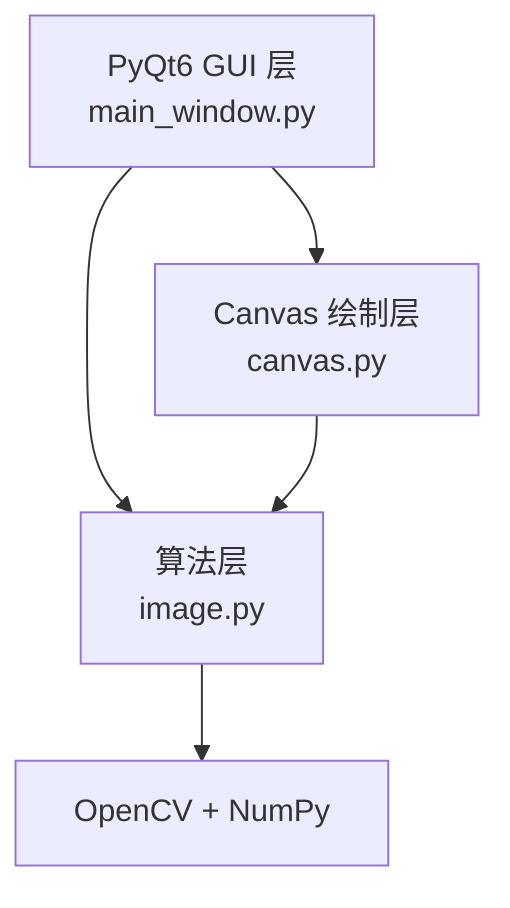
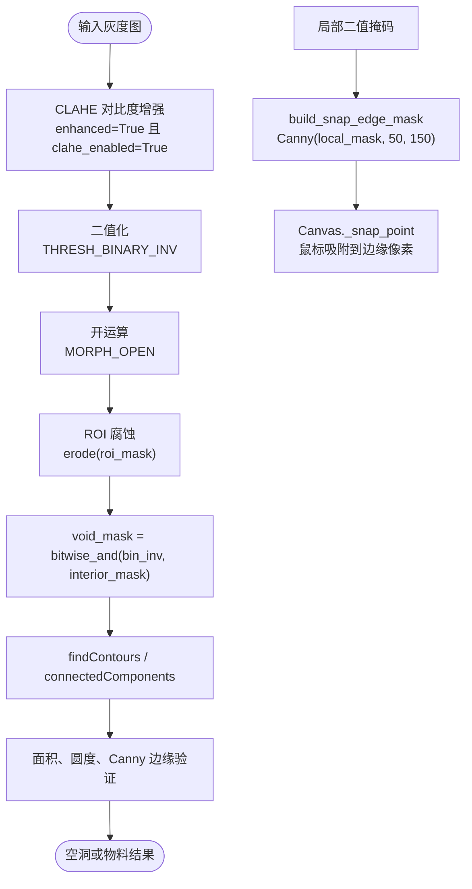
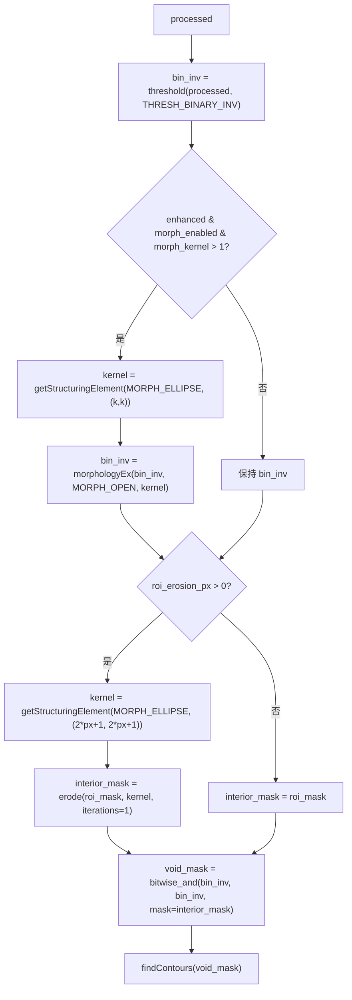
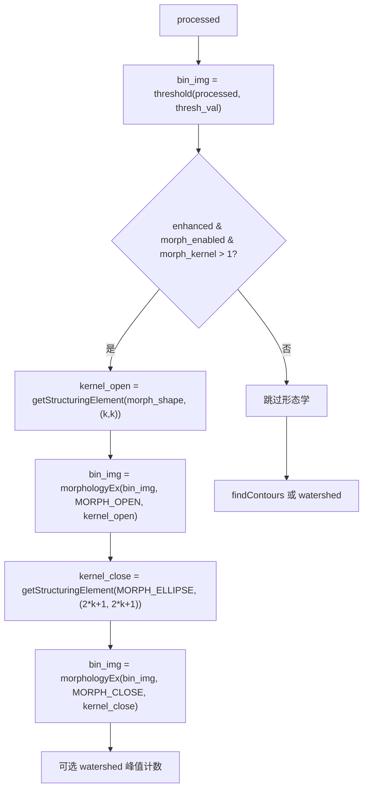
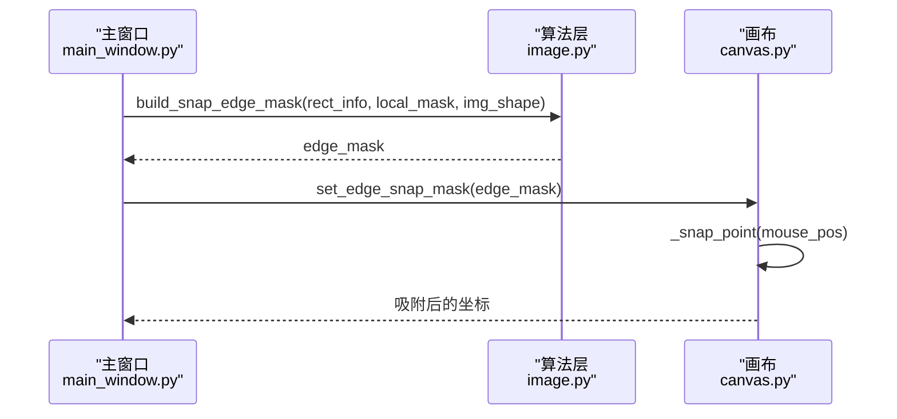
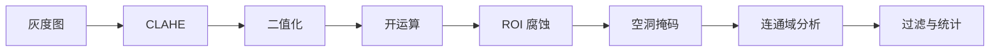
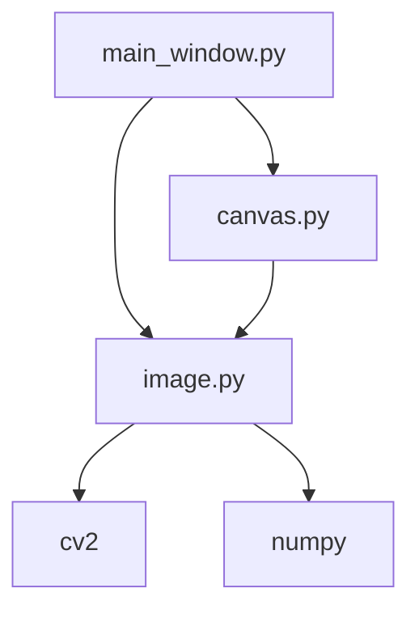

# 形态学去噪与边缘吸附

<cite>
**本文引用的文件**   
- [image.py](file://image.py)
- [main_window.py](file://main_window.py)
- [canvas.py](file://canvas.py)
- [README.md](file://README.md)
- [PROJECT_CONCEPTION.md](file://PROJECT_CONCEPTION.md)
</cite>

## 目录
1. [引言](#引言)
2. [项目结构定位](#项目结构定位)
3. [核心算法组件](#核心算法组件)
4. [架构总览](#架构总览)
5. [详细组件分析](#详细组件分析)
6. [依赖关系分析](#依赖关系分析)
7. [性能注意事项](#性能注意事项)
8. [故障排查指南](#故障排查指南)
9. [结论](#结论)

## 引言
本文围绕 `image.py` 中的形态学操作与边缘吸附机制，说明空洞检测与物料计数两条主线的图像处理流程。重点解释：
- 开运算（`MORPH_OPEN`）用于空洞检测去噪；
- 闭运算（`MORPH_CLOSE`）用于物料计数粘连分离；
- 腐蚀（`erode`）用于收缩 ROI，避免边界伪影参与空洞连通域分析；
- 椭圆核 `cv2.getStructuringElement(cv2.MORPH_ELLIPSE, (k, k))` 的选择依据；
- `morph_kernel=3`、`morph_shape=cv2.MORPH_ELLIPSE`、`roi_erosion_px=3` 对最终空洞掩码的影响；
- `build_snap_edge_mask()` 如何通过 Canny 生成边缘吸附掩码，以及它被哪些 UI 交互使用；
- 形态学处理顺序约定与典型参数组合示例；
- 大核形态学在高分辨率 SEM/X 光图上的性能注意事项。

## 项目结构定位
Aurascope 是面向微电子封装产线的半自动化视觉检测桌面应用，技术栈为 PyQt6 + OpenCV + NumPy + Pandas。根据项目构思文档，算法层集中在 `image.py`，GUI 层通过 main_window 和 canvas 调用算法函数，Canvas 负责绘制、坐标转换、ROI 编辑与鼠标交互。

**图示来源**
- [PROJECT_CONCEPTION.md:77-107](file://PROJECT_CONCEPTION.md#L77-L107)
- [README.md:35-64](file://README.md#L35-L64)

**章节来源**
- [README.md:1-76](file://README.md#L1-L76)
- [PROJECT_CONCEPTION.md:1-143](file://PROJECT_CONCEPTION.md#L1-L143)

## 核心算法组件
`image.py` 中与本主题直接相关的核心函数包括：
- `build_snap_edge_mask(rect_info, local_mask, img_shape)`：从局部二值掩码提取 Canny 边缘，并映射到整幅图像尺寸。
- `detect_voids(gray_img, roi_mask, thresh_val, ...)`：空洞检测主流程，包含 CLAHE、二值化、开运算、ROI 腐蚀、连通域分析与可选 Canny 边缘验证。
- `detect_voids_local(gray_img, roi_mask, global_thresh_val, local_regions=None, ...)`：支持局部阈值覆盖的空洞检测副本。
- `detect_objects(gray_img, thresh_val, ..., morph_shape=cv2.MORPH_ELLIPSE, ...)`：物料计数流程，包含开运算与闭运算。

这些函数共同构成「增强 → 二值化 → 形态学 → ROI 约束 → 轮廓/连通域 → 统计」的通用管线。

**章节来源**
- [image.py:158-177](file://image.py#L158-L177)
- [image.py:200-286](file://image.py#L200-L286)
- [image.py:328-422](file://image.py#L328-L422)
- [image.py:491-632](file://image.py#L491-L632)

## 架构总览
下图展示空洞检测与物料计数的形态学处理路径，以及边缘吸附掩码在 UI 中的流向。

**图示来源**
- [image.py:208-226](file://image.py#L208-L226)
- [image.py:336-364](file://image.py#L336-L364)
- [image.py:527-540](file://image.py#L527-L540)
- [image.py:158-177](file://image.py#L158-L177)
- [canvas.py:302-324](file://canvas.py#L302-L324)

## 详细组件分析

### 形态学去噪与空洞掩码构建
空洞检测主流程 `detect_voids` 的处理顺序如下：
1. **CLAHE 增强**：当 `enhanced=True` 且 `clahe_enabled=True` 时，使用 `cv2.createCLAHE(clipLimit=clahe_clip_limit, tileGridSize=(8, 8))` 增强局部对比度。
2. **二值化**：对增强后的灰度图执行 `cv2.threshold(..., cv2.THRESH_BINARY_INV)`，得到暗区空洞的二值反相掩码 `bin_inv`。
3. **开运算去噪**：当 `enhanced=True`、`morph_enabled=True` 且 `morph_kernel > 1` 时，构造椭圆核 `cv2.getStructuringElement(cv2.MORPH_ELLIPSE, (morph_kernel, morph_kernel))`，并对 `bin_inv` 执行 `cv2.morphologyEx(..., cv2.MORPH_OPEN, kernel)`。
4. **ROI 腐蚀**：当 `roi_erosion_px > 0` 时，构造核大小为 `(roi_erosion_px * 2 + 1, roi_erosion_px * 2 + 1)` 的椭圆核，对 `roi_mask` 执行一次腐蚀，得到 `interior_mask`。
5. **空洞掩码合成**：执行 `void_mask = cv2.bitwise_and(bin_inv, bin_inv, mask=interior_mask)`，即只保留 ROI 内部区域中的空洞二值结果。
6. **连通域分析**：对 `void_mask` 执行 `cv2.findContours(..., cv2.RETR_EXTERNAL, cv2.CHAIN_APPROX_SIMPLE)`，随后进行面积过滤、圆度过滤与可选 Canny 边缘验证。

**图示来源**
- [image.py:208-226](file://image.py#L208-L226)

#### 关键参数影响
- `morph_kernel=3`：默认核尺寸为 `3×3` 的椭圆核。开运算会先腐蚀再膨胀，因此该核倾向于去除小于约 3 像素宽度的细小噪声点，同时尽量保持空洞主体形状。
- `morph_shape=cv2.MORPH_ELLIPSE`：椭圆核各向同性较好，适合 SEM/X 光图中近似圆形或椭圆的焊料空洞与物料轮廓，避免矩形核带来的方向性偏差。
- `roi_erosion_px=3`：ROI 腐蚀核尺寸为 `(2×3+1, 2×3+1) = (7, 7)`，对 ROI 掩码进行一次腐蚀，使有效分析区域向内收缩约 3 像素，从而断开 ROI 边界处的伪影与空洞连通域。
- `void_mask = bitwise_and(bin_inv, bin_inv, mask=interior_mask)`：该表达式等价于用 `interior_mask` 作为掩码对 `bin_inv` 做按位与，最终空洞掩码仅保留 ROI 内部区域，避免边界伪影进入后续连通域分析。

**章节来源**
- [image.py:208-226](file://image.py#L208-L226)
- [image.py:336-364](file://image.py#L336-L364)

### 物料计数中的开运算与闭运算
物料计数函数 `detect_objects` 复用空洞检测的核心思想，但业务目标不同：不是找暗色空洞，而是统计离散物料数量。其形态学流程为：
1. **CLAHE 增强**：同空洞检测。
2. **二值化**：根据 `invert` 选择 `THRESH_BINARY_INV` 或 `THRESH_BINARY`。
3. **开运算**：当 `enhanced=True`、`morph_enabled=True` 且 `morph_kernel > 1` 时，使用 `morph_shape` 构造核，执行 `MORPH_OPEN`。
4. **闭运算**：紧接着使用 `cv2.MORPH_ELLIPSE` 构造核大小为 `(morph_kernel * 2 + 1, morph_kernel * 2 + 1)` 的椭圆核，执行 `MORPH_CLOSE`。
5. **ROI 约束与距离变换峰值计数**：可选 `roi_mask` 约束；若启用 `watershed_enabled`，则基于距离变换寻找局部极大值作为种子点进行计数。

**图示来源**
- [image.py:527-540](file://image.py#L527-L540)
- [image.py:544-572](file://image.py#L544-L572)

#### 为什么物料计数需要闭运算？
- 开运算主要用于去噪，断开细小噪声与主体的连接。
- 闭运算用于填充物体内部小孔、连接断裂边缘，并在一定程度上合并因阈值或噪声导致的碎片化区域，使单个物料形成更完整的连通域，便于后续计数。
- 闭运算核大小取 `morph_kernel * 2 + 1`，比开运算核更大，以覆盖更明显的粘连与断裂尺度。

**章节来源**
- [image.py:491-540](file://image.py#L491-L540)
- [image.py:544-572](file://image.py#L544-L572)

### 边缘吸附掩码与 UI 交互
`build_snap_edge_mask` 的职责是把局部二值掩码转换为可用于 UI 边缘吸附的全图边缘掩码：
1. 校验 `rect_info` 与 `local_mask`，任一为空则返回 `None`。
2. 根据 `img_shape` 创建全图尺寸的零掩码。
3. 对 `local_mask` 执行 `cv2.Canny(local_mask, 50, 150)`，得到局部边缘线。
4. 将局部边缘线粘贴到全图掩码对应 ROI 区域 `[y:y+h, x:x+w]`。

**图示来源**
- [image.py:158-177](file://image.py#L158-L177)
- [main_window.py:1058-1070](file://main_window.py#L1058-L1070)
- [canvas.py:188-192](file://canvas.py#L188-L192)
- [canvas.py:302-324](file://canvas.py#L302-L324)

#### 哪些 UI 交互使用边缘吸附？
- **ROI 多边形编辑**：当 `canvas.snap_enabled=True` 且存在 `edge_snap_mask` 时，用户在拖动顶点或边时会调用 `_snap_point`，在当前鼠标位置附近搜索非零边缘像素，并吸附到最近边缘点。
- **一键自动 ROI 与手动确认 ROI**：`confirm_layer_roi` 与 `_apply_polygon_roi` 在生成 ROI 多边形后，调用 `build_snap_edge_mask` 计算边缘吸附掩码，并通过 `canvas.set_edge_snap_mask` 传递给 Canvas。
- **开关控制**：`toggle_snap_edges` 调用 `canvas.set_snap_enabled`，用户可关闭吸附功能。
- **重置 ROI**：`reset_roi` 会清空 `snap_edge_mask` 并通知 Canvas 清除吸附掩码。

**章节来源**
- [main_window.py:1036-1070](file://main_window.py#L1036-L1070)
- [main_window.py:1194-1196](file://main_window.py#L1194-L1196)
- [main_window.py:1223-1234](file://main_window.py#L1223-L1234)
- [canvas.py:69-76](file://canvas.py#L69-L76)
- [canvas.py:188-192](file://canvas.py#L188-L192)
- [canvas.py:302-324](file://canvas.py#L302-L324)

### 形态学处理顺序约定
根据 `detect_voids` 与 `detect_voids_local` 的实现，空洞检测的标准顺序为：
1. **CLAHE 对比度增强**：可选，由 `enhanced` 与 `clahe_enabled` 控制。
2. **二值化**：空洞检测使用 `THRESH_BINARY_INV`。
3. **开运算**：可选，由 `enhanced`、`morph_enabled`、`morph_kernel > 1` 控制。
4. **ROI 腐蚀**：由 `roi_erosion_px > 0` 控制。
5. **空洞掩码合成**：`void_mask = bitwise_and(bin_inv, bin_inv, mask=interior_mask)`。
6. **连通域分析**：`findContours` 或 `connectedComponentsWithStats`。
7. **后处理过滤**：面积、圆度、Canny 边缘验证。

物料计数 `detect_objects` 的顺序略有不同：二值化之后先开运算，再闭运算，然后可选距离变换峰值计数或直接轮廓计数。

**图示来源**
- [image.py:208-226](file://image.py#L208-L226)
- [image.py:336-364](file://image.py#L336-L364)

**章节来源**
- [image.py:200-286](file://image.py#L200-L286)
- [image.py:328-422](file://image.py#L328-L422)
- [image.py:491-572](file://image.py#L491-L572)

### 典型参数组合与效果对比
以下参数组合适用于金锡焊料空洞分析场景，其中 `enhanced=True` 表示启用增强检测，`morph_enabled=True` 表示启用形态学去噪，`morph_kernel=3` 为默认开运算核，`roi_erosion_px=3` 为默认 ROI 收缩像素。

| 场景 | 推荐参数 | 主要效果 |
|------|----------|----------|
| 常规 SEM/X 光空洞检测 | `enhanced=True`, `clahe_enabled=True`, `morph_enabled=True`, `morph_kernel=3`, `roi_erosion_px=3` | CLAHE 提升局部对比度；开运算去除细小噪声；ROI 腐蚀避免边界伪影；空洞掩码仅保留 ROI 内部连通域。 |
| 低噪声、光照均匀样本 | `enhanced=False`, `morph_enabled=False`, `roi_erosion_px=0` | 跳过增强与形态学，直接二值化与连通域分析，速度最快，但易受噪声与边界伪影影响。 |
| 强噪声、细碎伪影较多 | `enhanced=True`, `morph_enabled=True`, `morph_kernel=5`, `roi_erosion_px=3` | 增大开运算核以更强去噪，但仍保持 ROI 收缩防止边界伪影混入。 |
| 物料计数 | `detect_objects(..., morph_enabled=True, morph_kernel=3, morph_shape=cv2.MORPH_ELLIPSE)` | 开运算去噪 + 闭运算分离/填充，配合距离变换峰值计数提高粘连物料计数稳定性。 |

注意：
- `morph_kernel=3` 是默认值，适合大多数 SEM/X 光空洞；若噪声明显增大，可尝试 `5` 或 `7`，但过大可能侵蚀真实空洞。
- `roi_erosion_px=3` 会使 ROI 向内收缩约 3 像素；若 ROI 本身较小，过大的收缩可能导致有效区域不足。
- `morph_shape=cv2.MORPH_ELLIPSE` 在物料计数中可替换为其他形状，但椭圆核在各向同性上更适合圆形/椭圆形物料。

**章节来源**
- [image.py:200-226](file://image.py#L200-L226)
- [image.py:491-540](file://image.py#L491-L540)

## 依赖关系分析
`image.py` 是纯算法层，不依赖 PyQt6 主界面逻辑；GUI 层通过导入函数调用算法。Canvas 层负责渲染与交互，但不内联实现图像算法。

**图示来源**
- [main_window.py:33](file://main_window.py#L33)
- [image.py:1-11](file://image.py#L1-L11)

**章节来源**
- [main_window.py:33](file://main_window.py#L33)
- [image.py:1-11](file://image.py#L1-L11)

## 性能注意事项
- **大核形态学较慢**：`morph_kernel` 越大，`getStructuringElement` 与 `morphologyEx` 的计算量越高；在高分辨率 SEM/X 光图上尤其明显。
- **优先缩小图像或仅对 ROI 处理**：对于大图，建议先缩放至合适分辨率再进行形态学与连通域分析；空洞检测已天然限制在 `void_mask` 与 `interior_mask` 范围内，但仍需关注二值化与 CLAHE 的全图开销。
- **可选功能按需开启**：`enhanced=True` 会触发 CLAHE、可选 Canny 边缘验证等额外步骤；若实时性要求高，可关闭 `edge_verify` 或降低 `clahe_clip_limit`。
- **物料计数的闭运算核更大**：闭运算核为 `(morph_kernel * 2 + 1, morph_kernel * 2 + 1)`，比开运算核更大，因此在粘连严重时可考虑先用较小的 `morph_kernel` 调参，再逐步增大。
- **进度刷新机制**：算法循环中每处理一定数量的轮廓或标签会调用 `_pump_events()`，在无 GUI 环境下安全忽略，有 GUI 环境下可让界面有机会刷新。

**章节来源**
- [image.py:14-25](file://image.py#L14-L25)
- [image.py:238-240](file://image.py#L238-L240)
- [image.py:375-377](file://image.py#L375-L377)
- [image.py:585-587](file://image.py#L585-L587)

## 故障排查指南
- **空洞检测未生效**：检查是否启用了 `enhanced=True` 与 `morph_enabled=True`，以及 `morph_kernel > 1`；确认 `thresh_val` 是否合理，必要时使用 Otsu 自动阈值。
- **ROI 边界伪影仍被计入**：增大 `roi_erosion_px`，例如从 `3` 调到 `5`，观察边界伪影是否断开；注意不要过度收缩导致有效区域过小。
- **物料计数粘连未分离**：检查 `detect_objects` 是否启用闭运算；若启用 `watershed_enabled`，调整 `watershed_distance`，值越大越保守。
- **边缘吸附无效**：确认 `canvas.snap_enabled=True` 且 `canvas.edge_snap_mask` 不为 `None`；检查 `build_snap_edge_mask` 是否成功返回边缘掩码，Canny 阈值 `50, 150` 是否过于严格。
- **已知技术债提示**：仓库中存在 `main_window.py` 内的 `detect_voids_local` 副本，现行行为应以 `image.py` 为准；此外，handoff 清单指出 `edge_map` 未初始化可能导致 Canny 校验静默失效等问题，调试时应优先检查相关分支。

**章节来源**
- [image.py:200-286](file://image.py#L200-L286)
- [image.py:328-422](file://image.py#L328-L422)
- [image.py:491-632](file://image.py#L491-L632)
- [main_window.py:1058-1070](file://main_window.py#L1058-L1070)
- [canvas.py:302-324](file://canvas.py#L302-L324)

## 结论
`image.py` 中的形态学操作与边缘吸附机制构成了 Aurascope 空洞检测与物料计数的核心处理链。空洞检测以「CLAHE → 二值化 → 开运算 → ROI 腐蚀 → 连通域分析」为主流顺序，物料计数则在开运算后追加闭运算以改善粘连与断裂。`morph_kernel=3`、`morph_shape=cv2.MORPH_ELLIPSE`、`roi_erosion_px=3` 是兼顾去噪、形状保持与边界伪影抑制的默认配置。边缘吸附掩码通过 `build_snap_edge_mask` 生成，并由 Canvas 的 `_snap_point` 在 ROI 多边形编辑等交互中使用。实际应用中应根据图像噪声水平、ROI 大小与实时性需求调整核大小与增强选项，并注意大核形态学在高分辨率图像上的性能代价。