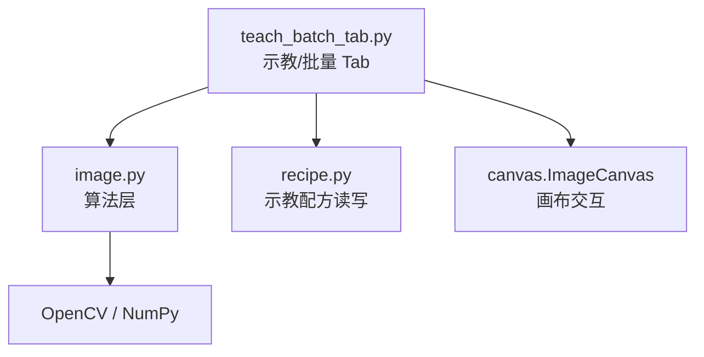
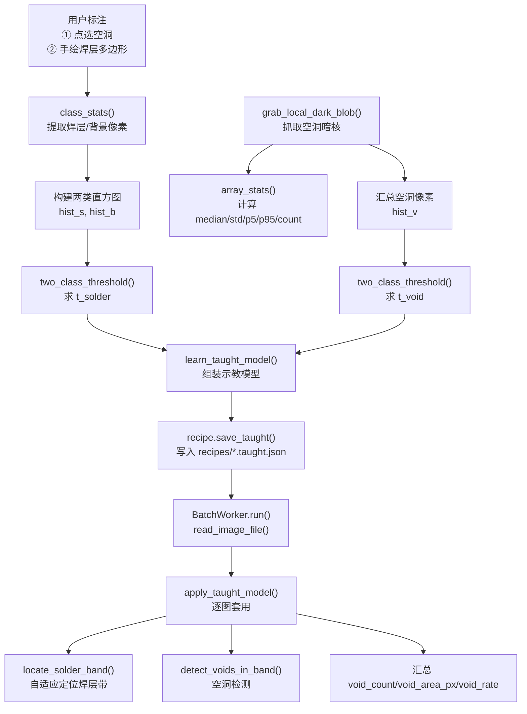
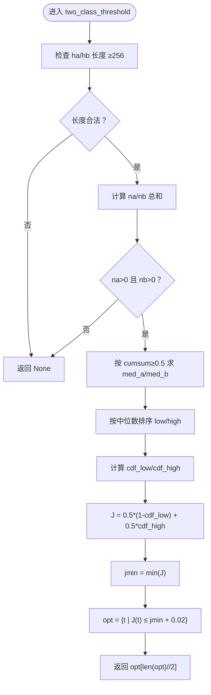
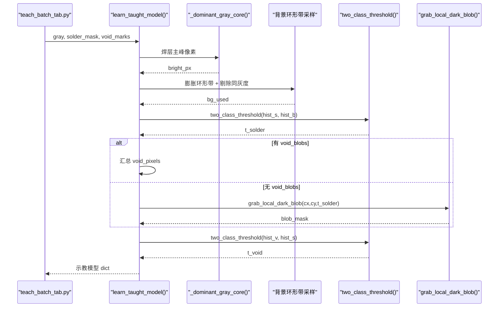
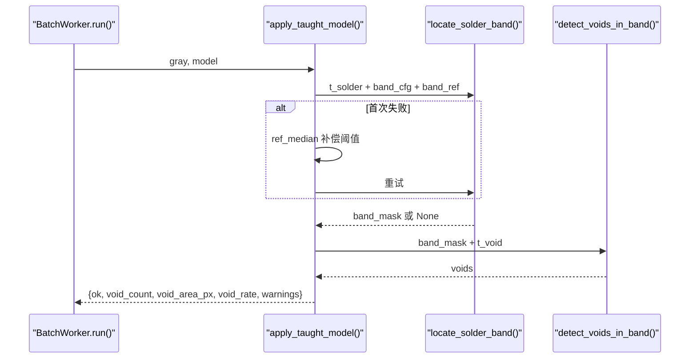
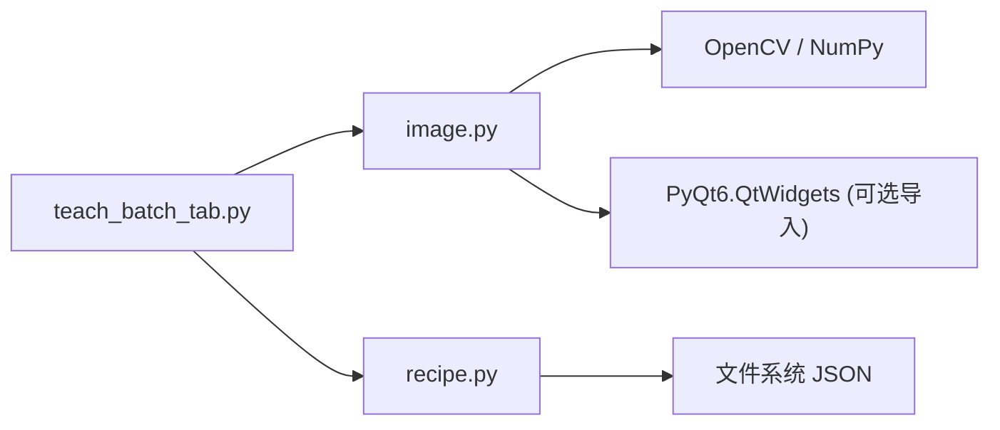

# 示教学习算法

<cite>
**本文引用的文件**   
- [image.py](file://image.py)
- [teach_batch_tab.py](file://teach_batch_tab.py)
- [recipe.py](file://recipe.py)
- [README.md](file://README.md)
- [PROJECT_CONCEPTION.md](file://PROJECT_CONCEPTION.md)
</cite>

## 目录
1. [引言](#引言)
2. [项目结构定位](#项目结构定位)
3. [核心组件](#核心组件)
4. [架构总览](#架构总览)
5. [详细组件分析](#详细组件分析)
6. [依赖关系分析](#依赖关系分析)
7. [性能与复杂度](#性能与复杂度)
8. [已知限制](#已知限制)
9. [故障排查](#故障排查)
10. [结论](#结论)

## 引言
本模块实现的是「统计学习」型示教算法，而非神经网络：用户先在样板图上标注焊层区域和若干典型空洞，系统从这些示范像素中提取两类灰度直方图，计算 median、std、p5、p95、count 等统计量，再用 `two_class_threshold()` 寻找使 balanced 误分类率最小的分离阈值。学出的模型（含焊层/背景/空洞三类灰度统计与阈值）以 `.taught.json` 配方落盘，批量时由 `apply_taught_model()` 逐图套用。

该设计动机来自金锡焊料 SEM/X 光图的典型灰度分布：焊层是亮带，空洞是暗核，而背景类常呈多峰——上方亮区、下方暗区、图像白边或扫描框线。此时 Otsu 的分区内方差法容易把阈值落在背景类内部谷值处；直接优化“已知标签的两类互分错得最少”更贴合示教语义，且取 J 最小 ±2% 容差带的中点可抗批次间灰度漂移。

## 项目结构定位
Aurascope 按「GUI → Canvas 绘制层 → image.py 算法层 → recipe.py 配方/导出」分层组织。本次文档聚焦算法层中与示教相关的函数，以及 `teach_batch_tab.py` 对它们的调用方式。

**图示来源**
- [teach_batch_tab.py:36-42](file://teach_batch_tab.py#L36-L42)
- [image.py:747-751](file://image.py#L747-L751)
- [recipe.py:261-348](file://recipe.py#L261-L348)

**章节来源**
- [README.md:35-64](file://README.md#L35-L64)
- [PROJECT_CONCEPTION.md:77-107](file://PROJECT_CONCEPTION.md#L77-L107)

## 核心组件
本节列出与示教学习直接相关的函数及其职责：

| 函数 | 输入 | 输出 | 作用 |
|---|---|---|---|
| `array_stats(px)` | 一维像素数组 | 字典 `{median, std, p5, p95, count}` 或 `None` | NumPy 向量化统计单类像素灰度 |
| `class_stats(gray, mask=None)` | 二维灰度图 + 可选掩码 | 同上 | 支持 ROI 掩码采样一类像素 |
| `two_class_threshold(hist_a, hist_b)` | 两个长度 ≥256 的灰度直方图 | 浮点阈值或 `None` | 最小化 balanced 误分类率并取容差带中点 |
| `class_separability(stats_a, stats_b)` | 两组 `array_stats` 结果 | 浮点数 | 中位数差 / 合并 std，提示示范是否充分 |
| `_dominant_gray_core(px, win, rel)` | 示范区域内像素 | 一维数组 | 用平滑直方图主峰提取焊料主材，排除两端杂质 |
| `grab_local_dark_blob(gray, cx, cy, t_ref, radius, region_mask)` | 点击位置 + 参考阈值 | `(blob_mask, area)` 或 `(None, 0)` | 抓取局部暗核作为空洞类样本 |
| `learn_taught_model(...)` | 样板灰度 + 焊层掩码 + 空洞点选 | 示教模型 dict 或 `None` | 组装焊层/背景/空洞三类统计与阈值 |
| `apply_taught_model(gray, model)` | 批次灰度 + 示教模型 | 检测结果 dict | 逐图套用模型，定位焊层带并检测空洞 |
| `locate_solder_band(...)` | 灰度 + 焊层阈值 + 几何先验 | `(band_mask, diag)` 或 `(None, diag)` | 二值化 + 形态学 + 连通域 + 几何择带 |
| `detect_voids_in_band(...)` | 灰度 + 焊层带掩码 + 空洞阈值 | 空洞列表 | 在已定位焊层带内做暗核阈值 + 轮廓过滤 |

**章节来源**
- [image.py:753-771](file://image.py#L753-L771)
- [image.py:774-823](file://image.py#L774-L823)
- [image.py:1067-1134](file://image.py#L1067-L1134)
- [image.py:1182-1330](file://image.py#L1182-L1330)
- [image.py:1333-1430](file://image.py#L1333-L1430)
- [image.py:894-1046](file://image.py#L894-L1046)
- [image.py:1137-1179](file://image.py#L1137-L1179)

## 架构总览
示教学习的端到端数据流如下：

**图示来源**
- [image.py:753-823](file://image.py#L753-L823)
- [image.py:1092-1134](file://image.py#L1092-L1134)
- [image.py:1182-1330](file://image.py#L1182-L1330)
- [image.py:1333-1430](file://image.py#L1333-L1430)
- [image.py:894-1046](file://image.py#L894-L1046)
- [image.py:1137-1179](file://image.py#L1137-L1179)
- [teach_batch_tab.py:82-158](file://teach_batch_tab.py#L82-L158)
- [recipe.py:385-404](file://recipe.py#L385-L404)

## 详细组件分析

### `array_stats()`：一维像素向量化统计
`array_stats(px)` 将输入转为 float64 一维数组，若为空返回 `None`；否则返回包含 `median`、`std`、`p5`、`p95`、`count` 的字典。它不关心像素空间位置，只关心灰度分布，因此适合对任意掩码采样后的像素序列做统计。

时间复杂度为 O(n)，空间复杂度为 O(1) 额外空间（NumPy 内部视图）。

**章节来源**
- [image.py:753-764](file://image.py#L753-L764)

### `class_stats()`：支持 ROI 掩码的一类像素统计
`class_stats(gray, mask=None)` 在 `mask is not None` 时对 `gray[mask > 0]` 调用 `array_stats()`，否则对全图做统计。这使 UI 层可以用多边形 ROI 掩码精确圈出焊层区域，避免整图噪声污染背景类统计。

**章节来源**
- [image.py:767-771](file://image.py#L767-L771)

### `two_class_threshold()`：最小化 balanced 误分类率的分离阈值
这是本模块的核心决策函数。其设计要点如下：

1. **输入校验**：两个直方图必须至少长度为 256；任一类的总频数 ≤0 时返回 `None`。
2. **方向归一**：通过累计分布找到两类的中位数灰度，保证低灰度类始终放在 `low`，高灰度类放在 `high`，从而让阈值下侧属于低类、上侧属于高类，调用顺序无关。
3. **误分类代价**：定义 `J(t) = 0.5·P(low>t) + 0.5·P(high≤t)`，即低类漏判到高侧的概率与高类漏判到低侧的概率之和的一半。
4. **容差带中点**：不只取 `J.min()` 对应的单一灰度，而是取所有满足 `J ≤ jmin + 0.02` 的灰度索引的中点。这是因为谷底往往是一段区间，取中点比取边缘更抗灰度漂移。

**图示来源**
- [image.py:774-811](file://image.py#L774-L811)

#### 为什么不用 Otsu？
Otsu 的目标是最小化类内方差，等价于最大化类间方差。当背景类本身是多峰分布（例如上方亮区 + 下方暗区 + 白边）时，Otsu 可能把阈值落在背景类内部的某个谷里，而不是真正区分“焊层 vs 背景”。`two_class_threshold()` 直接优化“已知标签的两类互分错得最少”，语义与示教一致：我们明确知道哪些像素属于哪类，因此应最小化这两类的误分类率。

**章节来源**
- [image.py:774-811](file://image.py#L774-L811)

### `class_separability()`：示范质量自检
`class_separability(stats_a, stats_b)` 用 `|median_a - median_b| / pooled_std` 衡量两类可分性，上限截到 99.9，避免合成图或极干净样本中 std=0 导致无意义的大值。该指标用于界面提示“示范可能不充分”。

**章节来源**
- [image.py:814-823](file://image.py#L814-L823)

### `_dominant_gray_core()`：从示范区域内提取焊料主峰
示范 ROI 内除焊料外还可能混入空洞暗像素和灰度相近的邻层。该函数先对像素做 256 长直方图，用滑动窗口卷积平滑后找主峰，再向两侧扩展至平滑峰值降至 rel 倍以内的范围，得到“焊料主材”子集。若子集太小则退回原像素。

这一步比“取中位数以上的亮半边”更抗污染，因为当邻层比焊料亮时，亮半边会把邻层带进来。

**章节来源**
- [image.py:1067-1089](file://image.py#L1067-L1089)

### `grab_local_dark_blob()`：从点击位置抓取空洞暗核
该函数以点击点为中心取半径窗口，用点击灰度锚定生长阈值：`grow_t = click_v + 0.25*(t_ref - click_v)`，然后对 `patch <= grow_t` 做连通域分析，取出点击点所在暗连通块。若提供 `region_mask`，会裁剪掉区域外部分；面积小于 4 或暗核中位数过亮（>0.7×t_ref）则丢弃。

这样避免对 patch 全局 Otsu 把边界线或邻近暗区一起并进暗核，从而污染空洞类统计。

**章节来源**
- [image.py:1092-1134](file://image.py#L1092-L1134)

### `learn_taught_model()`：组装示教模型
这是从用户标注到最终模型的汇聚函数。流程如下：

1. **焊层类**：从 `solder_mask > 0` 的像素中用 `_dominant_gray_core()` 提取焊料主峰，再 `array_stats()` 得到 `stats_solder`。
2. **背景类**：对焊层掩码做椭圆膨胀得到环形带，扣除原掩码后取周边像素；剔除与焊料核心灰度接近的部分（基于 `p5-p95±margin`），若剩余不足 50 像素则退回全环。
3. **直方图与阈值**：分别对焊料主峰和背景像素做 256 长直方图，调用 `two_class_threshold(hist_s, hist_b)` 得到 `t_solder`。
4. **空洞类**：优先使用调用方传入的 `void_blobs`（保证 UI 确认的暗核与模型学习一致），否则按点击中心重抓；汇总空洞像素后 `array_stats()` 并用 `two_class_threshold(hist_v, hist_s)` 得到 `t_void`。
5. **模型输出**：返回 schema v2 的 dict，包含 `solder`、`background`、`void`、`px_per_um`、`ref_median`、`band`、`band_ref`、`scale_bar`、`diagnostics`。

**图示来源**
- [image.py:1182-1330](file://image.py#L1182-L1330)
- [image.py:1067-1089](file://image.py#L1067-L1089)
- [image.py:1092-1134](file://image.py#L1092-L1134)
- [image.py:774-811](file://image.py#L774-L811)

**章节来源**
- [image.py:1182-1330](file://image.py#L1182-L1330)

### `apply_taught_model()`：批量逐图套用
`apply_taught_model(gray, model)` 是批量阶段的入口。主要步骤：

1. 从模型读取 `t_solder`、`t_void`、`band` 配置。
2. 调用 `locate_solder_band()` 定位焊层带。
3. 若失败且存在 `ref_median`，按当前图整体中位数补偿阈值重试一次。
4. 计算焊层面积、与示教模板的几何偏差、亮度漂移自检。
5. 若未学到空洞阈值，回退到带内 Otsu。
6. 桥接贴边空洞造成的边界缺口。
7. 调用 `detect_voids_in_band()` 检测空洞，并汇总 `void_count`、`void_area_px`、`void_rate`。

**图示来源**
- [image.py:1333-1430](file://image.py#L1333-L1430)
- [image.py:894-1046](file://image.py#L894-L1046)
- [image.py:1137-1179](file://image.py#L1137-L1179)
- [teach_batch_tab.py:106-158](file://teach_batch_tab.py#L106-L158)

**章节来源**
- [image.py:1333-1430](file://image.py#L1333-L1430)

### `locate_solder_band()`：自适应定位焊层带
该函数不是简单二值化，而是结合形态学与几何先验：

1. 二值化后清零最外 2px，防止扫描框线连成整幅大组件。
2. 开运算断开细界面，闭运算连接左右碎片但不用方阵/椭圆核以免桥接上下相邻层。
3. 连通域筛选：最小面积、纵横比、填充孔洞后面积、亮填充率。
4. 白边/图框候选剔除：紧贴图像上下边界或填充后中位灰度接近纯白。
5. 几何先验择带：若有 `band_ref`，按纵向窗口内与模板几何距离最小者为主带，并合并纵向邻近、x 相接的碎片。
6. 终检：焊层带不可能占满大半个画面；必要时用水平结构元开运算剔除竖直薄滴/毛刺。

**章节来源**
- [image.py:894-1046](file://image.py#L894-L1046)

### `detect_voids_in_band()`：焊层带内空洞检测
与通用 `detect_voids()` 不同，该函数不做 CLAHE 和 ROI 腐蚀，因为焊层带已由示教模型定位；它直接用 `t_void` 做反二值化，与 `band_mask` 相与，再做形态学开运算和轮廓提取，并按面积、圆度过滤。

**章节来源**
- [image.py:1137-1179](file://image.py#L1137-L1179)

## 依赖关系分析
示教学习相关代码的依赖方向如下：

- `teach_batch_tab.py` 通过 `from image import ...` 引入 `two_class_threshold`、`learn_taught_model`、`apply_taught_model`、`locate_solder_band`、`grab_local_dark_blob` 等函数。
- `recipe.py` 负责示教配方的规范化、校验与持久化，schema v2 字段与 `learn_taught_model()` 输出对应。
- `image.py` 顶层仅依赖 OpenCV 和 NumPy；PyQt6 仅在 `_pump_events()` 中可选导入，不影响算法逻辑。

**图示来源**
- [teach_batch_tab.py:36-42](file://teach_batch_tab.py#L36-L42)
- [image.py:3-11](file://image.py#L3-L11)
- [recipe.py:261-348](file://recipe.py#L261-L348)

**章节来源**
- [teach_batch_tab.py:36-42](file://teach_batch_tab.py#L36-L42)
- [image.py:3-11](file://image.py#L3-L11)
- [recipe.py:261-348](file://recipe.py#L261-L348)

## 性能与复杂度
- `array_stats()`：O(n) 时间，O(1) 额外空间。
- `two_class_threshold()`：固定 256 长直方图，O(256)=O(1) 时间。
- `learn_taught_model()`：主要开销在直方图构建与连通域分析，典型样板图可在毫秒级完成。
- `apply_taught_model()`：每图执行一次 `locate_solder_band()` 和 `detect_voids_in_band()`；批量线程 `BatchWorker.run()` 顺序处理，每 10 个轮廓迭代调用一次 `_pump_events()` 让 GUI 有机会刷新。
- 内存方面，`BatchWorker` 显式剥离 `band_mask`、`voids` 等重型字段，只向 UI 发送轻量结果，避免几十张 4K 图常驻掩码导致数百 MB 内存占用。

[本节为一般性讨论，不直接分析具体代码片段]

## 已知限制
1. **PyQt6 可选依赖**：`image.py` 顶部尝试导入 `PyQt6.QtWidgets`，失败时 `QApplication = None`；无 GUI 环境时 `_pump_events()` 不阻塞，也不抛出异常。这使得报告工具等非 GUI 场景仍可复用算法。
2. **直方图长度不足**：`two_class_threshold()` 要求输入直方图长度 ≥256，否则返回 `None`。
3. **某类像素数为 0**：若 `na ≤ 0` 或 `nb ≤ 0`，`two_class_threshold()` 返回 `None`。
4. **焊层带定位失败**：`locate_solder_band()` 找不到合适候选时返回 `(None, diag)`，`apply_taught_model()` 会记录原因并可能触发亮度补偿重试。
5. **空洞阈值缺失**：若模型未学到 `t_void`，`apply_taught_model()` 回退到带内 Otsu 并追加警告。
6. **历史技术债**：仓库中存在重复的 `detect_voids_local` 副本、`edge_map` 未初始化导致 Canny 校验静默失效、`chk_roi_overlay` 被重复创建、滚轮缩放 Y 轴漂移、`select_for_local` 为无 UI 入口的死代码、大图增强检测无进度提示等问题，详见 handoff 清单。

**章节来源**
- [image.py:8-24](file://image.py#L8-L24)
- [image.py:787-794](file://image.py#L787-L794)
- [image.py:1356-1377](file://image.py#L1356-L1377)
- [image.py:1400-1403](file://image.py#L1400-L1403)

## 故障排查
| 现象 | 可能原因 | 建议操作 |
|---|---|---|
| 学习返回 `None` | 焊层掩码像素 <50 或背景环形带有效像素 <50 | 扩大示范 ROI，确保覆盖足够焊层像素 |
| `two_class_threshold()` 返回 `None` | 直方图长度 <256 或某类总频数 ≤0 | 检查直方图构造路径；确认示范样本非空 |
| 批量检测未找到焊层带 | 阈值绝对灰度不适配当前图曝光/增益 | 查看 `warnings` 中的亮度补偿信息；确认拍摄条件一致 |
| 空洞阈值显示“退回带内 Otsu” | 示范空洞太少或暗核抓取失败 | 增加典型空洞点选数量，确保每个点落在明显暗核上 |
| 焊层带面积过大 | 白边/图框被连通 | 检查 `diagnostics.reason`；重新标注 ROI 避免包含图像边框 |
| 界面卡顿 | 长循环未释放事件 | 确认算法路径调用了 `_pump_events()`；批量线程应走 `BatchWorker` |

**章节来源**
- [image.py:1199-1234](file://image.py#L1199-L1234)
- [image.py:1356-1377](file://image.py#L1356-L1377)
- [image.py:1400-1403](file://image.py#L1400-L1403)
- [teach_batch_tab.py:106-158](file://teach_batch_tab.py#L106-L158)

## 结论
该示教学习模块以统计直方图为核心，通过 `array_stats()` 提取焊层/背景/空洞三类像素的 median/std/p5/p95/count，再用 `two_class_threshold()` 最小化 balanced 误分类率并取容差带中点，从而在背景多峰、灰度漂移的场景下获得比 Otsu 更稳定的分离阈值。`teach_batch_tab.py` 负责用户交互与批量调度，`recipe.py` 负责示教配方的持久化，`image.py` 是唯一算法实现层。

对于工程落地而言，关键成功因素是：
- 示范 ROI 要覆盖代表性焊层区域；
- 点选空洞要落在明显暗核上；
- 批量图应与样板图保持相近曝光/增益；
- 若自动定位失败，优先检查 `diagnostics` 与 `warnings`，再考虑调整 `band` 几何先验或手动修正焊层多边形。

[本节为总结性内容，不直接分析具体代码片段]