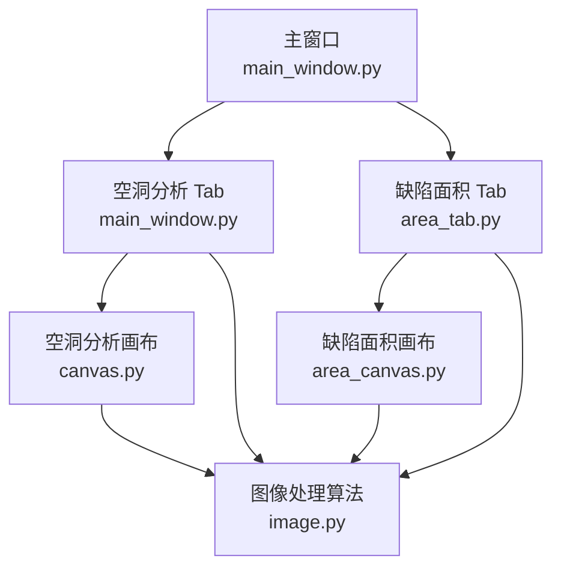
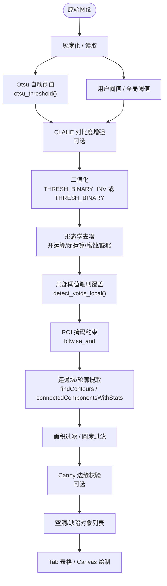
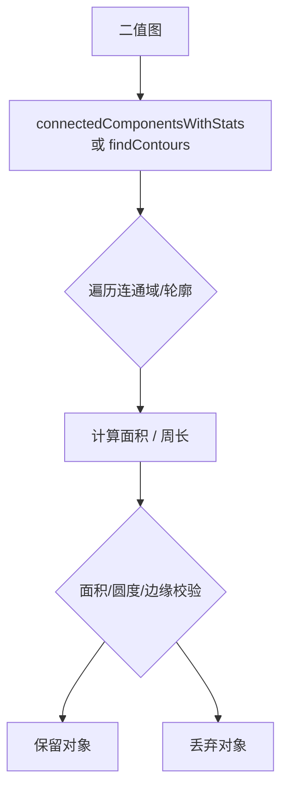
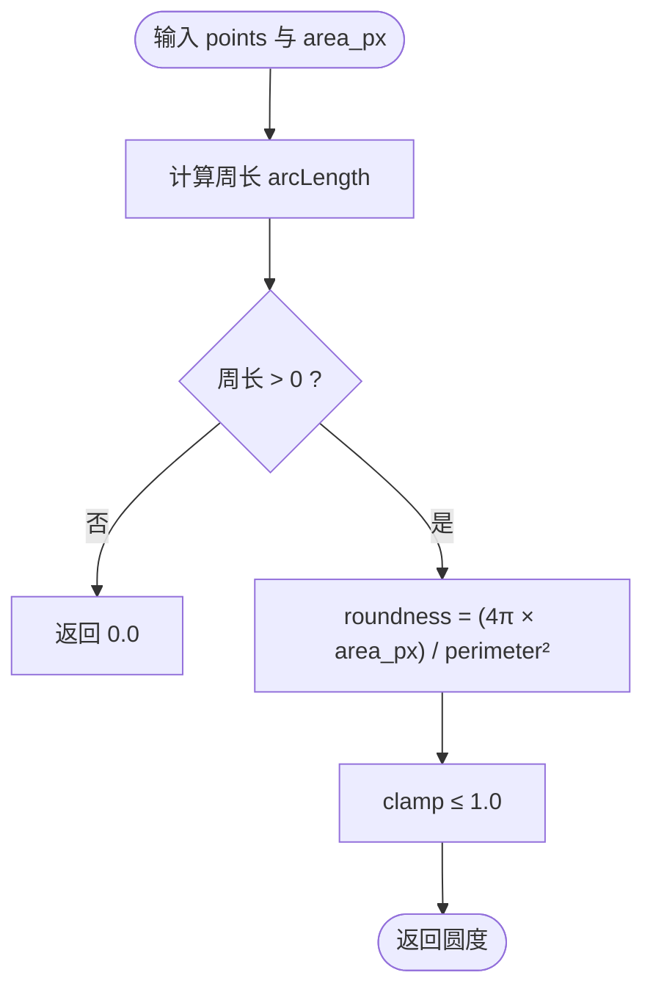
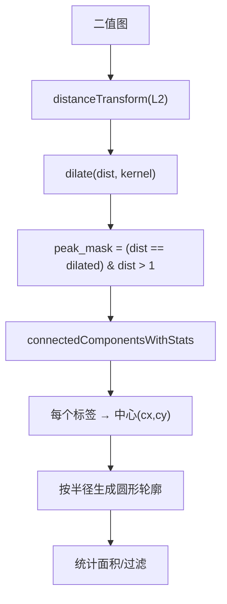
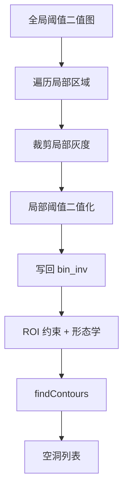
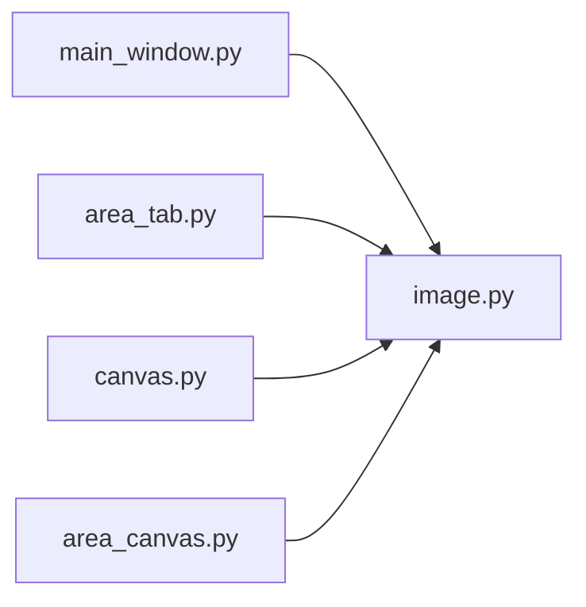

# 算法实现细节

<cite>
**本文引用的文件**   
- [image.py](file://image.py)
- [main_window.py](file://main_window.py)
- [canvas.py](file://canvas.py)
- [area_tab.py](file://area_tab.py)
- [area_canvas.py](file://area_canvas.py)
</cite>

## 目录
1. [引言](#引言)
2. [项目结构与调用边界](#项目结构与调用边界)
3. [核心算法函数清单](#核心算法函数清单)
4. [系统架构与数据流](#系统架构与数据流)
5. [关键算法逐项说明](#关键算法逐项说明)
6. [依赖关系分析](#依赖关系分析)
7. [性能优化建议](#性能优化建议)
8. [已知限制与故障排查](#已知限制与故障排查)
9. [结论](#结论)

## 引言
本文面向 Aurascope 的图像算法层，以 `image.py` 为唯一权威实现，逐项说明空洞检测、缺陷面积检测、形态学去噪、连通域/轮廓处理、圆度计算、距离变换局部极大值计数、Canny 边缘校验以及局部阈值笔刷区域处理。文档同时给出从原始图像到空洞/缺陷列表的数据流图，并明确这些函数被哪些 Tab 和 Canvas 调用，最后补充性能优化建议和已知限制。

## 项目结构与调用边界
Aurascope 是 PyQt6 + OpenCV + NumPy + Pandas 的单机桌面应用，代码分层约定如下：
- GUI 入口与主窗口装配：`main.py` → `main_window.py`
- 业务 Tab：ROI（缺陷面积）、空洞分析、示教/批量、剪切力、物料计数、图像拼接
- Canvas 绘制层：`canvas.py`（空洞分析画布）、`area_canvas.py`（缺陷面积画布）
- 算法层：`image.py`（唯一算法实现）
- 配方与导出：`recipe.py`、CSV/汇总图渲染

**图表来源**
- [main_window.py:31-48](file://main_window.py#L31-L48)
- [canvas.py:13-28](file://canvas.py#L13-L28)
- [area_tab.py:21-28](file://area_tab.py#L21-L28)
- [area_canvas.py:85-97](file://area_canvas.py#L85-L97)

**章节来源**
- [README.md:1-76](file://README.md#L1-L76)
- [main_window.py:31-48](file://main_window.py#L31-L48)
- [canvas.py:13-28](file://canvas.py#L13-L28)
- [area_tab.py:21-28](file://area_tab.py#L21-L28)
- [area_canvas.py:85-97](file://area_canvas.py#L85-L97)

## 核心算法函数清单
本节按业务目标列出 `image.py` 中与空洞/缺陷检测直接相关的函数，并标注其职责、输入输出单位及主要 OpenCV/NumPy API。

| 函数 | 职责 | 主要输入 | 返回值结构 | 数值单位 | 主要 API |
|---|---|---|---|---|---|
| `otsu_threshold(gray_img, roi_mask)` | Otsu 自动阈值 | 灰度图、可选 ROI 掩码 | 整数阈值 `[0,255]` | 灰度级 | `cv2.threshold(..., THRESH_BINARY_INV+THRESH_OTSU)` |
| `detect_voids(...)` | 全局阈值 + 增强 + 形态学 + 轮廓 + 过滤的空洞检测 | 灰度图、ROI 掩码、阈值、面积/圆度/Canny 等开关 | 空洞字典列表 | 面积/坐标/周长均为像素 | `cv2.threshold`, `cv2.morphologyEx`, `cv2.findContours`, `cv2.contourArea`, `cv2.arcLength`, `cv2.Canny` |
| `calculate_roundness(points, area_px)` | 圆度 `(4π×面积)/周长²` | 轮廓点、像素面积 | 浮点圆度 `[0,1]` | 面积像素；周长像素 | `cv2.arcLength` |
| `detect_voids_local(...)` | 全局阈值 + 局部阈值笔刷覆盖 + 轮廓检测 | 灰度图、ROI 掩码、全局阈值、局部区域列表 | 空洞字典列表 | 像素 | `cv2.threshold`, `cv2.morphologyEx`, `cv2.findContours`, `cv2.Canny` |
| `create_local_region_around_void(void_info, padding)` | 根据空洞矩形生成局部调节区域 | 空洞信息字典、扩展像素 | `(x,y,w,h)` | 像素 | NumPy/Python 算术 |
| `is_void_in_roi(points, roi_mask)` | 判断空洞是否落在 ROI 内 | 轮廓点、ROI 掩码 | 布尔值 | 像素 | `cv2.fillPoly`, `cv2.countNonZero` |
| `extract_threshold_contour(img, rect_tuple, thresh_val)` | 矩形区域阈值 + 最大外轮廓提取 | BGR/灰度图、`(x,y,w,h)`、阈值 | `(rect_info, local_mask, contour)` 或全 `None` | 像素 | `cv2.cvtColor`, `cv2.threshold`, `cv2.findContours` |
| `contour_to_polygon(contour, target_vertices)` | 轮廓近似为多边形顶点 | OpenCV 轮廓、目标顶点数 | 顶点列表 | 像素 | `cv2.arcLength`, `cv2.approxPolyDP` |
| `polygon_to_mask(points, img_shape)` | 多边形转二值掩码 | 顶点列表、图像尺寸 | `(h,w) uint8` 掩码 | 像素 | `cv2.fillPoly` |
| `build_snap_edge_mask(rect_info, local_mask, img_shape)` | 构建边缘吸附掩码 | 矩形信息、局部掩码、图像尺寸 | 二值掩码 | 像素 | `cv2.Canny` |
| `detect_defects(gray, thresh_val, bright, min_area, roi_mask)` | 8 邻域缺陷检测，返回精确面积与 bbox 局部掩膜 | 二维 `uint8` 灰度、阈值、方向、最小面积、可选 ROI | 对象字典列表（含 `mask`） | 面积像素；质心像素 | `cv2.threshold`, `cv2.connectedComponentsWithStats`, `cv2.findContours` |
| `detect_objects(...)` | 物料计数通用检测，支持分水岭峰值计数 | 灰度图、阈值、形态学/圆度/Canny/ROI 等参数 | 对象字典列表 | 像素 | `cv2.distanceTransform`, `cv2.dilate`, `cv2.connectedComponentsWithStats`, `cv2.findContours`, `cv2.Canny` |

**章节来源**
- [image.py:180-197](file://image.py#L180-L197)
- [image.py:200-286](file://image.py#L200-L286)
- [image.py:312-326](file://image.py#L312-L326)
- [image.py:328-422](file://image.py#L328-L422)
- [image.py:425-488](file://image.py#L425-L488)
- [image.py:491-632](file://image.py#L491-L632)
- [image.py:635-651](file://image.py#L635-L651)
- [image.py:289-309](file://image.py#L289-L309)
- [image.py:27-70](file://image.py#L27-L70)
- [image.py:112-155](file://image.py#L112-L155)
- [image.py:158-177](file://image.py#L158-L177)

## 系统架构与数据流
从原始图像到空洞/缺陷列表的典型数据流如下：

**图表来源**
- [image.py:180-197](file://image.py#L180-L197)
- [image.py:200-286](file://image.py#L200-L286)
- [image.py:328-422](file://image.py#L328-L422)
- [image.py:425-488](file://image.py#L425-L488)
- [image.py:491-632](file://image.py#L491-L632)

**章节来源**
- [image.py:180-197](file://image.py#L180-L197)
- [image.py:200-286](file://image.py#L200-L286)
- [image.py:328-422](file://image.py#L328-L422)
- [image.py:425-488](file://image.py#L425-L488)
- [image.py:491-632](file://image.py#L491-L632)

## 关键算法逐项说明

### 阈值分割与 Otsu 自动阈值
- **函数签名**：`otsu_threshold(gray_img, roi_mask=None)`
- **参数含义**：
  - `gray_img`：二维灰度图像。
  - `roi_mask`：可选二值掩码，仅对掩码内像素计算 Otsu。
- **返回值**：整数阈值，范围 `[0,255]`；若 ROI 无有效像素则回退为 `128`。
- **OpenCV API**：`cv2.threshold(roi_pixels, 0, 255, cv2.THRESH_BINARY_INV + cv2.THRESH_OTSU)`。
- **数值单位**：灰度级，非物理长度。
- **边界条件与失败路径**：
  - `roi_mask` 为空时退化为全图直方图。
  - 像素数组长度为 0 时返回固定阈值 `128`，不抛异常。
  - 该函数本身不做类型强校验，传入非 NumPy 数组可能由底层 OpenCV 报错。

**章节来源**
- [image.py:180-197](file://image.py#L180-L197)

### 形态学去噪：开运算、闭运算、腐蚀、膨胀
- **开运算**：先腐蚀后膨胀，用于去除小噪声、断开细界面。在 `detect_voids`、`detect_voids_local`、`detect_objects` 中通过 `cv2.morphologyEx(..., MORPH_OPEN, kernel)` 实现。
- **闭运算**：先膨胀后腐蚀，用于连接断裂区域。`detect_objects` 在开运算后追加一次椭圆核闭运算。
- **腐蚀**：`detect_voids` 与 `detect_voids_local` 使用 `cv2.erode(roi_mask, ...)` 收缩 ROI 边界，避免贴边伪影参与空洞检测。
- **膨胀**：`detect_objects` 的分水岭峰值计数分支中，用 `cv2.dilate(dist, kernel_peak)` 做局部极大值检测。
- **结构元形状**：多数使用椭圆核 `cv2.MORPH_ELLIPSE`；焊层带定位中使用横向矩形核做闭运算，避免桥接上下相邻层。
- **数值单位**：形态学操作单位为像素，核大小直接影响去噪强度。

**章节来源**
- [image.py:216-225](file://image.py#L216-L225)
- [image.py:340-363](file://image.py#L340-L363)
- [image.py:536-540](file://image.py#L536-L540)
- [image.py:544-550](file://image.py#L544-L550)

### 连通域分析与轮廓提取
- **空洞检测路径**：`cv2.findContours(void_mask, cv2.RETR_EXTERNAL, cv2.CHAIN_APPROX_SIMPLE)`，取外部轮廓。
- **缺陷面积路径**：`cv2.connectedComponentsWithStats(binary, connectivity=8)`，得到标签、统计、质心；再对每个连通域的 bbox 内局部掩膜调用 `findContours` 提取外轮廓。
- **复杂度**：连通域数量越多，循环开销越大；当前实现每 10 个对象调用一次 `_pump_events()` 以尽量保持 UI 响应。
- **返回值结构**：空洞/缺陷对象统一包含 `id`、`area_px`、`rect=(x,y,w,h)`、`cx/cy`、`points`；`detect_defects` 额外返回精确 `mask`。

**图表来源**
- [image.py:226-286](file://image.py#L226-L286)
- [image.py:462-488](file://image.py#L462-L488)
- [image.py:574-632](file://image.py#L574-L632)

**章节来源**
- [image.py:226-286](file://image.py#L226-L286)
- [image.py:462-488](file://image.py#L462-L488)
- [image.py:574-632](file://image.py#L574-L632)

### 圆度计算：`(4π×面积)/周长²`
- **函数签名**：`calculate_roundness(points, area_px)`
- **参数含义**：
  - `points`：轮廓点集。
  - `area_px`：已计算的像素面积。
- **返回值**：浮点圆度，上限截断为 `1.0`；周长为 0 时返回 `0.0`。
- **OpenCV API**：`cv2.arcLength(np.array(points), True)`。
- **数值单位**：面积与周长均为像素单位，因此圆度是无量纲几何指标。
- **边界条件**：
  - 空轮廓或零周长返回 `0.0`。
  - 结果被 `min(roundness, 1.0)` 截断，保证数学上不超过 1。

**图表来源**
- [image.py:312-326](file://image.py#L312-L326)

**章节来源**
- [image.py:312-326](file://image.py#L312-L326)

### distanceTransform 局部极大值计数
- **适用函数**：`detect_objects(..., watershed_enabled=True, watershed_distance=...)`
- **流程**：
  1. 对二值图执行 `cv2.distanceTransform(bin_img, cv2.DIST_L2, 3)`。
  2. 构造核 `ksize = max(3, int(watershed_distance)*2+1)`。
  3. 膨胀距离图：`dilated = cv2.dilate(dist, kernel_peak)`。
  4. 局部极大值掩码：`peak_mask = (dist == dilated) & (dist > 1.0)`。
  5. 对 `peak_mask` 做连通域计数，每个峰值作为物体中心，按半径生成圆形轮廓并统计面积。
- **参数含义**：
  - `watershed_enabled`：是否启用峰值计数。
  - `watershed_distance`：最小峰值间距（像素），默认语义为“越大越保守”。
- **返回值**：对象字典列表，含 `id`、`area_px`、`rect`、`cx/cy`、`points`。
- **数值单位**：距离变换值为像素距离；半径、核大小、面积均为像素。
- **边界条件**：
  - 仅当 `cv2.countNonZero(bin_img) > 0` 才进入分水岭分支。
  - 峰值位置需落在距离图范围内，否则跳过。
  - 生成的圆形轮廓面积小于 `min_area` 时被过滤。

**图表来源**
- [image.py:544-572](file://image.py#L544-L572)

**章节来源**
- [image.py:544-572](file://image.py#L544-L572)

### Canny 边缘校验与面积统计
- **触发条件**：仅在 `enhanced=True` 且 `edge_verify=True` 时计算 Canny 边缘图。
- **实现方式**：
  1. 高斯模糊：`cv2.GaussianBlur(processed, (5,5), 1.0)`。
  2. Canny：`cv2.Canny(blurred, 30, 100)`。
  3. 与 ROI 或 interior_mask 做 `bitwise_and` 限制验证区域。
  4. 对每个轮廓绘制掩膜，计算与 edge_map 的重叠像素比例。
  5. 若重叠比例 `< edge_thresh`，则丢弃该轮廓。
- **返回值影响**：Canny 校验不改变空洞字典结构，只决定是否加入最终列表。
- **数值单位**：edge_thresh 为比例，无量纲；Canny 内部阈值为灰度级。
- **边界条件**：
  - 未启用增强或边缘校验时，`edge_map` 保持 `None`，校验分支跳过。
  - 总像素为 0 时不会误判为通过。

**章节来源**
- [image.py:228-233](file://image.py#L228-L233)
- [image.py:255-263](file://image.py#L255-L263)
- [image.py:366-370](file://image.py#L366-L370)
- [image.py:392-399](file://image.py#L392-L399)
- [image.py:576-581](file://image.py#L576-L581)
- [image.py:602-610](file://image.py#L602-L610)

### 局部阈值笔刷区域处理
- **入口函数**：`detect_voids_local(gray_img, roi_mask, global_thresh_val, local_regions=None, ...)`
- **局部区域格式**：`local_regions` 为列表，每项形如 `(x, y, w, h, local_thresh)`。
- **处理逻辑**：
  1. 先用全局阈值生成二值图。
  2. 可选 CLAHE 与开运算。
  3. 对每个局部区域裁剪 `gray_img[y:y+h, x:x+w]`，按 `local_thresh` 做二值化。
  4. 将局部二值结果写回 `bin_inv` 对应区域，覆盖全局阈值结果。
  5. 再用 ROI 腐蚀后的 interior_mask 约束，最后统一 `findContours`。
- **边界处理**：
  - 坐标被 `max(0, ...)` 和 `min(shape, ...)` 裁剪。
  - 宽高 `<=0` 的区域直接跳过。
- **返回值**：空洞字典列表，结构与 `detect_voids` 一致。
- **调用方**：主窗口空洞分析侧边栏在确认局部阈值区域后调用该函数重新检测。

**图表来源**
- [image.py:328-422](file://image.py#L328-L422)

**章节来源**
- [image.py:328-422](file://image.py#L328-L422)
- [main_window.py:174-179](file://main_window.py#L174-L179)

## 依赖关系分析
- `main_window.py` 导入并调用 `image.py` 中的空洞检测、Otsu、局部阈值、ROI 判断、圆度、轮廓转换等函数。
- `area_tab.py` 导入 `detect_defects`、`otsu_threshold`、`polygon_to_mask`，用于缺陷面积多 ROI 检测。
- `canvas.py` 提供空洞分析交互，包括局部 Otsu 预览、笔刷模式、阈值偏移、边缘吸附掩码。
- `area_canvas.py` 负责缺陷面积结果的渲染与命中检测，不持有检测逻辑。

**图表来源**
- [main_window.py:31-48](file://main_window.py#L31-L48)
- [area_tab.py:21-28](file://area_tab.py#L21-L28)
- [canvas.py:1-10](file://canvas.py#L1-L10)
- [area_canvas.py:1-12](file://area_canvas.py#L1-L12)

**章节来源**
- [main_window.py:31-48](file://main_window.py#L31-L48)
- [area_tab.py:21-28](file://area_tab.py#L21-L28)
- [canvas.py:1-10](file://canvas.py#L1-L10)
- [area_canvas.py:1-12](file://area_canvas.py#L1-L12)

## 性能优化建议
1. **大图分块**：
   - 当前 `detect_voids` 与 `detect_voids_local` 对整幅图做 CLAHE、二值化、形态学、连通域/轮廓遍历。对于超大 SEM/X 光图，可先在调用方按 ROI 或网格切块，逐块调用算法后再合并结果。
   - `detect_objects` 的分水岭分支会创建距离图与膨胀图，内存占用约为原图的数倍，应结合 ROI 裁剪。
2. **ROI 裁剪优先**：
   - 所有函数都接受或可配合 `roi_mask`；在 GUI 层先裁剪到用户框选区域，再传给算法层，能显著减少 `cv2.findContours` 与 `connectedComponentsWithStats` 的开销。
3. **NumPy 向量化**：
   - 圆度计算、面积过滤、Canny 重叠统计已大量使用 NumPy/OpenCV 向量化；但 `detect_voids_local` 的局部区域循环仍为 Python 层 for 循环，可在调用方预先过滤无效区域或改用批量化掩码写入。
4. **避免重复 CLAHE**：
   - `detect_voids` 与 `detect_voids_local` 各自独立创建 CLAHE 实例；若同一张图多次调用，应在调用方缓存 `processed` 或 `clahe.apply(gray_img)` 的结果。
5. **事件泵频率**：
   - 当前每 10 个轮廓/连通域调用一次 `_pump_events()`；对极多图可考虑改为时间片或进度回调，避免频繁 UI 刷新。

[本节为通用性能建议，不直接分析具体代码行]

## 已知限制与故障排查
以下限制来自仓库已知问题清单与源码行为：

1. **重复实现 `detect_voids_local`**：
   - `main_window.py` 中存在一份 `detect_voids_local` 副本，属于已知技术债；现行行为应以 `image.py` 为准，两份待合并。
2. **Canny 边缘校验静默失效**：
   - 当 `enhanced=True` 且 `edge_verify=True` 时，`edge_map` 才会被初始化；若调用方未正确设置增强标志或提前短路，`edge_map` 为 `None`，Canny 校验分支被跳过，表现为“边缘验证未生效”而非报错。
3. **`chk_roi_overlay` 重复创建风险**：
   - 历史手记指出 `chk_roi_overlay` 存在重复创建问题；UI 层应确保控件生命周期稳定，避免重复 addWidget 导致状态不一致。
4. **滚轮缩放 Y 轴漂移**：
   - `canvas.py` 的缩放锚点计算存在 Y 轴漂移已知问题；不要把现状描述为正确设计，后续应统一 X/Y 锚点修正。
5. **`select_for_local` 为无 UI 入口的死代码**：
   - 该符号未被现有 UI 流程调用，不应视为可用功能。
6. **大图增强检测无进度提示**：
   - 长循环中虽有 `_pump_events()`，但没有明确的进度条或取消机制，用户可能感知为卡顿。
7. **单位混淆风险**：
   - 空洞/缺陷对象的 `area_px`、`rect`、`cx/cy`、`perimeter` 均为像素单位；只有经过标定后，`area_tab.py` 才能换算为微米平方。算法层不关心物理单位。

**章节来源**
- [handoff.md:1-200](file://handoff.md#L1-L200)
- [image.py:228-233](file://image.py#L228-L233)
- [image.py:366-370](file://image.py#L366-L370)
- [image.py:576-581](file://image.py#L576-L581)
- [canvas.py:695-706](file://canvas.py#L695-L706)
- [area_tab.py:35-50](file://area_tab.py#L35-L50)

## 结论
`image.py` 是 Aurascope 图像算法的唯一权威实现，承担阈值/Otsu、形态学去噪、连通域/轮廓、圆度、距离变换峰值计数、Canny 边缘校验与局部阈值笔刷等核心能力。GUI 层通过 `main_window.py`、`area_tab.py`、`canvas.py`、`area_canvas.py` 组织交互与渲染，不得内联算法实现。当前实现已在像素域完成空洞与缺陷检测，物理单位换算由 `area_tab.py` 在标定后完成。未来改进应优先合并重复实现、修复 Canny 静默失效与缩放 Y 漂移，并在大图场景引入分块、ROI 裁剪与进度反馈。