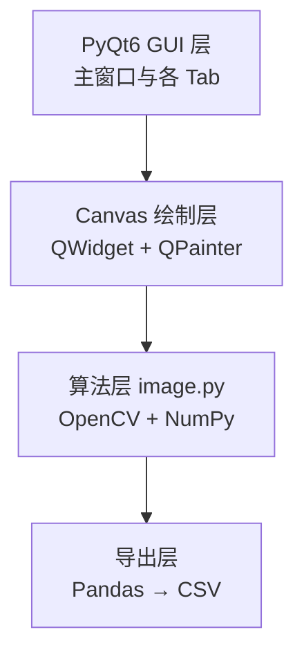
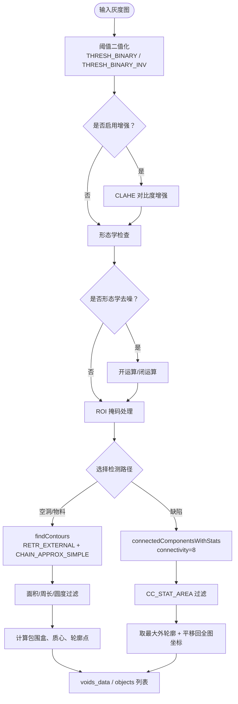
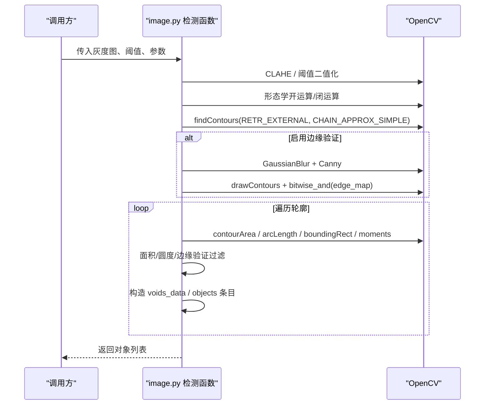
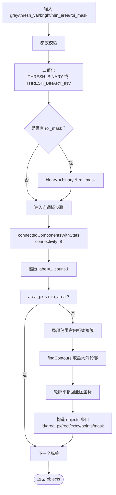
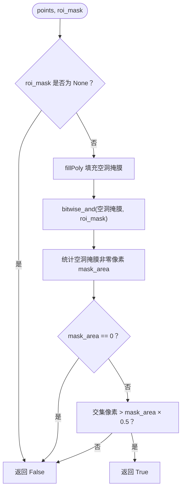
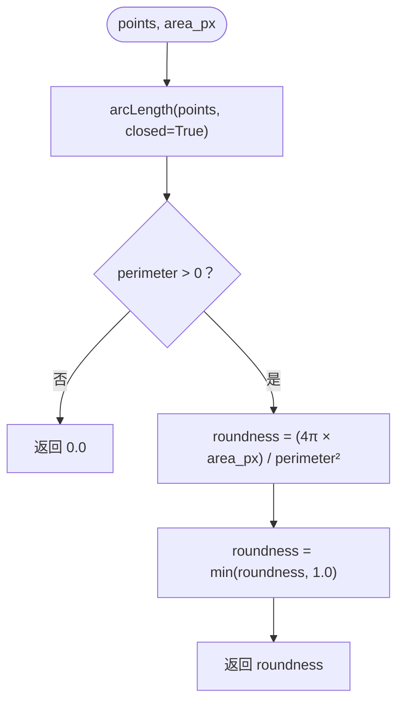
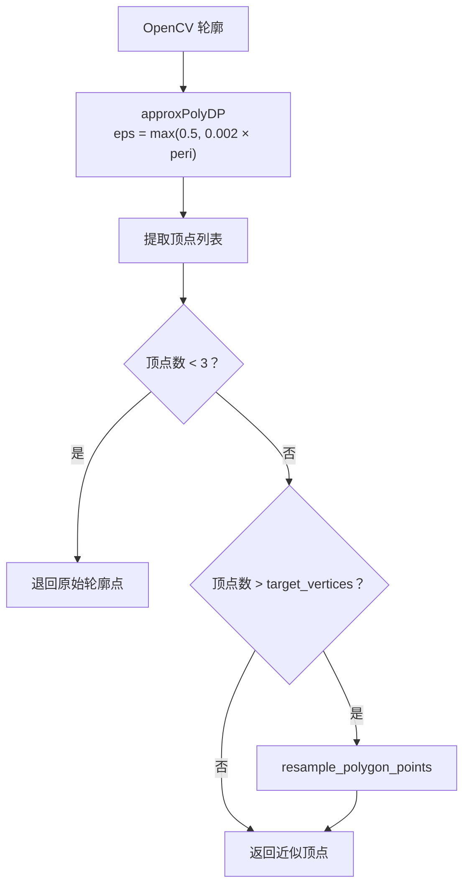
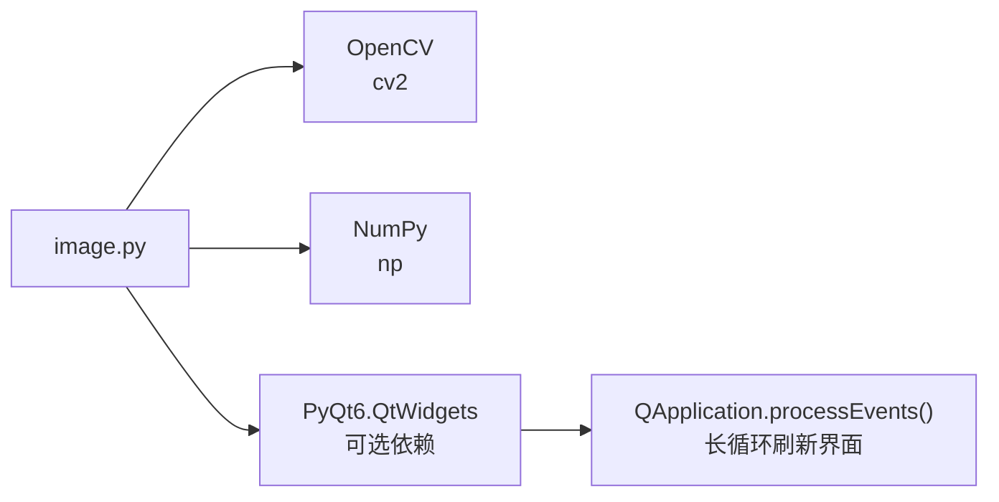

# 连通域分析与轮廓提取

<cite>
**本文引用的文件**   
- [image.py](file://image.py)
- [README.md](file://README.md)
- [PROJECT_CONCEPTION.md](file://PROJECT_CONCEPTION.md)
</cite>

## 目录
1. [引言](#引言)
2. [项目结构定位](#项目结构定位)
3. [核心组件总览](#核心组件总览)
4. [架构与数据流](#架构与数据流)
5. [详细算法分析](#详细算法分析)
6. [统一数据结构规范](#统一数据结构规范)
7. [依赖关系分析](#依赖关系分析)
8. [性能与边界情况](#性能与边界情况)
9. [已知问题与排查建议](#已知问题与排查建议)
10. [结论](#结论)

## 引言
本文聚焦 `image.py` 中的连通域分析与轮廓提取能力，面向 Aurascope（金锡焊空洞分析）的算法层。文档重点说明两条实现路径：

1. **基于 OpenCV 轮廓的路径**：`detect_voids`、`detect_voids_local`、`detect_objects` 使用 `cv2.findContours` + `RETR_EXTERNAL` + `CHAIN_APPROX_SIMPLE`，从二值掩码中提取外部轮廓，再计算面积、周长、质心、包围盒等几何信息。
2. **基于 8 邻域连通域的路径**：`detect_defects` 使用 `cv2.connectedComponentsWithStats(connectivity=8)`，直接获取每个连通域的像素面积、外接矩形、质心与标签图，并在局部包围盒内提取最大外轮廓作为 `points`。

同时明确：`voids_data` 与 `objects` 是同一份业务对象契约，字段包括 `id`、`area_px`、`rect=(x,y,w,h)`、`cx/cy`、`points`、`manual/mask`；其中 `area_px` 表示**像素面积**，不是物理单位 μm²。

## 项目结构定位
Aurascope 是 PyQt6 + OpenCV + NumPy + Pandas 的单机桌面应用，不联网、不收集用户数据、纯 CPU 计算，兼容 Windows 7+。其技术分层为：

**图表来源**
- [README.md:35-64](file://README.md#L35-L64)
- [PROJECT_CONCEPTION.md:77-107](file://PROJECT_CONCEPTION.md#L77-L107)

在空洞分析与缺陷检测场景中，GUI 层通过 `canvas.py`、`main_window.py`、`area_tab.py`、`area_canvas.py` 等页面与画布调用 `image.py` 的函数；`image.py` 是唯一算法实现层，负责阈值、形态学、轮廓、连通域、圆度、Canny 边缘校验与面积统计。

**章节来源**
- [README.md:1-64](file://README.md#L1-L64)
- [PROJECT_CONCEPTION.md:17-27](file://PROJECT_CONCEPTION.md#L17-L27)
- [PROJECT_CONCEPTION.md:77-107](file://PROJECT_CONCEPTION.md#L77-L107)

## 核心组件总览
本节按“输入图像 → 二值化/增强 → 连通域/轮廓 → 过滤 → 输出对象列表”的顺序梳理关键函数。

| 函数 | 主要用途 | 核心 API | 返回类型 |
|---|---|---|---|
| `extract_threshold_contour` | 从矩形 ROI 提取阈值轮廓并返回最大轮廓 | `cv2.threshold` + `cv2.findContours` | `(rect_info, local_mask, contour)` 或空 |
| `resample_polygon_points` | 将多边形顶点重采样为目标数量 | NumPy 线段长度累积 + 插值 | 顶点列表 |
| `contour_to_polygon` | 将 OpenCV 轮廓近似为固定顶点数的多边形 | `cv2.approxPolyDP` + `resample_polygon_points` | 顶点列表 |
| `polygon_to_mask` | 将多边形顶点转为二值掩码 | `cv2.fillPoly` | uint8 掩码 |
| `otsu_threshold` | Otsu 自动阈值 | `cv2.threshold(..., THRESH_BINARY_INV + THRESH_OTSU)` | int |
| `detect_voids` | 全局空洞检测 | CLAHE、开运算、ROI 腐蚀、`findContours`、可选 Canny 验证 | `voids_data` 列表 |
| `is_void_in_roi` | 判断空洞是否落在 ROI 内 | `fillPoly` + 重叠像素比例 | bool |
| `calculate_roundness` | 计算圆度 | `cv2.arcLength` + 圆度公式 | float |
| `detect_voids_local` | 带局部阈值覆盖的空洞检测 | 全局二值 + 局部区域覆盖 + `findContours` | `voids_data` 列表 |
| `detect_defects` | 8 邻域连通域缺陷检测 | `connectedComponentsWithStats(connectivity=8)` | `objects` 列表 |
| `detect_objects` | 物料计数对象检测 | CLAHE、形态学、可选分水岭峰值、`findContours` | `objects` 列表 |

**章节来源**
- [image.py:27-70](file://image.py#L27-L70)
- [image.py:73-155](file://image.py#L73-L155)
- [image.py:180-197](file://image.py#L180-L197)
- [image.py:200-286](file://image.py#L200-L286)
- [image.py:289-326](file://image.py#L289-L326)
- [image.py:328-422](file://image.py#L328-L422)
- [image.py:425-488](file://image.py#L425-L488)
- [image.py:491-632](file://image.py#L491-L632)

## 架构与数据流
下图展示空洞与缺陷检测的统一数据流：二值图 → 连通域/轮廓 → 面积/周长过滤 → 质心/包围盒 → 空洞/缺陷列表。

**图表来源**
- [image.py:200-286](file://image.py#L200-L286)
- [image.py:328-422](file://image.py#L328-L422)
- [image.py:425-488](file://image.py#L425-L488)
- [image.py:491-632](file://image.py#L491-L632)

## 详细算法分析

### 路径一：`detect_voids`、`detect_voids_local`、`detect_objects` 的轮廓路径
这三条函数共享相似流程：

1. 可选 CLAHE 增强。
2. 根据业务选择二值化方向：空洞通常用 `THRESH_BINARY_INV`，物料可用 `invert` 控制 `THRESH_BINARY` 或 `THRESH_BINARY_INV`。
3. 可选形态学开运算/闭运算去噪。
4. 对空洞路径进行 ROI 内部掩码处理（如 `roi_erosion_px` 腐蚀 ROI）。
5. 使用 `cv2.findContours(mask, cv2.RETR_EXTERNAL, cv2.CHAIN_APPROX_SIMPLE)` 提取外部轮廓。
6. 可选 Canny 边缘验证：若 `enhanced=True` 且 `edge_verify=True`，则对模糊后的灰度图做 Canny，再用轮廓掩码与边缘图求交，按边缘像素占比过滤。
7. 计算面积、周长、圆度、包围盒、质心、轮廓点，构造统一对象字典。

**图表来源**
- [image.py:200-286](file://image.py#L200-L286)
- [image.py:328-422](file://image.py#L328-L422)
- [image.py:491-632](file://image.py#L491-L632)

#### `detect_voids`
- 支持 CLAHE、形态学开运算、ROI 腐蚀后与二值图相与。
- 使用 `findContours` 提取空洞轮廓。
- 可选圆度过滤：`perimeter > 0` 时计算 `(4π×area)/perimeter²`，小于 `min_roundness` 跳过。
- 可选 Canny 边缘验证：轮廓掩码与 `edge_map` 交集像素占比低于 `edge_thresh` 时跳过。
- 输出 `voids_data`，包含 `id`、`area_px`、`rect`、`cx`、`cy`、`points`、`manual=False`。

**章节来源**
- [image.py:200-286](file://image.py#L200-L286)

#### `detect_voids_local`
- 先全局二值化，再按 `local_regions` 覆盖局部阈值区域。
- 同样进行 ROI 腐蚀、`findContours`、可选圆度与边缘验证。
- 当前仓库中存在另一份 `detect_voids_local` 副本位于 `main_window.py`，属于已知技术债；本文以 `image.py` 的实现为准，两份待合并。

**章节来源**
- [image.py:328-422](file://image.py#L328-L422)

#### `detect_objects`
- 用于物料计数，复用空洞检测核心逻辑。
- 支持 `invert` 控制亮/暗物体。
- 支持形态学开运算 + 闭运算。
- 可选分水岭峰值分离：通过距离变换找局部极大值，生成圆形种子并按最小面积过滤。
- 默认走 `findContours` 路径，输出 `objects` 列表。

**章节来源**
- [image.py:491-632](file://image.py#L491-L632)

### 路径二：`detect_defects` 的 8 邻域连通域路径
`detect_defects` 与上述轮廓路径不同，它直接基于像素级连通域：

1. 输入校验：`gray` 必须是非空二维 `uint8`；`thresh_val` 必须是 `[0,255]` 实数；`bright` 是布尔；`min_area` 是有限非负实数；`roi_mask` 可选但必须同形、`uint8`、仅含 0/255。
2. 根据 `bright` 选择 `THRESH_BINARY` 或 `THRESH_BINARY_INV` 二值化。
3. 若提供 `roi_mask`，则与二值图相与。
4. 调用 `cv2.connectedComponentsWithStats(binary, connectivity=8)`，得到 `count`、`labels`、`stats`、`centroids`。
5. 对每个标签 `label >= 1`：
   - 取 `stats[label, CC_STAT_AREA]` 作为 `area_px`。
   - 取 `stats[label,:4]` 作为 `rect=(x,y,w,h)`。
   - 在局部包围盒内构造 `(labels[y:y+h,x:x+w]==label).astype(np.uint8)*255`，避免整幅图分配掩膜。
   - 在局部掩膜上 `findContours(RETR_EXTERNAL, CHAIN_APPROX_SIMPLE)`，取最大轮廓并平移回全图坐标。
   - 使用 `centroids[label]` 作为 `cx/cy`。
   - 保留 `mask` 为局部二值掩膜。
   - 构造 `objects` 条目。

**图表来源**
- [image.py:425-488](file://image.py#L425-L488)

**章节来源**
- [image.py:425-488](file://image.py#L425-L488)

### `is_void_in_roi()`：空洞是否在 ROI 内的判断
`is_void_in_roi(points, roi_mask)` 的判断逻辑如下：

1. 若 `roi_mask` 为 `None`，直接返回 `False`。
2. 将 `points` 转为 `np.int32`。
3. 创建与 `roi_mask` 同尺寸的零掩膜。
4. 使用 `cv2.fillPoly` 将空洞轮廓填充为白色。
5. 计算空洞掩膜与 `roi_mask` 的交集。
6. 统计空洞掩膜的非零像素数 `mask_area`。
7. 若 `mask_area == 0`，返回 `False`。
8. 若交集非零像素数大于 `mask_area * 0.5`，即重叠超过 50%，返回 `True`。

**图表来源**
- [image.py:289-309](file://image.py#L289-L309)

**章节来源**
- [image.py:289-309](file://image.py#L289-L309)

### `calculate_roundness()`：圆度公式与边界情况
`calculate_roundness(points, area_px)` 的计算规则：

- 使用 `cv2.arcLength(np.array(points), True)` 计算闭合轮廓周长 `perimeter`。
- 若 `perimeter > 0`，圆度为 `(4π×area_px) / perimeter²`，并截断到不超过 1.0。
- 若 `perimeter == 0`，返回 `0.0`。

该公式对应几何意义上的圆度指标：越接近圆形的轮廓，圆度越接近 1；细长或不规则轮廓圆度较低。当周长为 0 时，说明轮廓无效或退化，因此返回 0.0 作为安全边界值。

**图表来源**
- [image.py:312-326](file://image.py#L312-L326)

**章节来源**
- [image.py:312-326](file://image.py#L312-L326)

### `resample_polygon_points()` 与 `contour_to_polygon()`：多边形重采样
这两个函数服务于多边形 ROI 编辑与轮廓标准化：

#### `resample_polygon_points(points, target_count)`
- 输入原始顶点列表和目标顶点数。
- 若顶点数小于 3，直接返回原列表。
- 将顶点转为 `np.float32`，计算相邻点之间的线段向量与长度。
- 若总长度极小（≤1e-6），返回原列表。
- 目标顶点数至少为 3。
- 按总长度等分步长，沿累计长度找到对应线段，在线段上按比例插值得到新顶点。

#### `contour_to_polygon(contour, target_vertices)`
- 输入 OpenCV 轮廓和目标顶点数。
- 先用 `cv2.approxPolyDP` 近似多边形，误差系数 `eps = max(0.5, 0.002 × peri)`。
- 若近似结果少于 3 个点，退化为原始轮廓点。
- 若近似点多于目标顶点数，调用 `resample_polygon_points` 重采样到目标顶点数。

**图表来源**
- [image.py:73-109](file://image.py#L73-L109)
- [image.py:112-135](file://image.py#L112-L135)

**章节来源**
- [image.py:73-109](file://image.py#L73-L109)
- [image.py:112-135](file://image.py#L112-L135)

## 统一数据结构规范
`voids_data` 与 `objects` 是空洞与缺陷检测的统一对象契约。尽管两个路径实现细节不同，但对外暴露的字段保持一致，便于上层 UI 和导出逻辑统一处理。

| 字段 | 含义 | 数据来源 | 注意事项 |
|---|---|---|---|
| `id` | 对象编号 | 循环自增 | 空洞路径从 1 开始；缺陷路径按 `len(objects)+1` |
| `area_px` | 对象像素面积 | 轮廓路径用 `cv2.contourArea`；缺陷路径用 `CC_STAT_AREA` | **单位是像素面积，不是 μm²** |
| `rect` | 包围盒 `(x,y,w,h)` | 轮廓路径用 `cv2.boundingRect`；缺陷路径用 `stats[label,:4]` | 坐标为全图坐标 |
| `cx` | 质心 x | 轮廓路径用 `moments`；缺陷路径用 `centroids[label,0]` | 若矩为 0，退化为包围盒中心 |
| `cy` | 质心 y | 同上 | 同上 |
| `points` | 轮廓点 | 轮廓路径为 `cnt.reshape(-1,2).tolist()`；缺陷路径为最大外轮廓平移后的点 | 可用于绘制、多边形编辑、`is_void_in_roi` |
| `manual` | 是否手动对象 | 空洞路径默认 `False` | 缺陷路径未设置该字段 |
| `mask` | 局部二值掩膜 | 缺陷路径返回 `local_mask` | 空洞路径未设置该字段 |

需要特别注意：

- `area_px` 是像素面积，不能直接当作物理面积 μm²。若需物理面积，应结合标定像素比换算。
- `points` 在空洞路径中是 OpenCV 轮廓点列表；在缺陷路径中是最大外轮廓点，已平移回全图坐标。
- `mask` 仅在 `detect_defects` 返回的对象中存在，用于精确定位该连通域对应的像素区域。
- `manual` 仅在空洞路径对象中存在，用于区分自动检测与手动添加对象。

**章节来源**
- [image.py:275-284](file://image.py#L275-L284)
- [image.py:411-420](file://image.py#L411-L420)
- [image.py:479-487](file://image.py#L479-L487)
- [image.py:622-629](file://image.py#L622-L629)

## 依赖关系分析
`image.py` 的核心依赖如下：

- `cv2` 提供阈值、形态学、轮廓、连通域、Canny、moments、boundingRect、arcLength 等图像处理能力。
- `numpy` 提供数组操作、几何计算、统计函数。
- `PyQt6` 是可选依赖：若无 GUI，`QApplication` 为 `None`，`_pump_events()` 静默跳过，使算法可独立运行于无界面场景。

**图表来源**
- [image.py:1-11](file://image.py#L1-L11)
- [image.py:14-24](file://image.py#L14-L24)

**章节来源**
- [image.py:1-11](file://image.py#L1-L11)
- [image.py:14-24](file://image.py#L14-L24)

## 性能与边界情况

### 性能特征
- 空洞与物料检测在轮廓遍历中使用 `_pump_events()`，每 10 个轮廓刷新一次界面事件，避免长循环阻塞 GUI。
- `detect_defects` 在连通域遍历中也使用 `_pump_events()`，提升大图下的交互响应。
- `detect_defects` 使用局部包围盒内标签掩膜构造轮廓，避免为每个连通域分配整幅掩膜，降低内存压力。
- `detect_objects` 的分水岭峰值分支会计算距离变换、膨胀、连通域，适合粘连物体分离，但计算量高于普通轮廓路径。

### 边界情况
- `calculate_roundness` 在 `perimeter == 0` 时返回 `0.0`，防止除零错误。
- `resample_polygon_points` 在顶点数小于 3 或总长度极小时返回原顶点列表。
- `contour_to_polygon` 在近似结果少于 3 个点时退回原始轮廓点。
- `polygon_to_mask` 在顶点数少于 3 时返回 `None`。
- `is_void_in_roi` 在 `roi_mask is None` 或空洞掩膜面积为 0 时返回 `False`。
- `detect_defects` 对非法输入抛出 `ValueError`，包括灰度图类型、阈值范围、布尔类型、面积范围和 ROI 掩膜形状/类型。

**章节来源**
- [image.py:73-109](file://image.py#L73-L109)
- [image.py:112-155](file://image.py#L112-L155)
- [image.py:289-326](file://image.py#L289-L326)
- [image.py:425-488](file://image.py#L425-L488)

## 已知问题与排查建议

### 1. Canny 边缘验证依赖 `edge_map` 初始化
在 `detect_voids`、`detect_voids_local`、`detect_objects` 中，Canny 边缘图 `edge_map` 仅在 `enhanced=True` 且 `edge_verify=True` 时创建。若未启用增强模式，`edge_map` 可能为 `None`，导致 Canny 验证分支被跳过。代码中已有 `edge_map is not None` 保护，因此不会崩溃，但会静默跳过边缘验证。

排查建议：
- 若期望启用 Canny 验证，必须同时设置 `enhanced=True` 与 `edge_verify=True`。
- 若只设置 `edge_verify=True` 而 `enhanced=False`，边缘验证不会生效。
- 建议在调用方日志中记录实际启用的增强与边缘验证组合，便于复现问题。

**章节来源**
- [image.py:228-233](file://image.py#L228-L233)
- [image.py:366-370](file://image.py#L366-L370)
- [image.py:576-580](file://image.py#L576-L580)

### 2. `detect_voids_local` 存在重复实现
仓库中存在 `image.py` 中的 `detect_voids_local` 与 `main_window.py` 中的副本。根据项目约定，现行行为以 `image.py` 为准，两份待合并。维护时应避免修改副本后忘记同步主实现。

**章节来源**
- [image.py:328-422](file://image.py#L328-L422)

### 3. 其他已知限制
根据项目作者提示，以下问题属于已知限制，但不一定全部体现在本文件：
- 重复 `detect_voids_local`。
- `edge_map` 未初始化导致 Canny 校验静默失效。
- `chk_roi_overlay` 被重复创建。
- 滚轮缩放 Y 漂移。
- `select_for_local` 为无 UI 入口的死代码。
- 大图增强检测无进度提示。

这些限制应在后续重构中逐步清理，尤其是 GUI 与算法耦合、重复实现和无反馈的大图处理路径。

**章节来源**
- [image.py:228-233](file://image.py#L228-L233)
- [image.py:328-422](file://image.py#L328-L422)

## 结论
`image.py` 提供了两套互补的连通域与轮廓提取实现：

- **轮廓路径**适用于空洞与物料检测，核心是 `cv2.findContours` + `RETR_EXTERNAL` + `CHAIN_APPROX_SIMPLE`，配合 CLAHE、形态学、圆度与 Canny 边缘验证，形成完整的空洞/物料识别流水线。
- **连通域路径**适用于缺陷检测，核心是 `cv2.connectedComponentsWithStats(connectivity=8)`，直接利用像素级连通域标签、面积、质心和局部掩膜，再通过局部轮廓提取获得标准 `points`。

两者最终统一为 `id`、`area_px`、`rect`、`cx/cy`、`points`、`manual/mask` 的数据结构，使上层 UI、绘图、导出逻辑可以统一消费检测结果。文档特别强调：`area_px` 是像素面积，不是 μm²；`is_void_in_roi()` 使用 `fillPoly` + 50% 重叠阈值判断空洞是否落在 ROI 内；`calculate_roundness()` 使用 `(4π×area)/perimeter²`，并在周长为 0 时返回 0.0；`resample_polygon_points()` 与 `contour_to_polygon()` 用于将 OpenCV 轮廓重采样为目标顶点数，支撑多边形 ROI 编辑。

最后，Canny 边缘验证依赖 `enhanced=True` 与 `edge_verify=True` 共同启用，否则 `edge_map` 未初始化时会静默跳过验证。这是当前实现的重要已知限制，应在参数配置与日志记录中显式暴露。