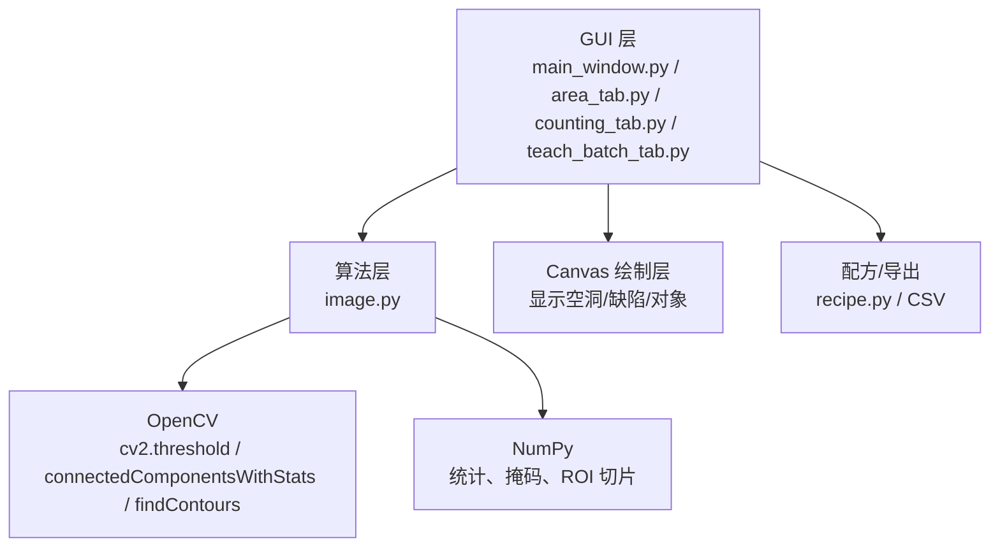
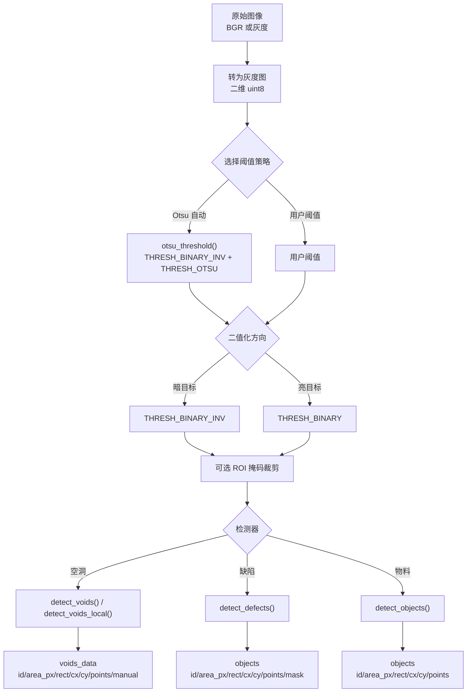
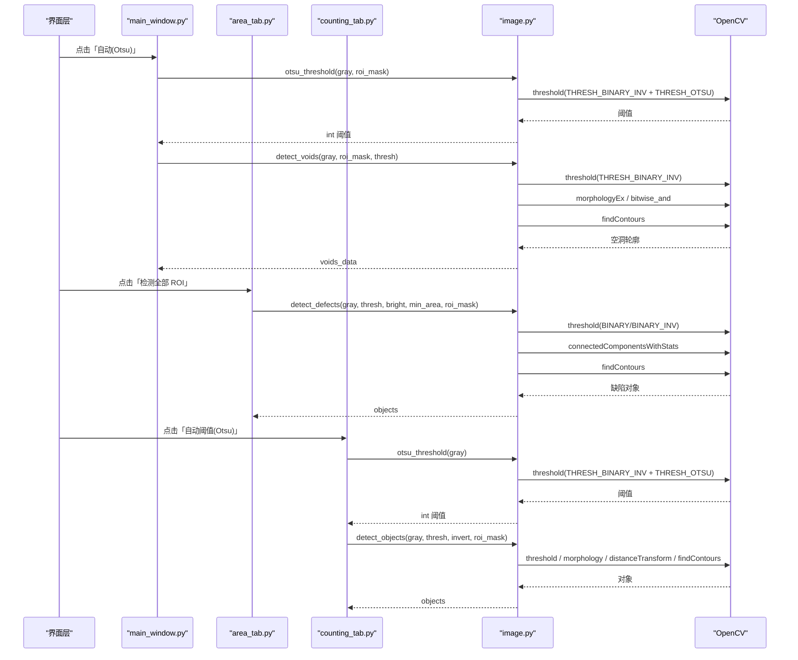

# 阈值分割与 Otsu 自动阈值

<cite>
**本文引用的文件**   
- [image.py](file://image.py)
- [main_window.py](file://main_window.py)
- [area_tab.py](file://area_tab.py)
- [counting_tab.py](file://counting_tab.py)
- [teach_batch_tab.py](file://teach_batch_tab.py)
</cite>

## 目录
1. [引言](#引言)
2. [项目结构与职责分层](#项目结构与职责分层)
3. [核心函数总览](#核心函数总览)
4. [架构与数据流](#架构与数据流)
5. [逐函数技术说明](#逐函数技术说明)
6. [调用位置与业务映射](#调用位置与业务映射)
7. [边界条件与回退逻辑](#边界条件与回退逻辑)
8. [性能优化建议](#性能优化建议)
9. [已知限制与技术债](#已知限制与技术债)
10. [结论](#结论)

## 引言
本文围绕 `image.py` 中的阈值分割与 Otsu 自动阈值相关函数，整理 Aurascope 中「空洞分析」「缺陷面积」「物料计数」三条主线的算法实现。重点说明：
- 灰度图输入要求（二维 `uint8`）；
- `cv2.THRESH_BINARY_INV` 与 `cv2.THRESH_BINARY` 的区别；
- Otsu 在 ROI 掩码内计算与全图计算的差异；
- 局部阈值笔刷 `local_regions` 如何覆盖全局二值化结果；
- `bright=True/False` 对 `detect_defects()` 的影响；
- 每个函数的签名、参数含义、返回值结构；
- OpenCV API 调用链；
- 像素单位说明；
- 边界条件与回退逻辑；
- 从原始图像到空洞/缺陷列表的数据流；
- 被 `main_window.py`、`area_tab.py`、`counting_tab.py`、`teach_batch_tab.py` 调用的位置；
- 性能优化建议与已知限制。

## 项目结构与职责分层
Aurascope 是 PyQt6 + OpenCV + NumPy + Pandas 的单机桌面应用，代码按「入口 → 主窗口 → Tab 页面 → Canvas 绘制层 → 算法层 image.py → 配方/导出」分层组织。`image.py` 是唯一算法实现层，GUI 层不得内联实现图像算法。

**图示来源**
- [image.py:1-12](file://image.py#L1-L12)
- [main_window.py:31-48](file://main_window.py#L31-L48)
- [area_tab.py:21-28](file://area_tab.py#L21-L28)
- [counting_tab.py:11-16](file://counting_tab.py#L11-L16)
- [teach_batch_tab.py:36-42](file://teach_batch_tab.py#L36-L42)

**章节来源**
- [image.py:1-12](file://image.py#L1-L12)
- [main_window.py:31-48](file://main_window.py#L31-L48)
- [area_tab.py:21-28](file://area_tab.py#L21-L28)
- [counting_tab.py:11-16](file://counting_tab.py#L11-L16)
- [teach_batch_tab.py:36-42](file://teach_batch_tab.py#L36-L42)

## 核心函数总览
| 函数 | 主要用途 | 关键 OpenCV 调用 | 返回类型 |
|---|---|---|---|
| `otsu_threshold(gray_img, roi_mask=None)` | 用 Otsu 自动计算最佳阈值 | `cv2.threshold(..., THRESH_BINARY_INV + THRESH_OTSU)` | `int` |
| `extract_threshold_contour(img, rect_tuple, thresh_val)` | 从矩形区域提取最大轮廓 | `cv2.threshold` + `cv2.findContours` | `(rect_info, local_mask, contour)` 或 `(None, None, None)` |
| `detect_voids(gray_img, roi_mask, thresh_val, ...)` | 基于全局阈值的空洞检测 | `cv2.threshold` + `cv2.findContours` | `voids_data`：字典列表 |
| `detect_voids_local(gray_img, roi_mask, global_thresh_val, local_regions=None, ...)` | 全局二值化后叠加局部阈值区域 | `cv2.threshold` + `cv2.findContours` | `voids_data`：字典列表 |
| `detect_defects(gray, thresh_val, bright=True, min_area=1, roi_mask=None)` | 8 邻域连通域缺陷检测 | `cv2.threshold` + `cv2.connectedComponentsWithStats` + `cv2.findContours` | `objects`：字典列表 |
| `detect_objects(gray_img, thresh_val, ..., invert=False, watershed_enabled=False, roi_mask=None)` | 物料计数对象检测 | `cv2.threshold` + `cv2.findContours` 或距离峰值计数 | `objects`：字典列表 |

**章节来源**
- [image.py:27-70](file://image.py#L27-L70)
- [image.py:180-197](file://image.py#L180-L197)
- [image.py:200-286](file://image.py#L200-L286)
- [image.py:328-422](file://image.py#L328-L422)
- [image.py:425-488](file://image.py#L425-L488)
- [image.py:491-632](file://image.py#L491-L632)

## 架构与数据流
从原始图像到空洞/缺陷列表的核心流程如下：

**图示来源**
- [image.py:180-197](file://image.py#L180-L197)
- [image.py:200-286](file://image.py#L200-L286)
- [image.py:328-422](file://image.py#L328-L422)
- [image.py:425-488](file://image.py#L425-L488)
- [image.py:491-632](file://image.py#L491-L632)

## 逐函数技术说明

### `otsu_threshold(gray_img, roi_mask=None)`
- **作用**：使用 Otsu 自动计算最佳阈值。
- **输入**：
  - `gray_img`：灰度图像，应为二维数组；实际实现通过 `flatten()` 取像素直方图，不强制检查 dtype。
  - `roi_mask`：可选 ROI 掩码；当非空时仅对掩码为 255 的像素计算 Otsu。
- **输出**：`int`，范围 0–255。
- **关键行为**：
  - 若 ROI 掩码为空或没有有效像素，返回默认阈值 `128`。
  - 内部使用 `cv2.THRESH_BINARY_INV + cv2.THRESH_OTSU`，即把暗像素作为前景进行 Otsu 双峰分离。
- **OpenCV 调用链**：`cv2.threshold(roi_pixels, 0, 255, cv2.THRESH_BINARY_INV + cv2.THRESH_OTSU)`。
- **像素单位**：阈值单位为灰度级 0–255，不是物理长度。

**章节来源**
- [image.py:180-197](file://image.py#L180-L197)

### `extract_threshold_contour(img, rect_tuple, thresh_val)`
- **作用**：从矩形区域提取阈值后的最大外轮廓。
- **输入**：
  - `img`：原始图像，可为灰度或 BGR。
  - `rect_tuple`：`(x, y, w, h)`。
  - `thresh_val`：阈值。
- **输出**：
  - 成功：`(rect_info, local_mask, contour)`，其中 `contour` 为 OpenCV 轮廓对象。
  - 失败：`(None, None, None)`。
- **关键行为**：
  - 若 `rect_tuple` 或 `img` 为空，直接返回 `(None, None, None)`。
  - 将 `w`、`h` 裁剪到图像边界；若 `w ≤ 1` 或 `h ≤ 1`，返回 `(None, None, None)`。
  - 对 ROI 做 `cv2.THRESH_BINARY` 二值化，再找外部轮廓。
  - 若无轮廓或最大轮廓面积 ≤ 3，返回 `(rect_info, mask, None)`。
  - 最大轮廓坐标加回全局偏移 `(x, y)`。
- **OpenCV 调用链**：`cv2.threshold` → `cv2.findContours` → `cv2.contourArea`。

**章节来源**
- [image.py:27-70](file://image.py#L27-L70)

### `detect_voids(gray_img, roi_mask, thresh_val, ...)`
- **作用**：基于全局阈值和 ROI 掩码的空洞检测。
- **输入**：
  - `gray_img`：灰度图。
  - `roi_mask`：与图像同形的二值掩码，用于限定空洞检测区域。
  - `thresh_val`：全局阈值。
  - 增强参数：`enhanced`、`clahe_enabled`、`morph_enabled`、`min_roundness`、`edge_verify`、`edge_thresh`、`roi_erosion_px`。
- **输出**：`voids_data`，为字典列表，每项包含：
  - `id`：连续编号。
  - `area_px`：像素面积。
  - `rect`：`(x, y, w, h)`。
  - `cx`、`cy`：质心。
  - `points`：轮廓点列表。
  - `manual`：固定为 `False`。
- **关键行为**：
  - 可选 CLAHE 增强。
  - 使用 `cv2.THRESH_BINARY_INV` 将暗像素设为前景。
  - 可选形态学开运算去噪。
  - 对 `roi_mask` 做腐蚀得到 `interior_mask`，再用 `bitwise_and` 排除 ROI 边缘伪影。
  - 使用 `cv2.findContours` 提取空洞轮廓。
  - 可选圆度过滤与 Canny 边缘验证。
  - 质心优先用 `cv2.moments`，面积为 0 时回退到包围盒中心。
- **OpenCV 调用链**：`cv2.threshold` → `cv2.morphologyEx` → `cv2.bitwise_and` → `cv2.findContours` → `cv2.contourArea` / `cv2.arcLength` / `cv2.moments`。

**章节来源**
- [image.py:200-286](file://image.py#L200-L286)

### `detect_voids_local(gray_img, roi_mask, global_thresh_val, local_regions=None, ...)`
- **作用**：在全局二值化基础上，用局部阈值笔刷覆盖指定区域。
- **输入**：
  - `gray_img`：灰度图。
  - `roi_mask`：ROI 掩码。
  - `global_thresh_val`：全局阈值。
  - `local_regions`：列表，每项为 `(x, y, w, h, local_thresh)`。
  - 其他增强参数与 `detect_voids` 类似。
- **输出**：`voids_data`，结构与 `detect_voids` 相同。
- **关键行为**：
  - 先对整图执行 `cv2.THRESH_BINARY_INV` 全局二值化。
  - 若存在 `local_regions`，逐个区域裁剪、局部阈值化，并写回 `bin_inv[y:y+h, x:x+w]`，从而覆盖该区域的二值结果。
  - 后续与 `detect_voids` 一致：ROI 腐蚀、`findContours`、面积/圆度/边缘验证、质心计算。
- **OpenCV 调用链**：`cv2.threshold` → `cv2.morphologyEx` → `cv2.bitwise_and` → `cv2.findContours`。
- **重要语义**：局部阈值不是独立检测，而是对全局二值结果的“补丁式覆盖”。

**章节来源**
- [image.py:328-422](file://image.py#L328-L422)

### `detect_defects(gray, thresh_val, bright=True, min_area=1, roi_mask=None)`
- **作用**：按 8 邻域连通域检测缺陷，返回精确像素面积及 bbox 局部掩膜。
- **输入**：
  - `gray`：必须是非空二维 `uint8` 数组。
  - `thresh_val`：[0, 255] 内的有限实数。
  - `bright`：布尔值。
  - `min_area`：有限非负实数。
  - `roi_mask`：可选，与 `gray` 同形、`uint8`、仅含 0/255。
- **输出**：`objects`，为字典列表，每项包含：
  - `id`：从 1 开始连续编号。
  - `area_px`：来自 `CC_STAT_AREA`。
  - `cx`、`cy`：像素质心。
  - `rect`：`(x, y, w, h)`。
  - `points`：全图坐标的最大外轮廓。
  - `mask`：bbox 范围内的局部 0/255 掩膜。
- **关键行为**：
  - 严格校验输入类型与范围，非法输入抛 `ValueError`。
  - `bright=True` 时使用 `cv2.THRESH_BINARY`，检测大于阈值的亮像素。
  - `bright=False` 时使用 `cv2.THRESH_BINARY_INV`，检测小于等于阈值的暗像素。
  - 可选 `roi_mask` 与二值结果做 `bitwise_and`。
  - 使用 `cv2.connectedComponentsWithStats(connectivity=8)` 获取连通域、面积、bbox、质心。
  - 对每个连通域只在其 bbox 内构造局部掩膜，再调用 `cv2.findContours` 提取最大外轮廓。
- **OpenCV 调用链**：`cv2.threshold` → `cv2.bitwise_and` → `cv2.connectedComponentsWithStats` → `cv2.findContours`。

**章节来源**
- [image.py:425-488](file://image.py#L425-L488)

### `detect_objects(gray_img, thresh_val, ..., invert=False, watershed_enabled=False, roi_mask=None)`
- **作用**：基于增强检测的物料计数，适用于蓝膜上 LD/Submount 等有明显边缘的物料。
- **输入**：
  - `gray_img`：灰度图。
  - `thresh_val`：二值化阈值。
  - `invert`：`True` 表示检测亮色物体（内部仍使用 `THRESH_BINARY_INV`），`False` 表示检测暗色物体（内部使用 `THRESH_BINARY`）。
  - `watershed_enabled`：启用距离峰值计数以分离粘连物体。
  - `roi_mask`：可选 ROI 掩码。
- **输出**：`objects`，为字典列表，每项包含：
  - `id`、`area_px`、`rect`、`cx`、`cy`、`points`。
  - 注意：该函数返回的对象不包含 `mask` 字段。
- **关键行为**：
  - 可选 CLAHE 增强。
  - 根据 `invert` 选择 `THRESH_BINARY_INV` 或 `THRESH_BINARY`。
  - 可选形态学开闭运算。
  - 可选 ROI 掩码裁剪。
  - 若启用距离峰值计数：计算距离变换、膨胀、峰值掩膜、连通域，并以质心为中心生成圆形对象。
  - 否则走常规 `findContours` 路径。
  - 可选圆度过滤与 Canny 边缘验证。
  - 质心回退逻辑与空洞检测一致。
- **OpenCV 调用链**：`cv2.threshold` → `cv2.morphologyEx` → `cv2.distanceTransform`（可选）→ `cv2.connectedComponentsWithStats`（可选）→ `cv2.findContours`。

**章节来源**
- [image.py:491-632](file://image.py#L491-L632)

## 架构与数据流

### 从原始图像到空洞/缺陷列表的数据流

**图示来源**
- [main_window.py:1261-1274](file://main_window.py#L1261-L1274)
- [main_window.py:1199-1228](file://main_window.py#L1199-L1228)
- [area_tab.py:821-847](file://area_tab.py#L821-L847)
- [area_tab.py:895-908](file://area_tab.py#L895-L908)
- [counting_tab.py:321-328](file://counting_tab.py#L321-L328)
- [counting_tab.py:395-412](file://counting_tab.py#L395-L412)
- [image.py:180-197](file://image.py#L180-L197)
- [image.py:200-286](file://image.py#L200-L286)
- [image.py:425-488](file://image.py#L425-L488)
- [image.py:491-632](file://image.py#L491-L632)

## 调用位置与业务映射

### main_window.py：空洞分析与局部阈值
- 导入：`extract_threshold_contour`、`contour_to_polygon`、`polygon_to_mask`、`build_snap_edge_mask`、`detect_voids`、`is_void_in_roi`、`calculate_roundness`、`detect_voids_local`、`create_local_region_around_void`、`otsu_threshold`。
- 空洞计算入口：`calculate_voids()` 调用 `detect_voids()`。
- Otsu 入口：`auto_otsu_threshold()` 调用 `otsu_threshold(gray, self.roi_mask)`。
- 局部阈值：
  - `on_void_selected_for_local()` 创建局部区域并加入 `self.local_regions`。
  - `calculate_voids_with_local_regions()` 调用 `detect_voids_local(gray, self.roi_mask, global_thresh, self.local_regions, ...)`。
  - `on_local_region_confirmed()`、`on_local_threshold_changed()`、`on_local_region_removed()` 管理笔刷区域并触发重新检测。

**章节来源**
- [main_window.py:31-34](file://main_window.py#L31-L34)
- [main_window.py:1199-1228](file://main_window.py#L1199-L1228)
- [main_window.py:1261-1274](file://main_window.py#L1261-L1274)
- [main_window.py:1402-1476](file://main_window.py#L1402-L1476)
- [main_window.py:1531-1560](file://main_window.py#L1531-L1560)

### area_tab.py：缺陷面积多 ROI
- 导入：`detect_defects`、`otsu_threshold`、`polygon_to_mask`。
- 批量检测：`_run_roi()` 调用 `detect_defects(self.gray, params['threshold'], params['bright'], params['min_area'], roi['mask'])`。
- Otsu：`auto_otsu()` 调用 `otsu_threshold(self.gray, roi['mask'])`。
- 手动添加遗漏：在点击处附近窗口内再次调用 `detect_defects(window, otsu_threshold(window, window_roi), bright=roi['params']['bright'], min_area=1, roi_mask=window_roi)`。

**章节来源**
- [area_tab.py:21-28](file://area_tab.py#L21-L28)
- [area_tab.py:821-847](file://area_tab.py#L821-L847)
- [area_tab.py:895-908](file://area_tab.py#L895-L908)
- [area_tab.py:1045-1077](file://area_tab.py#L1045-L1077)

### counting_tab.py：物料计数
- 导入：`detect_objects`、`otsu_threshold`。
- Otsu：`auto_otsu()` 将 `otsu_threshold(gray)` 写入滑块并触发检测。
- 检测：`_do_detect()` 构建 `roi_mask`，然后调用 `detect_objects(gray, thresh_val=..., invert=self.invert, watershed_enabled=..., watershed_distance=..., roi_mask=roi_mask)`。

**章节来源**
- [counting_tab.py:11-16](file://counting_tab.py#L11-L16)
- [counting_tab.py:321-328](file://counting_tab.py#L321-L328)
- [counting_tab.py:366-412](file://counting_tab.py#L366-L412)

### teach_batch_tab.py：示教与批量
- 导入：`polygon_to_mask`、`otsu_threshold`、`locate_solder_band`、`grab_local_dark_blob`、`learn_taught_model`、`apply_taught_model`、`read_scale_bar`、`resample_polygon_points`、`two_class_threshold`、`annotate_result`、`make_thumb`、`render_summary_sheet`、`render_solder_strip`。
- 当前仓库片段未直接展示 `otsu_threshold` 的具体调用位置，但该 Tab 明确依赖 `image.py` 中的 Otsu 与示教学习函数。

**章节来源**
- [teach_batch_tab.py:36-42](file://teach_batch_tab.py#L36-L42)

## 边界条件与回退逻辑

### 空 ROI 返回默认阈值 128
`otsu_threshold()` 在 ROI 掩码存在但无有效像素时返回 `128`：
- 当 `roi_mask is not None` 且 `gray_img[roi_mask == 255]` 长度为 0，直接返回 `128`。
- 这使上层即使遇到空 ROI 也不会崩溃，但会回到中性阈值。

**章节来源**
- [image.py:190-197](file://image.py#L190-L197)

### w/h ≤ 1 直接返回 None
`extract_threshold_contour()` 在矩形宽或高不大于 1 时返回 `(None, None, None)`：
- 这是防止极小 ROI 产生无效轮廓的快速失败路径。
- 注意：`detect_voids_local()` 对 `local_regions` 使用 `w <= 0 or h <= 0` 跳过，而 `extract_threshold_contour()` 使用 `w <= 1 or h <= 1` 返回空，两者判断略有不同。

**章节来源**
- [image.py:41-49](file://image.py#L41-L49)
- [image.py:347-353](file://image.py#L347-L353)

### 连通域面积为 0 时的质心回退逻辑
`detect_voids()`、`detect_voids_local()`、`detect_objects()` 在计算质心时都采用相同回退策略：
- 优先使用 `cv2.moments(cnt)` 的 `m10/m00` 与 `m01/m00`。
- 若 `M["m00"] == 0`，则回退为包围盒中心 `x + w/2, y + h/2`。
- 这是处理退化轮廓的必要保护。

**章节来源**
- [image.py:265-271](file://image.py#L265-L271)
- [image.py:401-407](file://image.py#L401-L407)
- [image.py:612-618](file://image.py#L612-L618)

### detect_defects 的输入校验
`detect_defects()` 对输入有严格校验：
- `gray` 必须是二维 `uint8` 且非空。
- `thresh_val` 必须是 [0, 255] 内的有限实数。
- `bright` 必须是布尔值。
- `min_area` 必须是有限非负实数。
- `roi_mask` 若非空，必须与 `gray` 同形、`uint8`、仅含 0/255。
- 非法输入抛出 `ValueError`。

**章节来源**
- [image.py:437-456](file://image.py#L437-L456)

## 性能优化建议

### 大图先 ROI 裁剪
- `detect_voids()` 和 `detect_voids_local()` 都接受 `roi_mask`，应优先在 GUI 层定义 ROI，避免对整图做形态学、Canny、连通域等操作。
- `counting_tab.py` 已按矩形或多边形 ROI 构建 `roi_mask`，再传给 `detect_objects()`。
- `area_tab.py` 的每个 ROI 也维护自己的 `mask`，并在 `_run_roi()` 中传入 `detect_defects()`。

### NumPy 向量化统计
- `otsu_threshold()` 使用 `gray_img.flatten()` 或 `gray_img[roi_mask == 255]` 取像素，属于 NumPy 向量化操作，适合大图。
- `array_stats()` 与 `class_stats()` 使用 `np.median`、`np.std`、`np.percentile`，避免 Python 循环。
- `detect_defects()` 使用 `connectedComponentsWithStats` 一次性获取所有连通域的面积、bbox、质心，比逐像素遍历更高效。

### 减少重复计算
- `main_window.py` 的 `calculate_voids()` 每次都会重新转换灰度图、读取增强参数并调用 `detect_voids()`；对于频繁滑动阈值场景，可考虑缓存灰度图。
- `area_tab.py` 已有防抖定时器 `_detect_timer`，避免拖动滑块时每帧重算。
- `counting_tab.py` 同样使用 `_detect_timer` 延迟 150ms 执行检测。

### 形态学与 Canny 的成本
- CLAHE、形态学开闭运算、GaussianBlur、Canny 都是逐像素或卷积操作，在大图上成本较高。
- 建议在默认关闭 `enhanced`、`edge_verify` 的情况下先获得稳定阈值，再逐步开启增强选项。

**章节来源**
- [image.py:180-197](file://image.py#L180-L197)
- [image.py:753-771](file://image.py#L753-L771)
- [image.py:200-286](file://image.py#L200-L286)
- [image.py:425-488](file://image.py#L425-L488)
- [image.py:491-632](file://image.py#L491-L632)
- [main_window.py:1199-1228](file://main_window.py#L1199-L1228)
- [area_tab.py:821-847](file://area_tab.py#L821-L847)
- [counting_tab.py:366-412](file://counting_tab.py#L366-L412)

## 已知限制与技术债

### main_window.py 内 detect_voids_local 副本为技术债
- 文档作者声明：`main_window.py` 内另有一份 `detect_voids_local` 副本属已知技术债，现行行为应以 `image.py` 为准，两份待合并。
- 这意味着任何对 `detect_voids_local()` 的行为修正都应优先在 `image.py` 完成，并同步清理 `main_window.py` 中的副本。

**章节来源**
- [image.py:328-422](file://image.py#L328-L422)

### 其他已知限制（依据 handoff.md 清单）
- `edge_map` 未初始化导致 Canny 校验静默失效。
- `chk_roi_overlay` 被重复创建。
- 滚轮缩放 Y 轴漂移。
- `select_for_local` 为无 UI 入口的死代码。
- 大图增强检测无进度提示。

这些限制影响用户体验与算法稳定性，应在后续重构中优先修复。

**章节来源**
- [handoff.md](file://handoff.md)

## 结论
`image.py` 提供了 Aurascope 中阈值分割与 Otsu 自动阈值的核心能力：
- `otsu_threshold()` 支持 ROI 内 Otsu 计算，空 ROI 回退到 128；
- `detect_voids()` 面向空洞检测，使用 `THRESH_BINARY_INV` 与 `findContours`；
- `detect_voids_local()` 在全局二值化基础上用 `local_regions` 覆盖局部区域；
- `detect_defects()` 面向缺陷面积，使用 `THRESH_BINARY` 或 `THRESH_BINARY_INV` 配合 `connectedComponentsWithStats`；
- `detect_objects()` 面向物料计数，支持 `invert`、形态学、距离峰值计数与 ROI 掩码。

业务层面：
- `main_window.py` 负责空洞分析与局部阈值调节；
- `area_tab.py` 负责缺陷面积多 ROI 检测；
- `counting_tab.py` 负责物料计数；
- `teach_batch_tab.py` 负责示教与批量检测，并依赖 `image.py` 的 Otsu 与学习函数。

推荐实践：
- 始终传入二维 `uint8` 灰度图；
- 大图优先使用 ROI；
- 先用 Otsu 确定阈值，再调整增强参数；
- 以 `image.py` 为唯一算法权威，避免多处实现不一致。