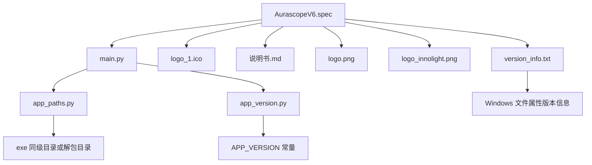
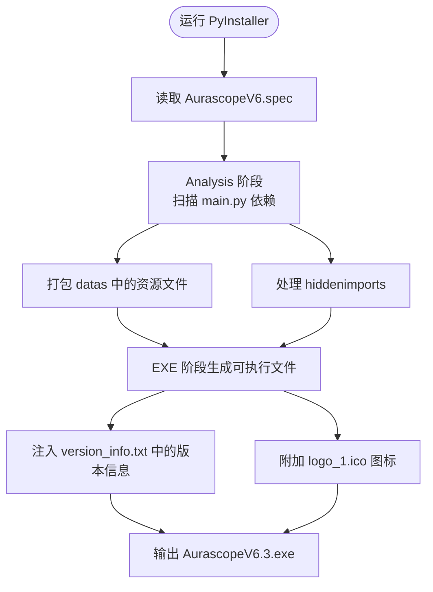
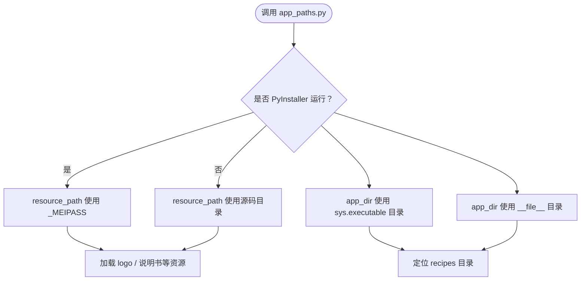
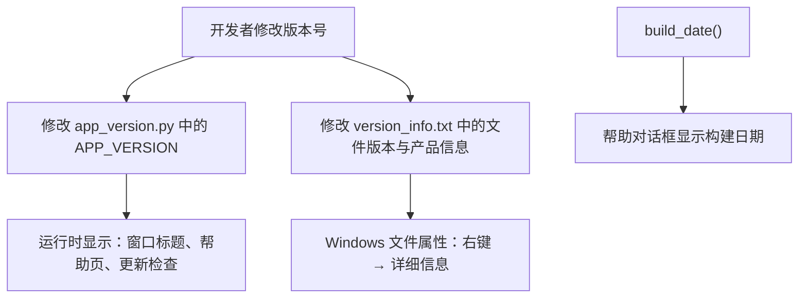
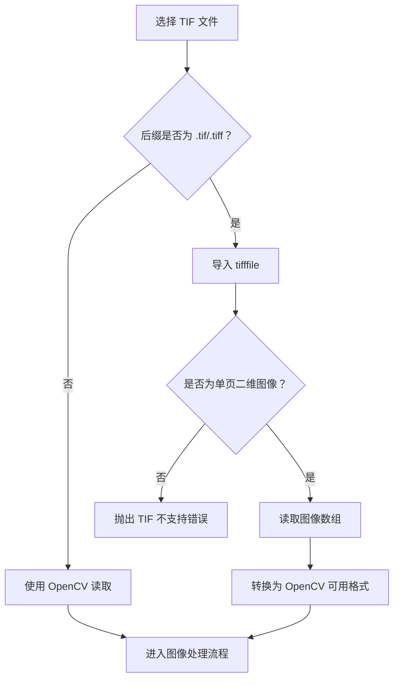
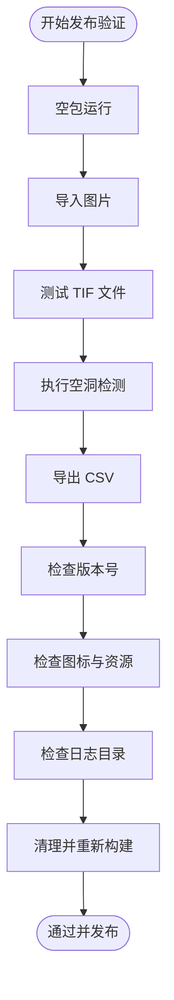
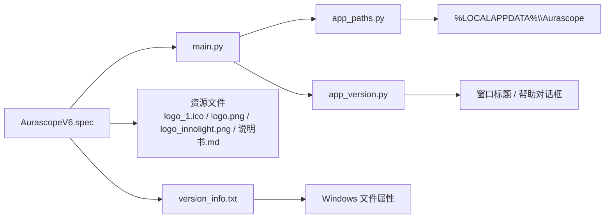

# 部署与打包

<cite>
**本文引用的文件**   
- [README.md](file://README.md)
- [PROJECT_CONCEPTION.md](file://PROJECT_CONCEPTION.md)
- [AurascopeV6.spec](file://AurascopeV6.spec)
- [app_paths.py](file://app_paths.py)
- [version_info.txt](file://version_info.txt)
- [app_version.py](file://app_version.py)
- [main.py](file://main.py)
- [help_dialogs.py](file://help_dialogs.py)
- [logging_setup.py](file://logging_setup.py)
- [recipe.py](file://recipe.py)
- [area_tab.py](file://area_tab.py)
- [stitching_tab.py](file://stitching_tab.py)
</cite>

## 目录
1. [简介](#简介)
2. [项目结构与打包入口](#项目结构与打包入口)
3. [构建命令](#构建命令)
4. [spec 文件关键配置](#spec-文件关键配置)
5. [资源路径与运行环境区分](#资源路径与运行环境区分)
6. [版本号管理机制](#版本号管理机制)
7. [常见打包错误与解决方案](#常见打包错误与解决方案)
8. [发布前验证清单](#发布前验证清单)
9. [依赖关系总览](#依赖关系总览)
10. [结论](#结论)

## 简介
Aurascope 是面向微电子封装产线的半自动化视觉检测与数据分析桌面应用，使用 PyQt6、OpenCV、NumPy 和 Pandas，在 Windows 7+ 上纯 CPU 运行，不联网、不收集用户数据。其核心业务包括金锡焊料空洞分析、距离测量、剪切力计算、物料计数等，并通过 CSV 导出检测结果。

从部署角度，本项目通过 PyInstaller 将 Python 源码、Qt 运行时、OpenCV DLL、图片资源与说明文档打包为 Windows 可执行文件。仓库中提供了 `AurascopeV6.spec` 作为当前推荐打包配置；`main.spec` 在当前工作区未找到，因此本文以实际存在的 `AurascopeV6.spec` 为准。

**章节来源**
- [README.md:1-76](file://README.md#L1-L76)
- [PROJECT_CONCEPTION.md:1-143](file://PROJECT_CONCEPTION.md#L1-L143)

## 项目结构与打包入口
从部署视角，与打包直接相关的文件如下：

| 文件 | 作用 |
|---|---|
| `main.py` | 程序入口，设置窗口图标、日志路径并启动主窗口 |
| `AurascopeV6.spec` | PyInstaller 打包配置，定义入口脚本、资源、隐藏导入、版本信息与图标 |
| `version_info.txt` | Windows 可执行文件元数据中的固定文件版本、产品版本、公司名称等 |
| `app_version.py` | 应用内部统一版本号常量，用于窗口标题、帮助对话框与更新检查 |
| `app_paths.py` | 解析资源路径、应用目录、本地数据目录、日志目录与构建日期 |
| `README.md` | 提供快速开始与打包命令参考 |



**图表来源**
- [AurascopeV6.spec:4-44](file://AurascopeV6.spec#L4-L44)
- [main.py:14-34](file://main.py#L14-L34)
- [app_paths.py:8-18](file://app_paths.py#L8-L18)
- [app_version.py:1-3](file://app_version.py#L1-L3)
- [version_info.txt:1-28](file://version_info.txt#L1-L28)

**章节来源**
- [README.md:42-72](file://README.md#L42-L72)
- [AurascopeV6.spec:1-45](file://AurascopeV6.spec#L1-L45)

## 构建命令
### 开发环境准备
1. 安装 Python 3.10+。
2. 安装项目依赖：
   ```bash
   pip install -r requirements.txt
   ```
3. 安装 PyInstaller：
   ```bash
   pip install pyinstaller
   ```

### 生成可执行文件
推荐使用仓库提供的 spec 文件：
```bash
pyinstaller AurascopeV6.spec
```

该命令会读取 `AurascopeV6.spec`，输出名为 `AurascopeV6.3.exe` 的可执行文件（由 spec 中 `EXE.name` 决定），并把 `datas` 中声明的资源复制到输出目录。

如果未来需要恢复或新增 `main.spec`，应遵循相同结构：入口脚本指向 `main.py`，资源通过 `datas` 声明，图标通过 `icon` 指定，版本信息通过 `version='version_info.txt'` 注入。

**章节来源**
- [README.md:67-72](file://README.md#L67-L72)
- [AurascopeV6.spec:4-44](file://AurascopeV6.spec#L4-L44)

## spec 文件关键配置
`AurascopeV6.spec` 的核心逻辑分为两部分：`Analysis` 与 `EXE`。

### Analysis 阶段
| 配置项 | 当前值 | 含义 |
|---|---|---|
| `['main.py']` | 入口脚本列表 | PyInstaller 从这里开始分析依赖 |
| `pathex=[]` | 空 | 不额外添加模块搜索路径 |
| `binaries=[]` | 空 | 不手动声明二进制依赖 |
| `datas=[...]` | 包含说明文档与 logo 资源 | 将这些文件随 exe 一起打包 |
| `hiddenimports=[]` | 空 | 当前未显式声明隐藏导入 |
| `excludes=['PySide6', 'PySide2']` | 排除 PySide | 避免混入 Qt 的另一个绑定实现 |
| `optimize=0` | 关闭优化 | 便于调试 |
| `noarchive=False` | 使用 PYZ 归档 | 默认行为 |

### EXE 阶段
| 配置项 | 当前值 | 含义 |
|---|---|---|
| `name='AurascopeV6.3'` | 输出文件名 | 最终生成 `AurascopeV6.3.exe` |
| `debug=False` | 关闭调试 | 生产构建 |
| `strip=False` | 不剥离符号 | 保留调试信息 |
| `upx=True` | 启用 UPX 压缩 | 减小体积 |
| `console=False` | 无控制台窗口 | 桌面 GUI 模式 |
| `version='version_info.txt'` | 使用版本信息文件 | 写入 Windows 文件属性 |
| `icon=['logo_1.ico']` | 使用 ICO 图标 | 显示在任务栏与文件属性中 |

### 关键配置说明
- **图标**：`icon=['logo_1.ico']` 同时影响 exe 图标与 Windows 文件属性图标。若替换图标，需同步更新 spec 与打包资源。
- **隐藏导入**：当前 `hiddenimports=[]` 为空。若后续引入动态导入库（如某些 OpenCV 后端、第三方图像处理库），需要在该字段显式声明，否则 PyInstaller 可能遗漏依赖。
- **资源文件**：通过 `datas` 声明。例如 `('logo_1.ico', '.')` 表示把 `logo_1.ico` 放入打包后的根目录，再由 `app_paths.resource_path()` 加载。
- **版本号来源**：
  - Windows 文件属性版本来自 `version_info.txt`。
  - 应用内显示版本来自 `app_version.APP_VERSION`。
  - 两者必须保持一致，否则“文件属性版本”和“软件帮助页版本”会出现不一致。



**图表来源**
- [AurascopeV6.spec:4-44](file://AurascopeV6.spec#L4-L44)
- [version_info.txt:1-28](file://version_info.txt#L1-L28)

**章节来源**
- [AurascopeV6.spec:1-45](file://AurascopeV6.spec#L1-L45)
- [version_info.txt:1-28](file://version_info.txt#L1-L28)

## 资源路径与运行环境区分
`app_paths.py` 是资源与路径解析的统一入口，负责区分两种运行环境：

| 函数 | 源码运行时的行为 | PyInstaller 打包后的行为 |
|---|---|---|
| `resource_path(name)` | 取本文件所在目录 | 取 `_MEIPASS` 解包目录 |
| `app_dir()` | 取本文件所在目录 | 取 exe 所在目录 |
| `local_data_dir()` | 取 `%LOCALAPPDATA%\Aurascope` | 同上 |
| `log_dir()` | 取 `%LOCALAPPDATA%\Aurascope\logs` | 同上 |
| `build_date()` | 取 `app_paths.py` 修改时间 | 取 exe 修改时间 |

### resource_path 的行为
`resource_path` 优先检查 `sys._MEIPASS`，这是 PyInstaller 单文件/多文件模式下临时解包目录的环境变量。如果存在，则从该目录读取资源；否则回退到源码目录。

这意味着：
- 打包后，`logo_1.ico`、`logo.png`、`logo_innolight.png`、`说明书.md` 必须出现在打包资源的根目录。
- 源码运行时，这些文件必须位于 `app_paths.py` 同级目录。

### app_dir 的行为
`app_dir()` 通过 `sys.frozen` 判断是否被 PyInstaller 冻结：
- 冻结时返回 `sys.executable` 所在目录。
- 非冻结时返回 `__file__` 所在目录。

该函数常用于定位用户数据或配方目录。例如 `recipe.py` 默认配方目录基于 `app_dir()`，但会回退到 `local_data_dir()` 下的 `recipes` 目录，确保无需管理员权限即可读写。

### 日志与本地数据
日志目录始终落在 `%LOCALAPPDATA%\Aurascope\logs`，由 `logging_setup.py` 使用。这样无论 exe 放在哪里，日志都不会因目录权限问题而写入失败。



**图表来源**
- [app_paths.py:8-18](file://app_paths.py#L8-L18)
- [app_paths.py:21-32](file://app_paths.py#L21-L32)
- [recipe.py:3-86](file://recipe.py#L3-L86)

**章节来源**
- [app_paths.py:1-42](file://app_paths.py#L1-L42)
- [main.py:14-34](file://main.py#L14-L34)
- [help_dialogs.py:8-77](file://help_dialogs.py#L8-L77)
- [logging_setup.py:10-35](file://logging_setup.py#L10-L35)
- [recipe.py:3-86](file://recipe.py#L3-L86)

## 版本号管理机制
Aurascope 的版本号分布在两个位置，分别服务于不同用途：

| 位置 | 内容 | 用途 |
|---|---|---|
| `version_info.txt` | VSVersionInfo，包含 `filevers`、`prodvers`、`FileVersion`、`ProductVersion` 等 | PyInstaller 注入 Windows 可执行文件属性 |
| `app_version.py` | `APP_VERSION = '6.3.0'` | 窗口标题、帮助对话框、更新检查等运行时显示 |

### 一致性要求
当前两个位置的版本均为 `6.3.0`。发布前应确保：
1. 修改 `app_version.py` 中的 `APP_VERSION`。
2. 修改 `version_info.txt` 中的 `filevers`、`prodvers`、`FileVersion`、`ProductVersion`、`OriginalFilename`。
3. 如需变更 exe 名称，同步修改 `AurascopeV6.spec` 中的 `EXE.name`。
4. 重新执行 `pyinstaller AurascopeV6.spec`。
5. 右键查看生成的 exe 属性，确认“详细信息”中的版本与软件内显示一致。

### 构建日期
`build_date()` 不是硬编码版本，而是根据目标文件的修改时间生成可读的构建日期：
- 源码运行：取 `app_paths.py` 的修改时间。
- 打包运行：取 exe 的修改时间。
- 无法读取时返回占位符。

该日期通常用于帮助对话框与日志上下文，帮助用户确认当前运行的构建时间。



**图表来源**
- [app_version.py:1-3](file://app_version.py#L1-L3)
- [version_info.txt:1-28](file://version_info.txt#L1-L28)
- [app_paths.py:35-41](file://app_paths.py#L35-L41)
- [help_dialogs.py:74-77](file://help_dialogs.py#L74-L77)

**章节来源**
- [app_version.py:1-4](file://app_version.py#L1-L4)
- [version_info.txt:1-28](file://version_info.txt#L1-L28)
- [app_paths.py:35-41](file://app_paths.py#L35-L41)
- [help_dialogs.py:74-77](file://help_dialogs.py#L74-L77)
- [main_window.py:59-59](file://main_window.py#L59-L59)

## 常见打包错误与解决方案

### 1. Qt 插件缺失
**现象**
- 启动时报 Qt 平台插件错误。
- 界面空白或崩溃。
- 提示找不到 `qwindows.dll` 或相关 Qt 插件。

**原因**
PyInstaller 没有自动发现所有 Qt 插件。虽然 `AurascopeV6.spec` 排除了 `PySide6` 和 `PySide2`，但仍需确保 PyQt6 的 Qt 插件被正确打包。

**解决方案**
- 确认已安装 PyQt6：`pip install PyQt6`。
- 在 `AurascopeV6.spec` 的 `Analysis.hiddenimports` 中添加必要的 Qt 插件，例如 `PyQt6.QtWidgets`、`PyQt6.QtGui` 等。
- 如果仍失败，可在 spec 中显式加入 Qt 插件目录，或使用 PyInstaller 的 `--add-binary` 补充缺失的 `qwindows.dll`。
- 构建后检查输出目录是否存在 `PyQt6\Qt6\plugins\platforms\qwindows.dll`。

### 2. OpenCV DLL 未包含
**现象**
- 导入 `cv2` 时报 DLL 加载失败。
- 运行图像算法时抛出 OpenCV 相关异常。

**原因**
OpenCV 依赖多个原生 DLL，PyInstaller 不一定能自动发现全部二进制依赖。

**解决方案**
- 确认 `requirements.txt` 中包含 OpenCV。
- 在 `AurascopeV6.spec` 的 `Analysis.binaries` 或 `EXE` 参数中使用 `a.binaries` 与 `a.datas`，让 PyInstaller 自动收集。
- 若仍缺失，手动添加 `opencv_world*.dll` 或对应 OpenCV 发行版中的 DLL。
- 构建后检查输出目录是否包含 OpenCV 所需 DLL。

### 3. TIF 文件无法打开
**现象**
- 选择 `.tif` 或 `.tiff` 图片时报错。
- 提示缺少 `tifffile` 或未支持的 TIF 维度。

**原因**
TIF 支持由 `area_tab.py` 和 `stitching_tab.py` 通过 `tifffile` 实现。如果打包时未包含 `tifffile`，或 TIF 文件本身不符合预期，就会失败。

**解决方案**
- 在 `requirements.txt` 中确认包含 `tifffile`。
- 在 `AurascopeV6.spec` 的 `hiddenimports` 中添加 `tifffile`。
- 确认 TIF 文件为单页二维图像，且为灰度或 RGB/RGBA。
- 对于多页 TIF，代码明确拒绝加载，需先拆分为单页图像。



**图表来源**
- [area_tab.py:56-75](file://area_tab.py#L56-L75)
- [stitching_tab.py:220-248](file://stitching_tab.py#L220-L248)

**章节来源**
- [area_tab.py:56-75](file://area_tab.py#L56-L75)
- [stitching_tab.py:220-248](file://stitching_tab.py#L220-L248)

### 4. 资源文件找不到
**现象**
- 启动后图标缺失。
- 帮助对话框无法加载说明文档。
- 画布背景图或 logo 无法显示。

**原因**
资源文件未在 `AurascopeV6.spec` 的 `datas` 中声明，或 `app_paths.resource_path()` 的路基目录不正确。

**解决方案**
- 确认 `logo_1.ico`、`logo.png`、`logo_innolight.png`、`说明书.md` 已加入 `datas`。
- 确认所有资源加载都通过 `resource_path()`，而不是直接拼接相对路径。
- 打包后检查输出目录是否包含这些文件。

### 5. 日志目录不可写
**现象**
- 日志文件未生成。
- 报错提示无法创建日志目录。

**原因**
日志目录默认写入 `%LOCALAPPDATA%\Aurascope\logs`，如果环境变量异常或磁盘权限受限，可能失败。

**解决方案**
- 确认 `LOCALAPPDATA` 环境变量存在。
- 检查当前用户对 `%LOCALAPPDATA%\Aurascope` 是否有写入权限。
- 查看 `logging_setup.py` 中日志路径生成逻辑，必要时调整日志目录策略。

**章节来源**
- [AurascopeV6.spec:4-44](file://AurascopeV6.spec#L4-L44)
- [app_paths.py:21-32](file://app_paths.py#L21-L32)
- [logging_setup.py:10-35](file://logging_setup.py#L10-L35)
- [area_tab.py:56-75](file://area_tab.py#L56-L75)
- [stitching_tab.py:220-248](file://stitching_tab.py#L220-L248)

## 发布前验证清单
发布前应按以下顺序验证打包产物：

| 步骤 | 操作 | 预期结果 |
|---|---|---|
| 1 | 空包运行 | 双击 `AurascopeV6.3.exe` 能启动主窗口，无 Qt 插件或 DLL 报错 |
| 2 | 导入图片 | 能正常加载 PNG、JPG、BMP 等常用图片 |
| 3 | 导入 TIF | 单页灰度或 RGB/RGBA TIF 能打开；多页或非二维 TIF 应给出明确错误 |
| 4 | 执行空洞检测 | 空洞分析流程可完成，不出现 OpenCV 或轮廓处理异常 |
| 5 | 导出 CSV | 检测结果能导出为 CSV 文件，文件可被 Excel 或其他表格工具打开 |
| 6 | 检查版本号 | 窗口标题、帮助对话框显示 `6.3.0`；右键 exe 属性中“详细信息”也显示 `6.3.0` |
| 7 | 检查图标 | 任务栏图标与 exe 图标为 `logo_1.ico` |
| 8 | 检查资源 | 帮助对话框能加载说明文档，logo 图片正常显示 |
| 9 | 检查日志 | `%LOCALAPPDATA%\Aurascope\logs\aurascope.log` 可正常写入 |
| 10 | 清理后复现 | 删除构建目录后重新执行 `pyinstaller AurascopeV6.spec`，仍能成功构建 |

### 建议的验证顺序


**图表来源**
- [AurascopeV6.spec:23-44](file://AurascopeV6.spec#L23-L44)
- [app_version.py:1-3](file://app_version.py#L1-L3)
- [version_info.txt:1-28](file://version_info.txt#L1-L28)
- [logging_setup.py:10-35](file://logging_setup.py#L10-L35)

**章节来源**
- [README.md:67-72](file://README.md#L67-L72)
- [AurascopeV6.spec:23-44](file://AurascopeV6.spec#L23-L44)
- [app_version.py:1-3](file://app_version.py#L1-L3)
- [version_info.txt:1-28](file://version_info.txt#L1-L28)
- [logging_setup.py:10-35](file://logging_setup.py#L10-L35)

## 依赖关系总览
从部署与打包角度看，主要依赖关系如下：



**图表来源**
- [AurascopeV6.spec:4-44](file://AurascopeV6.spec#L4-L44)
- [main.py:14-34](file://main.py#L14-L34)
- [app_paths.py:8-18](file://app_paths.py#L8-L18)
- [app_version.py:1-3](file://app_version.py#L1-L3)
- [version_info.txt:1-28](file://version_info.txt#L1-L28)

**章节来源**
- [AurascopeV6.spec:1-45](file://AurascopeV6.spec#L1-L45)
- [main.py:14-34](file://main.py#L14-L34)
- [app_paths.py:1-42](file://app_paths.py#L1-L42)
- [app_version.py:1-4](file://app_version.py#L1-L4)
- [version_info.txt:1-28](file://version_info.txt#L1-L28)

## 结论
Aurascope 的部署与打包核心在于三点：

1. **spec 文件准确描述入口、资源、图标与版本信息**。当前推荐以 `AurascopeV6.spec` 为准，`main.spec` 在当前仓库中不存在，不应作为构建依据。
2. **资源路径统一通过 `app_paths.py` 解析**，确保源码运行与 PyInstaller 打包后都能正确定位资源、日志与本地数据目录。
3. **版本号保持 `app_version.py` 与 `version_info.txt` 一致**，并在发布前通过空包运行、图片导入、空洞检测、CSV 导出与版本检查完成验证。

只要 spec、资源、版本号三者保持一致，PyInstaller 就能稳定生成可直接分发的 Windows 可执行文件。