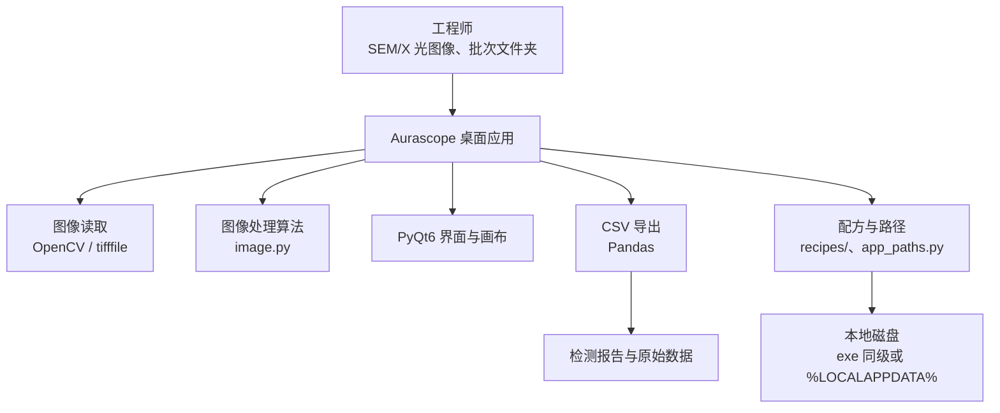
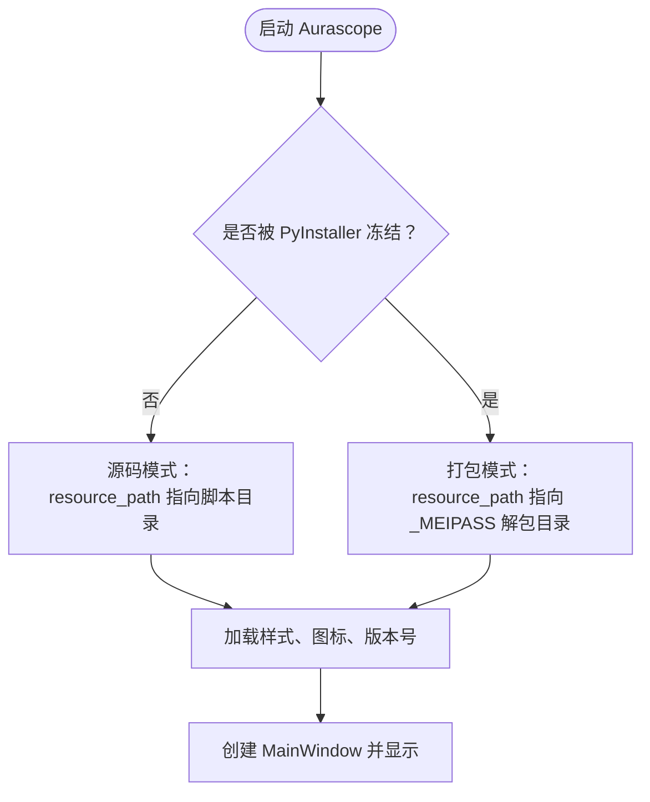
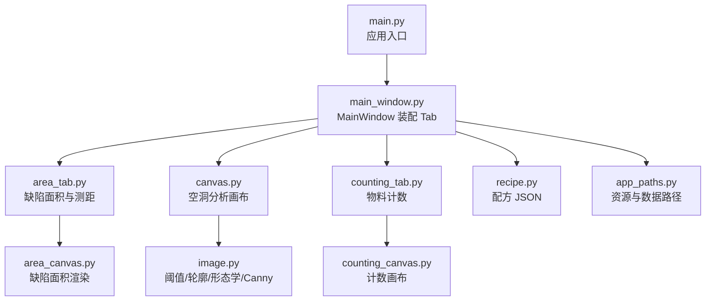
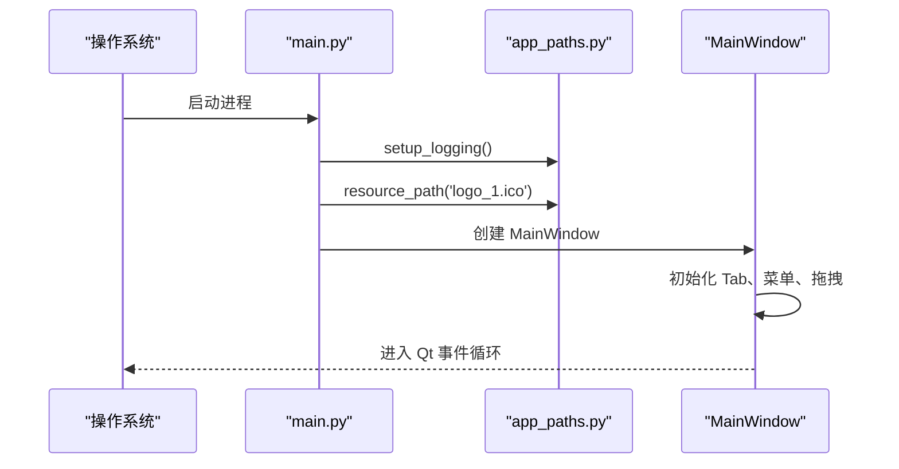
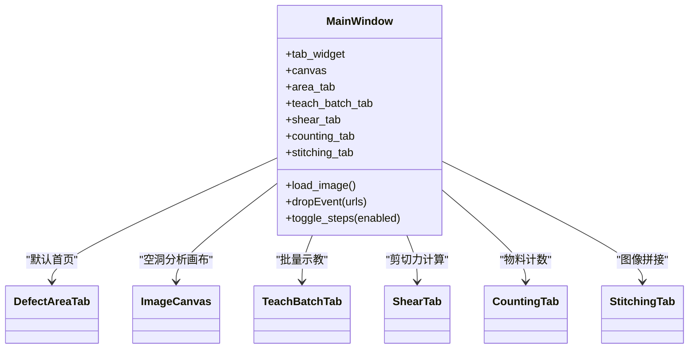
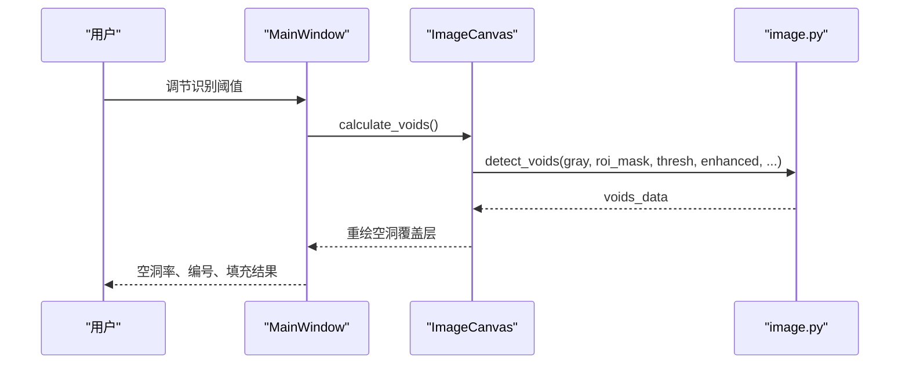
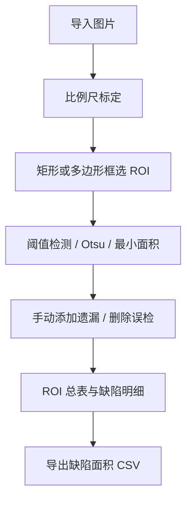
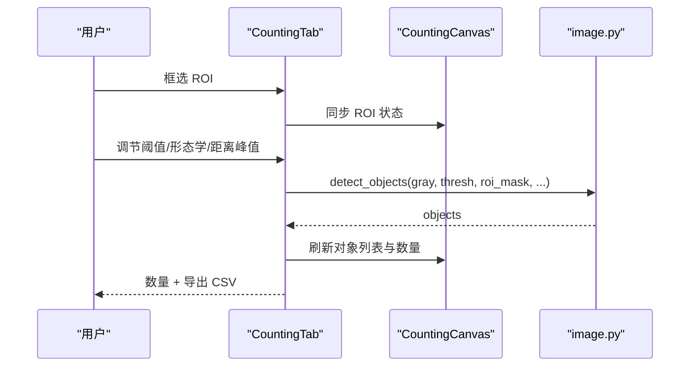

# 项目概述

<cite>
**本文引用的文件**   
- [README.md](file://README.md)
- [PROJECT_CONCEPTION.md](file://PROJECT_CONCEPTION.md)
- [说明书.md](file://说明书.md)
- [requirements.txt](file://requirements.txt)
- [main.py](file://main.py)
- [app_paths.py](file://app_paths.py)
- [app_version.py](file://app_version.py)
- [main_window.py](file://main_window.py)
- [image.py](file://image.py)
- [canvas.py](file://canvas.py)
- [area_tab.py](file://area_tab.py)
- [area_canvas.py](file://area_canvas.py)
- [counting_tab.py](file://counting_tab.py)
- [counting_canvas.py](file://counting_canvas.py)
</cite>

## 目录
1. [产品定位与核心价值](#产品定位与核心价值)
2. [系统上下文与能力矩阵](#系统上下文与能力矩阵)
3. [技术栈与依赖用途](#技术栈与依赖用途)
4. [安装与首次运行](#安装与首次运行)
5. [源码运行与 PyInstaller 打包的区别](#源码运行与-pyinstaller-打包的区别)
6. [架构总览](#架构总览)
7. [核心业务主线与实现映射](#核心业务主线与实现映射)
8. [关键组件分析](#关键组件分析)
9. [已知限制与注意事项](#已知限制与注意事项)
10. [常见问题与排错建议](#常见问题与排错建议)
11. [结论](#结论)

## 产品定位与核心价值

Aurascope（金锡焊料空洞分析工具）是面向微电子封装产线的半自动化视觉检测与数据分析桌面应用。它把工程师在 SEM/X 光图像上重复、易错的量化工作标准化，替代人工目检和手算流程；但软件不做“AI 全自动判断”，最终决策仍由工艺/质量/可靠性工程师负责。

| 维度 | 说明 |
|---|---|
| 目标用户 | 封装工艺工程师、IQC、质量/可靠性工程师、产线与仓管人员 |
| 输入数据 | PNG / JPG / BMP / TIF 等 SEM 或 X 光图像，以及批次文件夹 |
| 输出产物 | CSV 检测结果、截图到剪贴板、配方 JSON、拼接图 |
| 运行环境 | Windows 7+，纯 CPU 计算，不联网，不收集用户数据 |
| 交互方式 | PyQt6 桌面窗口 + 鼠标绘制 ROI + 参数滑块 + 表格结果 |
| 核心价值 | 空洞率检测、缺陷面积多 ROI 测量、物料计数、剪切力计算、图像拼接与批量示教 |

**本节来源**
- [README.md:3-14](file://README.md#L3-L14)
- [PROJECT_CONCEPTION.md:3-14](file://PROJECT_CONCEPTION.md#L3-L14)
- [说明书.md:7-10](file://说明书.md#L7-L10)

## 系统上下文与能力矩阵

### 系统上下文图



**图表来源**
- [main.py:19-39](file://main.py#L19-L39)
- [app_paths.py:8-41](file://app_paths.py#L8-L41)
- [image.py:200-286](file://image.py#L200-L286)
- [area_tab.py:110-150](file://area_tab.py#L110-L150)

### 能力矩阵表

| 功能 | 能做什么 | 不能做什么 | 主要入口 |
|---|---|---|---|
| 空洞分析 | 对金锡焊料区域做阈值二值化、Otsu、形态学去噪、圆度过滤、Canny 边缘验证，支持局部阈值笔刷与手动增删 | 不自动识别所有图片；未标定前面积为像素单位 | 空洞分析 Tab、`canvas.py`、`image.py::detect_voids` |
| 缺陷面积多 ROI | 支持矩形和多边形 ROI，按亮/暗缺陷、阈值、最小面积检测，可导出缺陷明细 CSV | 不自动导入后直接检测，必须先框选 ROI | `area_tab.py`、`area_canvas.py`、`image.py::detect_defects` |
| 物料计数 | 蓝膜 LD/Submount 离散物料计数，支持距离峰值分离粘连物体、手动添加遗漏或删除多选 | 不是通用 AI 分类器；ROI 必须有效 | `counting_tab.py`、`counting_canvas.py`、`image.py::detect_objects` |
| 测距 | 标定像素比后两点测距，支持水平/垂直吸附、批量记录与统计 | 未标定时不能换算实际距离 | `area_tab.py`、`area_canvas.py` |
| 剪切力计算 | 按 MIL-STD-883H Method 2019.9 计算芯片剪切力要求值 | 仅适用于标准三段式映射范围 | `shear_tab.py`（主窗口挂载） |
| 图像拼接 | 多张切片按金锡水平线标定后拼接，可复制或发送到空洞分析 | 不替代专业拼接软件 | `stitching_tab.py`（主窗口挂载） |
| 批量示教 | 快速示教与完整示教，保存配方后批量检测整批图片 | 不是神经网络模型，而是基于示教样本的统计学习 | `teach_batch_tab.py`、`recipe.py` |

**本节来源**
- [README.md:7-14](file://README.md#L7-L14)
- [PROJECT_CONCEPTION.md:17-61](file://PROJECT_CONCEPTION.md#L17-L61)
- [说明书.md:46-118](file://说明书.md#L46-L118)

## 技术栈与依赖用途

| 依赖 | 最低版本 | 用途 | 备注 |
|---|---:|---|---|
| Python | 3.10+ | 解释器与运行时 | README 与说明书均要求 |
| PyQt6 | ≥ 6.4.0 | 桌面 GUI、QTabWidget、QPainter 画布、QSettings 配置 | main.py 设置 Fusion 样式与 HighDpi 策略 |
| OpenCV | ≥ 4.8.0 | 阈值、轮廓、形态学、Canny、distanceTransform、connectedComponentsWithStats | image.py 的核心算法库 |
| NumPy | ≥ 1.24.0 | 数组运算、几何计算、坐标转换 | 与 OpenCV 配合处理灰度图和掩膜 |
| Pandas | ≥ 1.5.0 | CSV 导出 | 主要用于结构化结果落盘 |
| tifffile | ≥ 2023.7.8 | 科学图像 TIF 读取 | area_tab.py 对单页二维 TIF 做严格校验 |

**本节来源**
- [README.md:18-40](file://README.md#L18-L40)
- [requirements.txt:1-5](file://requirements.txt#L1-L5)
- [说明书.md:13-20](file://说明书.md#L13-L20)
- [area_tab.py:53-92](file://area_tab.py#L53-L92)

## 安装与首次运行

### 环境准备
1. 安装 Python 3.10+。
2. 在仓库根目录执行：
   ```bash
   pip install -r requirements.txt
   ```

### 首次运行
1. 启动程序：
   ```bash
   python main.py
   ```
2. 打开「ROI」页面，点击「导入图片」。
3. 可选：点击「划线标定」输入实际长度和单位，完成像素比换算。
4. 使用「矩形框选」或「多边形框选」创建 ROI。
5. 点击「检测全部 ROI」开始缺陷面积检测。
6. 需要空洞分析时，切换到「空洞分析」Tab 并上传 SEM 图片。

**本节来源**
- [README.md:23-33](file://README.md#L23-L33)
- [说明书.md:13-20](file://说明书.md#L13-L20)
- [说明书.md:46-57](file://说明书.md#L46-L57)

## 源码运行与 PyInstaller 打包的区别

| 对比项 | 源码运行 | PyInstaller 打包 |
|---|---|---|
| 运行方式 | `python main.py` | 双击生成的 exe |
| 依赖管理 | 当前 Python 环境中已安装 requirements.txt 依赖 | 打包时冻结依赖，exe 自带运行环境 |
| 资源路径 | 以脚本所在目录为 base | 通过 `_MEIPASS` 解包目录加载 logo、配置文件等资源 |
| 日志位置 | 由 app_paths.py 写入 `%LOCALAPPDATA%\Aurascope\logs` | 同源码运行，但构建日期可能来自 exe 修改时间 |
| 打包命令 | 不适用 | `pip install pyinstaller` 后执行 `pyinstaller AurascopeV6.spec` |
| 适用场景 | 开发、调试、二次开发 | 产线或离线机器分发绿色单文件 exe |



**图表来源**
- [main.py:19-39](file://main.py#L19-L39)
- [app_paths.py:8-18](file://app_paths.py#L8-L18)

**本节来源**
- [README.md:67-72](file://README.md#L67-L72)
- [app_paths.py:1-41](file://app_paths.py#L1-L41)
- [app_version.py:1-4](file://app_version.py#L1-L4)

## 架构总览

Aurascope 采用「入口 → 主窗口 → Tab 页面 → Canvas 绘制层 → 算法层 image.py → 配方/导出」的分层结构。GUI 层负责交互与状态，Canvas 层负责图像缩放、平移、坐标转换与覆盖层绘制，算法层集中在 image.py，避免 UI 代码内联实现图像处理逻辑。



**图表来源**
- [main.py:19-39](file://main.py#L19-L39)
- [main_window.py:53-147](file://main_window.py#L53-L147)
- [area_tab.py:110-150](file://area_tab.py#L110-L150)
- [canvas.py:13-28](file://canvas.py#L13-L28)
- [counting_tab.py:19-52](file://counting_tab.py#L19-L52)
- [image.py:200-286](file://image.py#L200-L286)

**本节来源**
- [PROJECT_CONCEPTION.md:77-107](file://PROJECT_CONCEPTION.md#L77-L107)
- [main_window.py:53-147](file://main_window.py#L53-L147)

## 核心业务主线与实现映射

| 业务主线 | 页面/模块 | 画布 | 算法函数 | 数据/导出 |
|---|---|---|---|---|
| 空洞分析 | 空洞分析 Tab | `canvas.py::ImageCanvas` | `image.py::detect_voids`、`detect_voids_local`、`otsu_threshold` | 截图、CSV、配方 |
| 缺陷面积多 ROI | `area_tab.py::DefectAreaTab` | `area_canvas.py::AreaCanvas` | `image.py::detect_defects`、`polygon_to_mask` | ROI 表、缺陷明细 CSV |
| 物料计数 | `counting_tab.py::CountingTab` | `counting_canvas.py::CountingCanvas` | `image.py::detect_objects`、`otsu_threshold` | 计数结果 CSV |
| 测距 | `area_tab.py` | `area_canvas.py` | 无专用算法，依赖坐标与角度规则 | 距离 CSV |
| 剪切力计算 | `shear_tab.py` | 无独立 Canvas | 标准映射逻辑 | 复制 2X 力值 |
| 图像拼接 | `stitching_tab.py` | `stitching_canvas.py` | 水平线标定与拼接逻辑 | 拼接图、复制到剪贴板 |
| 批量示教 | `teach_batch_tab.py` | 复用空洞分析画布 | `image.py` 中示教学习相关函数 | recipes/*.json、汇总 CSV |

**本节来源**
- [README.md:42-64](file://README.md#L42-L64)
- [说明书.md:46-118](file://说明书.md#L46-L118)

## 关键组件分析

### 应用入口与路径管理

`main.py` 负责初始化日志、异常钩子、HighDpi 策略、全局 QSS、图标和 MainWindow。`app_paths.py` 提供资源路径、应用目录、用户数据目录、日志目录和构建日期解析，兼容源码运行与 PyInstaller 单文件模式。



**图表来源**
- [main.py:19-39](file://main.py#L19-L39)
- [app_paths.py:8-41](file://app_paths.py#L8-L41)

**本节来源**
- [main.py:1-44](file://main.py#L1-L44)
- [app_paths.py:1-42](file://app_paths.py#L1-L42)
- [app_version.py:1-4](file://app_version.py#L1-L4)

### 主窗口与 Tab 装配

`main_window.py` 中的 `MainWindow` 装配六个业务 Tab：ROI、空洞分析、示教/批量、剪切力计算、物料计数、图像拼接。它还负责最近打开记录、窗口状态持久化、拖拽导入路由、更新检查与撤销栈。



**图表来源**
- [main_window.py:53-147](file://main_window.py#L53-L147)

**本节来源**
- [main_window.py:53-147](file://main_window.py#L53-L147)

### 空洞分析：Canvas 与算法调用

空洞分析的主交互在 `canvas.py::ImageCanvas`，主窗口侧边栏控制阈值、增强检测、圆度过滤、Canny 边缘验证、局部阈值笔刷和手动编辑。算法实现集中在 `image.py::detect_voids` 与 `detect_voids_local`。



**图表来源**
- [main_window.py:536-668](file://main_window.py#L536-L668)
- [canvas.py:13-28](file://canvas.py#L13-L28)
- [image.py:200-286](file://image.py#L200-L286)

**本节来源**
- [main_window.py:536-668](file://main_window.py#L536-L668)
- [canvas.py:13-800](file://canvas.py#L13-L800)
- [image.py:200-422](file://image.py#L200-L422)

### 缺陷面积多 ROI：area_tab 与 area_canvas

`area_tab.py::DefectAreaTab` 是缺陷面积测量的业务中枢，维护多个 ROI、阈值参数、手动修正、距离测量与 CSV 导出；`area_canvas.py::AreaCanvas` 只负责渲染、坐标变换和交互，不持有检测业务逻辑。



**图表来源**
- [area_tab.py:110-150](file://area_tab.py#L110-L150)
- [area_tab.py:342-378](file://area_tab.py#L342-L378)
- [area_canvas.py:85-150](file://area_canvas.py#L85-L150)

**本节来源**
- [area_tab.py:1-150](file://area_tab.py#L1-L150)
- [area_canvas.py:1-150](file://area_canvas.py#L1-L150)
- [image.py:425-488](file://image.py#L425-L488)

### 物料计数：counting_tab 与 counting_canvas

`counting_tab.py::CountingTab` 负责蓝膜物料计数流程，包括 ROI 选择、二值化阈值、形态学去噪、距离峰值计数、手动编辑和 CSV 导出；`counting_canvas.py::CountingCanvas` 负责对象绘制、ROI 绘制和基础交互。



**图表来源**
- [counting_tab.py:19-52](file://counting_tab.py#L19-L52)
- [counting_tab.py:363-413](file://counting_tab.py#L363-L413)
- [counting_canvas.py:10-59](file://counting_canvas.py#L10-L59)
- [image.py:491-632](file://image.py#L491-L632)

**本节来源**
- [counting_tab.py:1-447](file://counting_tab.py#L1-L447)
- [counting_canvas.py:1-270](file://counting_canvas.py#L1-L270)
- [image.py:491-632](file://image.py#L491-L632)

## 已知限制与注意事项

以下限制来自仓库现有实现与交接文档约定，不应视为产品设计承诺：

| 类别 | 已知问题 | 影响 | 建议 |
|---|---|---|---|
| 算法重复 | `main_window.py` 内存在 `detect_voids_local` 副本 | 行为可能与 `image.py` 不一致 | 现行行为以 `image.py` 为准，两份待合并 |
| Canny 校验 | `edge_map` 在某些分支未初始化导致 Canny 校验静默失效 | 开启边缘验证可能不生效 | 先确认 edge_map 赋值路径，再启用该选项 |
| ROI 蒙版 | `chk_roi_overlay` 被重复创建 | 可能产生多余控件或状态不一致 | 清理重复创建逻辑 |
| 缩放锚点 | canvas.py 滚轮缩放存在 Y 轴漂移 | 缩放中心可能偏离鼠标位置 | 修复 wheelEvent 中 offset 计算 |
| 死代码 | `select_for_local` 为无 UI 入口的死代码 | 增加维护成本但不影响运行 | 评估保留或移除 |
| 大图性能 | 大图增强检测无进度提示 | 用户可能以为程序卡死 | 增加进度反馈或后台任务提示 |
| 测试环境 | 部分 pytest 用例依赖 QApplication | 无 CI 配置，不能假设覆盖率或流水线 | 本地运行测试，不要虚构发布流程 |

**本节来源**
- [handoff.md](file://handoff.md)

## 常见问题与排错建议

| 现象 | 可能原因 | 处理建议 |
|---|---|---|
| 图像加载失败 | 格式不支持、路径含异常字符、多页 TIF | 确认 PNG/JPG/BMP/TIF，路径不含异常字符；多页 TIF 不支持 |
| 检测不准 | ROI 不正确、阈值不合适 | 先确认 ROI，再调阈值或使用 Otsu；必要时启用增强检测与局部阈值 |
| 界面卡顿 | 图像过大、形态学核过大 | 缩小图像尺寸、降低形态学核大小；阈值拖动时只预览，松手才重跑 |
| 更新检查失败 | 公司网络限制 GitHub | 手动下载新版本 exe 替换 |
| 日志找不到 | 路径位于 `%LOCALAPPDATA%\Aurascope\logs` | 通过「帮助 → 关于 Aurascope」查看并打开日志目录 |

**本节来源**
- [说明书.md:121-150](file://说明书.md#L121-L150)

## 结论

Aurascope 的定位很明确：它不是通用 AI 平台，也不是联网云端服务，而是一套面向微电子封装产线的单机桌面视觉检测工具。它的价值在于把空洞率检测、缺陷面积测量、物料计数、剪切力计算、图像拼接和批量示教这些重复性工作标准化，让工程师用更少的鼠标操作、更稳定的参数和可复现的结果完成产线分析。

对于新用户，建议优先掌握「导入图片 → 标定 → 框选 ROI → 阈值检测 → 手动修正 → 导出 CSV」这一条主线；对于开发者，应遵循「GUI 层不内联算法、Canvas 层统一坐标与绘制约定、image.py 作为唯一算法实现层」的架构约束，并在合并重复实现、修复滚动缩放 Y 漂移、补充大图进度提示等方面持续改进。